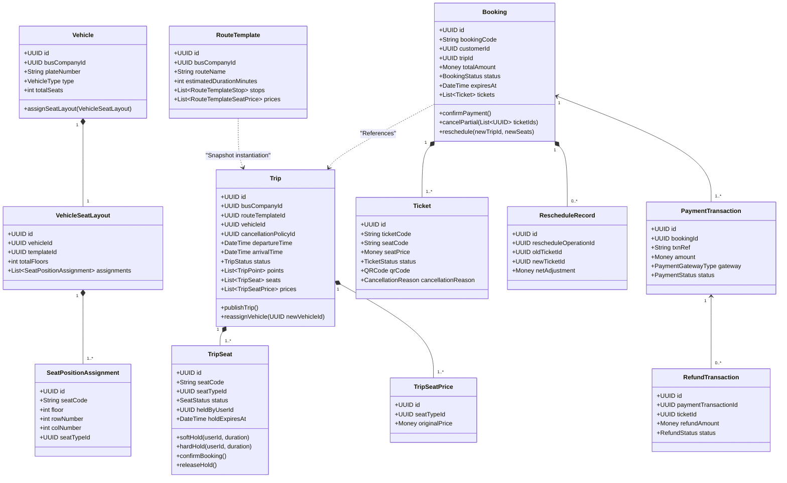
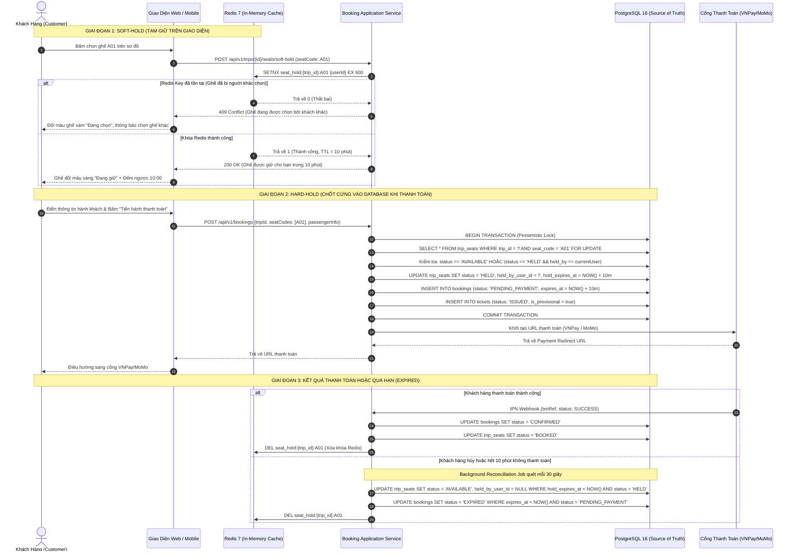
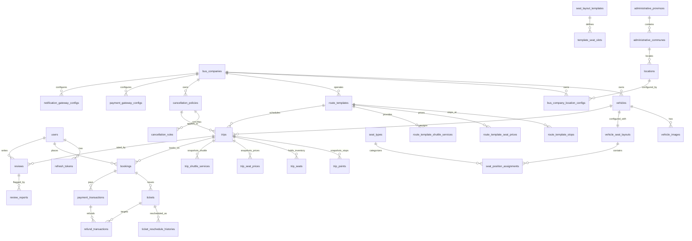
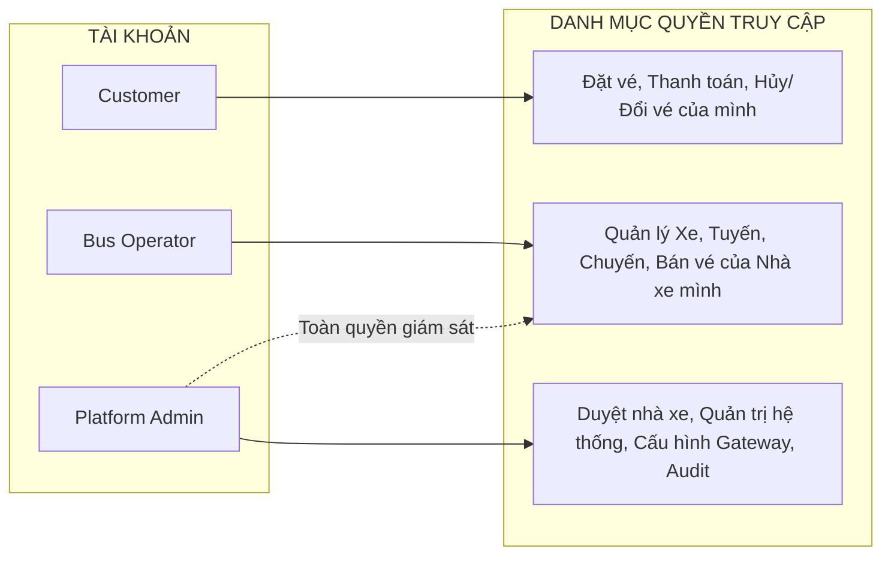

# 🚍 HỆ THỐNG QUẢN LÝ VÀ ĐẶT VÉ XE KHÁCH LIÊN TỈNH ĐA NHÀ XE (VEXERE CLONE)
## TÀI LIỆU THIẾT KẾ HỆ THỐNG QUY NHẤT TOÀN DIỆN (MASTER SYSTEM ARCHITECTURE & DESIGN SPECIFICATION)
### ĐỒ ÁN MÔN HỌC — NHÓM 7

---

> **Tài liệu tham chiếu chuẩn tắc (Canonical Sources of Truth):**
> Toàn bộ nội dung trong bản thiết kế này được quy tụ, chuẩn hóa và hợp nhất từ bộ 6 tài liệu thiết kế gốc trong thư mục `docs/`:
> 1. `docs/SRS_Vexere.md` — Đặc tả yêu cầu phần mềm theo chuẩn IEEE Std 830-1998 (v2.0)
> 2. `docs/PROJECT_ARCHITECTURE (1).md` — Kiến trúc hệ thống Modular Monolith & Clean/Hexagonal (ADR-001)
> 3. `docs/domain.md` — Thiết kế Domain-Driven Design (DDD), Bounded Contexts & Aggregate Roots
> 4. `docs/class_diagram.md` — Biểu đồ lớp chi tiết hợp nhất v2 (19 Aggregates, 13 Entities, 13 VOs, 14 Services)
> 5. `docs/database_design.md` — Thiết kế Cơ sở dữ liệu vật lý PostgreSQL Production-Level (36 bảng, 6 nhóm)
> 6. `docs/schema.sql` — Kịch bản DDL PostgreSQL hoàn chỉnh với đầy đủ ràng buộc, chỉ mục & Trigger Invariants

---

## MỤC LỤC TỔNG QUAN

1. [GIỚI THIỆU TỔNG QUAN DỰ ÁN](#1-giới-thiệu-tổng-quan-dự-án)
   - 1.1 Bối cảnh & Mục tiêu hệ thống
   - 1.2 Các phân hệ người dùng (Actors)
   - 1.3 Hệ thống tích hợp ngoại vi (External Integrations)
   - 1.4 Ma trận chức năng tổng quát
2. [KIẾN TRÚC TỔNG THỂ HỆ THỐNG (SYSTEM ARCHITECTURE)](#2-kiến-trúc-tổng-thể-hệ-thống-system-architecture)
   - 2.1 Quyết định kiến trúc nền tảng (ADR-001: Modular Monolith)
   - 2.2 10 Nguyên tắc kiến trúc cốt lõi
   - 2.3 Sơ đồ kiến trúc tổng thể (High-Level Architecture Diagram)
   - 2.4 Bản đồ 12 Module vật lý (Maven Multi-Module Map)
   - 2.5 Kiến trúc bên trong từng module (Hexagonal / Clean Vertical Slice)
   - 2.6 Ngăn xếp công nghệ sử dụng (Technology Stack)
3. [THIẾT KẾ NGHIỆP VỤ & MIỀN DỮ LIỆU (DOMAIN-DRIVEN DESIGN)](#3-thiết-kế-nghiệp-vụ--miền-dữ-liệu-domain-driven-design)
   - 3.1 Phân vùng Domain & 13 Bounded Contexts
   - 3.2 Danh mục thực thể miền (19 Aggregates, 13 Entities con, 13 VOs, 14 Services)
   - 3.3 Danh mục 23 Enumeration chuẩn tắc
   - 3.4 Biểu đồ phân rã Bounded Contexts & Quan hệ lớp (Class Diagram)
   - 3.5 Các Luồng Nghiệp Vụ Cốt Lõi (Core Business Workflows)
     - A. Cơ chế Giữ chỗ 2 tầng (Two-Tier Seat Hold Protocol: Redis Soft-Hold & DB Hard-Hold)
     - B. Vòng đời Đơn hàng & Phát hành vé điện tử (Booking & Ticket Lifecycle)
     - C. Quy trình Đổi vé/chuyến đi (Reschedule Flow — Phương án A)
     - D. Quy trình Hủy vé từng phần (Partial Cancellation — Phương án A)
     - E. Quy tắc Bất biến Bản chụp (Snapshot Immutability Rules)
     - F. Điều xe khẩn cấp & Tự động ghép lại sơ đồ ghế (Emergency Re-seat)
4. [THIẾT KẾ CƠ SỞ DỮ LIỆU TOÀN DIỆN (DATABASE DESIGN & ERD)](#4-thiết-kế-cơ-sở-dữ-liệu-toàn-diện-database-design--erd)
   - 4.1 Sơ đồ quan hệ thực thể tổng thể (Master Entity-Relationship Diagram)
   - 4.2 Danh bạ tra cứu chi tiết 36 bảng CSDL (Phân loại theo 6 nhóm chức năng)
   - 4.3 Các Ràng buộc Bất biến và Trigger Cơ sở Dữ liệu (DB Constraints & Triggers)
   - 4.4 Chiến lược Tối ưu hóa Chỉ mục (Indexing Strategy) & Concurrency
5. [THIẾT KẾ KIẾN TRÚC FRONTEND (FRONTEND ARCHITECTURE)](#5-thiết-kế-kiến-trúc-frontend-frontend-architecture)
   - 5.1 Cấu trúc ứng dụng & Quy ước thiết kế (React 19 + TypeScript + Vite)
   - 5.2 Phân hệ Khách hàng (`vexere-web`)
   - 5.3 Phân hệ Quản trị & Điều hành Nhà xe (`vexere-admin`)
   - 5.4 Quản lý State & Caching (TanStack Query + Zustand)
6. [BẢO MẬT & PHÂN QUYỀN ĐA KHÁCH HÀNG (SECURITY & MULTI-TENANCY)](#6-bảo-mật--phân-quyền-đa-khách-hàng-security--multi-tenancy)
   - 6.1 Cơ chế Xác thực không mật khẩu (OTP Phone / Google OAuth2 / JWT + Refresh Token Rotation)
   - 6.2 Phân quyền vai trò (RBAC Matrix: ADMIN, OPERATOR, CUSTOMER)
   - 6.3 Cô lập dữ liệu đa nhà xe (Multi-tenant Data Isolation Scoping)
   - 6.4 Bảo mật thông tin nhạy cảm & Ký số Webhook/IPN (HMAC-SHA512)
7. [XỬ LÝ LỖI, GIAO DỊCH & GIÁM SÁT (TRANSACTIONS & OBSERVABILITY)](#7-xử-lý-lỗi-giao-dịch--giám-sát-transactions--observability)
   - 7.1 Chuẩn hóa phản hồi API & Mô hình ngoại lệ (`ApiResponse<T>` & `AppException`)
   - 7.2 Ranh giới Giao dịch CSDL & Khóa cạnh tranh (Transaction Boundaries & Locking)
   - 7.3 Mẫu thiết kế Transactional Outbox cho Tác vụ Bất đồng bộ
   - 7.4 Giám sát & Nhật ký kiểm toán (Tracing, OpenTelemetry & Append-only Audit Logs)
8. [CẤU TRÚC THƯ MỤC MÃ NGUỒN CHUẨN (PROJECT DIRECTORY STRUCTURE)](#8-cấu-trúc-thư-mục-mã-nguồn-chuẩn-project-directory-structure)
   - 8.1 Cấu trúc Backend Modular Monolith
   - 8.2 Cấu trúc Frontend Feature-First
9. [HƯỚNG DẪN CÀI ĐẶT & VẬN HÀNH TỪ A ĐẾN Z (SETUP & DEPLOYMENT GUIDE)](#9-hướng-dẫn-cài-đặt--vận-hành-từ-a-đến-z-setup--deployment-guide)
   - 9.1 Yêu cầu môi trường tiền đề (Prerequisites)
   - 9.2 Cấu hình biến môi trường (`.env` mẫu)
   - 9.3 Khởi chạy hạ tầng qua Docker Compose (PostgreSQL, Redis, Mailpit)
   - 9.4 Khởi tạo & Đồng bộ Cơ sở dữ liệu (`schema.sql` / Seed Data)
   - 9.5 Khởi chạy ứng dụng Backend & Frontend
   - 9.6 Kiểm thử tự động (Unit Tests, ArchUnit, Integration Tests)
10. [LỘ TRÌNH PHÁT TRIỂN & PHÂN CÔNG NHIỆM VỤ (ROADMAP & ROLES)](#10-lộ-trình-phát-triển--phân-công-nhiệm-vụ-roadmap--roles)
    - 10.1 5 Giai đoạn thực hiện MVP (Phase 0 đến Phase 5)
    - 10.2 Phân công trách nhiệm nhóm (Nhóm 7)

---

## 1. GIỚI THIỆU TỔNG QUAN DỰ ÁN

### 1.1 Bối cảnh & Mục tiêu hệ thống
Dự án **Quản lý & Đặt vé Nhà xe Liên tỉnh (Vexere Platform - Nhóm 7)** được xây dựng nhằm cung cấp giải pháp chuyển đổi số toàn diện cho thị trường vận tải hành khách đường bộ. Hệ thống đóng vai trò là sàn thương mại điện tử kết nối hành khách với hàng trăm nhà xe liên tỉnh, đồng thời cung cấp công cụ SaaS quản trị vận hành mạnh mẽ cho từng doanh nghiệp vận tải.

**Các mục tiêu trọng tâm:**
*   **Trải nghiệm khách hàng vượt trội:** Tra cứu tuyến đường, lọc chuyến thông minh, chọn điểm đón/trả và dịch vụ xe trung chuyển trực quan, tương tác sơ đồ ghế thời gian thực theo cấu trúc 2 tầng (Limousine, Giường nằm, Ghế ngồi), thanh toán trực tuyến an toàn và nhận vé điện tử kèm mã QR Code.
*   **Chống trùng vé (Zero Double-Booking):** Giải quyết triệt để bài toán tranh chấp ghế ở điều kiện chịu tải cao nhờ kiến trúc **Two-Tier Seat Hold** (Soft-Hold trên Redis phân tán và Hard-Hold trên PostgreSQL với khóa bi quan).
*   **Vận hành nhà xe linh hoạt & Độc lập:** Mỗi nhà xe có toàn quyền quản trị đội xe, tự định nghĩa mẫu sơ đồ ghế, thiết kế tuyến đường mẫu với danh sách điểm đón/trả linh hoạt, quy định biểu giá theo từng loại ghế và lập lịch mở bán chuyến đi.
*   **Tính toàn vẹn & Bất biến tài chính (Financial Immutability):** Áp dụng nghiêm ngặt cơ chế **Snapshot Immutability** cho biểu giá và điểm dừng khi chuyến đi được mở bán; đảm bảo quy trình hoàn tiền, hủy vé một phần và đổi chuyến (Reschedule) luôn khớp từng xu và có đầy đủ nhật ký kiểm toán.

### 1.2 Các phân hệ người dùng (Actors)

```
                    +------------------------------------+
                    |        VEXERE PLATFORM SYSTEM      |
                    +-----------------+------------------+
                                      |
         +----------------------------+----------------------------+
         |                            |                            |
+--------v-------+          +---------v---------+        +---------v---------+
| Khách Hàng     |          | Nhân Viên Nhà Xe  |        | Quản Trị Viên Sàn |
| (CUSTOMER)     |          | (OPERATOR)        |        | (ADMIN)           |
+----------------+          +-------------------+        +-------------------+
| - Tìm chuyến   |          | - Quản lý xe/ghế  |        | - Phê duyệt xe    |
| - Giữ & Đặt vé |          | - Lập chuyến đi   |        | - Quản lý địa lý  |
| - Thanh toán   |          | - Bán vé tại quầy |        | - Cấu hình cổng   |
| - Đổi / Hủy vé |          | - Đổi xe khẩn cấp |        | - Kiểm duyệt review|
| - Viết review  |          | - Báo hoãn chuyến |        | - Xem audit logs  |
+----------------+          +-------------------+        +-------------------+
```

*   **Khách Hàng (CUSTOMER):** Người dùng cuối đặt vé qua Website hoặc Mobile Web. Thao tác không đòi hỏi kỹ năng công nghệ cao, giao diện trực quan, xác thực đơn giản qua OTP Số điện thoại hoặc Google OAuth2.
*   **Nhân Viên Nhà Xe (OPERATOR):** Nhân viên điều hành thuộc về một đối tác nhà xe cụ thể (`bus_company_id`). Chỉ được phép xem và thao tác trên dữ liệu thuộc phạm vi sở hữu của nhà xe mình (Fleet, Route Template, Trips, Bán vé tại quầy, Ghép xe khẩn cấp).
*   **Quản Trị Viên Sàn (ADMIN):** Quản trị viên cấp cao của hệ thống. Kiểm soát toàn bộ danh mục dùng chung (Tỉnh/Huyện/Xã, Bến xe công cộng, Loại ghế, Mẫu sơ đồ ghế), phê duyệt thông tin nhà xe, kiểm duyệt đánh giá, quản lý banner tiếp thị và giám sát nhật ký bảo mật.
*   > ⚠️ **Lưu ý kiến trúc V1:** Hệ thống **KHÔNG CÓ** actor "Tài xế". Danh sách hành khách và sơ đồ ghế sẽ được nhà xe xuất ra phiếu giấy hoặc file Excel/PDF để gửi điều phối ngoại tuyến cho tài xế trước giờ khởi hành.

### 1.3 Hệ thống tích hợp ngoại vi (External Integrations)
1.  **Cổng thanh toán trực tuyến (Payment Gateways):** VNPay, MoMo, ZaloPay (hỗ trợ điều hướng thanh toán, xác thực chữ ký số HMAC-SHA512 qua IPN Webhook tự động và hoàn tiền API).
2.  **Cổng viễn thông & Tin nhắn (SMS/OTT Gateways):** Twilio, eSMS, Zalo ZNS (gửi mã OTP đăng nhập, thông báo xác nhận đặt vé, thông báo hủy chuyến hoặc đổi xe khẩn cấp).
3.  **Dịch vụ Email (Email Gateways):** Amazon SES, SendGrid, SMTP nội bộ (gửi vé điện tử PDF kèm QR Code, hóa đơn giao dịch).
4.  **Bản đồ số (Map & Geocoding Service):** OpenStreetMap / Nominatim / Mapbox phục vụ hiển thị tọa độ điểm đón/trả và bến xe.

### 1.4 Ma trận chức năng tổng quát

| Nhóm chức năng | Khách hàng (Customer) | Nhà xe (Operator) | Quản trị sàn (Admin) |
|---|:---:|:---:|:---:|
| **Xác thực & Tài khoản** | Đăng ký/Đăng nhập OTP & Google, cập nhật profile | Đăng nhập tài khoản được cấp, đổi mật khẩu | Đăng nhập quản trị viên, quản lý tài khoản sàn |
| **Quản lý Đội xe & Ghế** | Xem thông tin xe, tiện ích, ảnh xe | CRUD Xe, gán sơ đồ ghế, cấu hình ảnh | Duyệt xe mới, quản lý thư viện sơ đồ ghế mẫu |
| **Quản lý Tuyến & Lịch** | Tìm kiếm chuyến, lọc giá, lọc giờ, xem lộ trình | CRUD Tuyến mẫu, cấu hình điểm đón/trả/trung chuyển, lập chuyến đi | Quản lý danh mục Tỉnh/Xã, Bến xe dùng chung |
| **Giữ chỗ & Bán vé** | Chọn ghế thời gian thực (Soft-hold 10p, Hard-hold 10p) | Bán vé tại quầy, tra cứu danh sách khách lên xe | Xem báo cáo lưu lượng đặt vé toàn sàn |
| **Thanh toán & Hoàn tiền** | Thanh toán qua VNPay/MoMo, nhận vé QR | Thu tiền mặt tại quầy, xem lịch sử giao dịch | Cấu hình tham số Cổng thanh toán, xem đối soát |
| **Đổi vé & Hủy vé** | Đổi chuyến (Reschedule), Hủy vé từng phần (Partial) | Hỗ trợ đổi chuyến, hủy vé theo yêu cầu | Cấu hình khung chính sách hủy mẫu toàn sàn |
| **Điều hành sự cố** | Nhận SMS/Email thông báo trễ/đổi xe khẩn cấp | Đổi phương tiện khẩn cấp (Auto Re-seat), báo trễ giờ | Giám sát trạng thái vận hành của các nhà xe |
| **Đánh giá & Tiếp thị** | Viết đánh giá chuyến đã đi, báo cáo vi phạm | Phản hồi đánh giá của khách hàng | Kiểm duyệt đánh giá, quản lý banner quảng cáo |
| **Giám sát & Bảo mật** | Xem lịch sử đơn hàng của bản thân | Xem doanh thu nhà xe, nhật ký thao tác nội bộ | Xem toàn bộ Audit Log, cấu hình cổng bảo mật |

---

## 2. KIẾN TRÚC TỔNG THỂ HỆ THỐNG (SYSTEM ARCHITECTURE)

### 2.1 Quyết định kiến trúc nền tảng (ADR-001: Modular Monolith)
Trong tài liệu `docs/PROJECT_ARCHITECTURE (1).md`, quyết định kiến trúc số 01 đã xác định rõ: **Hệ thống được xây dựng theo mô hình Modular Monolith trên nền tảng Spring Boot 3 + Java 21, KHÔNG sử dụng Microservices phân tán.**

| Tiêu chí | Quyết định & Cơ sở lý luận |
|---|---|
| **Mô hình kiến trúc** | **Modular Monolith** (Đơn khối module hóa cao) — Triển khai dưới dạng 1 artifact duy nhất (Single Deployable Artifact) nhưng phân tách ranh giới module vật lý nghiêm ngặt qua Maven multi-module. |
| **Tại sao không dùng Microservices?** | Quy mô dự án gồm 36 bảng CSDL, ~19 Aggregate Roots với các ràng buộc nghiệp vụ xuyên biên giới cực kỳ chặt chẽ (Đặt vé ↔ Giữ chỗ ↔ Thanh toán ↔ Hoàn tiền). Microservices sẽ gây ra hiện tượng *Distributed Transaction Pain* (Saga phức tạp, Two-Phase Commit thất bại, tính nhất quán suy giảm) với chi phí hạ tầng và vận hành quá đắt đỏ mà không mang lại giá trị tương xứng ở giai đoạn này. |
| **Ranh giới module vật lý** | Sử dụng Maven Multi-Module (`<modules>` trong `pom.xml`) kết hợp quy tắc kiểm thử kiến trúc tự động bằng **ArchUnit**. Mỗi module có ranh giới đóng gói riêng, ngăn chặn triệt để hiện tượng mã nguồn biến thành "Mớ bòng bong" (Big Ball of Mud). |
| **Kiến trúc nội bộ module** | **Hexagonal / Clean Architecture** chia cắt 4 lớp: `domain` ➔ `application` ➔ `infrastructure` ➔ `presentation`. Tầng Domain thuần túy không phụ thuộc vào bất kỳ framework bên ngoài nào. |
| **Giao tiếp liên module** | Truy xuất trực tiếp qua Public Service Ports (Interface) khi cần tính nhất quán đồng bộ; Sử dụng **Transactional Outbox + Domain Events** cho các tác nghiệp bất đồng bộ (Gửi thông báo, cập nhật Read Model tìm kiếm, ghi Audit Log). |
| **Frontend Architecture** | **React 19 + TypeScript + Vite** theo định dạng Feature-First, phân tách thành 2 ứng dụng độc lập: Customer Web App và Admin/Operator Portal. |

### 2.2 10 Nguyên tắc kiến trúc cốt lõi
1.  **High Cohesion, Low Coupling (Gắn kết cao, Phụ thuộc thấp):** Mỗi module sở hữu toàn bộ vòng đời Aggregate của mình. Tuyệt đối không có chuyện module này truy vấn trực tiếp bảng dữ liệu của module khác. Mọi trao đổi dữ liệu bắt buộc đi qua Public API/Port của module sở hữu.
2.  **Dependency Rule (Quy tắc phụ thuộc một chiều hướng tâm):** Sự phụ thuộc luôn hướng vào lõi Domain (`domain` ⇦ `application` ⇦ `infrastructure` / `presentation`). Tầng Domain không bao giờ import code từ Presentation hay Infrastructure.
3.  **No Circular Dependencies (Tuyệt đối không phụ thuộc vòng):** Được kiểm soát tại thời điểm biên dịch bằng đồ thị module Maven và được giám sát bởi bài kiểm thử tự động `ArchUnitTest`.
4.  **Aggregate Integrity (Toàn vẹn thực thể gốc):** Mỗi Aggregate Root tương ứng với 1 Repository và 1 ranh giới Transaction. Khi có nghiệp vụ tác động lên nhiều Aggregate, việc điều phối được thực hiện qua Application Service / Saga Orchestrator, không bao giờ để Aggregate này trực tiếp thay đổi trạng thái của Aggregate khác.
5.  **Snapshot Immutability (Bản chụp bất biến):** Cơ chế sao chép độc lập biểu giá (`trip_seat_prices`), điểm dừng (`trip_points`), xe trung chuyển (`trip_shuttle_services`) và chính sách hủy (`cancellation_policies`) khi lập chuyến đi được bảo vệ ở cả 2 cấp độ: Tầng mã nguồn (Domain Invariant) và CSDL (PostgreSQL Trigger).
6.  **Redis không cạnh tranh Chân lý tối thượng với Database:** Redis chỉ đóng vai trò bộ nhớ đệm và khóa phân tán tạm thời cho Soft-Hold. PostgreSQL mới là **Single Source of Truth** duy nhất cho trạng thái ghế và giao dịch tiền.
7.  **Async by Default cho các tác vụ phụ:** Gửi Email, SMS, làm mới dữ liệu tìm kiếm, ghi nhật ký kiểm toán đều được đẩy vào bảng Outbox và xử lý bất đồng bộ bởi Background Worker. Luồng chính dành toàn bộ tài nguyên cho giao dịch tiền và giữ chỗ.
8.  **Fail Loudly on Money (Báo lỗi dứt khoát trên luồng tài chính):** Mọi giao dịch liên quan đến tiền bạc (Thanh toán, Hoàn tiền, Thu thêm khi đổi vé) bắt buộc sử dụng Pessimistic Locking (`SELECT ... FOR UPDATE`), ranh giới Transaction rõ ràng, tuyệt đối không nuốt lỗi (No silent swallow).
9.  **Observability-First (Khả năng quan sát toàn diện):** Structured JSON Logging, Trace ID / Correlation ID xuyên suốt từ Frontend xuống Database, OpenTelemetry và bảng `audit_logs` append-only không bao giờ bị xóa.
10. **Pragmatism (Thực dụng công nghệ):** Tránh trừu tượng hóa quá mức (No Architecture Astronaut). Một module chỉ được tạo ra khi nó thực sự sở hữu Aggregate và bảng dữ liệu rõ ràng.

### 2.3 Sơ đồ kiến trúc tổng thể (High-Level Architecture Diagram)

```mermaid
flowchart TD
    subgraph CLIENT_TIER["TẦNG GIAO DIỆN NGƯỜI DÙNG (FRONTEND CLIENTS)"]
        A1["Khách Hàng (Customer Web)<br/>React 19 + Vite + Tailwind"]
        A2["Nhà Xe & Quản Trị (Admin/Operator Portal)<br/>React 19 + Vite + AntD/Tailwind"]
    end

    subgraph GATEWAY_TIER["TẦNG REVERSE PROXY & GATEWAY"]
        B["Nginx / Cloudflare Reverse Proxy<br/>SSL Termination / Rate Limiting / Static Assets Cache"]
    end

    subgraph MONOLITH_BACKEND["HỆ THỐNG BACKEND (SPRING BOOT 3 MODULAR MONOLITH)"]
        direction TB
        C_BOOT["vexere-bootstrap<br/>(Wiring, Security Config, Runner)"]

        subgraph BUSINESS_MODULES["CÁC MODULE NGHIỆP VỤ (IN-PROCESS ISOLATED MODULES)"]
            M_ID["vexere-identity<br/>(Auth, RBAC, Users)"]
            M_FL["vexere-fleet<br/>(Vehicles, Layouts, Seats)"]
            M_SCH["vexere-scheduling<br/>(Routes, Trips, Inventory, Hold)"]
            M_BK["vexere-booking<br/>(Booking, Tickets, Reschedule)"]
            M_PAY["vexere-payment<br/>(VNPay, MoMo, Refunds)"]
            M_RAT["vexere-rating<br/>(Reviews, Moderation)"]
            M_TEN["vexere-tenant<br/>(Company, Gateways, Audit)"]
            M_NOT["vexere-notification<br/>(Outbox Consumer, Dispatcher)"]
            M_SCH_PROJ["vexere-search<br/>(Fast Read Model Projection)"]
        end

        C_COMMON["vexere-common<br/>(Shared Kernel, Result Envelope, ErrorCodes, Domain Base)"]
    end

    subgraph PERSISTENCE_TIER["TẦNG LƯU TRỮ & ĐỆM DỮ LIỆU"]
        DB[(PostgreSQL 16+<br/>36 Tables, ACID Source of Truth)]
        REDIS[(Redis 7+<br/>Soft-Hold Keys, Rate Limits, Cache)]
    end

    subgraph EXTERNAL_TIER["DỊCH VỤ NGOẠI VI (EXTERNAL SERVICES)"]
        EXT_PAY["Cổng Thanh Toán<br/>(VNPay / MoMo / ZaloPay)"]
        EXT_SMS["SMS Gateway<br/>(Twilio / eSMS / Zalo ZNS)"]
        EXT_MAIL["Email Gateway<br/>(SendGrid / Amazon SES)"]
        EXT_AUTH["Firebase Auth<br/>(Google OAuth2 / Phone OTP)"]
    end

    %% Flow connections
    A1 -->|HTTPS / REST API| B
    A2 -->|HTTPS / REST API| B
    B -->|Proxy Pass| C_BOOT
    C_BOOT --> BUSINESS_MODULES
    BUSINESS_MODULES --> C_COMMON

    M_ID -->|JWT / Phone Verify| EXT_AUTH
    M_SCH -->|Soft-Hold TTL 10m| REDIS
    M_SCH -->|Hard-Hold & Inventory| DB
    M_BK -->|Pessimistic Lock & Trx| DB
    M_PAY -->|IPN Webhook & Pay API| EXT_PAY
    M_PAY -->|Financial Records| DB
    M_NOT -->|Send SMS| EXT_SMS
    M_NOT -->|Send Ticket PDF| EXT_MAIL
    M_TEN -->|Audit Trail| DB
```



### 2.4 Bản đồ 12 Module vật lý (Maven Multi-Module Map)

Mã nguồn Backend được tổ chức thành 12 module con thuộc một Maven Project cha:

| STT | Tên Module Maven | Trách nhiệm chính | Bảng CSDL sở hữu (Trích xuất từ `schema.sql`) | Aggregate Roots tương ứng |
|:---:|---|---|---|---|
| **1** | `vexere-common` | Chứa hạt nhân dùng chung (Shared Kernel): `ApiResponse<T>`, danh mục mã lỗi `ErrorCode`, lớp cơ sở `AppException`, Base Entity, Money VO, GeoCoordinate VO, DateTime Utils. Không phụ thuộc module nào. | *Không sở hữu bảng* | Base VOs, Events |
| **2** | `vexere-identity` | Xác thực người dùng, tích hợp Firebase Auth, phát hành/thu hồi JWT Token, quản lý Refresh Token, phân quyền RBAC (`ADMIN`, `OPERATOR`, `CUSTOMER`). | `users`, `refresh_tokens` | `User` |
| **3** | `vexere-fleet` | Quản lý thông tin phương tiện, ảnh xe, danh mục loại ghế, thư viện sơ đồ ghế mẫu và sơ đồ vị trí ghế thực tế của từng xe. | `vehicles`, `vehicle_images`, `seat_layout_templates`, `template_seat_slots`, `seat_types`, `vehicle_seat_layouts`, `seat_position_assignments` | `Vehicle`, `SeatLayoutTemplate`, `VehicleSeatLayout`, `SeatType` |
| **4** | `vexere-scheduling` | Quản lý địa lý hành chính, điểm dừng/đón/trả, cấu hình nhà xe, tuyến đường mẫu, chính sách hủy, lập chuyến đi, sao chép snapshot giá và điểm dừng, quản lý kho ghế và cơ chế Soft-Hold/Hard-Hold. | `administrative_provinces`, `administrative_communes`, `locations`, `bus_company_location_configs`, `route_templates`, `route_template_stops`, `route_template_seat_prices`, `route_template_shuttle_services`, `cancellation_policies`, `cancellation_rules`, `trips`, `trip_points`, `trip_seats`, `trip_seat_prices`, `trip_shuttle_services` | `Location`, `BusCompanyLocationConfig`, `RouteTemplate`, `Trip`, `CancellationPolicy` |
| **5** | `vexere-booking` | Tiếp nhận yêu cầu đặt vé, quản lý trạng thái đơn hàng, phát hành vé điện tử kèm mã QR, xử lý đổi vé/chuyến đi (Reschedule) và hủy vé từng phần (Partial Cancellation). | `bookings`, `tickets`, `ticket_reschedule_histories` | `Booking` (chứa `Ticket`, `RescheduleRecord`) |
| **6** | `vexere-payment` | Điều phối thanh toán trực tuyến, xử lý IPN/Webhook từ VNPay/MoMo/ZaloPay, cơ chế hoàn tiền (Refund), đối soát doanh thu. | `payment_transactions`, `refund_transactions` | `PaymentTransaction`, `RefundTransaction` |
| **7** | `vexere-rating` | Quản lý đánh giá sao, nhận xét của khách hàng sau khi hoàn thành chuyến đi; xử lý báo cáo vi phạm đánh giá và kiểm duyệt nội dung. | `reviews`, `review_reports` | `Review` |
| **8** | `vexere-tenant` | Quản lý thông tin pháp lý nhà xe, cấu hình bảo mật các cổng thanh toán/SMS (mã hóa AES-256), banner quảng cáo, ghi nhật ký kiểm toán hệ thống. | `bus_companies`, `banners`, `payment_gateway_configs`, `notification_gateway_configs`, `audit_logs` | `BusCompany`, `Banner`, `PaymentGatewayConfig`, `NotificationGatewayConfig`, `AuditLog` |
| **9** | `vexere-notification` | Xử lý lắng nghe sự kiện từ Outbox Table để gửi Email hóa đơn/vé điện tử và SMS/ZNS thông báo trạng thái đơn hàng bất đồng bộ. | *Không sở hữu bảng riêng* (Đọc từ Outbox) | Domain Event Dispatcher |
| **10** | `vexere-search` | Xây dựng Read-Model tối ưu tốc độ tra cứu tìm kiếm chuyến đi, kết hợp bộ lọc nâng cao (giờ chạy, loại ghế, khoảng giá, đánh giá nhà xe). | *Không sở hữu bảng riêng* (View/Cache Read Model) | Query Projections |
| **11** | `vexere-bootstrap` | Module chạy chính (Spring Boot Runnable Main Class), chứa cấu hình Bean tổng, Spring Security filter chain, cấu hình kết nối CSDL và CORS. | *Không sở hữu bảng* | Application Runner |
| **12** | `vexere-integration-tests` | Bộ kiểm thử tích hợp đầu-cuối (E2E Integration Tests), kiểm thử kịch bản đổi vé, hủy vé, thanh toán và kiểm thử kiến trúc bằng ArchUnit. | *Dùng test-container CSDL* | Test Suite |

### 2.5 Kiến trúc bên trong từng module (Hexagonal / Clean Vertical Slice)

Mỗi module nghiệp vụ đều tuân thủ cấu trúc thư mục 4 tầng độc lập:

```
vexere-[module-name]/
├── domain/                         # LÕI NGHIỆP VỤ THUẦN TÚY (ZERO DEPENDENCY)
│   ├── model/                      # Aggregate Roots, Child Entities, Value Objects
│   ├── service/                    # Domain Services (Xử lý logic đa thực thể)
│   ├── event/                      # Domain Events (Sự kiện phát sinh trong miền)
│   └── repository/                 # Repository Interfaces (Cổng giao tiếp dữ liệu)
├── application/                    # ĐIỀU PHỐI NGHIỆP VỤ (USE CASE ORCHESTRATION)
│   ├── port/in/                    # Use Case Interfaces (Đầu vào từ Presentation)
│   ├── port/out/                   # Output Ports (Giao tiếp sang module khác, Gateway)
│   ├── service/                    # Use Case Implementations (@Transactional boundary)
│   └── query/                      # Các dịch vụ đọc dữ liệu (Read-only queries)
├── infrastructure/                 # TẦNG CÔNG NGHỆ & TÍCH HỢP (ADAPTERS)
│   ├── persistence/                # JPA Entities, Spring Data Repositories, Mappers
│   ├── adapter/                    # Triển khai Output Ports (Redis Client, Kafka/MQ, HTTP)
│   └── config/                     # Spring Configuration Beans cục bộ của module
└── presentation/                   # TẦNG GIAO TIẾP VỚI CLIENT
    ├── rest/                       # @RestController, Request/Response Mappings
    └── dto/                        # Request DTO, Response DTO, Validation Annotations
```

**Quy tắc bất biến:** Tầng `presentation`, `infrastructure` và `application` đều có thể phụ thuộc vào `domain`. Tầng `application` định nghĩa các cổng giao tiếp và phụ thuộc vào `domain`. Tầng `infrastructure` triển khai các cổng đó. Tầng `presentation` phụ thuộc vào `application`. **Tầng `domain` tuyệt đối không import bất kỳ thư viện hay framework bên ngoài nào.**

### 2.6 Ngăn xếp công nghệ sử dụng (Technology Stack)

```
+-------------------------------------------------------------------------------+
| FRONTEND: React 19 · TypeScript 5.5 · Vite 8 · Tailwind CSS · TanStack Query  |
+-------------------------------------------------------------------------------+
| BACKEND: Java 21 LTS · Spring Boot 3.3.x · Spring Security · Spring Data JPA   |
+-------------------------------------------------------------------------------+
| DATA & CACHE: PostgreSQL 16+ · Redis 7.2+ · Flyway Database Migration         |
+-------------------------------------------------------------------------------+
| INTEGRATIONS: VNPay / MoMo API · Twilio / eSMS · SendGrid · Firebase Auth SDK  |
+-------------------------------------------------------------------------------+
| TESTING & QUALITY: JUnit 5 · Mockito · ArchUnit · Testcontainers · Playwright  |
+-------------------------------------------------------------------------------+
| DEVOPS & INFRA: Docker & Docker Compose · Nginx · GitHub Actions · Prometheus |
+-------------------------------------------------------------------------------+
```

---

## 3. THIẾT KẾ NGHIỆP VỤ & MIỀN DỮ LIỆU (DOMAIN-DRIVEN DESIGN)

### 3.1 Phân vùng Domain & 13 Bounded Contexts

Mô hình nghiệp vụ được phân rã thành 3 phân vùng chiến lược theo chuẩn DDD:
*   **Core Domain (Miền cốt lõi):** Tạo nên giá trị cạnh tranh sống còn của sàn.
    1.  *Trip & Seat Inventory Context:* Quản lý lịch trình chuyến đi và kho ghế thời gian thực.
    2.  *Booking Context:* Quy trình giữ chỗ 2 tầng, tạo đơn và phát hành vé điện tử.
    3.  *Payment & Refund Context:* Quản lý giao dịch nạp tiền, hoàn tiền và đối soát cổng thanh toán.
*   **Supporting Domain (Miền hỗ trợ):** Phục vụ trực tiếp cho hoạt động của Core Domain.
    4.  *Fleet Context:* Quản lý đội xe và năng lực vận tải của từng nhà xe.
    5.  *Seat Layout Catalog Context:* Thư viện mẫu sơ đồ ghế chuẩn hóa.
    6.  *Route Template & Stops Context:* Thiết kế lộ trình mẫu và cấu hình điểm dừng.
    7.  *Ticketing Context:* Quản lý vòng đời vé, tra cứu mã vé và xác thực QR Code.
    8.  *Review & Rating Context:* Đánh giá chất lượng phục vụ sau chuyến đi.
*   **Generic Domain (Miền dùng chung):** Các chức năng nền tảng có thể tái sử dụng.
    9.  *Identity & Access Context:* Quản lý danh tính người dùng và phân quyền RBAC.
    10. *Location Catalog Context:* Danh mục chuẩn hóa địa giới hành chính và bến xe.
    11. *Notification Context:* Điều phối gửi email và tin nhắn thông báo.
    12. *Tenant & Admin Context:* Quản lý đối tác nhà xe, banner và cấu hình sàn.
    13. *Audit Context:* Ghi nhật ký kiểm toán bất biến phục vụ an ninh và thanh tra.

### 3.2 Danh mục thực thể miền (Canonical Domain Catalog)

Theo tài liệu thiết kế chuẩn `docs/class_diagram.md` (Patch v2), hệ thống được cấu thành từ:
*   **19 Aggregate Roots:**
    `User`, `Vehicle`, `BusCompany`, `VehicleSeatLayout`, `SeatLayoutTemplate`, `SeatType`, `Location`, `Trip`, `CancellationPolicy`, `Booking`, `PaymentTransaction`, `RefundTransaction`, `Review`, `Banner`, `PaymentGatewayConfig`, `NotificationGatewayConfig`, `AuditLog`, `RouteTemplate`, `BusCompanyLocationConfig`.
*   **13 Child Entities (Composition nội bộ Aggregate):**
    1.  `RefreshToken` (nằm trong `User`)
    2.  `SeatPositionAssignment` (nằm trong `VehicleSeatLayout`)
    3.  `TemplateSeatSlot` (nằm trong `SeatLayoutTemplate`)
    4.  `TripPoint` (nằm trong `Trip` — snapshot từ `route_template_stops`)
    5.  `TripSeat` (nằm trong `Trip` — kho ghế chuyến đi)
    6.  `TripSeatPrice` (nằm trong `Trip` — snapshot biểu giá theo loại ghế)
    7.  `TripShuttleService` (nằm trong `Trip` — snapshot dịch vụ xe trung chuyển)
    8.  `Ticket` (nằm trong `Booking` — vé điện tử chi tiết từng ghế)
    9.  `RescheduleRecord` (nằm trong `Booking` — ghi nhận lịch sử đổi vé)
    10. `ReviewReport` (nằm trong `Review` — báo cáo vi phạm đánh giá)
    11. `RouteTemplateSeatPrice` (nằm trong `RouteTemplate` — giá mẫu theo loại ghế)
    12. `RouteTemplateStop` (nằm trong `RouteTemplate` — điểm dừng mẫu)
    13. `RouteTemplateShuttleService` (nằm trong `RouteTemplate` — dịch vụ trung chuyển mẫu)
*   **13 Value Objects (Bất biến, định danh bằng giá trị):**
    `PhoneNumber`, `Email`, `Money`, `GeoCoordinate`, `SeatCode`, `SeatPosition`, `QRCode`, `OTPCode`, `PassengerInfo`, `TripSchedule`, `CancellationRule`, `AuditDetail`, `JwtClaims`.
*   **14 Domain Services (Xử lý quy tắc nghiệp vụ liên Aggregate):**
    1.  `SeatHoldService`: Quản lý logic giữ chỗ 2 tầng (Soft-hold Redis & Hard-hold DB).
    2.  `BookingOrchestrationService`: Điều phối đặt vé, tính tổng tiền đơn hàng, áp dụng biểu giá snapshot.
    3.  `SeatRemappingService`: Thuật toán tự động ghép lại ghế khi xảy ra sự cố đổi xe khẩn cấp.
    4.  `PaymentProcessingService`: Khởi tạo giao dịch thanh toán và xử lý IPN Webhook.
    5.  `PaymentReconciliationService`: Đối soát đối chiếu giao dịch định kỳ với cổng thanh toán.
    6.  `RefundCalculationService`: Tính toán số tiền hoàn dựa trên mốc thời gian và chính sách hủy.
    7.  `RefundProcessingService`: Thực thi lệnh hoàn tiền an toàn với khóa bi quan.
    8.  `CancellationPolicyResolutionService`: Xác định chính sách hủy hợp lệ áp dụng cho chuyến đi.
    9.  `NotificationDispatchService`: Tạo bản tin và điều phối gửi SMS/Email qua Outbox.
    10. `TripDelayReportService`: Tiếp nhận báo hoãn chuyến từ nhà xe và gửi thông báo khẩn cấp.
    11. `TripPointGenerationService`: Tính toán giờ dự kiến (ETA) của từng điểm đón/trả và xe trung chuyển.
    12. `ReviewModerationService`: Tự động lọc từ khóa nhạy cảm và kiểm duyệt đánh giá người dùng.
    13. `AuthenticationService`: Xác thực mã OTP, định danh người dùng qua Firebase UID/Google.
    14. `IdentityAnonymizationService`: Ẩn danh hóa thông tin cá nhân khách hàng theo chuẩn bảo vệ quyền riêng tư.
*   **20 Repository Interfaces:** Tương ứng với 19 Aggregate Roots + 1 Repository phụ cho `RefreshToken`.

### 3.3 Danh mục 23 Enumeration chuẩn tắc

```
1.  BookingStatus                  : PENDING_PAYMENT, CONFIRMED, CANCELLED, EXPIRED
2.  TicketStatus                   : ISSUED, USED, CANCELLED
3.  PaymentStatus                  : PENDING, SUCCESS, FAILED, EXPIRED
4.  RefundStatus                   : PENDING, COMPLETED, FAILED
5.  TripStatus                     : SCHEDULED, DEPARTED, COMPLETED, CANCELLED
6.  SeatStatus                     : AVAILABLE, HELD, BOOKED, BLOCKED
7.  ReviewStatus                   : PENDING_APPROVAL, APPROVED, REJECTED
8.  ReviewReportStatus             : PENDING, REVIEWED, DISMISSED
9.  UserRole                       : ADMIN, OPERATOR, CUSTOMER
10. AccountStatus                  : ACTIVE, SUSPENDED, DELETED
11. BusCompanyStatus               : PENDING_APPROVAL, ACTIVE, SUSPENDED
12. VehicleType                    : SLEEPER, LIMOUSINE, SEAT
13. PaymentGatewayType             : VNPAY, MOMO, ZALOPAY
14. RouteTemplateStatus            : ACTIVE, INACTIVE, DRAFT
15. RouteStopType                  : PICKUP, DROPOFF, REST_STOP
16. BusCompanyLocationConfigStatus : ACTIVE, INACTIVE
17. SeatAssignmentStatus           : ACTIVE, MAINTENANCE
18. ShuttleType                    : PICKUP, DROPOFF
19. ShuttlePricingType             : INCLUDED, SURCHARGE
20. LocationType                   : BUS_STATION, INTERSECTION, OFFICE, REST_STOP, OTHER
21. BannerStatus                   : ACTIVE, INACTIVE
22. NotificationGatewayType        : TWILIO, ESMS, ZALO_ZNS, SENDGRID, AWS_SES
23. CancellationReason             : PASSENGER_REQUEST, OPERATOR_CANCELLED, RESCHEDULED, FORCE_MAJEURE
```

### 3.4 Biểu đồ phân rã Bounded Contexts & Quan hệ lớp (Class Diagram)



---

### 3.5 Các Luồng Nghiệp Vụ Cốt Lõi (Core Business Workflows)

#### A. Cơ chế Giữ chỗ 2 tầng (Two-Tier Seat Hold Protocol)
Đây là cơ chế kỹ thuật cốt lõi giúp hệ thống triệt tiêu hoàn toàn lỗi **Double-Booking (Hai người đặt trùng một ghế)** dưới áp lực truy cập lớn vào dịp lễ, tết:



#### B. Vòng đời Đơn hàng & Phát hành vé điện tử (Booking & Ticket Lifecycle)

1.  **Khởi tạo (`PENDING_PAYMENT`):** Đơn hàng được tạo thành công sau bước Hard-Hold. Hệ thống cấp mã đơn hàng duy nhất dạng `BK-YYYYMMDD-XXXXX` và mã vé tạm thời dạng `TK-YYYYMMDD-XXXXX`. Thời gian chờ thanh toán tối đa là **10 phút** (`expires_at`).
2.  **Xác nhận thanh toán (`CONFIRMED`):** Khi nhận được tín hiệu IPN hợp lệ có chữ ký số từ Cổng thanh toán, trạng thái đơn hàng đổi sang `CONFIRMED`, trạng thái vé đổi sang `ISSUED`.
3.  **Sinh mã vé QR Code:** Hệ thống tự động tạo chuỗi chữ ký bảo mật dạng JWT chứa thông tin: `{ticketCode, tripId, seatCode, departureTime}` và mã hóa thành hình ảnh QR Code. Vé điện tử kèm file PDF được gửi đến Email của khách hàng và đẩy thông báo SMS.
4.  **Sử dụng vé (`USED`):** Khi hành khách lên xe, nhân viên nhà xe sử dụng Portal quét mã QR trên vé. Trạng thái vé chuyển thành `USED`.
5.  **Hết hạn hoặc Hủy (`EXPIRED` / `CANCELLED`):** Nếu quá 10 phút chưa thanh toán hoặc khách chủ động hủy đơn, đơn hàng chuyển thành `EXPIRED` hoặc `CANCELLED`, giải phóng ghế về `AVAILABLE`.

#### C. Quy trình Đổi vé / Đổi chuyến (Reschedule Flow — Phương án A)

Theo quyết định nghiệp vụ chuẩn tắc trong `docs/SRS_Vexere.md` và `docs/domain.md`: **Áp dụng Phương án A (Immutable Booking History).**

*   **Nguyên tắc cốt lõi:** Khi đổi vé, hệ thống **KHÔNG CẬP NHẬT ĐÈ** lên vé cũ, không đổi `trip_id` trên vé cũ nhằm bảo toàn nguyên vẹn lịch sử đối soát kế toán.
*   **Các bước thực thi:**
    1.  Khách hàng chọn 1 hoặc nhiều vé cần đổi (`oldTickets`) từ chuyến đi hiện tại (`oldTrip`) sang chuyến đi mới (`newTrip`) và chọn vị trí ghế mới.
    2.  Hệ thống tạo một **`Booking` mới (`newBooking`)** gắn với `newTrip`, sinh các **`Ticket` mới (`newTickets`)** với trạng thái ban đầu là `PENDING_PAYMENT`.
    3.  Tạo bản ghi đối soát trong bảng `ticket_reschedule_histories` liên kết cặp `(old_ticket_id, new_ticket_id)` cùng mang một định danh giao dịch chung là `reschedule_operation_id`.
    4.  **Tính toán chênh lệch tài chính:**
        $$\text{TotalNetAdjustment} = \sum (\text{NewSeatPrice} - \text{OldSeatPrice})$$
        *(Trong phiên bản V1, phí đổi vé `rescheduleFee` mặc định là 0).*
        *   *Trường hợp 1 (Giá vé mới > Giá vé cũ — `TotalNetAdjustment > 0`):* Tạo một giao dịch thanh toán bổ sung (`RESCHEDULE_SURCHARGE`). Khách hàng thanh toán phần tiền chênh lệch. Sau khi thanh toán thành công, `newTickets` chuyển sang `ISSUED`, `oldTickets` chuyển sang `CANCELLED` với lý do `cancellationReason = RESCHEDULED`.
        *   *Trường hợp 2 (Giá vé mới < Giá vé cũ — `TotalNetAdjustment < 0`):* `newTickets` được xác nhận `ISSUED` ngay lập tức; `oldTickets` đổi thành `CANCELLED`; hệ thống tự động kích hoạt giao dịch hoàn tiền phần chênh lệch (`REFUND`) về tài khoản gốc của khách.
        *   *Trường hợp 3 (Giá vé bằng nhau — `TotalNetAdjustment == 0`):* Đổi trạng thái vé lập tức, không phát sinh giao dịch tài chính.

#### D. Quy trình Hủy vé từng phần (Partial Cancellation — Phương án A)

Khách hàng mua một đơn hàng gồm 4 vé (`Booking` có 4 `Ticket`), nhưng có 1 người bận không đi được và cần hủy riêng 1 vé đó:
1.  Khách hàng chọn chính xác vé cần hủy trên giao diện Portal.
2.  Hệ thống truy xuất chính sách hủy `cancellation_policies` gắn với chuyến đi đó.
3.  `RefundCalculationService` tính số giờ còn lại từ thời điểm yêu cầu đến giờ khởi hành (`departure_time`):
    *   Đối chiếu với danh sách các mốc trong `cancellation_rules`:
        *   Ví dụ: Hủy trước $\ge 24h$ hoàn 90%; Hủy từ $12h - 24h$ hoàn 50%; Hủy dưới $12h$ không hoàn tiền (0%).
4.  Cập nhật trạng thái của riêng vé đó: `Ticket.status = 'CANCELLED'`, ghi rõ `cancellation_reason = 'PASSENGER_REQUEST'`.
5.  Giải phóng ghế tương ứng trên chuyến đi: `trip_seats.status = 'AVAILABLE'`, `held_by_user_id = NULL`.
6.  Tạo bản ghi `refund_transactions` với số tiền hoàn tính được và đẩy vào luồng hoàn tiền bất đồng bộ qua Cổng thanh toán.
7.  **Đơn hàng cha (`Booking`) vẫn duy trì trạng thái `CONFIRMED`** vì vẫn còn ít nhất 1 vé có hiệu lực (`ISSUED`). Đơn hàng chỉ chuyển sang `CANCELLED` khi toàn bộ các vé con bên trong đều đã bị hủy.

#### E. Quy tắc Bất biến Bản chụp (Snapshot Immutability Rules)

Khi tạo một chuyến đi (`Trip`), các thông tin sau được sao chép nguyên trạng từ Tuyến mẫu (`RouteTemplate`) và cấu hình ban đầu để tạo thành các bản ghi độc lập:
*   `trip_seat_prices`: Chụp lại giá vé theo từng loại ghế từ `route_template_seat_prices`.
*   `trip_points`: Chụp lại danh sách điểm dừng, thời gian ETA dự kiến, loại điểm (Đón/Trả/Nghỉ) từ `route_template_stops`.
*   `trip_shuttle_services`: Chụp lại dịch vụ xe trung chuyển và giá phụ phí từ `route_template_shuttle_services`.
*   `cancellation_policy_id`: Gắn cứng chính sách hủy áp dụng cho chuyến.
*   `tickets.seat_price`: Khi xuất vé, giá vé tại đúng thời điểm đó được ghi nhận trực tiếp vào cột `tickets.seat_price`.

> **Ý nghĩa nghiệp vụ:** Nếu sau đó nhà xe có tăng giá vé trên Tuyến mẫu từ 200.000đ lên 250.000đ, hoặc thay đổi thứ tự điểm đón, thì **toàn bộ các chuyến đi đã tạo và các vé khách hàng đã mua vẫn tuyệt đối giữ nguyên giá trị cũ**, bảo vệ quyền lợi hợp pháp của hành khách và tránh sai lệch số liệu kế toán.

#### F. Điều xe khẩn cấp & Tự động ghép lại sơ đồ ghế (Emergency Re-seat)
Trong trường hợp xe đăng ký chạy chuyến đi gặp sự cố kỹ thuật trước giờ xuất bến, nhân viên nhà xe thực hiện đổi phương tiện khẩn cấp:
1.  Nhân viên chọn xe thay thế (`newVehicle`) có sơ đồ ghế `newLayout`.
2.  `SeatRemappingService` kích hoạt thuật toán ghép ghế thông minh:
    *   *Tiêu chí 1:* Ưu tiên ghép vào ghế cùng mã code (nếu layout tương đồng).
    *   *Tiêu chí 2:* Ghép theo thuộc tính: Cùng Tầng ➔ Cùng Loại ghế (VIP/Thường) ➔ Cùng Hàng ghế (Đầu/Giữa/Cuối).
3.  Hệ thống hiển thị bảng đề xuất ghép ghế trực quan cho nhân viên nhà xe duyệt hoặc kéo-thả điều chỉnh thủ công.
4.  Khi nhân viên bấm "Xác nhận đổi xe":
    *   Cập nhật `trips.vehicle_id = newVehicle.id`.
    *   Cập nhật lại `trip_seats` theo danh sách phân bổ mới.
    *   Tự động phát lệnh gửi SMS/Email khẩn cấp đến từng hành khách thông báo vị trí ghế mới và lý do đổi xe.

---

## 4. THIẾT KẾ CƠ SỞ DỮ LIỆU TOÀN DIỆN (DATABASE DESIGN & SCHEMA)

### 4.1 Sơ đồ quan hệ thực thể tổng thể (Master Entity-Relationship Diagram)

Hệ thống cơ sở dữ liệu được thiết kế trên hệ quản trị **PostgreSQL 16+**, bao gồm **36 bảng** được phân loại khoa học thành 6 nhóm chức năng:



### 4.2 Danh bạ tra cứu chi tiết 36 bảng CSDL

#### Nhóm A: Identity & Access (2 bảng)
1.  **`users`:** Bảng tài khoản người dùng trung tâm. Khóa chính `id (UUID)`. Lưu `phone_number` (Unique, định dạng E.164), `email`, `full_name`, `role` (`CUSTOMER`, `OPERATOR`, `ADMIN`), `status` (`ACTIVE`, `SUSPENDED`), `bus_company_id` (NULL đối với Khách và Admin sàn; NOT NULL đối với Nhân viên nhà xe), `firebase_uid`.
2.  **`refresh_tokens`:** Quản lý phiên đăng nhập mở rộng. Khóa chính `id (UUID)`, khóa ngoại `user_id`. Lưu chuỗi băm `token_hash`, thời gian hết hạn `expires_at`, địa chỉ IP và thông tin thiết bị (`user_agent`), trạng thái `revoked`.

#### Nhóm B: Fleet & Seat Catalog (8 bảng)
3.  **`bus_companies`:** Thông tin pháp nhân đối tác nhà xe. Khóa chính `id (UUID)`. Tên nhà xe `name`, mã định danh `code` (Unique), thông tin liên hệ (`hotline`, `email`), địa chỉ văn phòng, ảnh đại diện, đánh giá trung bình `average_rating`, trạng thái duyệt `status` (`PENDING_APPROVAL`, `ACTIVE`, `SUSPENDED`).
4.  **`vehicles`:** Danh mục phương tiện vận tải. Khóa chính `id (UUID)`, khóa ngoại `bus_company_id`. Biển số xe `plate_number` (Unique), loại xe `type` (`SLEEPER`, `LIMOUSINE`, `SEAT`), tổng số ghế `total_seats`, năm sản xuất, trạng thái vận hành.
5.  **`vehicle_images`:** Thư viện hình ảnh ngoại thất, nội thất xe. Khóa chính `id (UUID)`, khóa ngoại `vehicle_id`. Lưu đường dẫn ảnh `image_url`, thứ tự hiển thị `display_order`, cờ `is_primary`.
6.  **`seat_layout_templates`:** Thư viện sơ đồ ghế mẫu do sàn quản lý. Khóa chính `id (UUID)`. Tên mẫu `name`, số tầng `total_floors` (1 hoặc 2), số hàng `total_rows`, số cột `total_columns`.
7.  **`template_seat_slots`:** Vị trí các ô ghế/lối đi trong sơ đồ mẫu. Khóa chính `id (UUID)`, khóa ngoại `template_id`. Lưu số tầng `floor`, tọa độ `(row_number, col_number)`, mã vị trí `slot_type` (GHẾ, LỐI ĐI, CỬA, NHÀ VỆ SINH).
8.  **`seat_types`:** Danh mục định nghĩa phân hạng ghế dùng chung. Khóa chính `id (UUID)`. Tên loại ghế `name` (Ghế tiêu chuẩn, Giường nằm đơn, Giường VIP massage, Phòng Limousine đôi), mô tả tiện ích đi kèm.
9.  **`vehicle_seat_layouts`:** Sơ đồ ghế thực tế được gán cho một chiếc xe cụ thể (Quan hệ 1-1 với `vehicles`). Khóa chính `id (UUID)`, khóa ngoại `vehicle_id`, `template_id`.
10. **`seat_position_assignments`:** Chi tiết gán loại ghế cho từng vị trí ghế cụ thể của xe. Khóa chính `id (UUID)`, khóa ngoại `vehicle_seat_layout_id`, `seat_type_id`. Lưu mã ghế hiển thị `seat_code` (A01, A02, B01...), tầng, tọa độ hàng/cột, trạng thái ghế `status` (`ACTIVE`, `MAINTENANCE`).

#### Nhóm F: Master Data & Route Template (8 bảng)
11. **`administrative_provinces`:** Danh mục tỉnh/thành phố trực thuộc trung ương của Việt Nam (Hà Nội, TP.HCM, Đà Nẵng...). Mã chuẩn tổng cục thống kê `code`, tên tiếng Việt `name`.
12. **`administrative_communes`:** Danh mục quận/huyện/thị xã và phường/xã. Khóa ngoại liên kết tỉnh `province_code`.
13. **`locations`:** Danh mục bến xe công cộng, văn phòng điểm dừng dùng chung trên toàn quốc (Bến xe Miền Đông, Bến xe Mỹ Đình, Ngã tư An Sương...). Tọa độ địa lý `latitude`, `longitude`, địa chỉ chi tiết.
14. **`bus_company_location_configs`:** Cấu hình riêng của từng nhà xe đối với một địa điểm (Tên biển hiệu văn phòng riêng, số điện thoại đón khách riêng, hướng dẫn chỉ đường đón khách). Khóa ngoại `bus_company_id`, `location_id`.
15. **`route_templates`:** Tuyến đường mẫu định kỳ của nhà xe (VD: "Sài Gòn ➔ Đà Lạt Limousine"). Khóa chính `id (UUID)`, khóa ngoại `bus_company_id`. Thời gian chạy ước tính `estimated_duration_minutes`, khoảng cách (km), trạng thái `status`.
16. **`route_template_stops`:** Danh sách các điểm dừng đón/trả/nghỉ trên tuyến mẫu. Khóa ngoại `route_template_id`, `bus_company_location_config_id`. Thứ tự dừng `stop_order`, khoảng thời gian chênh lệch so với giờ xuất bến `offset_minutes`, loại điểm `stop_type` (`PICKUP`, `DROPOFF`, `REST_STOP`).
17. **`route_template_seat_prices`:** Biểu giá vé mặc định của tuyến mẫu theo từng loại ghế. Khóa ngoại `route_template_id`, `seat_type_id`. Mức giá `price` (VND).
18. **`route_template_shuttle_services`:** Cấu hình dịch vụ xe trung chuyển đón tận nhà hoặc trả tận nơi. Khóa ngoại `route_template_id`. Loại dịch vụ `shuttle_type` (`PICKUP`, `DROPOFF`), mô tả phạm vi phục vụ `coverage_area_description`, loại giá `pricing_type` (`INCLUDED`, `SURCHARGE`), mức phụ phí `surcharge_amount`.

#### Nhóm C: Trip & Seat Inventory (7 bảng)
19. **`cancellation_policies`:** Chính sách hủy vé do nhà xe ban hành. Khóa chính `id (UUID)`, khóa ngoại `bus_company_id`. Tên chính sách, quy định hủy ngày lễ/tết.
20. **`cancellation_rules`:** Các mốc thời gian và tỷ lệ hoàn tiền cụ thể. Khóa ngoại `cancellation_policy_id`. Số giờ trước giờ xuất bến `hours_before_departure`, phần trăm hoàn tiền `refund_percentage` (0% - 100%).
21. **`trips`:** Chuyến đi thực tế được lên lịch mở bán. Khóa chính `id (UUID)`, khóa ngoại `bus_company_id`, `route_template_id`, `vehicle_id`, `cancellation_policy_id`. Giờ xuất bến `departure_time`, giờ đến dự kiến `arrival_time`, trạng thái `status` (`SCHEDULED`, `DEPARTED`, `COMPLETED`, `CANCELLED`).
22. **`trip_points`:** Bản chụp (Snapshot) danh sách điểm đón/trả thực tế của chuyến đi. Khóa ngoại `trip_id`. Giờ dự kiến đón khách `estimated_time (ETA)`, thứ tự dừng `point_order`.
23. **`trip_seats`:** Kho ghế của chuyến đi — **bảng có tần suất truy cập và mức độ tranh chấp cao nhất hệ thống**. Khóa ngoại `trip_id`, `seat_type_id`. Mã ghế `seat_code`, trạng thái `status` (`AVAILABLE`, `HELD`, `BOOKED`, `BLOCKED`), khóa người giữ `held_by_user_id`, thời gian hết hạn giữ chỗ `hold_expires_at`.
24. **`trip_seat_prices`:** Bản chụp (Snapshot) giá vé chính thức của từng loại ghế trên chuyến đi tại thời điểm mở bán. Khóa ngoại `trip_id`, `seat_type_id`. Giá vé `original_price`.
25. **`trip_shuttle_services`:** Bản chụp (Snapshot) dịch vụ xe trung chuyển gắn riêng cho chuyến đi.

#### Nhóm D: Booking, Ticketing, Payment & Refund (5 bảng)
26. **`bookings`:** Đơn hàng đặt vé. Khóa chính `id (UUID)`. Mã đơn `booking_code` (Unique), khóa ngoại `customer_id`, `trip_id`. Tổng số tiền thanh toán `total_amount`, trạng thái `status` (`PENDING_PAYMENT`, `CONFIRMED`, `CANCELLED`, `EXPIRED`), thời gian hết hạn đơn `expires_at`.
27. **`tickets`:** Chi tiết vé điện tử cho từng vị trí ghế ngồi. Khóa chính `id (UUID)`, khóa ngoại `booking_id`. Mã vé `ticket_code` (Unique), mã ghế `seat_code`, giá vé thực thu `seat_price`, trạng thái vé `status` (`ISSUED`, `USED`, `CANCELLED`), mã chuỗi QR Code `qr_code_signature`, lý do hủy `cancellation_reason`.
28. **`payment_transactions`:** Nhật ký các giao dịch thanh toán trực tuyến. Khóa ngoại `booking_id`. Mã tham chiếu giao dịch cổng `txn_ref` (Unique), cổng thanh toán `gateway` (`VNPAY`, `MOMO`, `ZALOPAY`), số tiền `amount`, mã phản hồi cổng `gateway_response_code`, trạng thái `status` (`PENDING`, `SUCCESS`, `FAILED`).
29. **`refund_transactions`:** Giao dịch hoàn tiền khi hủy vé hoặc đổi vé thừa tiền. Khóa ngoại `payment_transaction_id`, `ticket_id`. Số tiền hoàn `refund_amount`, lý do hoàn, mã giao dịch hoàn tại cổng, trạng thái `status`.
30. **`ticket_reschedule_histories`:** Lịch sử đổi vé của hành khách. Liên kết khóa ngoại `old_ticket_id`, `new_ticket_id`. Mã đợt đổi vé `reschedule_operation_id`, chênh lệch tiền vé `net_adjustment`, thời gian thực hiện.

#### Nhóm E: Review, Marketing, Gateway Config & Audit (6 bảng)
31. **`reviews`:** Đánh giá chất lượng sau chuyến đi của hành khách. Khóa ngoại `user_id`, `trip_id`. Số sao đánh giá `rating` (1 - 5), bình luận nội dung `comment`, trạng thái kiểm duyệt `status` (`PENDING_APPROVAL`, `APPROVED`, `REJECTED`).
32. **`review_reports`:** Báo cáo phản ánh đánh giá tiêu cực/vi phạm từ phía nhà xe. Khóa ngoại `review_id`, `reported_by_company_id`. Lý do báo cáo, bằng chứng, trạng thái xử lý `status`.
33. **`banners`:** Quản lý banner tiếp thị hiển thị trên trang chủ ứng dụng khách hàng. Tiêu đề, ảnh `image_url`, đường dẫn liên kết `target_url`, thứ tự ưu tiên hiển thị, trạng thái `is_active`.
34. **`payment_gateway_configs`:** Cấu hình tham số kết nối API của các cổng thanh toán. Khóa ngoại `bus_company_id` (NULL là cấu hình chung của sàn; có giá trị là cấu hình tài khoản riêng của nhà xe). Mã merchant ID, chuỗi bí mật **Secret Key (Bắt buộc mã hóa AES-256)**, `version` (Optimistic locking).
35. **`notification_gateway_configs`:** Cấu hình tài khoản dịch vụ SMS và Email. Thông tin API Key, Token, Sender ID **(Bắt buộc mã hóa AES-256)**.
36. **`audit_logs`:** Nhật ký kiểm toán an ninh hệ thống dạng **Append-Only (Chỉ thêm mới, không bao giờ sửa hoặc xóa)**. Ghi nhận `actor_user_id`, địa chỉ IP, hành động `action`, tên thực thể `entity_name`, khóa `entity_id`, dữ liệu trước/sau thay đổi dạng JSONB `old_values`, `new_values`.

---

### 4.3 Các Ràng buộc Bất biến và Trigger Cơ sở Dữ liệu (DB Constraints & Triggers)

Để đảm bảo toàn vẹn dữ liệu ở cấp độ cao nhất ngay trong lòng PostgreSQL, hệ thống cài đặt các Trigger Invariants:
1.  **Trigger chống sửa đổi dữ liệu Snapshot (`tg_prevent_snapshot_modification`):**
    Ngăn chặn tuyệt đối hành vi sửa đổi bảng `trip_seat_prices`, `trip_points`, `trip_shuttle_services` khi chuyến đi (`Trip`) đã có ít nhất 1 đơn hàng ở trạng thái `CONFIRMED` hoặc `PENDING_PAYMENT`.
2.  **Trigger bảo vệ tính bất biến của Nhà xe quản lý (`tg_users_bus_company_immutable`):**
    Tài khoản của nhân viên nhà xe (`User.role == 'OPERATOR'`) một khi đã được tạo và liên kết với một `bus_company_id`, thì CSDL cấm tuyệt đối mọi hành vi UPDATE thay đổi cột `bus_company_id` sang công ty khác.
3.  **Check Constraints bảo vệ tài chính:**
    *   `CHECK (total_amount >= 0)` trên bảng `bookings`.
    *   `CHECK (refund_percentage >= 0 AND refund_percentage <= 100)` trên bảng `cancellation_rules`.
    *   `CHECK (rating >= 1 AND rating <= 5)` trên bảng `reviews`.
    *   `CHECK (hold_expires_at > held_at)` trên bảng `trip_seats`.

### 4.4 Chiến lược Tối ưu hóa Chỉ mục (Indexing Strategy) & Concurrency
*   **Chỉ mục tìm kiếm chuyến xe:** `CREATE INDEX idx_trips_search ON trips (status, departure_time) INCLUDE (id, route_template_id, vehicle_id);`
*   **Chỉ mục kiểm tra kho ghế tức thời:** `CREATE INDEX idx_trip_seats_availability ON trip_seats (trip_id, status) INCLUDE (seat_code, seat_type_id);`
*   **Chỉ mục tra cứu mã vé điện tử:** `CREATE UNIQUE INDEX uq_tickets_ticket_code ON tickets (ticket_code);`
*   **Chỉ mục phân tách dữ liệu Nhà xe (Multi-tenant):** Mọi bảng có cột `bus_company_id` (`vehicles`, `route_templates`, `trips`, `cancellation_policies`) đều được đánh B-Tree Index trên cột này.

---

## 5. THIẾT KẾ KIẾN TRÚC FRONTEND (FRONTEND ARCHITECTURE)

### 5.1 Cấu trúc ứng dụng & Quy ước thiết kế (React 19 + TypeScript + Vite)
Hệ thống Frontend được thiết kế theo tư tưởng **Feature-First Architecture**, chia thành 2 ứng dụng web độc lập:
1.  **`vexere-web`:** Cổng thông tin & Đặt vé dành cho Khách hàng (B2C).
2.  **`vexere-admin`:** Cổng Portal tích hợp dành cho Đối tác Nhà xe và Quản trị viên sàn (B2B / Back-Office).

### 5.2 Phân hệ Khách hàng (`vexere-web`)
*   **Giao diện Trang chủ:** Thanh tìm kiếm đa năng (Chọn điểm đi - điểm đến theo Tỉnh/Bến xe, ngày đi, ngày về đối với vé khứ hồi). Băng chuyền Banner ưu đãi và gợi ý các tuyến đường thịnh hành.
*   **Trang Kết quả Tìm kiếm & Bộ lọc thông minh:**
    *   Hiển thị danh sách chuyến xe dạng thẻ (Card) trực quan.
    *   Bộ lọc thời gian thực: Giờ xuất bến (Sáng sớm, Buổi sáng, Buổi chiều, Buổi tối), Loại xe (Limousine, Giường nằm, Ghế ngồi), Mức giá vé, Điểm đón/trả, Đánh giá nhà xe ($\ge 4$ sao).
*   **Trình chọn Ghế tương tác 2 tầng (Interactive Bus Seat Layout):**
    *   Hiển thị trực quan tầng 1 và tầng 2 của xe theo đúng sơ đồ thực tế.
    *   Màu sắc trạng thái ghế: Trắng (Còn trống), Xám (Đã bán), Vàng (Đang chọn - Soft Hold của bạn kèm đồng hồ đếm ngược 10 phút), Đỏ (Đang được giữ bởi người khác).
*   **Màn hình Chọn Điểm Đón / Trả & Dịch vụ Xe Trung Chuyển:**
    *   Tích hợp bản đồ trực quan vị trí bến xe, văn phòng nhà xe.
    *   Tùy chọn dịch vụ đón tận nhà (có phụ phí hoặc miễn phí tùy cấu hình tuyến).
*   **Màn hình Thanh toán & Quản lý Vé Điện Tử:**
    *   Tích hợp SDK điều hướng Cổng thanh toán VNPay / MoMo.
    *   Hiển thị vé điện tử kèm mã QR Code tương thích quét ngoại tuyến, nút tải vé file PDF, tính năng tra cứu đơn hàng và yêu cầu Hủy vé / Đổi chuyến online.

### 5.3 Phân hệ Quản trị & Điều hành Nhà xe (`vexere-admin`)
*   **Role-based Dynamic Layout:** Hệ thống tự động render giao diện và menu điều hướng dựa trên Role của tài khoản đăng nhập (`ADMIN` hoặc `OPERATOR`).
*   **Tính năng cho Nhân viên Nhà xe (Operator):**
    *   *Quản lý Phương tiện:* Khai báo xe mới, cập nhật biển số, upload album ảnh xe, chọn mẫu sơ đồ ghế tương thích.
    *   *Thiết kế Tuyến đường:* Vẽ lộ trình tuyến mẫu, kéo thả sắp xếp thứ tự điểm dừng đón/trả, thiết lập thời gian ETA dự kiến, cài đặt biểu giá theo loại ghế.
    *   *Lập lịch & Điều hành Chuyến xe:* Lên lịch mở bán chuyến đi định kỳ, giám sát sơ đồ ghế thời gian thực, bán vé tại quầy cho khách vãng lai thanh toán tiền mặt.
    *   *Xử lý Sự cố Vận hành:* Công cụ đổi phương tiện khẩn cấp với thuật toán tự động ghép ghế (`Auto Re-seat`), chức năng gửi thông báo hoãn chuyến hàng loạt qua SMS.
*   **Tính năng cho Quản trị viên Sàn (Admin):**
    *   Phê duyệt hồ sơ đăng ký nhà xe mới.
    *   Quản trị danh mục địa giới hành chính quốc gia và bến xe dùng chung.
    *   Cấu hình tham số bảo mật các Cổng thanh toán và Cổng viễn thông.
    *   Kiểm duyệt đánh giá của khách hàng, xử lý khiếu nại từ nhà xe.
    *   Theo dõi dòng tiền, đối soát doanh thu toàn sàn và tra cứu nhật ký an ninh `audit_logs`.

### 5.4 Quản lý State & Caching (TanStack Query + Zustand)
*   **Server State (Dữ liệu từ API):** Được quản lý tập trung bằng **TanStack Query (React Query v5)**. Cơ chế tự động cache dữ liệu tìm kiếm chuyến xe, tự động refetch định kỳ khi ở màn hình chọn ghế để đảm bảo sơ đồ ghế luôn tươi mới.
*   **Client State (Dữ liệu cục bộ giao diện):** Sử dụng **Zustand** siêu nhẹ để lưu trữ trạng thái phiên làm việc: Thông tin giỏ vé đang chọn tạm thời, thông tin người đặt vé, trạng thái đóng/mở Drawer menu.

---

## 6. BẢO MẬT & PHÂN QUYỀN ĐA KHÁCH HÀNG (SECURITY & MULTI-TENANCY)

### 6.1 Cơ chế Xác thực không mật khẩu (Passwordless Authentication)
Theo chuẩn thiết kế V1: **Hệ thống không lưu trữ mật khẩu tĩnh dạng văn bản cho khách hàng.**
*   **Khách hàng (Customer):** Đăng nhập an toàn qua 2 phương thức:
    1.  *Xác thực Số điện thoại qua OTP SMS:* Nhập số điện thoại ➔ Nhận mã OTP 6 chữ số qua SMS Gateway ➔ Xác thực và đăng nhập.
    2.  *Google OAuth2 via Firebase Auth SDK:* Đăng nhập 1 chạm bằng tài khoản Google. Backend nhận diện và ánh xạ thông qua trường `users.firebase_uid`.
*   **Nhân viên & Admin (Operator / Admin):** Đăng nhập bằng tài khoản nội bộ được cấp, mật khẩu quản trị mã hóa bằng thuật toán băm mạnh **BCrypt (Cost Factor 12)**.
*   **Phiên làm việc JWT & Refresh Token Rotation:**
    *   `AccessToken`: Mã hóa JWT ngắn hạn (Thời hạn sống **15 phút**), mang thông tin claims: `userId`, `role`, `busCompanyId`.
    *   `RefreshToken`: Chuỗi ngẫu nhiên 64 bytes có độ entropy cao, được băm SHA-256 trước khi lưu vào bảng `refresh_tokens` (Thời hạn sống **7 ngày**). Mỗi lần đổi Token mới, Refresh Token cũ bị thu hồi ngay lập tức (Token Rotation) nhằm vô hiệu hóa các cuộc tấn công đánh cắp phiên.

### 6.2 Phân quyền vai trò (RBAC Matrix)



Mỗi Endpoint REST API đều được bảo vệ bởi Annotation kiểm tra quyền chi tiết:
`@PreAuthorize("hasRole('ADMIN') or (hasRole('OPERATOR') and @securityService.isCompanyOwner(authentication, #busCompanyId))")`

### 6.3 Cô lập dữ liệu đa nhà xe (Multi-tenant Data Isolation Scoping)
*   **Nguyên tắc ứng dụng thực thi (Application-Enforced Scoping):**
    Mỗi nhà xe là một khách thuê (Tenant) độc lập trên cùng một CSDL. Tài khoản `OPERATOR` luôn bị ràng buộc cứng với `currentUser.busCompanyId`.
*   Tất cả các câu lệnh truy vấn danh sách xe, chuyến xe, doanh thu của nhà xe bắt buộc phải được lọc tự động qua mệnh đề `WHERE bus_company_id = :currentCompanyId` tại tầng Service. Không bao giờ cho phép client truyền tùy ý `busCompanyId` trên URL mà không có kiểm tra đối chiếu quyền sở hữu với Token.

### 6.4 Bảo mật thông tin nhạy cảm & Ký số Webhook/IPN
*   **Mã hóa dữ liệu nhạy cảm ở trạng thái nghỉ (Encryption-at-Rest):** Toàn bộ API Key, Secret Token của Cổng thanh toán (VNPay Hash Secret, MoMo Secret Key) và SMS Gateway lưu tại bảng `payment_gateway_configs` và `notification_gateway_configs` bắt buộc phải được mã hóa bằng thuật toán **AES-256-GCM** trước khi ghi vào CSDL. Khóa giải mã Master Key được nạp qua biến môi trường của hệ điều hành.
*   **Chống giả mạo IPN Webhook:** Khi nhận tín hiệu thanh toán từ VNPay/MoMo, hệ thống tính toán lại mã băm kiểm tra (Checksum) bằng **HMAC-SHA512** đối chiếu với chữ ký của cổng gửi sang. Đồng thời kiểm tra tính lũy thừa (Idempotency) qua trường `txn_ref` để đảm bảo một thông báo thanh toán dù bị gửi lặp lại nhiều lần cũng chỉ cập nhật trạng thái đơn hàng duy nhất một lần.

---

## 7. XỬ LÝ LỖI, GIAO DỊCH & GIÁM SÁT (TRANSACTIONS & OBSERVABILITY)

### 7.1 Chuẩn hóa phản hồi API & Mô hình ngoại lệ

Tất cả các API của hệ thống đều trả về cấu trúc bao bọc chuẩn nhất quán:

```json
{
  "success": true,
  "timestamp": "2026-10-19T18:30:00+07:00",
  "traceId": "c8a4b2f1-9d3e-4b6a-8f1a-1e2d3c4b5a6f",
  "data": {
    "bookingCode": "BK-20261019-88291",
    "status": "CONFIRMED",
    "totalAmount": 450000
  }
}
```

Khi có lỗi xảy ra, cấu trúc lỗi chuẩn tắc được trả về (HTTP Status Code tương ứng):

```json
{
  "success": false,
  "timestamp": "2026-10-19T18:30:00+07:00",
  "traceId": "c8a4b2f1-9d3e-4b6a-8f1a-1e2d3c4b5a6f",
  "code": "BOOKING_SEAT_NOT_AVAILABLE",
  "status": 409,
  "message": "Ghế A01 trên chuyến đi này hiện không còn khả dụng.",
  "errors": [
    {
      "field": "seatCode",
      "rejectedValue": "A01",
      "message": "Ghế đã bị đặt hoặc đang trong thời gian giữ chỗ của hành khách khác"
    }
  ],
  "path": "/api/v1/bookings"
}
```

**Bộ phân loại mã lỗi có định kiểu (Typed Error Codes):**
*   `AUTH_001` (Chưa đăng nhập), `AUTH_003` (Không có quyền truy cập dữ liệu nhà xe khác).
*   `SEAT_001` (Ghế không tồn tại), `SEAT_002` (Ghế đã bị giữ hoặc đã bán).
*   `TRIP_001` (Chuyến đi không tồn tại), `TRIP_002` (Chuyến đi đã xuất bến hoặc bị hủy).
*   `PAYMENT_001` (Giao dịch thanh toán không hợp lệ), `PAYMENT_002` (Sai lệch chữ ký số IPN).
*   `RESCHEDULE_001` (Chuyến xe mới không thuộc cùng chính sách đổi vé).

### 7.2 Ranh giới Giao dịch CSDL & Khóa cạnh tranh

*   **Ranh giới một giao dịch:** `@Transactional` được khai báo ở lớp Application Service. Mỗi Transaction chỉ thực hiện đột biến trên duy nhất 1 Aggregate Root.
*   **Pessimistic Locking (Khóa bi quan):** Áp dụng bắt buộc cho:
    *   Luồng Hard-Hold ghế: `SELECT * FROM trip_seats WHERE ... FOR UPDATE`.
    *   Luồng thanh toán & hoàn tiền: `SELECT * FROM payment_transactions WHERE ... FOR UPDATE`.
*   **Optimistic Locking (Khóa lạc quan):** Sử dụng cột `version` cho các bảng cấu hình hệ thống (`payment_gateway_configs`, `notification_gateway_configs`) để chống ghi đè cấu hình đồng thời giữa các quản trị viên.

### 7.3 Mẫu thiết kế Transactional Outbox cho Tác vụ Bất đồng bộ

Để giải quyết bài toán giao dịch phân tán giữa CSDL và các dịch vụ bên ngoài (Gửi SMS, Email) mà không làm chậm luồng thanh toán:
1.  Khi đơn hàng được xác nhận, trong cùng Transaction của CSDL, một bản tin sự kiện được INSERT vào bảng `outbox_events` (Chứa payload JSON của đơn hàng).
2.  Sau khi Transaction commit thành công, một Background Worker (chạy bằng `@Scheduled` hoặc Debezium/Kafka) quét các sự kiện chưa xử lý trong `outbox_events`.
3.  Worker thực hiện gọi API gửi Email vé điện tử và SMS mã đặt chỗ.
4.  Khi gửi thành công, đánh dấu bản ghi Outbox là `PROCESSED`. Nếu gửi thất bại, cơ chế Exponential Backoff sẽ tự động thử lại tối đa 5 lần.

### 7.4 Giám sát & Nhật ký kiểm toán (Observability & Audit Logs)
*   **Distributed Tracing:** Sử dụng **OpenTelemetry** gắn `traceId` vào Mapped Diagnostic Context (MDC) của Spring Boot. Mọi dòng log phát sinh trong cùng một Request đều mang chung `traceId` này.
*   **Bảng `audit_logs` bất biến:** Tự động ghi lại nhật ký mọi thao tác thêm/sửa/xóa nhạy cảm của Admin và Nhà xe: Phê duyệt xe, điều xe khẩn cấp, sửa giá tuyến mẫu, hoàn tiền. Dữ liệu gồm trạng thái cũ (`old_values`) và mới (`new_values`) dưới dạng JSONB.

---

## 8. CẤU TRÚC THƯ MỤC MÃ NGUỒN CHUẨN (PROJECT DIRECTORY STRUCTURE)

### 8.1 Cấu trúc Backend Modular Monolith

```
Nhom7_QUANLYNHAXE/
├── pom.xml                                  # Maven Parent BOM (Quản lý version thư viện chung)
├── docs/                                    # Bộ tài liệu thiết kế gốc (SRS, Architecture, Domain...)
│   ├── SRS_Vexere.md
│   ├── PROJECT_ARCHITECTURE (1).md
│   ├── domain.md
│   ├── class_diagram.md
│   ├── database_design.md
│   └── schema.sql
├── vexere-common/                           # Kernel dùng chung (Exceptions, Result, VOs)
│   ├── pom.xml
│   └── src/main/java/com/vexere/common/
│       ├── exception/                       # AppException, GlobalExceptionHandler, ErrorCode
│       ├── response/                        # ApiResponse<T>, PageResponse<T>
│       └── model/vo/                        # Money, GeoCoordinate, PhoneNumber
├── vexere-identity/                         # Module Định danh, Xác thực & Phân quyền
│   ├── pom.xml
│   └── src/main/java/com/vexere/identity/
│       ├── domain/model/                    # User, RefreshToken, UserRole
│       ├── application/service/             # AuthService, TokenProvider
│       └── presentation/rest/               # AuthController, UserController
├── vexere-fleet/                            # Module Quản lý Đội xe & Sơ đồ ghế
│   └── src/main/java/com/vexere/fleet/
│       ├── domain/model/                    # Vehicle, VehicleSeatLayout, SeatType
│       ├── application/service/             # VehicleService, SeatLayoutService
│       └── presentation/rest/               # VehicleController, SeatLayoutController
├── vexere-scheduling/                       # Module Tuyến đường, Chuyến xe & Kho ghế
│   └── src/main/java/com/vexere/scheduling/
│       ├── domain/model/                    # RouteTemplate, Trip, TripSeat, TripPoint
│       ├── domain/service/                  # SeatHoldService, TripPointGenerationService
│       └── presentation/rest/               # RouteController, TripController, SeatHoldController
├── vexere-booking/                          # Module Đơn hàng, Vé & Đổi/Hủy vé
│   └── src/main/java/com/vexere/booking/
│       ├── domain/model/                    # Booking, Ticket, RescheduleRecord
│       ├── application/service/             # BookingOrchestrationService, RescheduleService
│       └── presentation/rest/               # BookingController, TicketController
├── vexere-payment/                          # Module Thanh toán & Hoàn tiền
│   └── src/main/java/com/vexere/payment/
│       ├── domain/model/                    # PaymentTransaction, RefundTransaction
│       ├── infrastructure/gateway/          # VNPayAdapter, MoMoAdapter, ZaloPayAdapter
│       └── presentation/rest/               # PaymentWebhookController
├── vexere-rating/                           # Module Đánh giá & Kiểm duyệt
├── vexere-tenant/                           # Module Nhà xe, Gateway Config & Audit Log
├── vexere-notification/                     # Module Dispatcher gửi SMS & Email qua Outbox
├── vexere-search/                           # Module Tối ưu hóa Tra cứu chuyến xe (Read Model)
├── vexere-bootstrap/                        # Module Ứng dụng chính (Spring Boot Main Runner)
│   └── src/main/java/com/vexere/
│       └── VexereApplication.java           # @SpringBootApplication
└── vexere-integration-tests/                # Bộ kiểm thử tích hợp E2E & ArchUnit
```

### 8.2 Cấu trúc Frontend Feature-First

```
vexere-frontend/
├── vexere-web/                              # Ứng dụng Khách Hàng (Customer Booking Portal)
│   ├── package.json
│   ├── vite.config.ts
│   └── src/
│       ├── app/                             # Router, QueryClientProvider, Layout chính
│       ├── assets/                          # Hình ảnh, icons, CSS styles
│       ├── components/                      # UI Components dùng chung (Button, Modal, Input)
│       └── features/                        # Cấu trúc theo Tính năng (Feature-First)
│           ├── auth/                        # Đăng nhập OTP, Google Auth Popup
│           ├── search/                      # Thanh tìm kiếm, Bộ lọc kết quả
│           ├── booking/                     # Sơ đồ ghế tương tác, Chọn điểm đón/trả
│           ├── payment/                     # Màn hình thanh toán, Kết quả IPN
│           └── tickets/                     # Quản lý vé, Hiển thị QR Code, Yêu cầu Hủy/Đổi
└── vexere-admin/                            # Cổng Portal Nhà Xe & Quản Trị Sàn (Admin/Operator)
    ├── package.json
    ├── vite.config.ts
    └── src/
        ├── app/                             # Role-based Navigation, Auth Guards
        └── features/
            ├── fleet/                       # Quản lý xe, gán sơ đồ ghế
            ├── routes/                      # Vẽ tuyến mẫu, cấu hình trạm dừng
            ├── trips/                       # Lập lịch chuyến, sơ đồ điều hành xe
            ├── counter-booking/             # Bán vé tại quầy cho nhà xe
            ├── emergency-reseat/            # Công cụ đổi xe và ghép ghế khẩn cấp
            ├── review-moderation/           # Kiểm duyệt đánh giá khách hàng
            └── system-audit/                # Xem nhật ký kiểm toán hệ thống
```

---

## 9. HƯỚNG DẪN CÀI ĐẶT & VẬN HÀNH TỪ A ĐẾN Z (SETUP & DEPLOYMENT GUIDE)

### 9.1 Yêu cầu môi trường tiền đề (Prerequisites)
Trước khi cài đặt, hãy đảm bảo máy tính của bạn đã cài đặt các công cụ sau:
*   **Java Development Kit (JDK):** Phiên bản **Java 21 (LTS)** trở lên (Khuyến nghị Eclipse Temurin hoặc Amazon Corretto).
*   **Apache Maven:** Phiên bản **3.9.x** trở lên.
*   **Node.js & npm:** Phiên bản **Node.js 20 LTS** trở lên và npm 10+.
*   **Docker & Docker Compose:** Docker Desktop mới nhất (Dành cho việc dựng PostgreSQL, Redis, Mailpit giả lập).
*   **Git:** Hệ thống quản lý mã nguồn.

### 9.2 Cấu hình biến môi trường (`.env` mẫu)

Tạo file `.env` tại thư mục gốc của dự án với các cấu hình chuẩn sau:

```properties
# ==============================================================================
# HẠ TẦNG CƠ SỞ DỮ LIỆU & CACHE (DOCKER / LOCAL)
# ==============================================================================
DB_HOST=localhost
DB_PORT=5432
DB_NAME=vexere_db
DB_USER=vexere_user
DB_PASSWORD=VexereSecretPassword2026!
REDIS_HOST=localhost
REDIS_PORT=6379
REDIS_PASSWORD=

# ==============================================================================
# THÔNG SỐ BẢO MẬT XÁC THỰC (JWT & AES)
# ==============================================================================
JWT_SECRET_KEY=9a7b8c6d5e4f3a2b1c0d9e8f7a6b5c4d3e2f1a0b9c8d7e6f5a4b3c2d1e0f9a8b
JWT_ACCESS_TOKEN_EXPIRATION_MS=900000      # 15 phút
JWT_REFRESH_TOKEN_EXPIRATION_DAYS=7       # 7 ngày
SYSTEM_AES_MASTER_KEY=12345678901234567890123456789012 # 32 bytes cho AES-256

# ==============================================================================
# CỔNG THANH TOÁN (SANDBOX CREDENTIALS)
# ==============================================================================
VNPAY_TMN_CODE=TESTVNPAY01
VNPAY_HASH_SECRET=SECRETKEYFORTESTINGVNPAYHMACSHA512
VNPAY_URL=https://sandbox.vnpayment.vn/paymentv2/vpcpay.html
VNPAY_RETURN_URL=http://localhost:3000/payment/vnpay-return

MOMO_PARTNER_CODE=MOMOTEST
MOMO_ACCESS_KEY=TESTACCESSKEY
MOMO_SECRET_KEY=TESTSECRETKEY
MOMO_ENDPOINT=https://test-payment.momo.vn/v2/gateway/api/create

# ==============================================================================
# DỊCH VỤ THÔNG BÁO (SMS & EMAIL)
# ==============================================================================
SMS_PROVIDER=ESMS
ESMS_API_KEY=test_api_key
ESMS_SECRET_KEY=test_secret_key

MAIL_HOST=localhost
MAIL_PORT=1025
MAIL_USERNAME=
MAIL_PASSWORD=
MAIL_FROM=support@vexere-nhom7.vn
```

### 9.3 Khởi chạy hạ tầng qua Docker Compose

Tạo file `docker-compose.yml` tại thư mục gốc để khởi chạy trọn gói các thành phần lưu trữ:

```yaml
version: '3.8'

services:
  postgres:
    image: postgres:16-alpine
    container_name: vexere-postgres
    restart: always
    environment:
      POSTGRES_DB: ${DB_NAME:-vexere_db}
      POSTGRES_USER: ${DB_USER:-vexere_user}
      POSTGRES_PASSWORD: ${DB_PASSWORD:-VexereSecretPassword2026!}
    ports:
      - "${DB_PORT:-5432}:5432"
    volumes:
      - postgres_data:/var/lib/postgresql/data
    healthcheck:
      test: ["CMD-SHELL", "pg_isready -U ${DB_USER:-vexere_user} -d ${DB_NAME:-vexere_db}"]
      interval: 5s
      timeout: 5s
      retries: 5

  redis:
    image: redis:7.2-alpine
    container_name: vexere-redis
    restart: always
    ports:
      - "${REDIS_PORT:-6379}:6379"
    volumes:
      - redis_data:/data
    command: ["redis-server", "--appendonly", "yes"]

  mailpit:
    image: axllent/mailpit:latest
    container_name: vexere-mailpit
    restart: always
    ports:
      - "1025:1025"   # Cổng SMTP để Backend gửi mail thử nghiệm
      - "8025:8025"   # Cổng Giao diện Web xem email gửi đi

volumes:
  postgres_data:
  redis_data:
```

**Khởi chạy hạ tầng bằng lệnh:**
```bash
docker compose up -d
```

### 9.4 Khởi tạo & Đồng bộ Cơ sở dữ liệu (`schema.sql` / Seed Data)

1.  Kiểm tra container PostgreSQL đã sẵn sàng:
    ```bash
    docker compose ps
    ```
2.  Nạp kịch bản DDL 36 bảng chuẩn tắc từ file `docs/schema.sql`:
    ```bash
    docker exec -i vexere-postgres psql -U vexere_user -d vexere_db < docs/schema.sql
    ```
3.  *(Tùy chọn)* Kiểm tra số lượng bảng đã tạo thành công trong PostgreSQL:
    ```bash
    docker exec -it vexere-postgres psql -U vexere_user -d vexere_db -c "\dt"
    # Kết quả sẽ hiển thị đầy đủ 36 bảng tương ứng với thiết kế.
    ```

### 9.5 Khởi chạy ứng dụng Backend & Frontend

#### Khởi chạy Backend (Spring Boot 3)
Mở cửa sổ dòng lệnh tại thư mục gốc `Nhom7_QUANLYNHAXE`:
```bash
# 1. Biên dịch và đóng gói toàn bộ các module
mvn clean install -DskipTests

# 2. Khởi chạy ứng dụng chính từ module bootstrap
mvn spring-boot:run -pl vexere-bootstrap
```
*Backend API sẽ chạy tại địa chỉ:* `http://localhost:8080`
*Tài liệu Swagger / OpenAPI UI:* `http://localhost:8080/swagger-ui/index.html`

#### Khởi chạy Frontend Khách Hàng (`vexere-web`)
Mở một cửa sổ dòng lệnh khác:
```bash
cd vexere-frontend/vexere-web
npm install
npm run dev
```
*Ứng dụng web khách hàng sẽ mở tại:* `http://localhost:3000`

#### Khởi chạy Frontend Quản Trị & Nhà Xe (`vexere-admin`)
Mở một cửa sổ dòng lệnh khác:
```bash
cd vexere-frontend/vexere-admin
npm install
npm run dev
```
*Portal điều hành nhà xe & sàn sẽ mở tại:* `http://localhost:3001`

### 9.6 Kiểm thử tự động (Unit Tests, ArchUnit, Integration Tests)

Hệ thống được trang bị bộ kiểm thử tự động nhiều tầng nhằm bảo vệ chất lượng phần mềm:
```bash
# 1. Chạy toàn bộ Unit Tests và Kiểm thử Kiến trúc (ArchUnit)
mvn test

# 2. Chạy bài kiểm thử kiến trúc độc lập (Xác thực không có phụ thuộc vòng và vi phạm ranh giới Clean Architecture)
mvn test -pl vexere-integration-tests -Dtest=ArchitectureEnforcementTest

# 3. Chạy kiểm thử tích hợp E2E luồng Đặt vé - Giữ chỗ - Thanh toán
mvn verify -pl vexere-integration-tests
```

---

## 10. LỘ TRÌNH PHÁT TRIỂN & PHÂN CÔNG NHIỆM VỤ (ROADMAP & ROLES)

### 10.1 5 Giai đoạn thực hiện MVP (Phase 0 đến Phase 5)

Theo quy hoạch tiến độ chuẩn trong `docs/PROJECT_ARCHITECTURE (1).md`, quá trình phát triển được phân bổ theo mô hình **Vertical Slices (Các lát cắt tính năng hoàn chỉnh từ Backend đến Frontend)**:

*   **Phase 0 — Nền tảng hạ tầng (Foundation & ArchUnit):**
    *   Tạo khung dự án Maven Multi-Module (`pom.xml` cha, 12 module con).
    *   Xây dựng `vexere-common` (`ApiResponse`, `ErrorCode`, `AppException`, Base VOs).
    *   Xây dựng khung xác thực `vexere-identity` (JWT, Refresh Token, RBAC).
    *   Cài đặt bộ test kiến trúc `ArchUnitTest` để giám sát ranh giới module ngay từ ngày đầu.
*   **Phase 1 — Danh mục dữ liệu cốt lõi (Core Catalog & Fleet):**
    *   Phát triển `vexere-fleet` (Quản lý xe, sơ đồ ghế mẫu, sơ đồ ghế xe, loại ghế).
    *   Phát triển `vexere-scheduling` (Tỉnh/Huyện/Xã, địa điểm, cấu hình nhà xe, tuyến mẫu, giá mẫu, chính sách hủy).
    *   Hoàn thiện CRUD dữ liệu nhà xe tại `vexere-tenant`.
*   **Phase 2 — Luồng tài chính & Giao dịch sống còn (Money Path):**
    *   Phát triển chức năng lập chuyến đi (`trips`), sinh bản chụp snapshot giá (`trip_seat_prices`) và điểm dừng (`trip_points`).
    *   Phát triển cơ chế giữ chỗ 2 tầng **Two-Tier Seat Hold** (`SeatHoldService` trên Redis + DB).
    *   Phát triển `vexere-booking` và tích hợp `vexere-payment` (Cổng VNPay Sandbox, xử lý IPN Webhook idempotent).
    *   Xây dựng nghiệp vụ Đổi vé (Reschedule - Phương án A) và Hủy vé từng phần (Partial Cancellation).
*   **Phase 3 — Tác vụ xuyên suốt & Nâng cao (Cross-Cutting Concerns):**
    *   Phát triển `vexere-notification` tiêu thụ sự kiện từ bảng Outbox gửi Email hóa đơn và SMS.
    *   Xây dựng Read-Model phục vụ tra cứu tốc độ cao tại `vexere-search`.
    *   Phát triển phân hệ Đánh giá (`vexere-rating`) và Báo cáo kiểm toán (`vexere-tenant`).
*   **Phase 4 — Hoàn thiện Frontend (Client Apps Integration):**
    *   Phát triển giao diện Khách hàng `vexere-web` (Tìm kiếm, Chọn ghế 2 tầng, Thanh toán).
    *   Phát triển giao diện Quản trị & Nhà xe `vexere-admin` (Quản lý xe, chuyến, bán vé quầy, đổi xe khẩn cấp).
    *   Kết nối API thật giữa Frontend và Backend, loại bỏ hoàn toàn mock data.
*   **Phase 5 — Tối ưu hóa & Đóng gói chuyển giao (Hardening & Delivery):**
    *   Kiểm thử tải đồng thời (Load testing với kịch bản 1.000 khách cùng tranh chấp 1 ghế).
    *   Kiểm tra tính nhất quán của Background Reconciliation Job nhả ghế quá hạn.
    *   Hoàn thiện tài liệu nghiệm thu đồ án, kịch bản Demo và Slide thuyết trình.

### 10.2 Phân công trách nhiệm nhóm (Nhóm 7)

| Thành viên | Vai trò phụ trách | Trách nhiệm chính trong đồ án |
|---|---|---|
| **Thành viên 1** | **Tech Lead & Backend Architect** | Phụ trách kiến trúc Modular Monolith, thiết kế CSDL 36 bảng, triển khai `vexere-common`, `vexere-scheduling` (Chuyến đi, Lập lịch, Kho ghế), thuật toán Two-Tier Seat Hold (Redis/DB) và ArchUnit tests. |
| **Thành viên 2** | **Backend Core & Payment Engineer** | Phụ trách `vexere-booking`, `vexere-payment` (Tích hợp Cổng VNPay/MoMo, IPN Webhook, Hoàn tiền), xử lý nghiệp vụ Đổi vé (Reschedule Saga), Hủy vé từng phần và khóa bi quan tài chính. |
| **Thành viên 3** | **Backend Support & Security Engineer** | Phụ trách `vexere-identity` (Xác thực Firebase/OTP/JWT, RBAC), `vexere-fleet` (Quản lý xe, sơ đồ ghế), `vexere-tenant`, `vexere-rating`, Transactional Outbox gửi thông báo và Audit Logging. |
| **Thành viên 4** | **Frontend Lead (Customer Web)** | Phụ trách xây dựng ứng dụng Khách hàng `vexere-web` (React 19, Vite, Tailwind CSS), thanh tìm kiếm chuyến thông minh, trình chọn ghế tương tác 2 tầng trực quan, tích hợp thanh toán và xem vé QR. |
| **Thành viên 5** | **Frontend Engineer (Admin Portal) & QA** | Phụ trách xây dựng Portal Nhà xe & Sàn `vexere-admin`, giao diện quản lý đội xe, lập lịch chuyến, bán vé tại quầy, công cụ đổi xe khẩn cấp; Viết kịch bản kiểm thử E2E và dựng Docker Compose. |

---

## 11. TỔNG KẾT & TÀI LIỆU LIÊN KẾT

Tài liệu **README.md** này là bản tổng hợp thiết kế kỹ thuật duy nhất và chuẩn mực nhất, bảo đảm phản ánh chính xác 100% các quyết định kỹ thuật từ 6 tài liệu chi tiết của đồ án. Để xem chi tiết mã nguồn, định nghĩa DDL và sơ đồ lớp đầy đủ, vui lòng tham khảo các đường dẫn sau:
*   Đặc tả yêu cầu phần mềm chi tiết: [`docs/SRS_Vexere.md`](docs/SRS_Vexere.md)
*   Tài liệu Quyết định Kiến trúc hệ thống: [`docs/PROJECT_ARCHITECTURE (1).md`](docs/PROJECT_ARCHITECTURE%20(1).md)
*   Mô hình miền nghiệp vụ DDD: [`docs/domain.md`](docs/domain.md)
*   Biểu đồ lớp chi tiết hợp nhất: [`docs/class_diagram.md`](docs/class_diagram.md)
*   Bản đặc tả thiết kế Cơ sở dữ liệu: [`docs/database_design.md`](docs/database_design.md)
*   Kịch bản DDL Cơ sở dữ liệu PostgreSQL: [`docs/schema.sql`](docs/schema.sql)

---
*Bản quyền tài liệu thuộc về Nhóm 7 — Đồ án Hệ Thống Quản Lý & Đặt Vé Xe Khách Liên Tỉnh.*
*Phiên bản tài liệu: 2.0 (Tháng 10/2026).*

