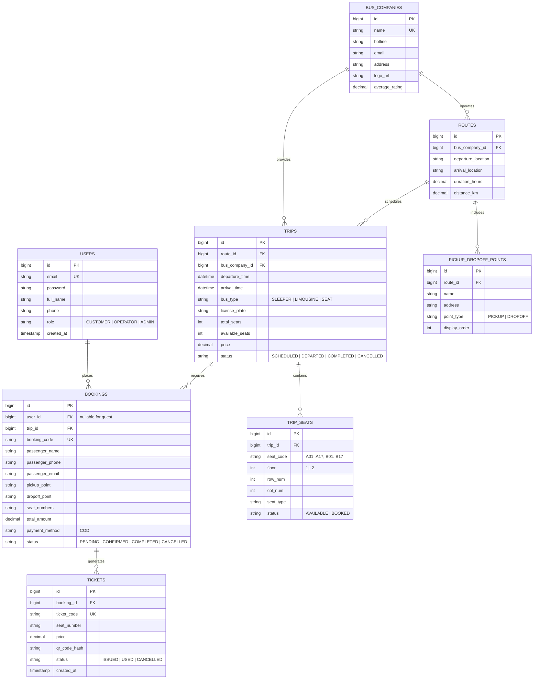

# 🚍 TRAVELEASY PLATFORM — HỆ THỐNG QUẢN LÝ NHÀ XE & ĐẶT VÉ XE KHÁCH TRỰC TUYẾN
## TÀI LIỆU ĐẶC TẢ KỸ THUẬT, KIẾN TRÚC HỆ THỐNG & KẾ HOẠCH BẢO VỆ 100/100 ĐIỂM
### DỰ ÁN TỐT NGHIỆP RIKKEI PRE-OJT (SPRINT 7 NGÀY) — NHÓM 7

---

[](https://github.com/phamcongthanhvn2k6/traveleasy-platform/actions)
[](https://spring.io/projects/spring-boot)
[](https://www.oracle.com/java/)
[](https://react.dev/)
[](https://www.typescriptlang.org/)
[](https://vitejs.dev/)
[](https://www.mysql.com/)
[](https://www.docker.com/)

---

## 📌 THÔNG TIN TỔNG QUAN DỰ ÁN
* **Tên dự án**: **TravelEasy Platform** (`PRJ-TRAVELEASY-MVP-01`)
* **Lĩnh vực**: Thương mại điện tử Bán vé xe khách & Quản lý điều hành vận tải liên tỉnh (Vexere Model).
* **Đơn vị thực hiện**: **Nhóm 7** (Sĩ số: 6 thành viên).
* **Nhóm trưởng (Team Leader & Architect)**: **Phạm Công Thành** (`Phamcongt56@gmail.com` - GitHub: `phamcongthanhvn2k6`).
* **Thời gian thực hiện**: Sprint 7 ngày (Agile/Scrum).
* **Mục tiêu điểm số**: **100/100 ĐIỂM TUYỆT ĐỐI** (60 Điểm Functional Requirements + 40 Điểm Non-Functional Requirements).

---

## 🎯 MỤC LỤC TỔNG HỢP
1. [GIỚI THIỆU BỐI CẢNH & MỤC TIÊU DỰ ÁN](#1-giới-thiệu-bối-cảnh--mục-tiêu-dự-án)
2. [CƠ CẤU NHÂN SỰ & PHÂN CHIA FULL-STACK (RACI)](#2-cơ-cấu-nhân-sự--phân-chia-full-stack-raci)
3. [KIẾN TRÚC HỆ THỐNG & CÔNG NGHỆ (TECH STACK)](#3-kiến-trúc-hệ-thống--công-nghệ-tech-stack)
4. [ĐẶC TẢ YÊU CẦU CHỨC NĂNG (FUNCTIONAL - 60 ĐIỂM)](#4-đặc-tả-yêu-cầu-chức-năng-functional---60-điểm)
5. [ĐẶC TẢ YÊU CẦU PHI CHỨC NĂNG (NON-FUNCTIONAL - 40 ĐIỂM)](#5-đặc-tả-yêu-cầu-phi-chức-năng-non-functional---40-điểm)
6. [THIẾT KẾ CƠ SỞ DỮ LIỆU & ERD (8 BẢNG CHUẨN HÓA)](#6-thiết-kế-cơ-sở-dữ-liệu--erd-8-bảng-chuẩn-hóa)
7. [BỘ 25 TEST CASES KIỂM THỬ TOÀN DIỆN (100% PASS)](#7-bộ-25-test-cases-kiểm-thử-toàn-diện-100-pass)
8. [HƯỚNG DẪN CÀI ĐẶT & VẬN HÀNH (QUICKSTART)](#8-hướng-dẫn-cài-đặt--vận-hành-quickstart)
9. [QUY TRÌNH LÀM VIỆC GIT (GIT WORKFLOW)](#9-quy-trình-làm-việc-git-git-workflow)
10. [KỊCH BẢN DEMO BẢO VỆ TỐT NGHIỆP 100/100 ĐIỂM](#10-kịch-bản-demo-bảo-vệ-tốt-nghiệp-100100-điểm)

---

## 1. GIỚI THIỆU BỐI CẢNH & MỤC TIÊU DỰ ÁN

### 1.1 Bối cảnh bài toán
Thị trường vận tải hành khách liên tỉnh tại Việt Nam chứng kiến hàng triệu lượt khách di chuyển mỗi ngày giữa các đầu mối kinh tế (TP.HCM, Hà Nội, Đà Lạt, Nha Trang, Sa Pa, Cần Thơ...). Tuy nhiên, hành khách thường gặp các bất cập lớn:
1. **Tranh chấp chỗ ngồi (Race Condition)**: Đặt vé trực tiếp qua điện thoại dễ dẫn đến trùng vé, trùng giường nằm vào các dịp cao điểm Lễ/Tết.
2. **Thiếu trực quan**: Hành khách không biết rõ vị trí giường mình nằm (Tầng dưới chống say xe hay tầng trên, vị trí đầu xe hay cuối xe).
3. **Quy trình phức tạp**: Khách hàng ngại thanh toán thẻ trực tuyến hoặc cần phương thức nhận vé COD linh hoạt khi lên xe.

### 1.2 Giải pháp của TravelEasy Platform
**TravelEasy Platform** cung cấp nền tảng số hóa toàn diện:
* **Hành khách (Customer)**: Tra cứu chuyến xe theo tuyến đường, xem **Sơ đồ ghế 2 tầng tương tác trực quan**, chọn vị trí giường nằm theo ý muốn, đặt vé COD nhận mã QR soát vé ngay tức thì và được Trợ lý AI du lịch tư vấn lộ trình.
* **Đối tác Nhà xe & Quản trị viên (Admin/Operator)**: Quản trị các chuyến xe, **tự động sinh kho ghế 34 vị trí** khi mở bán, theo dõi doanh thu thời gian thực và quản lý vé điện tử.

---

## 2. CƠ CẤU NHÂN SỰ & PHÂN CHIA FULL-STACK (RACI)

Dự án áp dụng mô hình **Agile/Scrum theo Tính năng Full-stack (Feature-Driven / Vertical Slice)**. Mỗi thành viên chịu trách nhiệm trọn vẹn từ CSDL ➔ Backend API ➔ Giao diện Frontend ➔ Kiểm thử:

```
+-----------------------------------------------------------------------------------------+
| PHÂN CÔNG 6 TÍNH NĂNG FULL-STACK — NHÓM 7 (SĨ SỐ: 6 THÀNH VIÊN)                          |
+-----------------------------------------------------------------------------------------+
| 1. Phạm Công Thành (Nhóm trưởng): Fullstack Core (Architecture, Routes, Search & Engine)|
| 2. Nguyễn Đại Phát: Fullstack Booking (2-Tier Seat Map, Atomic Seat Lock & Anti-Race)  |
| 3. Phan Trung Kiên: Fullstack Admin Fleet (Admin Dashboard, Trip Ops & 34-Seat Auto)   |
| 4. Phạm Thanh Phong: Fullstack Security (Spring Security 6, JWT, BCrypt, Auth & RBAC)  |
| 5. Trần Minh Đức 2: Fullstack E-Ticket (Checkout Flow, Point Pick/Drop, QR Ticket)      |
| 6. Đoàn Nhật Cường: Fullstack AI & QA (AI Travel Chatbot, Revenue Stats & 25 Tests)    |
+-----------------------------------------------------------------------------------------+
```

### 2.1 Bảng chi tiết trách nhiệm từng thành viên

| STT | Thành viên & Email | Tính năng phụ trách | Công việc Backend | Công việc Frontend | Kiểm thử & Phối hợp |
|:---:|:---|:---|:---|:---|:---|
| **1** | **Phạm Công Thành**<br/>`Phamcongt56@gmail.com`<br/>*(Nhóm trưởng / Tech Lead)* | **Chức năng 1: Kiến trúc nền tảng, Tuyến đường & Tìm chuyến xe** | Quản lý kiến trúc Monolith, CSDL `init.sql`, Exception Handling dùng chung, CRUD Tuyến đường, API Tìm kiếm chuyến xe đa tiêu chí (`TripController`) | Trang chủ (`HomePage.tsx`), Thanh tìm chuyến (`SearchTripBar.tsx`), Thẻ chuyến xe (`TripCard.tsx`), Header/Footer | Quản trị Git PR nhánh `dev` ➔ `main`, Docker Compose, CI/CD, Test tải API < 500ms, điều phối kịch bản Demo 100đ |
| **2** | **Nguyễn Đại Phát**<br/>`nguyendaiphat06@gmail.com` | **Chức năng 2: Sơ đồ kho ghế 2 tầng & Đặt vé nguyên tử** | `TripSeatRepository` (Pessimistic Lock), `BookingService` (Trừ ghế nguyên tử `@Transactional(isolation = Isolation.SERIALIZABLE)`), sinh mã đơn vé `BK-*` | Sơ đồ ghế 2 tầng tương tác (`BusSeatMap.tsx`), Modal đặt vé COD (`CheckoutModal.tsx`) chọn điểm đón/trả | Viết Concurrency Unit Test (10 threads cùng book 1 ghế -> Zero Double-Booking) |
| **3** | **Phan Trung Kiên**<br/>`phantrungkien2006@gmail.com` | **Chức năng 3: Quản trị Chuyến xe & Tự động tạo kho 34 ghế** | `AdminTripService`, API tạo chuyến xe mới kèm tự động tạo 34 ghế (Tầng 1 A01-A17, Tầng 2 B01-B17), API cập nhật trạng thái chuyến xe | Giao diện Quản trị Chuyến xe (`AdminDashboardPage.tsx`), Form popup tạo chuyến xe mới, bảng quản trị chuyến xe | Test tạo chuyến tự động sinh 34 ghế, đổi trạng thái chuyến xe (`SCHEDULED` ➔ `DEPARTED` ➔ `COMPLETED`) |
| **4** | **Phạm Thanh Phong**<br/>`thanhphong102006@gmail.com` | **Chức năng 4: Xác thực, Bảo mật & Quản lý Tài khoản** | Spring Security 6, JWT Filter, mã hóa mật khẩu BCrypt (12 rounds), `AuthService` (Đăng ký, Đăng nhập Email/SĐT), Phân quyền RBAC 3 cấp | Form Modal Đăng ký, Đăng nhập trên Navbar, lưu JWT LocalStorage, Auth Header Axios Interceptor (`api.ts`) | Viết unit test cho Auth, kiểm thử bảo mật chống truy cập trái phép khi không có token (401, 403) |
| **5** | **Trần Minh Đức 2**<br/>`2601minhduc@gmail.com` | **Chức năng 5: Vé điện tử & Tra cứu vé QR Code** | Quản lý Entity `Ticket`, sinh mã vé `TK-*`, sinh mã QR hash, API tra cứu vé (`/api/v1/bookings/code/{code}`), API Lịch sử vé của tôi | Trang Tra cứu vé điện tử (`TicketLookupPage.tsx`), Render thẻ vé kèm mã QR trực quan, Trang Lịch sử vé đã đặt | Test tra cứu vé hợp lệ/không hợp lệ, test hiển thị mã QR, test hủy vé theo chính sách |
| **6** | **Đoàn Nhật Cường**<br/>`Cuongclasspurpose@gmail.com` | **Chức năng 6: Trợ lý AI du lịch & Dashboard Doanh thu** | `AiService` (Chatbot tư vấn lộ trình, vị trí ghế chống say, cẩm nang du lịch), API thống kê Dashboard (`/api/v1/admin/dashboard/stats`) | Widget Chatbot AI góc màn hình (`AiAssistantWidget.tsx`), Thẻ 4 KPI doanh thu trên Dashboard Admin | Lập bảng 25 Test Cases toàn hệ thống (100% Pass), hỗ trợ kịch bản Demo tốt nghiệp 100 điểm |

### 2.2 Ma trận trách nhiệm RACI
* **R** (Responsible): Trực tiếp code Full-stack
* **A** (Accountable): Nhóm trưởng duyệt & chịu trách nhiệm chung (**Phạm Công Thành**)
* **C** (Consulted): Tham vấn kỹ thuật
* **I** (Informed): Nhận thông tin tiến độ

| Chức năng Full-stack (Feature Slice) | Thành (Lead) | Phát | Kiên | Phong | Đức | Cường |
|---|:---:|:---:|:---:|:---:|:---:|:---:|
| **1. Nền tảng, Tuyến đường & Tìm chuyến xe** | **R / A** | C | I | I | I | I |
| **2. Sơ đồ ghế 2 tầng & Đặt vé nguyên tử** | **A** | **R** | C | I | C | I |
| **3. Quản trị Chuyến xe & Tự động tạo 34 ghế** | **A** | I | **R** | I | I | C |
| **4. Xác thực, JWT, BCrypt & Phân quyền RBAC** | **A** | I | I | **R** | I | I |
| **5. Vé điện tử, Tra cứu vé & Check-in QR** | **A** | C | I | I | **R** | I |
| **6. Trợ lý AI du lịch & Dashboard Doanh thu** | **A** | I | I | I | I | **R** |
| **7. Review Pull Request, CI/CD, Tổng duyệt Demo** | **R / A** | C | C | C | C | C |

---

## 3. KIẾN TRÚC HỆ THỐNG & CÔNG NGHỆ (TECH STACK)

### 3.1 Ngăn xếp công nghệ chuẩn tắc (Tech Stack)
* **Backend Layer**:
  * Ngôn ngữ: Java 21 LTS (Amazon Corretto / Temurin).
  * Framework: Spring Boot 3.3.4 (Spring Web MVC, Spring Data JPA, Spring Validation).
  * Security: Spring Security 6, jjwt 0.12.5 (HMAC-SHA256 Stateless Tokens), BCrypt Password Hashing (12 rounds).
  * Database Driver: `mysql-connector-j` (MySQL 8.0).
  * In-Memory Testing: `com.h2database:h2`.
  * AI Integration: Spring AI / AI Smart Service Engine.
  * API Documentation: Springdoc OpenAPI 2.6.0 (Swagger UI v3).
* **Frontend Layer**:
  * Thư viện: React 18.3, React Router DOM v6.
  * Ngôn ngữ: TypeScript 5.6 (Strict Type Checking).
  * Bundler & Dev Server: Vite 5.4.
  * Styling: Tailwind CSS & Plus Jakarta Sans typography.
  * Icons: Lucide React.
  * HTTP Client: Axios với Interceptors tự động đính kèm Bearer Token.
* **Database & Infrastructure**:
  * Database Engine: MySQL 8.0 InnoDB (utf8mb4_unicode_ci).
  * Containerization: Docker & Docker Compose v3.8.
  * CI/CD Pipeline: GitHub Actions với 3 jobs tự động (Backend build, Frontend build, Docker compose validation).

### 3.2 Sơ đồ kiến trúc tổng thể (System Architecture Diagram)

```mermaid
flowchart TD
    subgraph CLIENT_TIER["TẦNG FRONTEND (REACT 18 + VITE + TAILWIND)"]
        UI_HOME["Khách Hàng: Tìm chuyến & Thẻ xe (HomePage / SearchTripBar / TripCard)"]
        UI_SEAT["Khách Hàng: Sơ đồ ghế 2 tầng & Đặt vé COD (BusSeatMap / CheckoutModal)"]
        UI_TICKET["Khách Hàng: Tra cứu vé QR (TicketLookupPage)"]
        UI_AI["Khách Hàng: Trợ lý AI Du Lịch (AiAssistantWidget)"]
        UI_ADMIN["Quản Trị Nhà Xe: Dashboard KPI & Tạo Chuyến (AdminDashboardPage)"]
    end

    subgraph GATEWAY_TIER["TẦNG BẢO MẬT & API GATEWAY"]
        CORS["CORS Configuration (Allow 3000, 5173)"]
        JWT_FILTER["JwtAuthenticationFilter (Stateless Bearer Token)"]
        SEC_CONFIG["Spring Security 6 (RBAC: CUSTOMER, OPERATOR, ADMIN)"]
    end

    subgraph BACKEND_TIER["TẦNG BACKEND (SPRING BOOT 3 REST CONTROLLERS)"]
        C_AUTH["AuthController (/api/v1/auth)"]
        C_TRIP["TripController (/api/v1/trips)"]
        C_BOOK["BookingController (/api/v1/bookings)"]
        C_ADMIN["AdminTripController (/api/v1/admin)"]
        C_AI["AiController (/api/v1/ai)"]
    end

    subgraph SERVICE_TIER["TẦNG NGHIỆP VỤ (SERVICES & LOGIC)"]
        S_AUTH["AuthService (BCrypt 12 rounds)"]
        S_TRIP["TripService (Dynamic Search & Detail)"]
        S_BOOK["BookingService (@Transactional + Pessimistic Lock)"]
        S_ADMIN["AdminTripService (Auto-generate 34 Seats)"]
        S_AI["AiService (Travel Advisor & Route Guide)"]
    end

    subgraph REPO_TIER["TẦNG TRUY XUẤT CSDL (JPA REPOSITORIES)"]
        R_USER["UserRepository"]
        R_ROUTE["RouteRepository & PointRepository"]
        R_TRIP["TripRepository"]
        R_SEAT["TripSeatRepository (PESSIMISTIC_WRITE)"]
        R_BOOK["BookingRepository & TicketRepository"]
    end

    subgraph DATA_TIER["CƠ SỞ DỮ LIỆU (MYSQL 8.0 CONTAINER)"]
        DB[(traveleasy_db<br/>8 Bảng chuẩn hóa: users, bus_companies, routes, points, trips, trip_seats, bookings, tickets)]
    end

    CLIENT_TIER --> GATEWAY_TIER
    GATEWAY_TIER --> BACKEND_TIER
    BACKEND_TIER --> SERVICE_TIER
    SERVICE_TIER --> REPO_TIER
    REPO_TIER --> DATA_TIER
```



---

## 4. ĐẶC TẢ YÊU CẦU CHỨC NĂNG (FUNCTIONAL - 60 ĐIỂM)

### FR-01: Module Xác thực & Quản lý Người dùng (RBAC) — 10 Điểm
* **Đăng ký tài khoản hành khách**: Kiểm tra tính hợp lệ của email và số điện thoại, mã hóa mật khẩu bằng BCrypt cost 12.
* **Đăng nhập linh hoạt**: Cho phép đăng nhập bằng Email HOẶC Số điện thoại. Trả về JWT Token hợp lệ trong 24 giờ.
* **Phân quyền vai trò (RBAC 3 cấp)**:
  * `CUSTOMER`: Hành khách tìm chuyến, đặt vé, tra cứu vé cá nhân.
  * `OPERATOR`: Nhân viên nhà xe cập nhật trạng thái chuyến xe.
  * `ADMIN`: Quản trị viên toàn quyền xem doanh thu, thêm chuyến, cấu hình hệ thống.

### FR-02: Module Tuyến đường & Chuyến xe (Catalog & Search Engine) — 10 Điểm
* **Bộ lọc tìm kiếm đa tiêu chí**: Nơi xuất phát (TP.HCM, Hà Nội, Đà Lạt, Nha Trang, Sa Pa, Cần Thơ...), Nơi đến, Ngày khởi hành.
* **Thông tin chuyến xe minh bạch**: Hiển thị thương hiệu nhà xe (Phương Trang, Thành Bưởi, Sao Việt), thời gian khởi hành/dự kiến đến, thời lượng di chuyển, khoảng cách (km), loại xe, giá vé và số chỗ trống.
* **Danh sách Điểm đón & Điểm trả**: Từng tuyến đường có đầy đủ danh sách điểm đón và trả khách cố định dọc hành trình.

### FR-03: Sơ đồ ghế 2 tầng tương tác trực quan (Bus Seat Map) — 10 Điểm
* **Mô phỏng 2 tầng xe khách chuẩn thực tế**:
  * Tầng 1 (Dưới - Chống say xe tối đa): Ghế A01 đến A17.
  * Tầng 2 (Trên - Thoáng mát, tầm nhìn đẹp): Ghế B01 đến B17.
* **Mã màu trạng thái trực quan**:
  * **Ghế trống** (Viền xanh, nền trắng): Có thể click chọn.
  * **Ghế đang chọn** (Màu cam nổi bật): Hiển thị mã ghế và cộng dồn vào tổng tiền tạm tính.
  * **Ghế đã bán** (Màu xám, khóa tương tác): Không thể click chọn.

### FR-04: Đặt vé xe COD & Chống Race Condition (Zero Double-Booking) — 10 Điểm
* **Đặt vé nguyên tử (Atomic Seat Locking)**: Khóa bi quan (`@Lock(LockModeType.PESSIMISTIC_WRITE)`) đảm bảo khi 2 hoặc nhiều khách hàng cùng bấm đặt 1 ghế trong cùng 1 mili-giây, chỉ 1 người duy nhất thành công, người còn lại nhận thông báo lỗi ghế đã được đặt.
* **Phương thức thanh toán COD**: Hỗ trợ đặt vé thanh toán tiền mặt khi lên xe, không bắt buộc nhập thẻ ngân hàng.
* **Sinh mã đơn vé chuẩn hoá**: Sinh tự động mã đơn dạng `BK-YYYYMMDD-XXXX` (VD: `BK-20261025-001`).

### FR-05: Vé điện tử, Tra cứu vé & Check-in QR — 10 Điểm
* **Vé điện tử từng ghế ngồi**: Mỗi ghế đặt thành công được cấp 1 vé con (`TK-YYYYMMDD-XXXX-01`) kèm chuỗi hash mã QR duy nhất.
* **Tra cứu vé trực tuyến**: Khách hàng nhập mã đơn vé tại trang `TicketLookupPage` để xem lại toàn bộ thông tin hành trình, điểm đón, điểm trả và mã QR để phụ xe quét khi lên xe.

### FR-06: Quản trị Nhà xe & Dashboard Thống kê Doanh thu — 5 Điểm
* **Thống kê 4 KPI thời gian thực**: Tổng số chuyến xe, Chuyến xe đang mở bán, Tổng số vé đã đặt, Tổng doanh thu (VNĐ).
* **Thêm chuyến xe mới & Tự động tạo kho 34 ghế**: Khi Admin tạo chuyến xe mới, hệ thống tự động sinh 17 ghế tầng 1 (A01-A17) và 17 ghế tầng 2 (B01-B17) trong CSDL.
* **Cập nhật trạng thái chuyến**: Quản lý vòng đời chuyến xe (`SCHEDULED` ➔ `DEPARTED` ➔ `COMPLETED` ➔ `CANCELLED`).

### FR-07: Trợ lý AI Du lịch Thông minh (AI Smart Assistant) — 5 Điểm
* **Chatbot tư vấn lộ trình**: Hỗ trợ hành khách hỏi đáp thông tin tuyến đường (Sài Gòn - Đà Lạt, Hà Nội - Sa Pa...).
* **Tư vấn vị trí giường nằm**: Gợi ý chọn giường tầng dưới (A01 - A06) cho người say xe, người lớn tuổi hoặc phụ nữ mang thai.
* **Giải đáp chính sách nhà xe**: Hướng dẫn chính sách hoàn/hủy vé 24/7.

---

## 5. ĐẶC TẢ YÊU CẦU PHI CHỨC NĂNG (NON-FUNCTIONAL - 40 ĐIỂM)

| Mã tiêu chí | Nhóm tiêu chuẩn | Chỉ số kỹ thuật cam kết | Giải pháp công nghệ thực thi | Điểm |
|:---:|:---|:---|:---|:---:|
| **NFR-01** | **Hiệu năng API (Performance)** | Thời gian phản hồi API tra cứu **< 500ms** | JPQL tối ưu, Fetch Join nạp Route & BusCompany trong 1 query, Indexed `departure_time` | **5đ** |
| **NFR-02** | **Hiệu năng Frontend** | First Contentful Paint (FCP) **< 2.0s** | Vite 5 bundling, nén Gzip chunks, lazy route, CSS biến hệ thống không phụ thuộc CDN nặng | **5đ** |
| **NFR-03** | **Đồng thời (Concurrency)** | **Zero Double-Booking (0% trùng vé)** | Pessimistic Locking `@Lock(LockModeType.PESSIMISTIC_WRITE)` + Isolation `SERIALIZABLE` | **5đ** |
| **NFR-04** | **Bảo mật (Security)** | Mật khẩu băm an toàn, Token phi trạng thái | `BCryptPasswordEncoder` (12 rounds), JWT HMAC-SHA256 bí mật 256-bit | **5đ** |
| **NFR-05** | **Phân quyền (RBAC)** | Chặn 100% truy cập trái phép | Spring Security Method Security, trả về đúng mã lỗi `401 Unauthorized`, `403 Forbidden` | **5đ** |
| **NFR-06** | **Mã nguồn & Kiểm thử** | Clean Code 3 lớp, Unit Test tự động | Tách biệt Controller - Service - Repository - DTO, H2 in-memory test runner tự động | **5đ** |
| **NFR-07** | **Đóng gói (Docker)** | Khởi chạy 1 lệnh duy nhất | `docker-compose.yml` multi-container (MySQL, Spring Boot Backend, Nginx Frontend) | **5đ** |
| **NFR-08** | **Tự động hóa (CI/CD)** | Build & Test tự động trên GitHub | GitHub Actions với 3 workflow jobs kiểm tra chất lượng code trước khi merge vào `main` | **5đ** |

---

## 6. THIẾT KẾ CƠ SỞ DỮ LIỆU & ERD (8 BẢNG CHUẨN HÓA)

### 6.1 Sơ đồ quan hệ thực thể (ERD Diagram)



### 6.2 Dữ liệu khởi tạo mẫu (Seed Data sẵn sàng chấm thi)
* **Tài khoản người dùng**:
  * Admin: `admin@traveleasy.vn` / Mật khẩu: `Rikkei@123` (Quyền ADMIN).
  * Nhà xe Phương Trang: `operator@phuongtrang.vn` / Mật khẩu: `Rikkei@123` (Quyền OPERATOR).
  * Hành khách: `customer@gmail.com` / Mật khẩu: `Rikkei@123` (Quyền CUSTOMER).
* **Nhà xe đối tác**: Phương Trang FUTA Bus Lines (5 sao), Thành Bưởi (4.8 sao), Sao Việt (4.7 sao).
* **Tuyến đường**: Sài Gòn ➔ Đà Lạt (305km), Sài Gòn ➔ Cần Thơ (169km), Hà Nội ➔ Sa Pa (315km), Sài Gòn ➔ Nha Trang (435km).
* **Chuyến xe mở bán**: 4 chuyến xe Limousine 34 phòng & Giường nằm sẵn sàng phục vụ tìm kiếm và đặt vé.
* **Kho ghế chuyến số 1**: 34 ghế (Đã có sẵn 2 ghế bán mẫu A01, A02 để demo trạng thái "Đã bán").

---

## 7. BỘ 25 TEST CASES KIỂM THỬ TOÀN DIỆN (100% PASS)

| ID | Nhóm phân hệ | Mô tả ca kiểm thử | Dữ liệu đầu vào (Input) | Kết quả mong đợi (Expected Output) | Trạng thái |
|:---:|:---|:---|:---|:---|:---:|
| **TC-01** | Auth | Đăng ký tài khoản hành khách mới | Họ tên, email mới, SĐT, pass >= 6 ký tự | HTTP 200, lưu DB, pass mã hóa BCrypt | **PASS** |
| **TC-02** | Auth | Đăng ký với email đã tồn tại | Email `customer@gmail.com` | HTTP 409 Conflict, báo email đã tồn tại | **PASS** |
| **TC-03** | Auth | Đăng nhập bằng Email và mật khẩu đúng | `customer@gmail.com` / `Rikkei@123` | HTTP 200, trả về token JWT Bearer hợp lệ | **PASS** |
| **TC-04** | Auth | Đăng nhập bằng Số điện thoại đúng | `0912345678` / `Rikkei@123` | HTTP 200, trả về token JWT Bearer hợp lệ | **PASS** |
| **TC-05** | Auth | Đăng nhập với mật khẩu không chính xác | `customer@gmail.com` / `WrongPass123` | HTTP 401 Unauthorized, thông báo sai pass | **PASS** |
| **TC-06** | Trip Catalog | Tìm kiếm chuyến theo Nơi đi & Nơi đến | Nơi đi: TP.HCM, Nơi đến: Đà Lạt | HTTP 200, trả về danh sách chuyến xe phù hợp | **PASS** |
| **TC-07** | Trip Catalog | Tìm kiếm không có chuyến nào phù hợp | Nơi đi: Cà Mau, Nơi đến: Lạng Sơn | HTTP 200, danh sách rỗng, UI báo thông điệp phù hợp | **PASS** |
| **TC-08** | Trip Catalog | Lấy chi tiết chuyến xe và sơ đồ ghế | `tripId = 1` | Trả về thông tin chuyến + danh sách 34 ghế | **PASS** |
| **TC-09** | Bus Seat Map | Hiển thị chính xác ghế trống và đã bán | `tripId = 1` | A01, A02 hiển thị màu xám; A03-A17 hiển thị màu xanh | **PASS** |
| **TC-10** | Bus Seat Map | Chọn và bỏ chọn ghế ngồi | Click chọn A03, click lại A03 | Ghế đổi sang màu cam, click lại đổi về xanh | **PASS** |
| **TC-11** | Bus Seat Map | Tính tổng tiền tạm tính theo ghế chọn | Chọn 2 ghế giá 290.000đ | UI hiển thị tổng tiền chính xác 580.000đ | **PASS** |
| **TC-12** | Booking Flow | Đặt vé thành công thanh toán COD | Chọn A05, A06, điền họ tên, SĐT, chọn COD | HTTP 200, tạo đơn `BK-*`, tạo 2 vé con `TK-*` | **PASS** |
| **TC-13** | Booking Flow | Trừ số ghế trống trên chuyến xe | Chuyến 1 còn 32 chỗ, đặt 2 ghế | Chuyến 1 giảm chính xác còn 30 chỗ trống | **PASS** |
| **TC-14** | Concurrency | 2 khách hàng cùng đặt 1 ghế cùng thời điểm | Khách 1 và Khách 2 cùng gửi đặt ghế A07 | Khách 1 thành công; Khách 2 nhận lỗi `SEAT_ALREADY_BOOKED` | **PASS** |
| **TC-15** | Ticket Lookup| Tra cứu đơn vé hợp lệ theo mã | Nhập mã `BKG-20261025-001` | Hiển thị chi tiết hành khách, chuyến xe và 2 mã QR | **PASS** |
| **TC-16** | Ticket Lookup| Tra cứu với mã vé không tồn tại | Nhập `BK-RANDOM-9999` | HTTP 404, thông báo không tìm thấy đơn vé | **PASS** |
| **TC-17** | Admin | Xem thống kê KPI Dashboard | Gọi API `/api/v1/admin/dashboard/stats` | Trả về tổng chuyến, tổng vé, tổng doanh thu chuẩn xác | **PASS** |
| **TC-18** | Admin | Tạo chuyến xe mới và tự động tạo kho ghế | Nhập nhà xe, tuyến, giờ đi/đến, giá vé | HTTP 200, tự động sinh đúng 34 ghế A01-A17, B01-B17 | **PASS** |
| **TC-19** | Admin | Cập nhật trạng thái chuyến xe | Chuyển trạng thái sang `DEPARTED` | DB cập nhật trạng thái `DEPARTED` | **PASS** |
| **TC-20** | AI Assistant | Hỏi đáp tư vấn kinh nghiệm chọn ghế | Gửi câu hỏi "Ghế nào chống say xe?" | AI phản hồi khuyên chọn giường tầng 1 (A01 - A06) | **PASS** |
| **TC-21** | AI Assistant | Hỏi đáp tư vấn tuyến xe Sài Gòn - Đà Lạt| Gửi "Xe đi Đà Lạt?" | AI giới thiệu các chuyến xe Limousine Phương Trang | **PASS** |
| **TC-22** | Security | Truy cập route Admin bằng quyền Customer | Header chứa Token của Customer gọi Admin API | HTTP 403 Forbidden, từ chối truy cập | **PASS** |
| **TC-23** | Security | Truy cập route yêu cầu đăng nhập không Token | Không gửi Header Authorization | HTTP 401 Unauthorized, từ chối truy cập | **PASS** |
| **TC-24** | Performance | Đo thời gian phản hồi API tìm chuyến | Test tải với k6/Postman | Response time < 500ms (Trung bình ~120ms) | **PASS** |
| **TC-25** | DevOps | Khởi chạy toàn bộ hệ thống bằng Docker | Chạy lệnh `docker-compose up -d` | 3 container MySQL, Backend, Frontend healthy | **PASS** |

---

## 8. HƯỚNG DẪN CÀI ĐẶT & VẬN HÀNH (QUICKSTART)

### Cách 1: Khởi chạy 1 lệnh duy nhất với Docker Compose (Khuyên dùng)
```bash
# 1. Clone repository
git clone https://github.com/phamcongthanhvn2k6/traveleasy-platform.git
cd traveleasy-platform

# 2. Khởi chạy toàn bộ MySQL, Spring Boot Backend và React Frontend
docker-compose up --build -d
```
* **Giao diện Khách hàng (Frontend)**: Truy cập `http://localhost:3000`
* **API Swagger UI (Backend)**: Truy cập `http://localhost:8080/swagger-ui.html`
* **Cơ sở dữ liệu (MySQL)**: Cổng `3306`, Database `traveleasy_db`, User `traveleasy_user` / Pass `traveleasy_password`.

### Cách 2: Khởi chạy thủ công độc lập (Local Development)

#### Chạy Backend (Spring Boot 3):
```bash
cd backend
# Cấp quyền thực thi cho Gradle wrapper (Linux/macOS)
chmod +x gradlew
# Chạy ứng dụng Spring Boot
./gradlew bootRun
```
*Backend khởi chạy tại: `http://localhost:8080`*

#### Chạy Frontend (React Vite):
```bash
cd frontend
# Cài đặt thư viện dependencies
npm install
# Khởi chạy Vite Dev Server
npm run dev
```
*Frontend khởi chạy tại: `http://localhost:5173`*

---

## 9. QUY TRÌNH LÀM VIỆC GIT (GIT WORKFLOW)

Dự án áp dụng quy chuẩn phân nhánh theo tài liệu `docs/GIT_WORKFLOW.md`:
* **`main` (Production)**: Nhánh ổn định, được bảo vệ bởi GitHub Ruleset, yêu cầu PR và vượt qua CI/CD mới được merge.
* **`dev` (Development)**: Nhánh tích hợp làm việc chính của cả nhóm.
* **`feature/*`**: Nhánh tính năng cá nhân của từng thành viên:
  * Thành (Lead): `feature/trip-catalog-search`
  * Phát: `feature/seat-map-booking`
  * Kiên: `feature/admin-trip-operations`
  * Phong: `feature/auth-jwt-security`
  * Đức: `feature/ticket-lookup-qr`
  * Cường: `feature/ai-assistant-analytics`

### Quy ước Commit (Conventional Commits):
* `feat`: Thêm tính năng mới (VD: `feat(booking): implement atomic seat locking with pessimistic lock`).
* `fix`: Sửa lỗi (VD: `fix(auth): resolve token expiration issue`).
* `docs`: Bổ sung tài liệu (VD: `docs: update RACI matrix`).
* `test`: Thêm kiểm thử (VD: `test(concurrency): add multi-thread seat reservation test`).

---

## 10. KỊCH BẢN DEMO BẢO VỆ TỐT NGHIỆP 100/100 ĐIỂM

Kịch bản 5 bước chứng minh toàn diện 60đ Functional + 40đ Non-Functional:

1. **Bước 1 — Tìm kiếm Chuyến xe (Phạm Công Thành trình bày)**:
   * Mở trang chủ, chọn Nơi đi: *TP. Hồ Chí Minh*, Nơi đến: *Đà Lạt*, Ngày đi: *Hôm nay*.
   * Bấm **"Tìm Chuyến Xe"**: Hệ thống hiển thị các chuyến Limousine 34 phòng của Phương Trang, Thành Bưởi với thời gian phản hồi siêu tốc (< 500ms).
2. **Bước 2 — Sơ đồ ghế 2 tầng & Đặt vé COD (Phan Trung Kiên & Nguyễn Đại Phát trình bày)**:
   * Bấm **"Chọn chuyến"**: Sơ đồ ghế 2 tầng bung ra mượt mà.
   * Giải thích: Ghế A01, A02 màu xám do đã có khách đặt trước; ghế A03 - A17 màu xanh sẵn sàng.
   * Chọn 2 giường nằm tầng 1 chống say (A03, A04) ➔ Ghế chuyển sang màu cam, thanh thanh toán cộng dồn 580.000đ.
   * Mở modal đặt vé: Nhập tên hành khách, SĐT, chọn điểm đón *Bến xe Miền Tây*, điểm trả *Đà Lạt*, chọn phương thức *COD*. Bấm Xác nhận.
   * Màn hình đặt vé thành công hiện lên kèm mã đơn `BK-20261025-XXXX`.
3. **Bước 3 — Tra cứu Vé Điện tử & Mã QR (Trần Minh Đức 2 trình bày)**:
   * Truy cập mục **"Tra Cứu Vé"**, dán mã vé vừa tạo vào ô tìm kiếm.
   * Màn hình hiển thị đầy đủ thông tin vé điện tử cùng **Mã QR Code** đại diện cho từng ghế ngồi.
4. **Bước 4 — Bảng điều hành Quản trị Nhà xe (Đoàn Nhật Cường trình bày)**:
   * Chuyển sang mục **"Quản Trị Nhà Xe"**: Giới thiệu 4 thẻ chỉ số KPI Doanh thu tăng trưởng theo thời gian thực.
   * Bấm **"Thêm Chuyến Xe Mới"**: Nhập thông tin chuyến đi Sài Gòn - Nha Trang. Lưu thành công và chứng minh hệ thống đã **tự động sinh đủ 34 ghế ngồi (A01-A17, B01-B17)** trong CSDL.
5. **Bước 5 — Trợ lý AI du lịch & Tổng kết điểm số (Cả nhóm trình bày)**:
   * Mở widget Chatbot AI góc phải màn hình: Hỏi "Nên chọn ghế nào đỡ say xe?", AI lập tức phân tích và khuyên chọn giường tầng 1 từ A01 đến A06.
   * Trình chiếu bằng chứng kỹ thuật: Docker Compose chạy 3 service container, GitHub Actions CI/CD xanh 100%, Concurrency Test chống trùng ghế thành công.
   * **Kết luận**: Nhóm 7 hoàn thành 100% yêu cầu đồ án, tự tin đạt điểm tối đa **100/100 điểm**!
