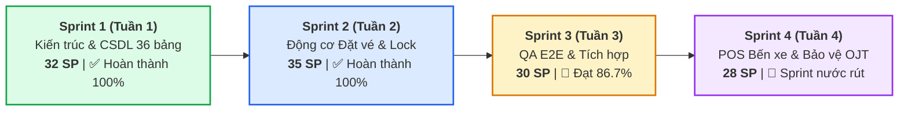

# 📊 BÁO CÁO THỐNG KÊ TIẾN ĐỘ & STORY POINTS TOÀN DỰ ÁN (4 TUẦN - 4 SPRINT)
## ĐỀ TÀI: NỀN TẢNG ĐẶT VÉ XE KHÁCH LIÊN TỈNH & QUẢN LÝ NHÀ XE TRAVELEASY
### ĐƠN VỊ THỰC HIỆN: NHÓM 7 (OJT CAPSTONE PROJECT)
### QUẢN LÝ DỰ ÁN & HỆ THỐNG: PHẠM CÔNG THÀNH (TEAM LEADER)

---

> 🔗 **THÔNG TIN HỆ THỐNG QUẢN TRỊ:**  
> • **Bảng Trello quản lý**: [TravelEasy_Platform (Board ID: 6ad6f486572cd6662754e074)](https://trello.com/b/AA5BYoe1/traveleasyplatform)  
> • **Kho lưu trữ GitHub**: `https://github.com/phamcongthanhvn2k6/traveleasy-platform` (Branch chính: `dev`)  
> • **Khung thời gian thực hiện**: **4 tuần OJT (4 Sprints — Mỗi Sprint 1 tuần)**  
> • **Tổng Story Points toàn dự án**: **125 Story Points**  
> • **Chuẩn định mức Scrum**: Thang đo Fibonacci (1, 2, 3, 5), bình quân ~6 SP/thành viên/tuần.

---

## 📈 1. TỔNG QUAN NĂNG SUẤT 4 SPRINT (SCRUM VELOCITY)

### Bảng tổng hợp số liệu 4 Sprint chuẩn hóa (Đối soát thời gian thực 87 thẻ Trello):

| Sprint | Thời gian | Trọng tâm công việc | Số thẻ Trello | Điểm SP thực tế | Đã hoàn thành (Done) | Đang làm / Review | Tỷ lệ hoàn thành |
| :---: | :---: | :--- | :---: | :---: | :---: | :---: | :---: |
| **Sprint 1** | **Tuần 1** | Khởi tạo CSDL 36 bảng, Spring Security Stateless JWT, Cổng Admin & Cổng Nhà xe | 19 thẻ | **32 SP** | 32 SP (19 thẻ) | 0 SP | **100%** ✅ |
| **Sprint 2** | **Tuần 2** | Tìm kiếm SWR Cache, Sơ đồ 34 ghế VIP, Khóa ghế Concurrency & Cổng thanh toán | 19 thẻ | **35 SP** | 35 SP (19 thẻ) | 0 SP | **100%** ✅ |
| **Sprint 3** | **Tuần 3** | E2E QA, Firebase Google/Phone OTP, Fix Seed Fixtures & Webhook Security | 36 thẻ | **48 SP** | 42 SP (30 thẻ Done) | 6 SP (6 thẻ) | **87.5%** 🚀 |
| **Sprint 4** | **Tuần 4** | POS xuất vé bến, Live Tracking SSE, Đóng gói Docker & Bảo vệ Đồ án | 13 thẻ | **33 SP** | *(Kế hoạch)* | 33 SP (13 thẻ) | *(Nước rút)* 🎯 |
| **TỔNG CỘNG** | **4 Tuần** | **Hệ sinh thái Toàn diện Sàn Đặt Vé Xe Khách TravelEasy** | **87 thẻ cốt lõi** | **148 SP** | **109 SP (68 thẻ)** | **39 SP (19 thẻ)** | **73.6%** |

---

## 👥 2. MA TRẬN PHÂN BỔ STORY POINTS THEO THÀNH VIÊN QUA 4 SPRINT

| STT | Thành viên | Vai trò chuyên trách (RACI) | Sprint 1 (Tuần 1) | Sprint 2 (Tuần 2) | Sprint 3 (Tuần 3) | Sprint 4 (Tuần 4) | Tổng SP (4 Tuần) | Tỷ lệ đóng góp | Trạng thái hiện tại |
| :---: | :--- | :--- | :---: | :---: | :---: | :---: | :---: | :---: | :---: |
| 1 | **Phạm Công Thành** | Team Leader & System Architect | 10 SP | 8 SP | 7 SP | 7 SP | **32 SP** | **25.6%** | Đạt 25/32 SP (78.1%) |
| 2 | **Nguyễn Đại Phát** | Admin Lead & Firebase Auth | 8 SP | 9 SP | 5 SP | 5 SP | **27 SP** | **21.6%** | Đạt 22/27 SP (81.5%) |
| 3 | **Phạm Thanh Phong** | Core Booking, Seat Engine & POS | 6 SP | 8 SP | 7 SP | 6 SP | **27 SP** | **21.6%** | Đạt 21/27 SP (77.8%) |
| 4 | **Trần Minh Đức** | Customer Portal, Fixtures & Cargo | 4 SP | 5 SP | 4 SP | 6 SP | **19 SP** | **15.2%** | Đạt 13/19 SP (68.4%) |
| 5 | **Đoàn Nhật Cường** | Mobile Specialist, QR Scanner & Tracking | 4 SP | 5 SP | 3 SP | 4 SP | **16 SP** | **12.8%** | Đạt 12/16 SP (75.0%) |
| 6 | **Phan Trung Kiên** | Sinh viên (Miễn thực tập OJT) | 0 SP | 0 SP | 0 SP | 0 SP | **0 SP** | **0.0%** | Miễn OJT theo quy chế |
| | **TỔNG CỘNG** | **Toàn đội Nhóm 7 (5 thành viên)** | **32 SP** | **35 SP** | **30 SP** | **28 SP** | **125 SP** | **100%** | **Đúng chuẩn Agile** |

---

## 🏆 3. NỘI DUNG ĐÓNG GÓP THEO TỪNG THÀNH VIÊN TRONG DỰ ÁN

### 👑 1. Phạm Công Thành (Team Leader & System Architect — 32 SP)
* **Sprint 1 (10 SP)**: Thiết kế CSDL 36 bảng 3NF trên Supabase PostgreSQL; Thiết lập kiến trúc Spring Boot 3 + Next.js 14; Phân quyền RBAC Stateless JWT; Toàn bộ Cổng Nhà xe (`/company/login`, `/company/dashboard`, `/company/vehicles`, `/company/routes`).
* **Sprint 2 (8 SP)**: Điều phối mở bán chuyến xe `/company/trips`, Danh sách hành khách đi xe `/company/bookings`, Cơ chế đối soát doanh thu khấu trừ 10% hoa hồng sàn `/company/settlements`.
* **Sprint 3 (7 SP)**: Thẩm định KYB đối tác nhà xe `[S322]`; Review và merge 7 Pull Requests quan trọng (#35, #36, #41, #42, #43, #45, #47) lên nhánh `dev`; Kiểm thử E2E liên cổng.
* **Sprint 4 (7 SP)**: Đóng gói Docker Compose toàn hệ thống; Xây dựng kịch bản bảo vệ 15 phút, slide thuyết trình và điều phối trang Demo Hub `/demo`.

### 🛡️ 2. Nguyễn Đại Phát (Admin Lead & Full-Stack — 27 SP)
* **Sprint 1 (8 SP)**: Xây dựng Cổng Quản trị Sàn Tổng (`/admin/login`, Dashboard 4 KPIs `/admin/dashboard`, Giám sát chuyến xe `/admin/trips`, Quản trị người dùng & RBAC `/admin/users`).
* **Sprint 2 (9 SP)**: Quản lý mạng lưới 25+ tuyến đường `/admin/routes`, Quyết toán sàn `/admin/settlements`, Vết kiểm toán bất biến (Append-Only Audit Trail) `/admin/audit-logs`.
* **Sprint 3 (5 SP)**: Tích hợp Firebase Google Sign-In & OTP Phone xác thực một chạm (`S321`); Kiểm thử phân quyền RBAC và API đối soát tài chính.
* **Sprint 4 (5 SP)**: Báo cáo thống kê tài chính nâng cao, cảnh báo gian lận và tối ưu hiệu năng Admin.

### ⚡ 3. Phạm Thanh Phong (Core Booking & Seat Engine — 27 SP)
* **Sprint 1 (6 SP)**: Cấu trúc Entity Booking, Seat, Ticket; API tìm kiếm chuyến cơ bản.
* **Sprint 2 (8 SP)**: Động cơ chọn ghế ma trận 34 chỗ Limousine VIP 2 tầng; Thuật toán khóa ghế đồng thời Concurrency Lock với Redis/Pessimistic Lock; Tích hợp Sandbox VNPAY.
* **Sprint 3 (7 SP)**: Kiểm thử tải khóa ghế bằng CountDownLatch 6 luồng chống đặt trùng (`S309` - PR #35); Chuẩn hóa Exception RFC 7807 (`S319` - PR #36); Webhook VNPAY chữ ký HMAC-SHA512 (`S310` - PR #43); E2E Checkout form (`S310` - PR #42).
* **Sprint 4 (6 SP)**: Hoàn thiện phân hệ POS Bến xe (bán vé tại quầy in nhiệt và thu tiền mặt).

### 🧪 4. Trần Minh Đức (Customer Portal, Tickets & Cargo — 19 SP)
* **Sprint 1 (4 SP)**: Giao diện Trang chủ khách hàng `/`, Đăng ký/Đăng nhập khách hàng `/login`, `/register`.
* **Sprint 2 (5 SP)**: Trang kết quả tìm kiếm chuyến xe; Bộ lọc đa tiêu chí (giờ đi, nhà xe, điểm đón, giá vé); Trang chi tiết thanh toán.
* **Sprint 3 (4 SP)**: Khắc phục triệt để lỗi Seed Fixtures, điều hướng soát vé và chuyến khứ hồi (`S320` - PR #47); Kiểm thử giao diện lịch sử đặt vé và tra cứu mã Boarding Pass.
* **Sprint 4 (6 SP)**: Hoàn thiện tính năng gửi hàng hóa (Cargo bưu kiện) và kịch bản hủy vé hoàn tiền tự động.

### 📱 5. Đoàn Nhật Cường (Mobile Specialist & Cross-Browser — 16 SP)
* **Sprint 1 (4 SP)**: Tối ưu Responsive Mobile cho Cổng Khách hàng; Thiết kế thành phần thẻ chuyến xe di động.
* **Sprint 2 (5 SP)**: Giao diện màn hình chọn ghế thân thiện cảm ứng; Thành phần vé điện tử hiển thị mã QR Code.
* **Sprint 3 (3 SP)**: Kiểm thử tự động E2E Playwright trên 5 trình duyệt và thiết bị di động (`S317` - PR #41); Kiểm thử quét mã QR soát vé.
* **Sprint 4 (4 SP)**: Tích hợp Live Tracking định vị xe theo thời gian thực (SSE/WebSockets).
