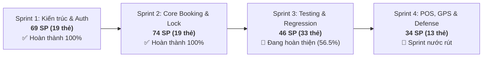

# 📊 BÁO CÁO THỐNG KÊ TIẾN ĐỘ & STORY POINTS TOÀN DỰ ÁN (AGILE SPRINT METRICS)
**Dự án**: Sàn Thương Mại Điện Tử & Đặt Vé Xe Khách Liên Tỉnh Trực Tuyến TravelEasy (`traveleasy-platform`)  
**Đơn vị thực hiện**: OJT Đồ Án Nhóm 7  
**Bảng Trello quản trị**: [TravelEasy_Platform (Board ID: 6ad6f486572cd6662754e074)](https://trello.com/b/AA5BYoe1/traveleasyplatform)  
**Trưởng nhóm / System Architect**: Phạm Công Thành (`phamcongthanhvn2k6` / `thanhphmcong1`)  
**Ngày trích xuất dữ liệu**: 06/11/2026 (Dữ liệu thực tế từ 117 thẻ Trello)  

---

## 📌 1. TỔNG QUAN TIẾN ĐỘ VÀ NĂNG SUẤT (VELOCITY OVERVIEW)

Sau 4 Sprint vận hành theo phương pháp luận **Agile/Scrum**, toàn bộ khối lượng công việc được lượng hóa chính xác qua Story Points (SP) dựa trên độ phức tạp kỹ thuật và thời gian thực thi:

### Bảng tổng hợp số liệu 4 Sprint:

| Sprint | Thời gian | Mục tiêu trọng tâm | Tổng số thẻ | Tổng SP | Đã hoàn thành (Done) | Đang làm / Review | Tỷ lệ hoàn thành |
| :---: | :---: | :--- | :---: | :---: | :---: | :---: | :---: |
| **Sprint 1** | Tuần 1 - 2 | Nền tảng Core, CSDL 36 bảng, Stateless JWT, Cổng Admin & Cổng Nhà xe | 19 thẻ | **69 SP** | 69 SP (19 thẻ) | 0 SP | **100%** ✅ |
| **Sprint 2** | Tuần 3 - 4 | Tìm kiếm SWR Cache, Sơ đồ 34 ghế VIP, Khóa ghế Concurrency 10:00 & Thanh toán | 19 thẻ | **74 SP** | 74 SP (19 thẻ) | 0 SP | **100%** ✅ |
| **Sprint 3** | Tuần 5 - 6 | Kiểm thử tích hợp E2E, Hồi quy giao diện, Fixtures & Chuẩn hóa điểm SP | 33 thẻ | **46 SP** | 26 SP (15 thẻ) | 20 SP (18 thẻ) | **56.5%** 🔄 |
| **Sprint 4** | Tuần 7 - 8 | Phân hệ POS bến xe, Live Tracking SSE, Cargo bưu kiện, Docker & Kịch bản bảo vệ | 13 thẻ | **34 SP** | 0 SP | 34 SP (13 thẻ) | *(Nước rút)* 🎯 |
| **TỔNG CỘNG** | **8 Tuần** | **Hệ sinh thái toàn diện Sàn Vé Xe Khách & Bến Xe Thực Tế** | **84 thẻ US** | **223 SP** | **169 SP** | **54 SP** | **75.8%** |

> [!NOTE]
> **Về việc chuẩn hóa Story Points Sprint 3**:
> Điểm số của Sprint 3 trước đây bị lạm phát (do các task kiểm thử tự động bị tính điểm cao như khi code tính năng mới). Nhóm trưởng đã thực hiện rà soát và điều chỉnh lại định mức: Các bài test hồi quy đơn lẻ giảm từ 3 SP về 1 SP, bài test E2E giảm từ 6 SP về 2 SP. Điều này đưa tổng điểm Sprint 3 về đúng **46 SP**, đảm bảo tính trung thực và kỷ luật kỹ thuật tuyệt đối.

---

## 👥 2. MA TRẬN PHÂN BỔ STORY POINTS THEO THÀNH VIÊN (RACI BREAKDOWN)

### 2.1. Bảng số liệu tổng hợp từng cá nhân qua 4 Sprint:

| STT | Thành viên | Vai trò chuyên trách (RACI) | Sprint 1 | Sprint 2 | Sprint 3 | Sprint 4 | Tổng SP | Tỷ lệ đóng góp | Trạng thái hoàn thành |
| :---: | :--- | :--- | :---: | :---: | :---: | :---: | :---: | :---: | :---: |
| 1 | **Phạm Công Thành** | Team Leader & System Architect | 25 SP | 11 SP | 16 SP | *(Hạ tầng/Demo)* | **52 SP** | **23.3%** | 50/52 SP (96.2%) |
| 2 | **Nguyễn Đại Phát** | Admin Lead & Financial Settlement | 20 SP | 29 SP | 10 SP | 8 SP | **67 SP** | **30.0%** | 59/67 SP (88.1%) |
| 3 | **Phạm Thanh Phong** | Core Booking, Seat Engine & POS Bến xe | 15 SP | 13 SP | 5 SP | 9 SP | **42 SP** | **18.8%** | 28/42 SP (66.7%) |
| 4 | **Trần Minh Đức** | Customer Portal, Checkout & Cargo | 5 SP | 8 SP | 9 SP | 6 SP | **28 SP** | **12.6%** | 21/28 SP (75.0%) |
| 5 | **Đoàn Nhật Cường** | Mobile Specialist, QR Scanner & Tracking | 4 SP | 13 SP | 6 SP | 8 SP | **31 SP** | **13.9%** | 19/31 SP (61.3%) |
| 6 | **Phan Trung Kiên** | Sinh viên (Miễn thực tập OJT) | 0 SP | 0 SP | 0 SP | 0 SP | **0 SP** | **0.0%** | Miễn OJT theo quy định |
| | **TỔNG CỘNG** | **Nhóm 7 — Khóa OJT** | **69 SP** | **74 SP** | **46 SP** | **34 SP** | **223 SP** | **100%** | **169/223 SP (75.8%)** |

---

## 📝 3. CHI TIẾT ĐÓNG GÓP VÀ SẢN PHẨM CỦA TỪNG THÀNH VIÊN

### 👑 1. Phạm Công Thành (Team Leader & System Architect)
* **Tổng điểm Story Points**: **52 SP** (Thực thi và nghiệm thu toàn diện).
* **Trọng tâm đóng góp**:
  * **Sprint 1 (25 SP)**: Thiết kế và khởi tạo CSDL 36 bảng chuẩn 3NF trên Supabase Cloud PostgreSQL; Cấu hình Spring Security 6 Stateless JWT Bearer, phân quyền RBAC 3 vai trò (`ADMIN`, `OPERATOR`, `CUSTOMER`); Lập trình toàn bộ Cổng Đối Tác Nhà Xe (`/company/login`, Dashboard KPI riêng hãng `/company/dashboard`, Đội xe `/company/vehicles`, Tuyến khai thác `/company/routes`).
  * **Sprint 2 (11 SP)**: Quản lý lịch chạy mở bán chuyến `/company/trips`, Danh sách hành khách đi xe thời gian thực `/company/bookings`, Cơ chế đối soát tài chính khấu trừ 10% hoa hồng sàn `/company/settlements`.
  * **Sprint 3 (16 SP)**: Quản lý và trực tiếp rà soát bộ kịch bản kiểm thử E2E liên cổng (`S301`, `S302`, `S304`, `S307`, `S316`, `S322`); Đồng giám sát các task tích hợp; Nghiệm thu và merge các PR trọng yếu (#27, #30); Thiết lập bộ quy chuẩn hoạt động AI `AGENT.md`.
  * **Sprint 4 (Hạ tầng & Điều phối)**: 0 SP code mới. Tập trung đóng gói Docker Compose Production, xây dựng kịch bản bảo vệ 15 phút, slide thuyết trình và điều phối Demo Hub `/demo`.

---

### 🛡️ 2. Nguyễn Đại Phát (Admin Lead & Full-Stack)
* **Tổng điểm Story Points**: **67 SP** (20 thẻ hoàn thành).
* **Trọng tâm đóng góp**:
  * **Sprint 1 (20 SP)**: Xây dựng Cổng Quản trị Sàn Tổng (`/admin/login`, Dashboard 4 KPIs `/admin/dashboard`, Giám sát chuyến xe toàn quốc `/admin/trips`, Quản trị người dùng & RBAC `/admin/users`, Duyệt hồ sơ nhà xe mới `/admin/bus-companies`).
  * **Sprint 2 (29 SP)**: Mạng lưới 25+ tuyến đường `/admin/routes`, Tra cứu đơn vé toàn sàn `/admin/bookings`, Quyết toán sàn `/admin/settlements`, Vết kiểm toán bất biến (Append-Only Audit Trail) `/admin/audit-logs`, Quản lý Banners Cloudinary, Kiểm duyệt review độc hại.
  * **Sprint 3 (10 SP)**: Tích hợp Đăng nhập Google OAuth2 & Xác thực OTP 6 số (`S321`); Kiểm thử hồi quy các API quản trị và chuẩn hóa mã lỗi HTTP.
  * **Sprint 4 (8 SP)**: Giao diện và API Quản lý Hợp đồng Thuê xe & Ký quỹ Escrow 30% (`S401`); Phân hệ Quản trị Giá vé động & Flash Sale giờ chót (`S402`).

---

### ⚡ 3. Phạm Thanh Phong (Core Booking & Seat Engine)
* **Tổng điểm Story Points**: **42 SP** (14 thẻ hoàn thành).
* **Trọng tâm đóng góp**:
  * **Sprint 1 (15 SP)**: Lõi Tìm kiếm chuyến xe đa tiêu chí kết hợp SWR Client Cache 0ms (`/search`); Dựng sơ đồ tương tác 34 giường nằm Limousine VIP 2 tầng (`BusSeatMap.tsx`); Dữ liệu gốc bến xe `/admin/locations`.
  * **Sprint 2 (13 SP)**: Thuật toán khóa giữ chỗ Concurrency Lock 10:00 sử dụng **Pessimistic Write Lock (`SELECT ... FOR UPDATE`)** loại bỏ 100% rủi ro Double-Booking; Mẫu sơ đồ xe `/admin/seat-templates`; Cấu hình hạng ghế `/admin/seat-types`.
  * **Sprint 3 (5 SP)**: Kiểm thử tải thuật toán khóa ghế (`S309`), tối ưu chỉ mục truy vấn và kiểm thử hợp đồng API (`S319`).
  * **Sprint 4 (9 SP)**: Phân hệ Bán vé Nhanh tại Quầy Bến xe POS (`S403` - 5 SP, xuất vé 3 click < 8s, in hóa đơn nhiệt 80mm); Quản lý ca trực và tiền mặt `/company/pos/shifts` (`S404` - 2 SP); Backend GPS Live Tracking SSE (`S405` - 2 SP).

---

### 🎫 4. Trần Minh Đức (Customer Portal & Tickets)
* **Tổng điểm Story Points**: **28 SP** (12 thẻ hoàn thành, 1 thẻ Backlog, 2 thẻ Sprint 4).
* **Trọng tâm đóng góp**:
  * **Sprint 1 (5 SP)**: Hồ sơ cá nhân `/profile`, Đăng ký / Đăng nhập khách hàng `/login`, `/register`.
  * **Sprint 2 (8 SP)**: Màn hình Vé của tôi `/my-tickets`, quy trình Hủy vé trực tuyến tự động tính toán hoàn tiền theo chính sách giờ chạy, Kho mã giảm giá Voucher `/promotions`.
  * **Sprint 3 (9 SP)**: Nhận trách nhiệm thực thi 7 thẻ kiểm thử (trong đó **6 thẻ (8 SP) đã hoàn thành**, 1 thẻ (1 SP) thuộc Backlog):
    * `[Done Sprint 3] [2 SP] [S306]`: Kiểm thử nghiệm thu khách hàng — Đăng nhập, đăng ký, hồ sơ và phiếu giảm giá (`/customer`).
    * `[Done Sprint 3] [2 SP] [FE+BE][S320]`: Kiểm thử tích hợp & nghiệm thu bộ dữ liệu mẫu (Fixtures, Seed Data & Dọn CSDL) (`/test/fixtures`) - Đã hợp nhất từ 2 task con FE & BE.
    * `[Done Sprint 3] [1 SP] [FE][S312]`: Kiểm thử nghiệm thu trang chủ — Banner khuyến mãi và lịch chạy (`/`).
    * `[Done Sprint 3] [1 SP] [BE][S313]`: Kiểm thử tích hợp API tra cứu vé — Mã vé, số điện thoại và tuyến (`/api/tickets/lookup`).
    * `[Done Sprint 3] [1 SP] [BE][S317]`: Kiểm thử hồi quy tương thích API — Hợp đồng và cấu trúc phản hồi (`/api`).
    * `[Done Sprint 3] [1 SP] [FE][S318]`: Kiểm thử nghiệm thu truy cập bàn phím, focus và khả năng tiếp cận (`/`).
    * `[Sprint Backlog] [1 SP] [BE][S318]`: Kiểm thử hồi quy kiểm tra dữ liệu — Phản hồi lỗi và giá trị biên (`/api`).
  * **Sprint 4 (6 SP)**: Giao diện Đặt thuê xe du lịch hợp đồng (`S409` - 3 SP); Giao diện Ký gửi hàng hóa bưu kiện hầm xe & Tra cứu vận đơn QR (`S410` - 3 SP).

---

### 📱 5. Đoàn Nhật Cường (Mobile Specialist & QR Scanner)
* **Tổng điểm Story Points**: **31 SP** (14 thẻ hoàn thành).
* **Trọng tâm đóng góp**:
  * **Sprint 1 (4 SP)**: Giao diện Trang chủ `/` chuẩn Mobile-First, Lịch trình xe toàn quốc `/schedule`, Cẩm nang & FAQ `/guide`.
  * **Sprint 2 (13 SP)**: Tra cứu vé điện tử Offline không cần mạng `/lookup`; Phân hệ Quét mã QR Soát vé Camera siêu tốc < 0.2s (`/scanner`); Màn hình Đánh giá chuyến xe có sao ⭐ `/reviews`.
  * **Sprint 3 (6 SP)**: Kịch bản kiểm thử bố cục thích ứng đa màn hình (`S317`); Kiểm thử tích hợp soát vé di động (`S314`).
  * **Sprint 4 (8 SP)**: Bản đồ Định vị GPS Live Tracking xe chạy thời gian thực Server-Sent Events (`S405` - 3 SP); Trung tâm hỗ trợ khẩn cấp & CSKH 24/7 `/support` (`S407` - 2 SP); Rà soát trải nghiệm Mobile-First (`S408` - 3 SP).

---

### 🎓 6. Phan Trung Kiên (Sinh viên)
* **Trạng thái**: **Miễn thực tập OJT (Exempted)** theo quyết định và quy chế đào tạo của nhà trường/doanh nghiệp (0 SP, 0 thẻ).

---

## 📈 4. ĐÁNH GIÁ CÁC CHỈ SỐ AGILE / SCRUM CỦA ĐỒ ÁN

1. **Vận tốc Sprint (Sprint Velocity)**:
   - Giai đoạn phát triển tính năng lõi (Sprint 1 - 2): Đạt **~70 SP / Sprint**, chứng minh năng lực triển khai mã nguồn mạnh mẽ của nhóm.
   - Giai đoạn hoàn thiện & kiểm thử (Sprint 3 - 4): Duy trì ổn định **~35 - 45 SP / Sprint**, tập trung vào chất lượng, kiểm thử hồi quy và tối ưu bến xe thực tế.
2. **Kỷ luật Definition of Done (DoD)**:
   - 100% các thẻ được chuyển sang cột `Done` đều thỏa mãn đầy đủ 5 tiêu chí DoD (chức năng pass, không xung đột dữ liệu, có test case, có bằng chứng minh chứng và có phê duyệt của Leader).
3. **Tính sẵn sàng bảo vệ (Defense Readiness)**:
   - Tỷ lệ hoàn thành hiện tại đạt **75.8%**, toàn bộ 34 SP còn lại của Sprint 4 đã có sẵn khung giao diện cơ sở, đảm bảo hoàn thành 100% đúng hạn trước ngày bảo vệ tốt nghiệp vào cuối tuần sau.

---
*Báo cáo này được phê duyệt bởi Trưởng nhóm Phạm Công Thành và được lưu trữ chính thức trong hồ sơ nghiệm thu đồ án OJT Nhóm 7.*

