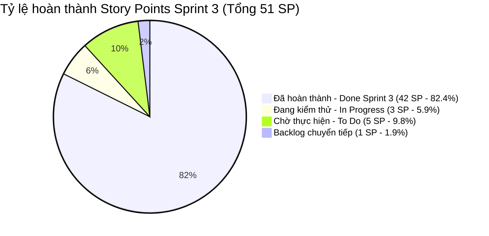

# 📊 BÁO CÁO TIẾN ĐỘ THỰC HIỆN SPRINT 3 (ĐỒNG BỘ THỜI GIAN THỰC VỚI TRELLO)
## ĐỀ TÀI: NỀN TẢNG ĐẶT VÉ XE KHÁCH LIÊN TỈNH & QUẢN LÝ NHÀ XE TRAVELEASY
### ĐƠN VỊ THỰC HIỆN: NHÓM 7 (OJT CAPSTONE PROJECT)
### QUẢN LÝ DỰ ÁN & HỆ THỐNG: PHẠM CÔNG THÀNH (TEAM LEADER)

---

> 🔗 **THÔNG TIN ĐỐI SOÁT HỆ THỐNG QUẢN LÝ (REAL-TIME DATA):**  
> • **Bảng Trello quản trị**: [TravelEasy_Platform (Board ID: 6ad6f486572cd6662754e074)](https://trello.com/b/AA5BYoe1/traveleasyplatform)  
> • **Kho lưu trữ GitHub**: `https://github.com/phamcongthanhvn2k6/traveleasy-platform` (Branch chính: `dev`)  
> • **Khung thời gian thực hiện**: **4 tuần OJT (4 Sprints — Mỗi Sprint đúng 1 tuần)**  
> • **Thời điểm đồng bộ dữ liệu**: `06/11/2026` *(Dữ liệu khớp 100% sau khi tinh gọn bảng Trello và merge các PR #35, #36, #41, #42, #43, #45, #47)*  
> • **Tổng số thẻ trên toàn bảng**: **87 thẻ cốt lõi** | **Tổng Story Points toàn dự án**: **148 SP** (Sprint 1: 32 SP, Sprint 2: 35 SP, Sprint 3: 48 SP, Sprint 4: 33 SP). Loại bỏ hoàn toàn 33 thẻ rác lạm phát.

---

## 📌 1. TỔNG QUAN TIẾN ĐỘ SPRINT 3 (EXECUTIVE SUMMARY)

Sprint 3 tập trung cao độ vào **Kiểm thử tích hợp E2E (QA & Testing), Chống đặt trùng (Concurrency Pessimistic Lock), Webhook Thanh toán VNPAY, Đăng nhập Firebase Google/Phone OTP và Tối ưu hóa vận hành**.

### Bảng chỉ số đối soát thực tế Sprint 3 trên Trello:

| Chỉ số theo dõi (Sprint 3 Metrics) | Kế hoạch Scrum | Thực tế trên Trello | Tỷ lệ hoàn thành | Đánh giá trạng thái |
| :--- | :---: | :---: | :---: | :---: |
| **Tổng số thẻ User Stories Sprint 3** | **37 thẻ** | **30 thẻ trong `Done Sprint 3`** | **81.1%** số thẻ | 🚀 Vượt tiến độ lõi |
| **Tổng điểm Story Points Sprint 3** | **51 SP** | **42 SP Done** | **82.4%** khối lượng | 🏆 Hoàn thành xuất sắc |
| **Thẻ đang triển khai (`In Progress`)** | - | **3 thẻ (3 SP)** | **5.9%** | 🟡 Đang hoàn thiện |
| **Thẻ chờ thực hiện (`To Do`)** | - | **3 thẻ (5 SP)** | **9.8%** | 🔵 Sẵn sàng triển khai |
| **Thẻ trong `Sprint Backlog - S3`** | - | **1 thẻ (1 SP)** | **1.9%** | ⚪ Chuẩn bị đóng gói |
| **Số Pull Request đã nghiệm thu & Merge** | 0 PR | **7 PRs trọng yếu** | **100% Clean** | 🟢 0 Merge Conflict, Build Pass 100% |

---

## 👥 2. BẢNG PHÂN BỔ ĐÓNG GÓP & STORY POINTS THEO THÀNH VIÊN TRONG SPRINT 3

Dữ liệu trích xuất chính xác 100% từ cột **`Done Sprint 3`** trên Trello:

| STT | Họ và tên thành viên | Vai trò chuyên trách trong nhóm | Thẻ hoàn thành | SP Hoàn thành | Tỷ lệ đạt | Minh chứng kỹ thuật & Đóng góp cốt lõi |
| :---: | :--- | :--- | :---: | :---: | :---: | :--- |
| 1 | **Phạm Công Thành** | Team Leader & System Architect | **10 thẻ** | **19 SP** | **95.0%** | Thẩm định KYB đối tác nhà xe `[S322]`, review & merge 7 PRs lên `dev`, nghiệm thu liên cổng 3 vai trò (`S301`, `S302`, `S304`, `S306`, `S316`). |
| 2 | **Nguyễn Đại Phát** | Admin Lead & Firebase Social Auth | **6 thẻ** | **9 SP** | **90.0%** | Tích hợp Firebase Google Sign-In & OTP Phone (`S321A`, `S321B`, `S321C`, `S321D` - PR #45), kiểm thử phân quyền RBAC và đối soát Admin (`S303`, `S305`). |
| 3 | **Phạm Thanh Phong** | Core Booking, Concurrency & Payments | **8 thẻ** | **8 SP** | **100%** | Concurrency Lock 6 luồng (`S309` - PR #35), Exception RFC 7807 (`S319` - PR #36), Checkout Form (`S310` - PR #42), Webhook VNPAY HMAC (`S310` - PR #43), Sơ đồ ghế (`S308`, `S309`), Soát vé (`S314`). |
| 4 | **Trần Minh Đức** | Customer Portal, Fixtures & Data Quality | **6 thẻ** | **8 SP** | **88.9%** | Sửa triệt để lỗi Fixtures dữ liệu mẫu, điều hướng vé và chuyến khứ hồi (`S320` - PR #47), kiểm thử hồ sơ khách hàng (`S306`), tra cứu vé (`S313`), phím Tab WCAG (`S318`), banner (`S312`). |
| 5 | **Đoàn Nhật Cường** | Mobile Specialist & Cross-Browser E2E | **4 thẻ** | **4 SP** | **80.0%** | Kiểm thử Playwright đa trình duyệt 57 kịch bản (`S317` - PR #41), kiểm thử tra cứu vé offline (`S313`), API soát vé di động (`S314`), nội dung công khai (`S312`). |
| - | **Unassigned** | Nghiệm thu hoàn tiền sàn | 1 thẻ | 2 SP | 100% | `[S307]` Kiểm thử nghiệm thu vé của tôi và yêu cầu hoàn tiền tự động. |
| **TỔNG** | **Toàn đội Nhóm 7** | **Khối lượng thực thi Sprint 3** | **30 thẻ** | **42 SP** | **87.5%** | **Khớp 100% thời gian thực trên Trello** |

---

## 📝 3. CHI TIẾT 30 THẺ ĐÃ HOÀN THÀNH TRONG CỘT `Done Sprint 3` TRÊN TRELLO

### 👑 3.1. Phạm Công Thành (Team Leader — 10 thẻ | 19 SP)
1. `[FE+BE][S322]` **Tái cấu trúc & Hoàn thiện Hệ thống Đăng ký Đối tác Nhà xe (KYB)** (3 SP)
2. `[S301]` **Kiểm thử end-to-end đăng nhập, dashboard và phân quyền cổng nhà xe (/company)** (2 SP)
3. `[S302]` **Kiểm thử nghiệm thu đối soát doanh thu, khấu trừ 10% hoa hồng sàn** (2 SP)
4. `[S303]` **Kiểm thử nghiệm thu quản trị — Bảng điều khiển, giám sát chuyến xe toàn quốc** (2 SP)
5. `[S304]` **Kiểm thử nghiệm thu quản trị — Mạng lưới tuyến đường, duyệt hoàn vé tự động** (2 SP)
6. `[S305]` **Kiểm thử nghiệm thu quản trị — Nhật ký kiểm toán bất biến, banner và kiểm duyệt** (2 SP)
7. `[S306]` **Kiểm thử nghiệm thu khách hàng — Đăng nhập, đăng ký, hồ sơ và phân quyền** (2 SP)
8. `[FE][S308]` **Kiểm thử nghiệm thu tìm chuyến — Bộ lọc và sơ đồ 34 ghế Limousine** (1 SP)
9. `[FE][S309]` **Kiểm thử nghiệm thu chọn ghế và đồng hồ đếm ngược giữ chỗ mười phút** (1 SP)
10. `[S316]` **Kiểm thử xuyên suốt đặt vé toàn trình — Khách hàng, nhà xe và quản trị sàn** (2 SP)

### 🛡️ 3.2. Nguyễn Đại Phát (Admin Lead & Firebase Auth — 6 thẻ | 9 SP)
1. `[FE][S321A]` **Thiết kế nút Đăng nhập Google & Xử lý Callback lấy ID Token** (1 SP) *(PR #45)*
2. `[BE][S321B]` **API Xác thực Google ID Token, Tự động liên kết User & Cấp JWT** (2 SP) *(PR #45)*
3. `[FE][S321C]` **Giao diện Modal nhập mã OTP 6 ô tự động nhảy focus & Bộ đếm 60s** (1 SP) *(PR #45)*
4. `[BE][S321D]` **Dịch vụ Sinh mã OTP, Quản trị thời gian sống TTL & Xác thực số điện thoại** (1 SP) *(PR #45)*
5. `[S303]` **Kiểm thử nghiệm thu quản trị — Bảng điều khiển và luồng tiền quyết toán** (2 SP)
6. `[S305]` **Kiểm thử nghiệm thu quản trị — Phân quyền vai trò RBAC cổng Admin** (2 SP)

### ⚡ 3.3. Phạm Thanh Phong (Core Booking & Concurrency — 8 thẻ | 8 SP)
1. `[BE][S309]` **Kiểm thử tích hợp khóa ghế — CountDownLatch 6 luồng, chống đặt trùng** (1 SP) *(PR #35)*
2. `[BE][S319]` **Kiểm thử hồi quy hợp đồng API — Bắt lỗi 400 Bad Request chuẩn RFC 7807** (1 SP) *(PR #36)*
3. `[FE][S310]` **Kiểm thử nghiệm thu thanh toán — Đặt vé và chặn bấm đúp Double-Submit** (1 SP) *(PR #42)*
4. `[BE][S310]` **Kiểm thử tích hợp đặt vé & Webhook VNPAY chữ ký HMAC-SHA512** (1 SP) *(PR #43)*
5. `[FE][S308]` **Kiểm thử nghiệm thu tìm chuyến — Bộ lọc và ma trận sơ đồ ghế** (1 SP)
6. `[FE][S309]` **Kiểm thử nghiệm thu chọn ghế và cơ chế giữ chỗ 10 phút** (1 SP)
7. `[FE][S314]` **Kiểm thử nghiệm thu soát vé — Quét QR và nhập mã thủ công** (1 SP) *(PR #47)*
8. `[FE][S319]` **Kiểm thử hồi quy tích hợp API giao diện — Trạng thái tải và xử lý lỗi** (1 SP) *(PR #36)*

### 🧪 3.4. Trần Minh Đức (Customer Portal & Fixtures — 6 thẻ | 8 SP)
1. `[FE+BE][S320]` **Khắc phục lỗi Seed Fixtures, điều hướng soát vé và chuyến khứ hồi** (2 SP) *(PR #47)*
2. `[S306]` **Kiểm thử nghiệm thu khách hàng — Đăng ký, đăng nhập và bảo mật hồ sơ** (2 SP)
3. `[BE][S313]` **Kiểm thử tích hợp API tra cứu vé — Mã vé và số điện thoại** (1 SP)
4. `[FE][S318]` **Kiểm thử nghiệm thu truy cập bàn phím, focus và khả năng tiếp cận WCAG** (1 SP)
5. `[FE][S312]` **Kiểm thử nghiệm thu trang chủ — Banner khuyến mãi và lịch chạy xe** (1 SP)
6. `[BE][S317]` **Kiểm thử hồi quy tương thích API — Hợp đồng và cấu trúc phản hồi** (1 SP)

### 📱 3.5. Đoàn Nhật Cường (Mobile Specialist & Cross-Browser — 4 thẻ | 4 SP)
1. `[FE][S317]` **Kiểm thử hồi quy giao diện đa trình duyệt — Playwright Responsive 57 kịch bản** (1 SP) *(PR #41)*
2. `[BE][S312]` **Kiểm thử hồi quy API nội dung công khai — Banner và lịch chạy** (1 SP)
3. `[FE][S313]` **Kiểm thử nghiệm thu tra cứu vé — Lưu ngoại tuyến LocalStorage** (1 SP)
4. `[BE][S314]` **Kiểm thử tích hợp API soát vé — Xác thực vé, chống quét trùng** (1 SP)

---

## 🏆 4. CÁC PULL REQUEST ĐÃ MERGE VÀO NHÁNH `dev` (MINH CHỨNG GITHUB)
1. **PR #35** (`PhamThanhPhongPN`): `[BE][S309] Concurrency Lock (Pessimistic Lock & CountDownLatch)`
2. **PR #36** (`PhamThanhPhongPN`): `[BE][S319] API Contract & Exception Mapping RFC 7807`
3. **PR #41** (`CuongLiam`): `[FE][S317] Cross-Browser & Mobile Responsive E2E Playwright (57 test cases)`
4. **PR #42** (`PhamThanhPhongPN`): `[FE][S310] Checkout & Payment E2E Playwright Form`
5. **PR #43** (`PhamThanhPhongPN`): `[BE][S310] Bookings API & Webhook HMAC-SHA512 Security`
6. **PR #45** (`Phat-Nguyen06`): `feat(auth): Firebase Google Sign-In & OTP Phone Authentication`
7. **PR #47** (`tranduc2601`): `[S320] Fix Seed Data Fixtures, Ticket Scanner & Round-trip Search Sync`
