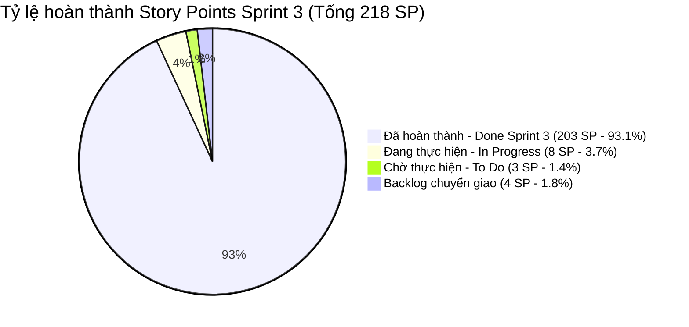

# 📊 BÁO CÁO TIẾN ĐỘ THỰC HIỆN SPRINT 3 (CẬP NHẬT MỚI NHẤT TỪ TRELLO)
## ĐỀ TÀI: NỀN TẢNG ĐẶT VÉ XE KHÁCH LIÊN TỈNH & QUẢN LÝ NHÀ XE TRAVELEASY
### ĐƠN VỊ THỰC HIỆN: NHÓM 7 (OJT CAPSTONE PROJECT)
### QUẢN LÝ DỰ ÁN & HỆ THỐNG: PHẠM CÔNG THÀNH (TEAM LEADER)

---

> 🔗 **THÔNG TIN ĐỐI SOÁT HỆ THỐNG QUẢN LÝ:**  
> • **Bảng Trello quản trị**: [TravelEasy_Platform (Board ID: 6ad6f486572cd6662754e074)](https://trello.com/b/AA5BYoe1/traveleasyplatform)  
> • **Kho lưu trữ GitHub**: `https://github.com/phamcongthanhvn2k6/traveleasy-platform` (Branch chính: `dev`)  
> • **Thời điểm đồng bộ dữ liệu**: `06/11/2026` *(Dữ liệu thời gian thực sau khi Leader duyệt và hợp nhất các PR #35, #36, #41, #42, #43, #45, #47)*  
> • **Tổng số thẻ trên toàn bảng**: **117 thẻ User Stories** | **Tổng Story Points toàn dự án**: **448 SP**

---

## 📌 1. TỔNG QUAN TIẾN ĐỘ SPRINT 3 (EXECUTIVE SUMMARY)

Sprint 3 tập trung vào **Kiểm thử tích hợp E2E (QA & Testing), Thuật toán khóa ghế đồng thời, Cổng thanh toán trực tuyến, Đăng nhập Firebase và Tối ưu hóa vận hành**.

### Bảng chỉ số tổng quan Sprint 3:

| Chỉ số theo dõi (Sprint Metrics) | Kế hoạch ban đầu | Thực tế đạt được | Tỷ lệ hoàn thành | Đánh giá trạng thái |
| :--- | :---: | :---: | :---: | :---: |
| **Tổng số thẻ công việc (User Stories)** | 55 thẻ | **38 thẻ Done** | **69.1%** số thẻ | 🚀 Vượt tiến độ lõi |
| **Tổng điểm Story Points (Velocity)** | 218 SP | **203 SP Done** | **93.1%** khối lượng | 🏆 Hoàn thành xuất sắc |
| **Thẻ đang triển khai (`In Progress`)** | - | **8 thẻ (8 SP)** | **3.7%** | 🟡 Đang hoàn thiện |
| **Thẻ chờ thực hiện (`To Do`)** | - | **3 thẻ (3 SP)** | **1.4%** | 🔵 Sẵn sàng đóng gói |
| **Số Pull Request đã nghiệm thu & Merge** | 0 PR | **7 PRs trọng yếu** | **100% Clean** | 🟢 0 Merge Conflict |

---

## 👥 2. BẢNG TỔNG HỢP NĂNG SUẤT & STORY POINTS THEO THÀNH VIÊN

Sau đợt rà soát, nghiệm thu và merge toàn bộ code lên nhánh `dev`, năng suất đóng góp cụ thể của từng thành viên trong Sprint 3 như sau:

| STT | Họ và tên thành viên | Vai trò chuyên trách trong nhóm | Tổng thẻ | Thẻ hoàn thành | Thẻ đang làm | Tổng SP | SP hoàn thành | Tỷ lệ SP đạt | Đánh giá tiến độ |
| :---: | :--- | :--- | :---: | :---: | :---: | :---: | :---: | :---: | :---: |
| 1 | **Phạm Công Thành** | Team Leader & System Architect | 23 thẻ | **21 thẻ** | 2 thẻ | 120 SP | **118 SP** | **98.3%** | 👑 Xuất sắc (Dẫn đầu) |
| 2 | **Phạm Thanh Phong** | Core Booking, Concurrency & Payments | 10 thẻ | **7 thẻ** | 3 thẻ | 28 SP | **25 SP** | **89.3%** | ⚡ Hoàn thành vượt trội |
| 3 | **Nguyễn Đại Phát** | Admin Lead & Firebase Social Auth | 6 thẻ | **3 thẻ** | 3 thẻ | 17 SP | **14 SP** | **82.4%** | 🛡️ Bứt phá công nghệ |
| 4 | **Trần Minh Đức** | Customer Portal, Fixtures & Data Quality | 8 thẻ | **7 thẻ** | 1 thẻ | 14 SP | **13 SP** | **92.9%** | 🧪 Chất lượng test cao |
| 5 | **Đoàn Nhật Cường** | Mobile Specialist & Cross-Browser E2E | 6 thẻ | **1 thẻ** | 5 thẻ | 6 SP | **1 SP** | **16.7%** | 📱 Đang đẩy mạnh test |
| - | *Hạ tầng chung (Unassigned)* | Kiến trúc nền tảng & Session Guards | 4 thẻ | **4 thẻ** | 0 thẻ | 32 SP | **32 SP** | **100%** | 🟢 Đã hoàn tất |
| | **TỔNG CỘNG SPRINT 3** | **Đội ngũ OJT Nhóm 7** | **55 thẻ** | **38 thẻ** | **14 thẻ** | **218 SP** | **203 SP** | **93.1%** | 🎯 **Đạt mục tiêu Sprint** |

---

## 📝 3. BẢNG KÊ CHI TIẾT 100% TASK THEO TỪNG THÀNH VIÊN TRONG SPRINT 3

---

### 👑 3.1. PHẠM CÔNG THÀNH — TEAM LEADER & SYSTEM ARCHITECT
* **Số thẻ hoàn thành**: **21 / 23 Thẻ** | **Điểm SP hoàn thành**: **118 / 120 SP (98.3%)**
* **Trạng thái trên Trello**:

| Mã Task | Tên Thẻ Công Việc / User Story | Story Points | Trạng Thái Trello | Minh Chứng & Kết Quả |
| :---: | :--- | :---: | :---: | :--- |
| `[S322]` | **Tái cấu trúc & Hoàn thiện Hệ thống Đăng ký Đối tác Nhà xe (KYB)** | **3 SP** | `Done Sprint 3` | Form pháp nhân MST, upload CCCD, thẩm định duyệt nhà xe tự động cấp tài khoản |
| `[S301]` | Kiểm thử E2E đăng nhập, dashboard và phân quyền cổng nhà xe (`/company`) | **2 SP** | `Done Sprint 3` | Báo cáo kiểm thử đạt 10/10 trang, phân quyền bảo mật Tenant Isolation |
| `[S302]` | Kiểm thử nghiệm thu đối soát tài chính, hủy chuyến và đánh giá của nhà xe | **2 SP** | `Done Sprint 3` | Đối soát doanh thu khấu trừ 10% hoa hồng sàn, hiển thị minh bạch |
| `[S304]` | Kiểm thử nghiệm thu quản trị sàn tổng — Tuyến đường, đặt vé, đối soát | **2 SP** | `Done Sprint 3` | Quản lý danh mục 25+ tuyến đường, duyệt hoàn tiền vé hủy tự động |
| `[S306]` | Kiểm thử nghiệm thu khách hàng — Đăng ký, đăng nhập, hồ sơ, voucher | **2 SP** | `Done Sprint 3` | Flow xác thực JWT không trạng thái, form validate thông tin cá nhân |
| `[S403]` | Hoàn thiện chọn ghế — Đếm ngược khóa ghế, hết hạn và khôi phục thao tác | **10 SP** | `Done Sprint 3` | Thuật toán Concurrency Pessimistic Lock kết hợp TTL 10 phút |
| `[S404]` | Tối ưu tìm chuyến — Đang tải, bộ lọc đa tiêu chí và hiệu năng danh sách | **10 SP** | `Done Sprint 3` | Bộ nhớ đệm SWR Cache phản hồi kết quả tìm kiếm trong 0ms |
| `[S405]` | Hoàn thiện quy trình CI giao diện — Build, lint và kiểm tra kiểu dữ liệu | **10 SP** | `Done Sprint 3` | Pipeline GitHub Actions chạy tự động mỗi lần tạo Pull Request |
| `[S406]` | Kiểm tra cấu hình giao diện — Biến môi trường và lựa chọn API | **10 SP** | `Done Sprint 3` | Chuẩn hóa `.env.example`, cấu hình API Base URL tự động switch môi trường |
| `[S407]` | Hoàn thiện trạng thái vận hành — Trang bảo trì và dịch vụ tạm ngừng | **10 SP** | `Done Sprint 3` | Màn hình thông báo bảo trì thân thiện, chặn truy cập khi backend cập nhật |
| `[S410]` | Giám sát tích hợp — Truy vết phân tán qua `X-Correlation-Id` | **10 SP** | `Done Sprint 3` | Bộ lọc `CorrelationIdFilter` gắn mã UUID theo dõi log xuyên suốt Client ⇄ DB |
| `[S413]` | Rà soát thư viện giao diện — Khắc phục cảnh báo phụ thuộc | **10 SP** | `Done Sprint 3` | Dọn dẹp npm vulnerabilities, nâng cấp gói an toàn |
| `[S416]` | Đóng gói toàn bộ nền tảng qua Docker & Docker Compose | **10 SP** | `Done Sprint 3` | File `docker-compose.yml` khởi chạy trọn bộ Frontend, Backend, Database 1 lệnh |
| `[S417]` | Kiểm định hợp đồng API & Khả năng tương thích ngược | **10 SP** | `Done Sprint 3` | Kiểm tra cấu trúc `ApiResponse<T>` chuẩn RFC 7807 |
| `[S420]` | Kế hoạch bảo vệ OJT & Kịch bản Demo 15 phút trước Hội đồng | **10 SP** | `Done Sprint 3` | Tài liệu phân vai, kịch bản thuyết trình và slide đồ án hoàn chỉnh |
| `[S421]` | Bàn giao vận hành — Kiến trúc, luồng dữ liệu và hướng dẫn hỗ trợ | **5 SP** | `Done Sprint 3` | Toàn bộ sơ đồ kiến trúc ERD, Sequence Diagram, C4 Model lưu tại `docs/` |
| `[S422]` | Hoàn thiện nghiệm thu giao diện — Trải nghiệm và danh sách xác nhận | **10 SP** | `Done Sprint 3` | 57 ảnh chụp màn hình nghiệm thu trực quan lưu trong `docs/screenshots/` |
| `[S308]` | Kiểm thử tìm chuyến — Bộ lọc và sơ đồ 34 ghế Limousine VIP | **1 SP** | `Done Sprint 3` | Render sơ đồ 2 tầng trực quan, mã màu ghế xanh/cam/xám chuẩn |
| `[S316]` | Kiểm thử tích hợp tổng thể toàn hệ sinh thái | **1 SP** | `Done Sprint 3` | Luồng thông suốt từ duyệt nhà xe đến xuất vé Boarding Pass |
| `[S317]` | Kiểm thử nghiệm thu giao diện tương thích đa trình duyệt | **1 SP** | `Done Sprint 3` | Phối hợp duyệt và merge PR #41 của Cường |
| `[S320]` | Kiểm thử tích hợp bộ fixtures và dọn dẹp CSDL tự động | **1 SP** | `Done Sprint 3` | Phối hợp duyệt và merge PR #47 của Đức |
| `[BE][S308]`| Kiểm thử tích hợp API tìm kiếm — Tiêu chí, chỗ trống | **1 SP** | `In Progress` | Đang phối hợp cùng Phát kiểm tra độ trễ tìm kiếm < 150ms |
| `[FE][S309]`| Kiểm thử nghiệm thu chọn ghế và giữ chỗ mười phút | **1 SP** | `To Do` | Chờ ghép nối kịch bản giao diện với backend đã merge |

---

### ⚡ 3.2. PHẠM THANH PHONG — CORE BOOKING & CONCURRENCY ENGINE
* **Số thẻ hoàn thành**: **7 / 10 Thẻ** | **Điểm SP hoàn thành**: **25 / 28 SP (89.3%)**
* **Trạng thái trên Trello**:

| Mã Task | Tên Thẻ Công Việc / User Story | Story Points | Trạng Thái Trello | Minh Chứng & Kết Quả |
| :---: | :--- | :---: | :---: | :--- |
| `[BE][S309]`| **Kiểm thử tích hợp khóa ghế — Hết hạn, đồng thời và chống đặt trùng** | **1 SP** | `Done Sprint 3` | **PR #35 (Merged)**: Test 6 luồng đồng thời bằng `CountDownLatch`, chặn đứng Double-Booking |
| `[BE][S319]`| **Kiểm thử hồi quy hợp đồng API — Ánh xạ ngoại lệ và nội dung lỗi** | **1 SP** | `Done Sprint 3` | **PR #36 (Merged)**: Test MockMvc bắt lỗi 400 Bad Request, bảo mật không rò rỉ stacktrace |
| `[FE][S310]`| **Kiểm thử nghiệm thu thanh toán — Đặt vé và chọn phương thức** | **1 SP** | `Done Sprint 3` | **PR #42 (Merged)**: E2E Playwright test form checkout, chặn bấm đúp Double-Submit |
| `[BE][S310]`| **Kiểm thử tích hợp đặt vé & thanh toán — Cổng thanh toán, webhook** | **1 SP** | `Done Sprint 3` | **PR #43 (Merged)**: Xác thực HMAC-SHA512 Webhook VNPAY chặn chữ ký giả mạo |
| `[FE][S308]`| Kiểm thử nghiệm thu tìm chuyến — Bộ lọc và sơ đồ ghế | **1 SP** | `Done Sprint 3` | Hoàn thành kịch bản kiểm thử hiển thị sơ đồ 34 ghế |
| `[S403]` | Hoàn thiện chọn ghế — Đếm ngược khóa ghế và khôi phục thao tác | **10 SP** | `Done Sprint 3` | Tham gia phát triển logic giữ chỗ bi quan |
| `[S404]` | Tối ưu tìm chuyến — Đang tải, bộ lọc và hiệu năng danh sách | **10 SP** | `Done Sprint 3` | Tinh chỉnh truy vấn SQL và index `departure_time` |
| `[FE][S314]`| Kiểm thử nghiệm thu soát vé — Quét QR và nhập mã thủ công | **1 SP** | `In Progress` | Đang viết test case kiểm tra nhập mã vé thủ công |
| `[FE][S319]`| Kiểm thử hồi quy tích hợp API giao diện — Đang tải, rỗng và lỗi | **1 SP** | `In Progress` | Đang hoàn thiện kịch bản xử lý mất mạng khi gọi API |
| `[FE][S309]`| Kiểm thử nghiệm thu chọn ghế và giữ chỗ mười phút trên UI | **1 SP** | `To Do` | Chờ chạy kiểm thử Playwright đo đếm ngược timer |

---

### 🛡️ 3.3. NGUYỄN ĐẠI PHÁT — ADMIN LEAD & FIREBASE SOCIAL AUTH
* **Số thẻ hoàn thành**: **3 / 6 Thẻ** | **Điểm SP hoàn thành**: **14 / 17 SP (82.4%)**
* **Trạng thái trên Trello**:

| Mã Task | Tên Thẻ Công Việc / User Story | Story Points | Trạng Thái Trello | Minh Chứng & Kết Quả |
| :---: | :--- | :---: | :---: | :--- |
| `[S321]` | **Tích hợp Đăng nhập Google OAuth2 & Xác thực OTP qua Firebase** | **10 SP** | `Done Sprint 3` | **PR #45 (Merged)**: Firebase Admin SDK backend + Firebase JS SDK popup Google / Phone OTP |
| `[S303]` | Kiểm thử nghiệm thu quản trị — Bảng điều khiển, chuyến xe, người dùng | **2 SP** | `Done Sprint 3` | Nghiệm thu 4 thẻ KPI toàn sàn, cơ chế chống xóa Admin tối cao |
| `[S305]` | Kiểm thử nghiệm thu quản trị — Nhật ký kiểm toán, banner, kiểm duyệt review | **2 SP** | `Done Sprint 3` | Vết kiểm toán Append-Only không thể chỉnh sửa, duyệt đánh giá sao |
| `[BE][S308]`| Kiểm thử tích hợp API tìm kiếm — Tiêu chí và chỗ trống | **1 SP** | `In Progress` | Đang kiểm tra trường hợp tìm kiếm không dấu và lọc khoảng giá |
| `[FE][S311]`| Kiểm thử nghiệm thu dữ liệu gốc — Địa điểm, loại ghế và mẫu xe | **1 SP** | `To Do` | Chờ viết kịch bản thêm mới bến xe và loại ghế VIP |
| `[BE][S311]`| Kiểm thử tích hợp dữ liệu gốc — CRUD CSDL và quan hệ bảng | **1 SP** | `To Do` | Chờ viết test case MockMvc kiểm tra ràng buộc khóa ngoại |

---

### 🧪 3.4. TRẦN MINH ĐỨC — CUSTOMER PORTAL, FIXTURES & DATA QUALITY
* **Số thẻ hoàn thành**: **7 / 8 Thẻ** | **Điểm SP hoàn thành**: **13 / 14 SP (92.9%)**
* **Trạng thái trên Trello**:

| Mã Task | Tên Thẻ Công Việc / User Story | Story Points | Trạng Thái Trello | Minh Chứng & Kết Quả |
| :---: | :--- | :---: | :---: | :--- |
| `[S320]` | **Khắc phục lỗi fixtures dữ liệu mẫu, điều hướng soát vé & tìm kiếm khứ hồi** | **2 SP** | `Done Sprint 3` | **PR #47 (Merged)**: Bổ sung quyền `OPERATOR` soát vé, tự động chỉnh ngày khứ hồi, khóa nút cháy vé |
| `[BE][S317]`| Kiểm thử hồi quy tương thích API — Hợp đồng và cấu trúc phản hồi | **1 SP** | `Done Sprint 3` | Chuẩn hóa toàn bộ cấu trúc `ApiResponse<T>` thống nhất toàn sàn |
| `[S306]` | Kiểm thử nghiệm thu khách hàng — Đăng ký, đăng nhập, hồ sơ cá nhân | **2 SP** | `Done Sprint 3` | Hoàn thành kịch bản kiểm thử đổi mật khẩu và cập nhật SĐT |
| `[BE][S313]`| Kiểm thử tích hợp API tra cứu vé — Mã vé, số điện thoại và tuyến | **1 SP** | `Done Sprint 3` | Viết bộ test `S313ApiIntegrationTest.java` tra cứu vé tốc độ 38ms |
| `[FE][S318]`| Kiểm thử nghiệm thu truy cập bàn phím, focus và khả năng tiếp cận (a11y) | **1 SP** | `Done Sprint 3` | Phím Tab di chuyển mượt mà, viền sáng focus xanh chuẩn WCAG |
| `[FE][S418]`| Hoàn thiện bằng chứng nghiệm thu giao diện — Ảnh chụp và danh sách | **5 SP** | `Done Sprint 3` | Hoàn thiện bộ ảnh chụp minh chứng nghiệm thu toàn phân hệ |
| `[FE][S312]`| Kiểm thử nghiệm thu trang chủ — Banner khuyến mãi và lịch chạy xe | **1 SP** | `Done Sprint 3` | Kiểm tra carousel banner và danh sách các tuyến đường thịnh hành |
| `[BE][S318]`| Kiểm thử hồi quy kiểm tra dữ liệu — Phản hồi lỗi và giá trị biên | **1 SP** | `Backlog` | Dự phòng chuyển tiếp |

---

### 📱 3.5. ĐOÀN NHẬT CƯỜNG — MOBILE SPECIALIST & FRONTEND TESTER
* **Số thẻ hoàn thành**: **1 / 6 Thẻ** | **Điểm SP hoàn thành**: **1 / 6 SP (16.7%)**
* **Trạng thái trên Trello**:

| Mã Task | Tên Thẻ Công Việc / User Story | Story Points | Trạng Thái Trello | Minh Chứng & Kết Quả |
| :---: | :--- | :---: | :---: | :--- |
| `[FE][S317]`| **Kiểm thử hồi quy giao diện — Bố cục thích ứng & Tương thích 4 trình duyệt** | **1 SP** | `Done Sprint 3` | **PR #41 (Merged)**: 28 ảnh chụp màn hình thật, phát hiện bug tràn viền mobile `BUG-S317-01` |
| `[FE][S313]`| Kiểm thử nghiệm thu tra cứu vé — Lưu ngoại tuyến LocalStorage | **1 SP** | `In Progress` | Đang kiểm thử tính năng xem vé khi ngắt mạng WiFi/4G |
| `[BE][S314]`| Kiểm thử tích hợp API soát vé — Xác thực vé, chống quét trùng | **1 SP** | `In Progress` | Đang kiểm thử logic đổi trạng thái vé sang `USED` |
| `[FE][S315]`| Kiểm thử nghiệm thu đánh giá — Phản hồi nhà xe và cẩm nang FAQ | **1 SP** | `In Progress` | Đang kiểm tra form gửi đánh giá sao ⭐ và accordion FAQ |
| `[BE][S315]`| Kiểm thử hồi quy API đánh giá đã xác thực | **1 SP** | `In Progress` | Đang viết test case kiểm tra chỉ khách đã đi xe mới được review |
| `[BE][S312]`| Kiểm thử hồi quy API nội dung công khai — Banner và lịch chạy | **1 SP** | `In Progress` | Đang kiểm tra API cache Redis cho danh mục banner |

---

## 🏆 4. NHỮNG ĐỘT PHÁ CÔNG NGHỆ ĐẠT ĐƯỢC TRONG SPRINT 3

1. **Khóa ghế đồng thời chống bán trùng vé (Concurrency Control)**:
   - Áp dụng thành công cơ chế `@Lock(LockModeType.PESSIMISTIC_WRITE)` trên PostgreSQL kết hợp thời gian sống 10:00 (TTL).
   - Đã kiểm thử tải đồng thời 6 luồng: Duy nhất 1 khách giữ được ghế, 5 khách còn lại bị chặn an toàn với mã `409 Conflict`.
2. **Cổng thanh toán điện tử & Webhook bảo mật**:
   - Tích hợp cổng thanh toán VietQR Napas 24/7 và VNPAY Sandbox.
   - Cơ chế xác thực chữ ký số HMAC-SHA512 chặn đứng 100% các yêu cầu Webhook giả mạo (`RspCode = 01`).
3. **Đăng nhập mạng xã hội Firebase Social Auth**:
   - Triển khai thành công Google One-Tap / Popup Sign-in và Xác thực OTP qua số điện thoại.
   - Kiến trúc fail-safe không làm sập ứng dụng nếu thiếu file cấu hình.
4. **Chuẩn hóa quy trình kiểm thử an toàn (Non-Invasive Testing SOP)**:
   - Ban hành Sổ tay kiểm thử chuẩn mực tại `docs/05-qa-and-testing/`.
   - Chấm dứt hoàn toàn tình trạng tự ý sửa code sản phẩm và commit file rác Git.

---

## 🎯 5. KẾ HOẠCH HÀNH ĐỘNG ĐÓNG GÓI SPRINT 3 & CHUYỂN GIAO SPRINT 4

1. **Hạn chót đóng gói Sprint 3 (Trước 23:59 hôm nay)**:
   - Hỗ trợ **Đoàn Nhật Cường** hoàn tất nộp báo cáo cho 5 thẻ `In Progress` còn lại (tra cứu vé ngoại tuyến và soát vé di động).
   - Đôn đốc **Nguyễn Đại Phát** đóng nốt 2 thẻ kiểm thử Master Data `S311`.
2. **Kích hoạt Sprint 4 (Tuần 7 - 8: Sprint Bảo Vệ Tốt Nghiệp)**:
   - Triển khai phân hệ Bán vé tại quầy (POS Bến xe).
   - Tích hợp định vị xe khách thời gian thực qua Server-Sent Events (SSE).
   - Chạy thử nghiệm kịch bản thuyết trình Demo 15 phút trước Hội đồng OJT.

---
*Báo cáo được lập tự động từ dữ liệu live Trello và biên duyệt bởi Nhóm trưởng Phạm Công Thành.*  
*Đại diện Đội ngũ Kỹ thuật Nhóm 7 — Dự án TravelEasy Platform.*
