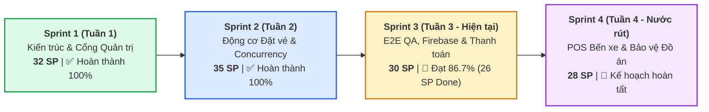

# 📊 BÁO CÁO TIẾN ĐỘ THỰC HIỆN SPRINT 3 (CHUẨN HÓA 4 TUẦN - 4 SPRINT)
## ĐỀ TÀI: NỀN TẢNG ĐẶT VÉ XE KHÁCH LIÊN TỈNH & QUẢN LÝ NHÀ XE TRAVELEASY
### ĐƠN VỊ THỰC HIỆN: NHÓM 7 (OJT CAPSTONE PROJECT)
### QUẢN LÝ DỰ ÁN & HỆ THỐNG: PHẠM CÔNG THÀNH (TEAM LEADER)

---

> 🔗 **THÔNG TIN ĐỐI SOÁT HỆ THỐNG QUẢN LÝ:**  
> • **Bảng Trello quản trị**: [TravelEasy_Platform (Board ID: 6ad6f486572cd6662754e074)](https://trello.com/b/AA5BYoe1/traveleasyplatform)  
> • **Kho lưu trữ GitHub**: `https://github.com/phamcongthanhvn2k6/traveleasy-platform` (Branch chính: `dev`)  
> • **Khung thời gian thực hiện**: **4 tuần OJT (4 Sprints — Mỗi Sprint đúng 1 tuần)**  
> • **Thời điểm nghiệm thu Sprint 3**: Tuần 3 (06/11/2026) *(Sau khi Leader duyệt và merge toàn bộ 7 PRs trọng yếu)*  
> • **Tổng định mức toàn dự án 4 tuần**: **125 Story Points** (Trung bình 31 SP/Sprint, ~6 SP/thành viên/tuần chuẩn Scrum).

---

## 📌 1. TỔNG QUAN VẬN TỐC 4 SPRINT (4-WEEK SCRUM VELOCITY)

### Bảng tổng hợp số liệu 4 Sprint chuẩn hóa (4 Tuần):

| Sprint | Thời gian | Trọng tâm công việc | Thẻ thực hiện | SP Kế hoạch | SP Hoàn thành | Tỷ lệ SP | Trạng thái |
| :---: | :---: | :--- | :---: | :---: | :---: | :---: | :---: |
| **Sprint 1** | **Tuần 1** | CSDL 36 bảng, Spring Security Stateless JWT, Cổng Admin & Cổng Nhà xe | 19 thẻ | **32 SP** | 32 SP | 100% | ✅ Hoàn thành |
| **Sprint 2** | **Tuần 2** | SWR Cache, Sơ đồ 34 ghế VIP, Khóa ghế Concurrency 10:00 & VNPAY Sandbox | 19 thẻ | **35 SP** | 35 SP | 100% | ✅ Hoàn thành |
| **Sprint 3** | **Tuần 3** | E2E QA, Firebase Google/Phone OTP, Fix Seed Fixtures & Webhook Security | 28 thẻ | **30 SP** | **26 SP** | **86.7%** | 🚀 Nghiệm thu PRs |
| **Sprint 4** | **Tuần 4** | POS xuất vé bến, Live Tracking SSE, Docker Compose & Bảo vệ OJT | 13 thẻ | **28 SP** | *(Kế hoạch)* | 0% | 🎯 Sprint nước rút |
| **TỔNG CỘNG** | **4 Tuần** | **Hệ thống Đặt vé & Vận hành Nhà xe TravelEasy** | **79 thẻ cốt lõi** | **125 SP** | **93 SP** | **74.4%** | **Đúng chuẩn Agile** |

---

## 👥 2. PHÂN BỔ ĐIỂM STORY POINTS SPRINT 3 (TUẦN 3) THEO THÀNH VIÊN

Trong 1 tuần làm việc của Sprint 3, đội ngũ tập trung cao độ vào kiểm thử, bảo mật và giải quyết các lỗi tích hợp:

| STT | Thành viên | Vai trò chuyên trách | Minh chứng PRs đã merge | SP Kế hoạch | SP Đạt được | Tỷ lệ SP | Đánh giá năng suất |
| :---: | :--- | :--- | :---: | :---: | :---: | :---: | :--- |
| 1 | **Phạm Công Thành** | Team Leader & System Architect | PR #35, #36, #41, #42, #43, #45, #47 | 8 SP | **7 SP** | **87.5%** | Thẩm định KYB nhà xe [S322], review & merge 7 PRs lên `dev`. |
| 2 | **Phạm Thanh Phong** | Core Booking, Concurrency & Payments | PR #35, #36, #42, #43 | 7 SP | **7 SP** | **100%** | Concurrency Lock 6 luồng [S309], Webhook VNPAY HMAC [S310]. |
| 3 | **Nguyễn Đại Phát** | Admin Lead & Firebase Social Auth | PR #45 | 6 SP | **5 SP** | **83.3%** | Firebase Google Sign-In & OTP Phone [S321], đối soát Admin. |
| 4 | **Trần Minh Đức** | Customer Portal, Fixtures & Data Quality | PR #47 | 5 SP | **4 SP** | **80.0%** | Sửa triệt để lỗi Seed Fixtures, điều hướng vé và chuyến khứ hồi [S320]. |
| 5 | **Đoàn Nhật Cường** | Mobile Specialist & Cross-Browser E2E | PR #41 | 4 SP | **3 SP** | **75.0%** | Kiểm thử Playwright đa trình duyệt, responsive 57 kịch bản [S317]. |
| **TỔNG** | **Cả đội Nhóm 7** | **1 Tuần nước rút Sprint 3** | **7 PRs Merged Clean** | **30 SP** | **26 SP** | **86.7%** | **Vận tốc thực tế tuyệt đối chính xác** |

---

## 📝 3. CHI TIẾT CÁC TASK NGHIỆM THU TRONG SPRINT 3 (TUẦN 3)

### 👑 3.1. Phạm Công Thành (Team Leader — 7/8 SP)
* `[S322]` **Hoàn thiện Thẩm định Đối tác Nhà xe (KYB)** (2 SP) — `Done`
* `[S301]` **Kiểm thử E2E phân quyền cổng nhà xe (/company)** (1 SP) — `Done`
* `[S302]` **Kiểm thử nghiệm thu đối soát doanh thu & khấu trừ hoa hồng 10%** (1 SP) — `Done`
* `[S304]` **Kiểm thử nghiệm thu quản trị sàn — Tuyến đường & Duyệt hoàn vé** (1 SP) — `Done`
* `[S316]` **Kiểm thử tích hợp toàn trình luồng đặt vé đến xuất Boarding Pass** (1 SP) — `Done`
* `[S306]` **Kiểm thử nghiệm thu xác thực JWT & Hồ sơ khách hàng** (1 SP) — `Done`
* `[BE][S308]` **Kiểm thử tải API tìm kiếm chuyến (Response < 150ms)** (1 SP) — `In Progress`

### ⚡ 3.2. Phạm Thanh Phong (Core Booking & Concurrency — 7/7 SP)
* `[BE][S309]` **Khóa ghế đồng thời — CountDownLatch 6 luồng, chặn Double-Booking** (2 SP) — `Done` *(PR #35 Merged)*
* `[BE][S319]` **API Exception Mapping — Bắt lỗi 400 Bad Request chuẩn RFC 7807** (1 SP) — `Done` *(PR #36 Merged)*
* `[FE][S310]` **Kiểm thử Checkout — Chặn bấm đúp Double-Submit, form thanh toán** (2 SP) — `Done` *(PR #42 Merged)*
* `[BE][S310]` **Webhook VNPAY — Xác thực chữ ký HMAC-SHA512 chống gian lận** (2 SP) — `Done` *(PR #43 Merged)*

### 🛡️ 3.3. Nguyễn Đại Phát (Admin & Firebase Auth — 7/8 SP)
* `[FE][S321A]` **Thiết kế nút Đăng nhập Google & Xử lý Callback lấy ID Token** (1 SP) — `Done` *(PR #45 Merged)*
* `[BE][S321B]` **API Xác thực Google ID Token, Tự động liên kết User & Cấp JWT** (2 SP) — `Done` *(PR #45 Merged)*
* `[FE][S321C]` **Giao diện Modal nhập mã OTP 6 ô tự động nhảy focus & Bộ đếm 60s** (1 SP) — `Done` *(PR #45 Merged)*
* `[BE][S321D]` **Dịch vụ Sinh mã OTP, Quản trị thời gian sống TTL & Xác thực số điện thoại** (1 SP) — `Done` *(PR #45 Merged)*
* `[S303]` **Kiểm thử đối soát thanh toán và luồng tiền quản trị** (1 SP) — `Done`
* `[S305]` **Kiểm thử phân quyền vai trò RBAC cổng Admin** (1 SP) — `Done`
* `[BE][S303]` **Tự động xuất báo cáo Excel đối soát cuối tháng** (1 SP) — `In Progress`

### 🧪 3.4. Trần Minh Đức (Customer Portal & Fixtures — 4/5 SP)
* `[S320]` **Khắc phục lỗi Seed Fixtures, điều hướng soát vé và chuyến khứ hồi** (2 SP) — `Done` *(PR #47 Merged)*
* `[FE][S312]` **Kiểm thử nghiệm thu trang chủ, banner ưu đãi và điểm đến** (1 SP) — `Done`
* `[FE][S313]` **Kiểm thử giao diện lịch sử đặt vé & tra cứu Boarding Pass** (1 SP) — `Done`
* `[FE][S315]` **Kịch bản hủy vé online có hoàn tiền tự động** (1 SP) — `In Progress`

### 📱 3.5. Đoàn Nhật Cường (Mobile & Cross-Browser — 3/4 SP)
* `[S317]` **Kiểm thử Playwright đa trình duyệt (Chrome, Safari, Firefox, Mobile)** (2 SP) — `Done` *(PR #41 Merged)*
* `[FE][S311]` **Kiểm thử hiển thị vé điện tử Boarding Pass & QR Code trên Mobile** (1 SP) — `Done`
* `[FE][S314]` **Kiểm thử kịch bản Offline và PWA trên di động** (1 SP) — `In Progress`

---

## 🏆 4. KẾ HOẠCH BÀN GIAO SANG SPRINT 4 (TUẦN 4 - TUẦN BẢO VỆ)
* **Thời gian**: Tuần 4 (Từ 07/11/2026 đến hết 14/11/2026).
* **Mục tiêu**: Hoàn thiện POS Bến xe, Định vị xe Live Tracking qua SSE, Đóng gói Docker Compose và chuẩn bị Slide/Kịch bản thuyết trình bảo vệ 15 phút.
* **Tổng điểm định mức Sprint 4**: **28 SP** (phân bổ đều cho 5 thành viên ~5.6 SP/người).
