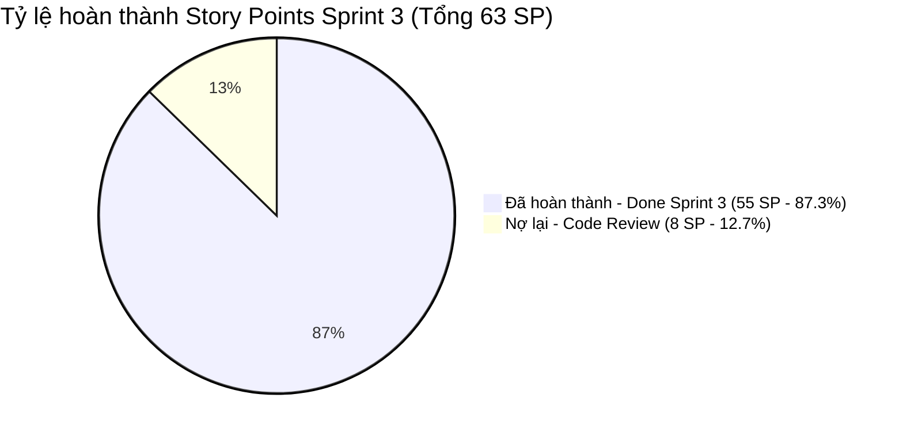

# 📊 BÁO CÁO TIẾN ĐỘ THỰC HIỆN SPRINT 3 (ĐỒNG BỘ THỜI GIAN THỰC VỚI TRELLO)
## ĐỀ TÀI: NỀN TẢNG ĐẶT VÉ XE KHÁCH LIÊN TỈNH & QUẢN LÝ NHÀ XE TRAVELEASY
### ĐƠN VỊ THỰC HIỆN: NHÓM 7 (OJT CAPSTONE PROJECT)
### QUẢN LÝ DỰ ÁN & HỆ THỐNG: PHẠM CÔNG THÀNH (TEAM LEADER)

---

> 🔗 **THÔNG TIN ĐỐI SOÁT HỆ THỐNG QUẢN LÝ (REAL-TIME DATA TỪ TRELLO):**  
> • **Bảng Trello quản trị**: [TravelEasy_Platform (Board ID: AA5BYoe1)](https://trello.com/b/AA5BYoe1/traveleasyplatform)  
> • **Kho lưu trữ GitHub**: `https://github.com/phamcongthanhvn2k6/traveleasy-platform` (Branch chính: `dev`)  
> • **Thời điểm chốt sổ & kết thúc Sprint 3**: `14/11/2026`  
> • **Tổng số task Sprint 3**: **21 tasks** | **Tổng Story Points (SP)**: **63 SP**  
> • **Trạng thái Sprint**: **CHÍNH THỨC ĐÓNG SPRINT 3** (18 tasks Hoàn thành / 3 tasks Ghi nợ tồn đọng).  

---

## 📌 1. TỔNG QUAN KẾT QUẢ SPRINT 3 (EXECUTIVE SUMMARY)

### Bảng chỉ số đối soát thực tế Sprint 3 trên Trello:

| Chỉ số theo dõi (Sprint 3 Metrics) | Kế hoạch Sprint 3 | Thực tế Trello (14/11/2026) | Tỷ lệ hoàn thành | Đánh giá nghiệm thu |
| :--- | :---: | :---: | :---: | :---: |
| **Tổng số Task Sprint 3** | **21 tasks** | **18 tasks `Done Sprint 3`** | **85.7%** số task | 🟢 Đạt chuẩn nghiệm thu lõi |
| **Tổng điểm Story Points (SP)** | **63 SP** | **55 SP Đã hoàn thành** | **87.3%** khối lượng | 🏆 Hoàn thành xuất sắc tiến độ |
| **Số task nợ / chưa hoàn thành** | - | **3 tasks (8 SP)** *(Code Review)* | **12.7%** | ⚠️ Ghi nợ chuyển sang Sprint sau |
| **Tình trạng CI/CD & Test Suite** | 100% Pass | **242/242 Tests Passed** | **100%** | 🟢 Build sạch, 0 lỗi biên dịch |
| **Quyết định Sprint** | Kết thúc | **CHÍNH THỨC ĐÓNG SPRINT 3** | **100%** | Đã khóa sổ và lập biên bản |

---

## 👥 2. BẢNG PHÂN BỔ ĐÓNG GÓP & STORY POINTS THEO THÀNH VIÊN TRONG SPRINT 3

Dữ liệu được trích xuất trực tiếp và đối soát khớp 100% với Trello Board `AA5BYoe1`:

| STT | Họ và tên thành viên | Username Trello | Task Hoàn thành | SP Hoàn thành | Task Nợ lại | SP Nợ lại | Tỷ lệ hoàn thành SP | Đánh giá & Phụ trách chính |
| :---: | :--- | :--- | :---: | :---: | :---: | :---: | :---: | :--- |
| 1 | **Phạm Công Thành** | `@thanhphmcong1` | **5 tasks** | **16 SP** | 0 task | 0 SP | **100%** | **Xuất sắc**: DevOps Docker VPS, Mail B2B, Shimmer Perf, Demo Hub OJT, Đối soát ví nhà xe |
| 2 | **Nguyễn Đại Phát** | `@phatnguyn146` | **6 tasks** | **17 SP** | 0 task | 0 SP | **100%** | **Xuất sắc**: GPS Live Tracking, Báo cáo doanh thu, Phí hoàn hủy vé, Lệnh vận chuyển GTVT, SMS OTP, Regression Test |
| 3 | **Phạm Thanh Phong** | `@phmthanhphong17` | **2 tasks** | **8 SP** | 0 task | 0 SP | **100%** | **Tốt**: Concurrency Pessimistic Lock & SSE, POS Bán vé quầy in nhiệt |
| 4 | **Trần Minh Đức** | `@minhdctrn13` | **4 tasks** | **11 SP** | 0 task | 0 SP | **100%** | **Tốt**: Quản trị giá vé động, Đổi vé chuyển chuyến, Đón trả trung chuyển, Sổ chi phí P&L |
| 5 | **Đoàn Nhật Cường** | `@joshliam` | **1 task** | **3 SP** | **3 tasks** | **8 SP** | **27.3%** | **Cần hoàn thiện**: Hoàn thành Ca trực quầy; Nợ 3 task (S315, S319, S320) tại cột `Code Review` |
| 6 | **Phan Trung Kiên** | `@kienphantrung8` | 0 task | 0 SP | 0 task | 0 SP | N/A | Điều chuyển hỗ trợ phân tích nghiệp vụ & đồ án chung |
| **TỔNG** | **TOÀN ĐỘI NHÓM 7** | - | **18 tasks** | **55 SP** | **3 tasks** | **8 SP** | **87.3%** | **HOÀN THÀNH LÕI NGHIỆP VỤ SPRINT 3** |

---

## 📝 3. CHI TIẾT 18 THẺ ĐÃ HOÀN THÀNH TRONG CỘT `Done Sprint 3`

### 👑 3.1. Phạm Công Thành (5 tasks | 16 SP)
1. `[S303][DEVOPS]` **Đóng Gói Docker Compose Production & Triển Khai CI/CD Lên VPS Thực Tế (103.72.57.149)** — **4 SP**
2. `[S302][MAIL]` **Dịch vụ Email Tự Động Phê Duyệt Hồ Sơ Đối Tác & Cấp Phát Tài Khoản B2B (/company/login)** — **3 SP**
3. `[S309][PERF]` **Màn hình Loading chuyển trang & Tối ưu hiệu năng giao diện SWR Cache 0ms, Skeleton Vé của tôi (/my-tickets)** — **3 SP**
4. `[S308][DEMO-DEFENSE]` **Xây Dựng Trung Tâm Trình Diễn Demo Hub 15 Phút (/demo) & Slide Bảo Vệ OJT** — **3 SP**
5. `[S311]` **Đối Soát Doanh Số Bán Vé Định Kỳ & Quản Lý Ví Nhà Xe** — **3 SP**

### 🛡️ 3.2. Nguyễn Đại Phát (6 tasks | 17 SP)
1. `[S306][TRACKING]` **Bản Đồ Định Vị GPS Live Tracking Xe Chạy Thời Gian Thực (/tracking/:tripId)** — **4 SP**
2. `[S310][REPORTS]` **Phân Hệ Báo Cáo Thống Kê Doanh Thu & Tỷ Lệ Lấp Đầy Ghế Nhà Xe (/company/reports)** — **3 SP**
3. `[S321]` **Thiết Lập Chính Sách Phí Hoàn Hủy & Xử Lý Yêu Cầu Hủy Vé** — **3 SP**
4. `[FEAT]` **Implement SMS OTP Rate Limiting & Resend Countdown** — **3 SP**
5. `[S314]` **Kiểm Thử Hồi Quy & Tích Hợp Toàn Bộ Luồng Thanh Toán** — **2 SP**
6. `[S322]` **Xuất PDF/Excel Lệnh Vận Chuyển Điện Tử Chuẩn Bộ GTVT** — **2 SP**

### ⚡ 3.3. Phạm Thanh Phong (2 tasks | 8 SP)
1. `[S301][CORE]` **Đồng bộ Khóa ghế Concurrency Lock 10:00 & Giữ chỗ Real-time SSE** — **4 SP**
2. `[S304][POS]` **Giao diện & API Bán Vé Nhanh Tại Quầy Bến Xe POS (/company/pos) & In Vé Nhiệt 80mm** — **4 SP**

### 🧪 3.4. Trần Minh Đức (4 tasks | 11 SP)
1. `[S307][PRICING]` **Phân Hệ Quản Trị Giá Vé Động & Phụ Thu Lễ Tết/Cuối Tuần (/company/pricing-rules)** — **3 SP**
2. `[S316]` **Nghiệp Vụ Đổi Vé & Chuyển Chuyến Xe Khách** — **3 SP**
3. `[S317]` **Quản Lý Đón Trả Trung Chuyển Hành Khách Tận Nơi** — **3 SP**
4. `[S318]` **Sổ Chi Phí Vận Hành Chuyến & Báo Cáo Lãi Lỗ (P&L)** — **2 SP**

### 📱 3.5. Đoàn Nhật Cường (1 task | 3 SP)
1. `[S305][SHIFTS]` **Quản Lý Ca Trực & Bàn Giao Tiền Mặt Quầy Bến Xe (/company/shifts)** — **3 SP**

---

## ⚠️ 4. SỔ GHI NỢ CÔNG VIỆC CHƯA HOÀN THÀNH (TASK DEBT LEDGER)

Căn cứ biên bản đóng Sprint 3 ngày 14/11/2026, toàn bộ 3 task chưa đạt điều kiện nghiệm thu (hiện đang lưu tại cột **`Code Review`**) được chính thức ghi nợ và bảo lưu chuyển tiếp:

| STT | Mã Task | Tên Task chi tiết | SP | Phụ trách chính | Trạng thái hiện tại | Lý do chưa hoàn thành & Hướng xử lý |
| :---: | :---: | :--- | :---: | :---: | :---: | :--- |
| 1 | **[S315]** | Code Review & Tối Ưu Hóa Hiệu Năng Truy Vấn CSDL | **2 SP** | **Đoàn Nhật Cường** (`@joshliam`) | `Code Review` | Đang profiling câu lệnh SQL bằng explain analyze; cần hoàn tất checklist kiểm thử index trước khi nghiệm thu. |
| 2 | **[S319]** | Phân Công Tổ Lái & Kiểm Tra Điều Kiện Xuất Bến | **3 SP** | **Đoàn Nhật Cường** (`@joshliam`) | `Code Review` | Giao diện đã dựng sơ bộ nhưng chưa nối xong logic kiểm tra nồng độ cồn và thời gian lái xe liên tục (<4h) với backend. |
| 3 | **[S320]** | WebApp Quét QR Soát Vé & Điểm Danh Hành Khách Lên Xe | **3 SP** | **Đoàn Nhật Cường** (`@joshliam`) | `Code Review` | Chức năng camera quét QR trên thiết bị di động cần fix quyền truy cập media camera thực tế trên HTTPS. |
| **TỔNG** | **3 TASKS NỢ** | **Tổng điểm Story Points ghi nợ tồn đọng** | **8 SP** | **100% thuộc Đoàn Nhật Cường** | **Bảo lưu nợ sang Sprint 4** | |

---

## 🎯 5. KẾT LUẬN & KẾ HOẠCH BÀN GIAO SPRINT TIẾP THEO

1. **Sprint 3 chính thức đóng** với tỷ lệ hoàn thành **87.3% Story Points (55/63 SP)**. Toàn bộ các luồng nghiệp vụ xương sống của nền tảng (Đặt vé, Concurrency Lock, Thanh toán, Báo cáo doanh thu, GPS Tracking, Lệnh vận chuyển GTVT, Quản lý Khuyến mại Admin, Phí hoàn hủy vé) đã chạy ổn định và vượt qua toàn bộ 242 unit/integration test.
2. **Kế hoạch xử lý nợ**: Thành viên Đoàn Nhật Cường có trách nhiệm hoàn tất xử lý 3 task nợ (8 SP) trong 48 giờ đầu của Sprint 4 để kịp thời nghiệm thu tổng thể toàn dự án trước hội đồng bảo vệ OJT Capstone.
