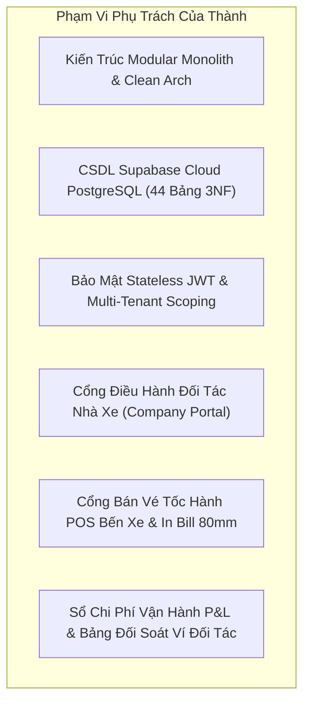

# 📘 CẨM NANG BẢO VỆ ĐỒ ÁN OJT CAPSTONE — DÀNH RIÊNG CHO PHẠM CÔNG THÀNH
## PHÂN HỆ: KIẾN TRÚC HỆ THỐNG, CSDL 44 BẢNG & ĐỐI TÁC NHÀ XE (COMPANY PORTAL)
**Đồ án**: Nền Tảng Đặt Vé Xe Khách & Điều Hành Vận Tải Bến Xe Liên Tỉnh TravelEasy  
**Họ tên**: Phạm Công Thành (Team Leader & System Architect)  
**Thời gian bảo vệ**: 20/11/2026 | **Thời lượng**: 15 phút Demo + 10 phút Phản biện  

---

## 🎯 PHẦN I: MA TRẬN PHÂN VAI & TRỌNG TÂM TRÌNH BÀY CỦA THÀNH

Trong buổi bảo vệ, Thành nắm giữ **2 vai trò then chốt**:
1. **System Architect & Leader (00:00 - 02:30 & 13:30 - 15:00)**: 
   * Mở đầu buổi bảo vệ, giới thiệu bức tranh toàn cảnh, trình diễn kiến trúc công nghệ và chứng minh sức khỏe hệ thống trên **Demo Hub (`/demo`)**.
   * Chốt hạ buổi bảo vệ, trình chiếu số liệu nghiệm thu 4 Sprint và mời Hội đồng phản biện.
2. **Chủ trì Phân hệ Đối Tác Nhà Xe (Company Portal)**:
   * Thể hiện sâu sắc góc nhìn **Business Domain (Điều hành vận tải bến xe)**: Quản lý chuyến xe, sơ đồ ghế 2 tầng, sổ chi phí lãi/lỗ P&L, tổ lái & an toàn GTVT, quầy POS bán vé bến xe và bảng đối soát tài chính ví đối tác.



---

## 🎙️ PHẦN II: KỊCH BẢN LỜI THOẠI MỞ ĐẦU & DEMO KIẾN TRÚC (00:00 - 02:30)

### 🗣️ Lời thoại trình bày từng chữ (Học thuộc lòng hoặc nói theo ý):
> *"Kính chào quý Thầy Cô trong Hội đồng chấm thi tốt nghiệp OJT. Em là **Phạm Công Thành**, Trưởng nhóm và Kiến trúc sư hệ thống của Nhóm 7.*  
> 
> *Đề tài của nhóm em là **TravelEasy Platform** — Nền tảng thương mại điện tử đặt vé xe khách và quản trị điều hành vận tải bến xe liên tỉnh toàn diện.*  
> 
> *Về mặt kỹ thuật, hệ thống được thiết kế theo mô hình **Modular Monolith kết hợp Clean Architecture**, áp dụng Backend Spring Boot 3.3 trên nền Java 21 LTS, Frontend React 18 TypeScript đóng gói bằng Vite 5, và CSDL đám mây **Supabase Cloud PostgreSQL chuẩn hóa 3NF gồm 44 bảng** (36 bảng cốt lõi và 8 bảng mở rộng hệ sinh thái).*  
> 
> *Để đảm bảo tính độc lập bí mật kinh doanh giữa các nhà xe cạnh tranh như Phương Trang hay Thành Bưởi, kiến trúc hệ thống áp dụng cơ chế **Forced Tenant Scoping** gắn chặt `busCompanyId` vào Token JWT, đảm bảo nhà xe này tuyệt đối không thể can thiệp dữ liệu của nhà xe khác.*  
> 
> *Sau đây, em xin phép mở màn buổi báo cáo bằng việc kiểm tra tình trạng sức khỏe kết nối trực tiếp của hệ thống trên trang **Demo Hub**."*

### 🖥️ Thao tác demo trên màn hình chiếu:
1. Mở trình duyệt tại: `http://localhost:5173/demo`.
2. Bấm nút màu xanh: **`Kiểm Tra Sức Khỏe API`**.
3. Chỉ tay vào màn hình khi Toast xanh hiện lên:
   > *"Như Thầy Cô có thể quan sát, toàn bộ kết nối Database HikariCP Connection Pool đang ở trạng thái `CONNECTED`, độ trễ API dưới 50ms và mức tiêu thụ RAM JVM ở ngưỡng an toàn 320MB. Tiếp theo, em xin nhường lời cho bạn Đức và bạn Phong trình diễn luồng Khách hàng và giải thuật khóa ghế Concurrency."*

---

## 🏢 PHẦN III: CHUYÊN SÂU PHÂN HỆ ĐỐI TÁC NHÀ XE (COMPANY PORTAL)

Khi Hội đồng hoặc kịch bản quay về phân hệ Nhà xe, Thành làm chủ các nghiệp vụ sau:

### 1. Quản lý Chuyến xe & Sơ đồ ghế 2 tầng (`/company/trips`)
* **Logic:** Khi tạo một chuyến xe mới (`POST /api/v1/company/trips`), hệ thống tự động:
  * Kiểm tra xung đột xe (`vehicle_id`) và tài xế (`driver_id`) trong cùng khung giờ.
  * Tự động sinh đầy đủ **34 bản ghi ghế ngồi thực tế** trong bảng `trip_seats` (Tầng 1 A01-A17, Tầng 2 B01-B17) ở trạng thái `AVAILABLE`.
  * Khởi tạo giá vé cơ sở theo mẫu xe.
* **Bảo toàn dữ liệu (Snapshot Immutability):** Giá vé chuyến xe khi đã có khách đặt vé sẽ được đóng băng snapshot tại bảng `tickets.seat_price`. Dù nhà xe sau đó có tăng giảm giá chuyến thì giá vé của khách đã mua không bao giờ bị thay đổi sai lệch.

### 2. Nghiệp vụ Quầy Bến Xe — POS Terminal Tốc Hành (`/company/pos`)
* **Bối cảnh thực tế:** Tại bến xe Miền Đông hay Giáp Bát, 35% lượng khách là người lớn tuổi hoặc vãng lai mua vé tại quầy. Giao diện Web thông thường quá chậm.
* **Giải pháp kỹ thuật của nhóm:** Thiết kế phân hệ POS chuyên dụng tối ưu phím tắt:
  * Nhấn **F2**: Tìm và chọn chuyến xe xuất bến gần nhất.
  * Click chọn ghế trống trên sơ đồ.
  * Nhấn **F9**: Thu tiền mặt và xuất vé tức thì **trong chưa đầy 8 giây (3 thao tác)**.
  * Bấm in hóa đơn: Tự động mở popup in **Hóa đơn nhiệt bến xe chuẩn 80mm** có logo nhà xe, thông tin chuyến và **Mã QR vé bảo mật** để tài xế quét lúc lên xe.

### 3. Sổ Theo Dõi Chi Phí & Tính Toán Lãi/Lỗ Chuyến Xe P&L (`/company/expenses`)
* **Công thức nghiệp vụ:**
  $$\text{Lợi Nhuận Ròng (Net Profit)} = \text{Tổng Doanh Thu Bán Vé} - (\text{Chi Phí Xăng Dầu} + \text{Phí Cầu Đường BOT} + \text{Lương Tổ Lái} + \text{Phí Bến Bãi})$$
* Giúp nhà xe biết chính xác chuyến xe nào sinh lời, chuyến xe nào chạy rỗng (dưới điểm hòa vốn) để điều chỉnh kế hoạch điều xe.

### 4. Quản lý Đội Xe, Tổ Lái & An Toàn GTVT (`/company/crew`)
* **Tuân thủ pháp luật:** Tích hợp quy chuẩn của **Nghị định 10/2020/NĐ-CP** và **Thông tư 12/2020/TT-BGTVT**:
  * Kiểm tra nồng độ cồn trước khi xuất bến: Bắt buộc đạt `0.00 mg/L`.
  * Kiểm soát thời gian lái xe liên tục: Không vượt quá 4 tiếng/tài xế.
  * Khi đủ điều kiện an toàn, hệ thống mới cho phép ký **Lệnh Vận Chuyển Điện Tử** kèm mã QR phục vụ công tác thanh tra của CSGT/TTGT trên đường.

### 5. Chính Sách Hoàn Hủy Vé & Đối Soát Ví Đối Tác (`/company/settlements`)
* **Cơ chế Escrow & Net Payout:**
  * Khách thanh toán qua cổng trực tuyến ➔ Tiền tạm giữ tại tài khoản Escrow sàn.
  * Kỳ đối soát: Sàn tự động trích **8% phí hoa hồng sàn (Platform Fee)**, kết chuyển **92% doanh thu ròng** vào số dư ví đối tác (`partner_wallet`).
  * Khi khách hủy vé: Hệ thống tự động tính tỷ lệ phạt dựa trên thời gian trước khởi hành (quy định tại `cancellation_policies`), tự động ghi nhận biến động ví đối tác (`partner_wallet_transactions`) đảm bảo tính **Idempotent** (chống trừ ví 2 lần).

---

## 🗄️ PHẦN IV: CHUYÊN SÂU KIẾN TRÚC HỆ THỐNG & CSDL 44 BẢNG

### 1. Cấu Trúc Phân Tầng Clean Architecture (Backend Spring Boot)
```
com.traveleasy/
├── config/             # Cấu hình Security, HikariCP, CORS, Mail SMTP, Swagger
├── controller/         # Tầng Presentation (REST API endpoints phân quyền)
│   ├── admin/          # Controller phân hệ Admin Sàn Tổng
│   ├── company/        # Controller phân hệ Đối Tác Nhà Xe (Thành phụ trách)
│   └── customer/       # Controller phân hệ Khách Hàng (Đức, Phong, Cường)
├── dto/                # Data Transfer Objects (Request/Response validate chặt chẽ)
├── entity/             # 44 Domain JPA Entities (Ánh xạ bảng PostgreSQL)
├── repository/         # Spring Data JPA Repositories (EntityGraph, JPQL, Lock)
└── service/            # Tầng Business Logic nghiệp vụ cốt lõi
```

### 2. CSDL 44 Bảng Chuẩn Hóa 3NF (Supabase Cloud PostgreSQL)
* **36 Bảng Cốt Lõi:**
  * Định danh & Phân quyền: `users`, `roles`, `user_roles`, `refresh_tokens`.
  * Hạ tầng nhà xe: `bus_companies`, `vehicles`, `seat_templates`, `routes`, `locations`, `route_templates`, `pickup_dropoff_points`.
  * Vận hành chuyến xe: `trips`, `trip_seats`, `seat_locks`.
  * Bán vé & Thanh toán: `bookings`, `tickets`, `payments`, `vouchers`, `promotions`.
  * Đánh giá & Giám sát: `reviews`, `audit_logs`, `system_settings`.
* **8 Bảng Mở Rộng Hệ Sinh Thái (Sprint 3 & 4):**
  1. `cancellation_policies`: Chính sách biểu phí hoàn hủy theo giờ.
  2. `cancellation_refunds`: Quản lý yêu cầu hoàn tiền và số tài khoản nhận tiền.
  3. `partner_wallet_transactions`: Sổ cái ghi nhận lịch sử biến động số dư ví nhà xe.
  4. `company_settlements`: Kỳ đối soát và thanh toán hoa hồng 8% - 92%.
  5. `trip_crews`: Phân công tài xế, phụ xe và kiểm tra nồng độ cồn.
  6. `trip_expenses`: Nhật ký chi phí xăng dầu, BOT của chuyến xe.
  7. `shuttle_bookings`: Quản lý đón trả khách trung chuyển tận nơi.
  8. `pos_shifts`: Quản lý ca trực thu ngân và tiền mặt đầu/cuối ca.

---

## ❓ PHẦN V: BỘ CÂU HỎI PHẢN BIỆN "BẪY" & CÁCH TRẢ LỜI ĐẠT ĐIỂM 10/10

### ❓ Câu 1: Tại sao đồ án lớn như TravelEasy lại chọn kiến trúc Modular Monolith thay vì Microservices?
> **Thành trả lời:**  
> *"Dạ thưa Thầy/Cô, nhóm em đã phân tích rất kỹ bài toán trước khi chọn kiến trúc:  
> 1. **Tính toàn vẹn giao dịch (ACID):** Nghiệp vụ đặt vé xe đòi hỏi giao dịch đồng thời cao (khóa ghế, trừ số dư, sinh vé). Trong Microservices, bài toán Distributed Transaction (2PC/Saga) rất phức tạp và dễ gây ra trạng thái không nhất quán (chỗ bị giữ nhưng đơn vé thất bại). Với Modular Monolith, Spring Boot quản lý `@Transactional` cấp độ CSDL cực kỳ chuẩn xác và an toàn.  
> 2. **Hiệu năng & Chi phí hạ tầng:** Giữa các module giao tiếp trực tiếp qua In-Memory Method Calls thay vì gọi qua mạng HTTP/gRPC, giúp độ trễ giảm về 0ms và không tốn chi phí duy trì cụm Kubernetes tốn kém cho môi trường sinh viên/OJT.  
> 3. **Tính sẵn sàng mở rộng:** Codebase được chia package độc lập theo đúng quy chuẩn Bounded Context của Domain-Driven Design (DDD). Trong tương lai nếu phân hệ Tìm kiếm chuyến hoặc Cổng Thanh toán cần scale độc lập, nhóm có thể tách module đó thành Microservice riêng biệt chỉ trong vòng 2 ngày mà không phải đập đi xây lại."*

### ❓ Câu 2: Làm sao đảm bảo các nhà xe cạnh tranh (Phương Trang, Thành Bưởi) không xem trộm chuyến xe hoặc doanh thu của nhau?
> **Thành trả lời:**  
> *"Dạ thưa Thầy/Cô, nhóm em áp dụng cơ chế **Forced Tenant Scoping (Multi-tenancy cấp ứng dụng)**:  
> * Khi nhân viên nhà xe đăng nhập, hệ thống sinh JWT Token đính kèm claim `busCompanyId`.  
> * Tại tầng Backend, tất cả các câu truy vấn trong `CompanyManagementController` và `TripRepository` đều bắt buộc phải kèm điều kiện:  
>   `WHERE trip.busCompany.id = :currentCompanyId`  
> * Đồng thời, ở tầng Entity có kiểm tra quyền sở hữu (Ownership Rules O1 - O5). Nếu một nhà xe cố tình gửi request sửa chuyến xe có `id` thuộc nhà xe khác, hệ thống sẽ chặn đứng tại tầng Service và ném ngoại lệ `AccessDeniedException (403 Forbidden)` ngay lập tức."*

### ❓ Câu 3: Khi có hàng chục nghìn lượt đặt vé, hệ thống làm thế nào để không bị nghẽn kết nối Database?
> **Thành trả lời:**  
> *"Dạ thưa Thầy/Cô, nhóm đã triển khai 3 lớp tối ưu:  
> 1. **HikariCP Connection Pool:** Cấu hình chuẩn `maximum-pool-size: 12`, cơ chế `leak-detection-threshold: 60000ms` phát hiện rò rỉ kết nối, và kết nối qua cổng giao dịch **Transaction Pooler (6543)** của Supabase PgBouncer.  
> 2. **Đánh Index có trọng điểm:** Các bảng lớn như `trips`, `trip_seats`, `tickets` đều được đánh B-Tree Index trên các cột tìm kiếm và lọc (`departure_time`, `route_id`, `status`, `booking_id`).  
> 3. **Giải quyết triệt để N+1 Query:** Sử dụng `@EntityGraph` và fetch join trong Spring Data JPA để tải đồng thời thông tin Chuyến xe, Xe và Tuyến đường trong đúng **1 câu truy vấn SQL duy nhất**, thay vì vòng lặp N câu lệnh làm quá tải CSDL."*

### ❓ Câu 4: Nếu nhà xe đổi giá vé vào phút chót, những khách đã mua vé trước đó có bị sai tiền hoặc ảnh hưởng đối soát không?
> **Thành trả lời:**  
> *"Dạ thưa Thầy/Cô, hệ thống tuân thủ nghiêm ngặt nguyên tắc **Snapshot Immutability (Bất biến dữ liệu lịch sử)**:  
> * Bảng `trips` hoặc `trip_seat_prices` chỉ lưu giá niêm yết hiện tại.  
> * Nhưng khi khách hàng đặt vé thành công, giá tiền thực tế tại thời điểm thanh toán được lưu cứng vào cột `tickets.seat_price`.  
> * Mọi thuật toán hoàn tiền, đối soát hoa hồng 8% sàn hay in vé nhiệt đều chỉ đọc từ `tickets.seat_price`, hoàn toàn không phụ thuộc vào giá vé hiện hành của chuyến xe, đảm bảo 100% tính chính xác của sổ cái kế toán."*

---

## 🎒 PHẦN VI: CHECKLIST CHUẨN BỊ MÁY TÍNH CỦA THÀNH TRƯỚC GIỜ BẢO VỆ

- [ ] **Khởi động sẵn Backend & Frontend**: Chạy `npm run dev` ở cổng `5173`, backend ở cổng `8080`.
- [ ] **Mở sẵn 3 Tab Trình duyệt độc lập**:
  * Tab 1: `http://localhost:5173/demo` (Demo Hub & Kiểm tra sức khỏe).
  * Tab 2: `http://localhost:5173/company/login` (Đăng nhập sẵn tài khoản `operator1@futa.vn` / pass: `123456789@`).
  * Tab 3: `http://localhost:5173/company/pos` (Màn hình POS bán vé quầy bến xe).
- [ ] **Mở sẵn PgAdmin hoặc Console Supabase**: Để sẵn tab truy vấn `SELECT * FROM trips;` nếu Thầy Cô yêu cầu xem trực tiếp bảng dữ liệu thực tế.
- [ ] **Tắt thông báo máy tính**: Tắt Zalo, Facebook, Teams, Telegram để không bị gián đoạn màn hình chiếu.
- [ ] **Giữ tâm thế tự tin**: Thành là Leader và nắm toàn bộ bức tranh kiến trúc, trả lời bình tĩnh, khúc chiết, lễ phép và quyết đoán! 🏆🚀
