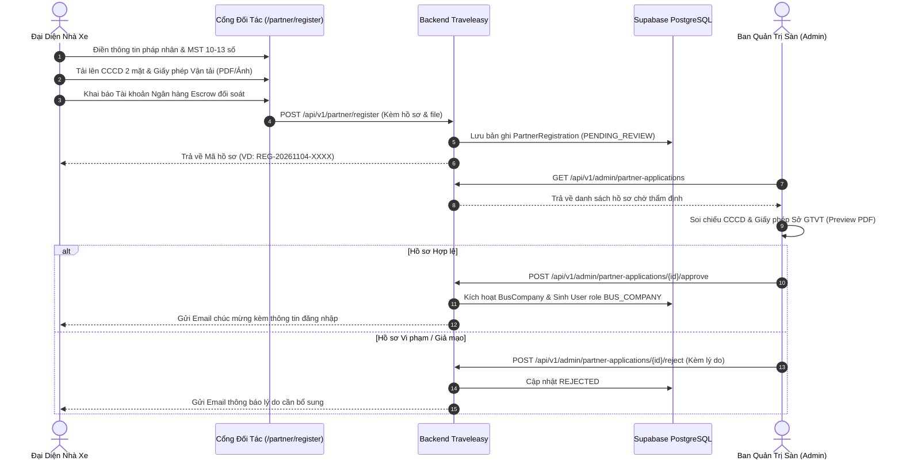

# 📌 ĐẶC TẢ YÊU CẦU & HƯỚNG DẪN THỰC THI TASK PHÁT SINH SPRINT 3
## DỰ ÁN: TRAVELEASY PLATFORM — NỀN TẢNG ĐẶT VÉ XE KHÁCH LIÊN TỈNH
### BỐI CẢNH: TIẾP THU Ý KIẾN THẨM ĐỊNH TỪ HỘI ĐỒNG GIẢNG VIÊN (SPRINT 3 REVIEW)
> **Mã đợt gia cố:** `SPRINT-3-FEEDBACK-FIX`  
> **Thời gian thực hiện:** Trong Sprint 3 (Kiểm thử tích hợp & Tối ưu hóa hệ thống)  
> **Trạng thái trên Trello:** Đã tạo thẻ ưu tiên cao nhất (`Ưu tiên: 1`) tại cột **`To Do`**  
> **Bảng Trello đồng bộ:** [https://trello.com/b/AA5BYoe1](https://trello.com/b/AA5BYoe1)

---

## 🎯 TỔNG QUAN PHẢN HỒI CỦA GIẢNG VIÊN & PHÂN CÔNG NHIỆM VỤ

Sau buổi kiểm tra tiến độ đồ án của giảng viên, hệ thống phát sinh 2 lỗ hổng nghiệp vụ & bảo mật then chốt cần được dứt điểm ngay trong Sprint 3:

| Mã Task | Tên Nhiệm Vụ | Người Thực Hiện | Vai Trò | Độ Ưu Tiên | Story Points |
| :--- | :--- | :--- | :--- | :---: | :---: |
| **`[S321]`** | **Tích hợp Đăng nhập Google OAuth2 & Xác thực OTP (Email/SMS)** | **Nguyễn Đại Phát** | Admin Lead & Full-Stack | `Ưu tiên: 1` (Cao nhất) | **5 SP** |
| **`[S322]`** | **Tái cấu trúc & Hoàn thiện Đăng ký Đối tác Nhà xe (KYB, CCCD, GPKD & Escrow)** | **Phạm Công Thành** | Team Leader & System Architect | `Ưu tiên: 1` (Cao nhất) | **5 SP** |

---

## 📝 PHẦN 1: HƯỚNG DẪN CHI TIẾT TASK CỦA NGUYỄN ĐẠI PHÁT (`[S321]`)

### 1.1 Vấn đề giảng viên chỉ ra:
* Khách hàng hiện tại chỉ có đăng nhập bằng Email/Password thông thường, chưa có đăng nhập nhanh **1-Click bằng Google Account** — đây là tiêu chuẩn bắt buộc của các sàn TMĐT & Vận tải hiện đại (Vexere, Grab).
* Khi đăng ký tài khoản hoặc thực hiện các thao tác nhạy cảm (đổi mật khẩu, hủy vé hoàn tiền), hệ thống chưa có bước **Xác thực mã OTP** để chống tài khoản rác (spam bot) và bảo vệ danh tính khách hàng.

### 1.2 Kiến trúc giải pháp (Google OAuth2 + OTP):
```
[Client React] --(1) Google Sign-In--> [Google OAuth2 Server]
      │                                       │
      │<----------(2) idToken-----------------┘
      │
      ├──(3) POST /api/v1/auth/google (kèm idToken)──> [Backend Spring Boot]
      │                                                        │ (4) Verify Token
      │                                                        ▼
      │<---------(5) JWT Stateless Bearer Token <────── [Google API Client]
```

### 1.3 Kế hoạch thực hiện từng bước (Checklist cho Phát):

#### A. Frontend (React 18 + Vite):
1. **Cài đặt thư viện Google Identity**:
   ```bash
   cd frontend
   npm install @react-oauth/google
   ```
2. **Cấu hình `GoogleOAuthProvider`** bọc quanh `App.tsx`:
   - Dùng `clientId` từ Google Cloud Console (hoặc cấu hình biến `VITE_GOOGLE_CLIENT_ID`).
3. **Thêm nút Đăng nhập Google tại `/login` và `/register`**:
   - Sử dụng component `<GoogleLogin onSuccess={handleGoogleSuccess} onError={handleGoogleError} />`.
   - Khi đăng nhập thành công, trích xuất `credential` (chính là JWT `idToken`), gọi `api.post('/auth/google', { idToken })`.
   - Lưu `traveleasy_token` và `traveleasy_user` vào `localStorage`, đồng bộ `AuthContext` và redirect người dùng về trang trước đó.
4. **Giao diện Modal nhập mã OTP**:
   - Gồm 6 ô input số riêng biệt tự động nhảy focus khi nhập.
   - Hiển thị bộ đếm ngược 60 giây và nút *"Gửi lại mã OTP"*.

#### B. Backend (Spring Boot 3):
1. **Bổ sung Dependency vào `backend/build.gradle`**:
   ```groovy
   implementation 'com.google.api-client:google-api-client:2.7.0'
   implementation 'org.springframework.boot:spring-boot-starter-mail'
   ```
2. **Endpoint xử lý Google Login (`AuthController.java`)**:
   ```java
   @PostMapping("/google")
   public ApiResponse<AuthResponse> loginWithGoogle(@Valid @RequestBody GoogleLoginRequest request) {
       return ApiResponse.success("Đăng nhập Google thành công", authService.authenticateGoogle(request.getIdToken()));
   }
   ```
3. **Service xác thực (`AuthService.java`)**:
   - Sử dụng `GoogleIdTokenVerifier` để verify chữ ký số của Google.
   - Nếu email chưa có trong DB: Tự động khởi tạo `User` mới với `Role.CUSTOMER`, `isEmailVerified = true`, `avatarUrl = payload.get("picture")`.
   - Nếu email đã có: Cập nhật thông tin profile và sinh JWT Bearer Token.
4. **Dịch vụ OTP (`OtpService.java`)**:
   - Sinh chuỗi ngẫu nhiên 6 chữ số: `String.format("%06d", new Random().nextInt(999999))`.
   - Lưu trữ dạng `Map<String, OtpEntry>` (hoặc Redis/Cache) với thời hạn hết hạn 5 phút.
   - Gửi mã OTP vào Email hành khách qua `JavaMailSender` (template HTML thân thiện TravelEasy).

---

## 🏛️ PHẦN 2: HƯỚNG DẪN CHI TIẾT TASK CỦA PHẠM CÔNG THÀNH (`[S322]`)

### 2.1 Vấn đề giảng viên chỉ ra:
* Trang đăng ký hợp tác nhà xe (`/partner/register`) chưa có quy trình kiểm soát hồ sơ doanh nghiệp chặt chẽ (**KYB - Know Your Business**).
* Thiếu cơ chế upload và xác thực tài liệu pháp lý: Giấy phép kinh doanh vận tải của Sở Giao Thông Vận Tải, CCCD 2 mặt của người đại diện theo pháp luật.
* Cổng Admin chưa có màn hình trực quan để chuyên viên ban quản trị xem trước tài liệu PDF/CCCD, đối soát mã số thuế (MST) và phê duyệt tự động kích hoạt tài khoản nhà xe.

### 2.2 Luồng thẩm định hồ sơ KYB chuẩn Nhà Nước:


### 2.3 Kế hoạch thực hiện từng bước (Checklist cho Thành):

#### A. Frontend Đăng Ký Nhà Xe (`/partner/register`):
1. **Tổ chức form 3 bước chuẩn hóa**:
   - **Bước 1 - Thông tin pháp nhân**:
     + Tên nhà xe / Doanh nghiệp vận tải.
     + Người đại diện theo pháp luật & Chức vụ.
     + Mã số thuế (MST): Bắt buộc kiểm tra Regex `^[0-9]{10}(-[0-9]{3})?$`.
     + Số điện thoại liên hệ & Email công ty.
     + Địa chỉ trụ sở đăng ký kinh doanh.
     + Tuyến đường vận tải đang khai thác & Quy mô đội xe.
   - **Bước 2 - Bộ hồ sơ pháp lý số hóa (Bắt buộc)**:
     + Ảnh CCCD mặt trước (Rõ 4 góc, đủ số định danh).
     + Ảnh CCCD mặt sau (Có chip điện tử và vân tay).
     + File scan Giấy phép kinh doanh / Giấy phép vận tải tuyến cố định của Sở GTVT (Hỗ trợ file `.PDF` và ảnh `.PNG/.JPG` tối đa 10MB).
     + Tích hợp Dropzone kéo thả file trực quan, xem trước ảnh thumbnail hoặc icon PDF.
   - **Bước 3 - Tài khoản ngân hàng Escrow đối soát**:
     + Ngân hàng thụ hưởng (MB Bank, VCB, Techcombank, BIDV...).
     + Số tài khoản ngân hàng.
     + Tên chủ tài khoản (Tự động in hoa không dấu: `PHAM CONG THANH`).
2. **Thông báo nghiệm thu**: Sau khi gửi thành công, hiển thị trang chúc mừng kèm mã hồ sơ và thông báo cam kết phản hồi trong 24 giờ.

#### B. Backend & Cơ Sở Dữ Liệu (`PartnerRegistrationService`):
1. **Migration CSDL bổ sung bảng `partner_registrations`**:
   - Lưu trữ: `id`, `registration_code`, `company_name`, `representative_name`, `tax_code`, `phone`, `email`, `headquarters_address`, `fleet_size`, `routes_summary`, `id_card_front_url`, `id_card_back_url`, `license_document_url`, `bank_name`, `bank_account_number`, `bank_account_name`, `status` (`PENDING_REVIEW`, `APPROVED`, `REJECTED`), `rejection_reason`, `created_at`.
2. **Xử lý lưu trữ File (Cloudinary / Multipart)**:
   - Lưu file scan PDF và ảnh CCCD lên cloud storage an toàn.
3. **Endpoint nộp đơn**: `POST /api/v1/partner/register`.
4. **Endpoint tra cứu trạng thái**: `GET /api/v1/partner/application-status/{code}`.

#### C. Cổng Admin Thẩm Định (`/admin/bus-companies/applications`):
1. **Giao diện bảng danh sách hồ sơ**: Lọc theo trạng thái `PENDING_REVIEW`, `APPROVED`, `REJECTED`.
2. **Modal Thẩm Định KYB Toàn Diện**:
   - Hiển thị đầy đủ thông tin pháp nhân và số CCCD.
   - Trình nhúng xem file PDF Giấy phép vận tải ngay trên trình duyệt (thẻ `<iframe>` hoặc `object`).
   - Xem ảnh phóng to CCCD 2 mặt để đối chiếu tên và ngày sinh người đại diện.
3. **Thao tác Phê Duyệt / Từ Chối**:
   - Khi bấm **Phê duyệt**: Tự động sinh `BusCompany`, tạo tài khoản `User` với quyền `BUS_COMPANY`, sinh mật khẩu ngẫu nhiên và gửi email bàn giao quyền truy cập cổng `/company/login`.
   - Khi bấm **Từ chối**: Bắt buộc nhập lý do (ví dụ: *Ảnh CCCD bị mờ góc, Giấy phép vận tải hết hạn kiểm định*), hệ thống cập nhật trạng thái và bắn email thông báo.

---

## 🏆 TIÊU CHÍ NGHIỆM THU ĐẠT ĐIỂM TỐI ĐA (ACCEPTANCE CRITERIA)

| Hạng mục | Tiêu chuẩn Đạt yêu cầu (Pass) | Tiêu chuẩn Đạt điểm Tuyệt đối (Excellence) |
| :--- | :--- | :--- |
| **Google Sign-In (Phát)** | Bấm đăng nhập Google mở popup chọn tài khoản và đăng nhập được vào web. | Tự động đồng bộ avatar Google, lưu session mượt mà, phân quyền chính xác. |
| **Xác thực OTP (Phát)** | Nhập đúng OTP thì thành công, nhập sai báo lỗi. | Có bộ đếm ngược 60s, tự động chuyển ô input khi gõ phím, email HTML đẹp mắt. |
| **Form KYB Nhà Xe (Thành)** | Điền thông tin và upload được file ảnh/PDF lên hệ thống. | Validate chặt chẽ MST, CCCD 12 số, hỗ trợ kéo thả file, tự động viết hoa tên chủ thẻ. |
| **Thẩm Định Admin (Thành)** | Admin xem được danh sách và bấm duyệt/từ chối được hồ sơ. | Preview trực tiếp file PDF và ảnh CCCD trên modal, phê duyệt tự động tạo tài khoản nhà xe và gửi email. |

---
*Tài liệu được lập và lưu trữ chính thức tại `docs/04-agile-and-sprints/DAC_TA_TASK_PHAT_SINH_SPRINT_3.md`.*

