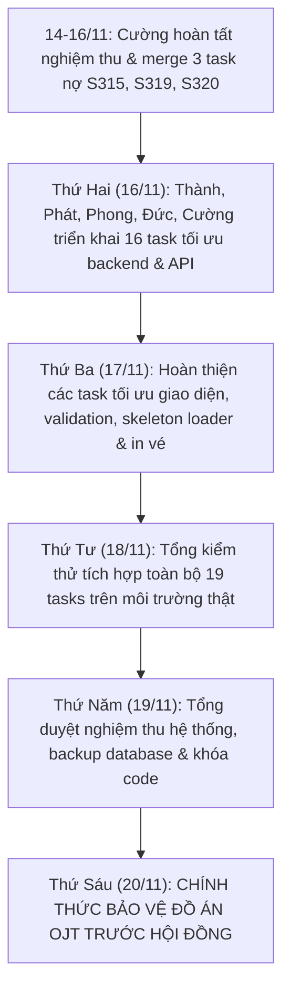

# 🎓 SPRINT 4 README — SPRINT CUỐI CÙNG: TỐI ƯU HÓA HỆ THỐNG, SỬA LỖI & HOÀN THIỆN TÍNH NĂNG
> **Dự án:** Nền Tảng Đặt Vé Xe Khách & Điều Hành Vận Tải Liên Tỉnh TravelEasy (`traveleasy-platform`)  
> **Đơn vị:** OJT Đồ Án Tốt Nghiệp Nhóm 7 — FPT Polytechnic  
> **Thời gian thực hiện:** **14/11/2026 – 20/11/2026** *(Đúng 1 tuần — Kết thúc vào Thứ Sáu 20/11)*  
> **Trạng thái:** 🚀 **CHÍNH THỨC KHỞI ĐỘNG (STABILIZATION & SYSTEM POLISH SPRINT)**  
> **Quy mô Sprint 4:** **19 Tasks kỹ thuật | 35 Story Points (gồm 16 Tasks Tối ưu hóa mới [27 SP] + 3 Tasks Trả nợ Sprint 3 [8 SP] đã nghiệm thu xong ngày 16/11)**

---

## 🎯 1. NGUYÊN TẮC THIẾT KẾ SPRINT 4

1. **CHỈ 5 THÀNH VIÊN THỰC HIỆN OJT**: Phạm Công Thành, Nguyễn Đại Phát, Phạm Thanh Phong, Trần Minh Đức, Đoàn Nhật Cường. (Phan Trung Kiên không tham gia OJT này).
2. **KHÔNG CÓ TASK SOẠN KỊCH BẢN**: 100% là task kỹ thuật thực chiến: Tối ưu hóa hiệu năng, sửa lỗi (bug fixes), tối ưu UI/UX, validation và hoàn thiện tính năng.
3. **STORY POINTS NHỎ (1 - 2 SP/TASK)**: Chia nhỏ thành 19 tasks để làm nhanh, dứt điểm, nhẹ nhàng trước ngày bảo vệ.

---

## 👥 2. MA TRẬN PHÂN BỔ STORY POINTS SPRINT 4 (5 THÀNH VIÊN OJT)

| STT | Thành viên | Username | Trách nhiệm kỹ thuật Sprint 4 | Danh sách Task phụ trách | Tổng SP |
| :---: | :--- | :--- | :--- | :--- | :---: |
| 1 | **Phạm Công Thành** | `@thanhphmcong1` | DevOps & Hạ tầng / Bảo mật API / Nén bundle / Global Exception | `[S401]`, `[S402]`, `[S403]`, `[S404]` | **6 SP** |
| 2 | **Nguyễn Đại Phát** | `@phatnguyn146` | Admin Portal / Bộ lọc tìm kiếm / Form Voucher / Responsive Dashboard | `[S405]`, `[S406]`, `[S407]`, `[S408]` | **6 SP** |
| 3 | **Phạm Thanh Phong** | `@phmthanhphong17` | Backend Core / Redis Cache / Concurrency Lock / POS / SQL N+1 | `[S409]`, `[S410]`, `[S411]`, `[S412]` | **6 SP** |
| 4 | **Trần Minh Đức** | `@minhdctrn13` | Fullstack / Đổi vé / Header Login State / In vé QR / Bảng Reviews | `[S413]`, `[S414]`, `[S415]`, `[S416]` | **6 SP** |
| 5 | **Đoàn Nhật Cường** | `@joshliam` | Mobile & Safety / Trả nợ Sprint 3 / Validate SĐT / Skeleton / GPS | `[S315]`, `[S319]`, `[S320]` *(Đã Done S3 ngày 16/11)*, `[S417]`, `[S418]`, `[S419]` | **11 SP** *(8 SP nợ + 3 SP S4)* |
| **TỔNG** | **5 THÀNH VIÊN OJT** | - | **Tập trung tối ưu hóa & sửa lỗi dứt điểm** | **19 Tasks** | **35 SP** |

---

## 📋 3. DANH MỤC CHI TIẾT 19 TASKS KỸ THUẬT SPRINT 4

### 1️⃣ Phạm Công Thành (DevOps & Backend System — 6 SP)
- **`[S401]` Tối ưu hóa bundle Vite & Cấu hình nén Gzip/Brotli Frontend (1 SP)**:
  - Loại bỏ package thừa, chia chunk nhỏ (`vendor-chunk`), tối ưu thời gian tải trang First Contentful Paint (FCP) dưới 1.2s.
- **`[S402]` Tối ưu cơ chế kiểm tra kết nối HikariCP Pool & Bổ sung Graceful Shutdown (2 SP)**:
  - Cấu hình timeout pool (`connectionTimeout: 20000ms`, `maxLifetime: 1800000ms`), xử lý giải phóng connection sạch khi đóng ứng dụng.
- **`[S403]` Tối ưu bảo mật CORS, Content-Security-Policy (CSP) headers & Rate Limiting IP (2 SP)**:
  - Giới hạn origin CORS an toàn, thêm Security Headers chống XSS/Clickjacking và cấu hình bộ lọc chống spam brute-force login.
- **`[S404]` Tối ưu cơ chế Global Exception Handler & Standardized Response Body (1 SP)**:
  - Bắt trọn vẹn các lỗi validation và database integrity, trả về cấu trúc `{ success: false, message, code, timestamp }` đồng nhất cho Frontend.

---

### 2️⃣ Nguyễn Đại Phát (Admin Portal & Promotions — 6 SP)
- **`[S405]` Tối ưu bộ lọc tìm kiếm & Phân trang Server-side tại Admin Trips & Bookings (2 SP)**:
  - Hỗ trợ lọc theo mã đặt vé, số điện thoại khách hàng, khoảng ngày xuất bến mượt mà không bị reload lại trang.
- **`[S406]` Sửa lỗi hiển thị & Hoàn thiện bảng biến động số dư hoàn tiền tại `CancellationRefundPage` (1 SP)**:
  - Hiển thị chính xác tỷ lệ hoàn tiền (90%, 70%, 0%) tương ứng thời gian khách hủy vé, cập nhật trạng thái hoàn tiền minh bạch.
- **`[S407]` Tối ưu UX/UI form nhập Voucher khuyến mại & Bổ sung Validation mã giảm giá (2 SP)**:
  - Tự động convert mã voucher thành chữ in hoa (`uppercase`), kiểm tra điều kiện giá trị đơn tối thiểu (`min_order_value`) trước khi áp dụng.
- **`[S408]` Sửa lỗi hiển thị & Tối ưu Responsive Dashboard Thống kê Doanh thu Admin trên iPad/Tablet (1 SP)**:
  - Căn chỉnh biểu đồ Recharts không bị tràn viền (overflow) khi co giãn kích thước màn hình.

---

### 3️⃣ Phạm Thanh Phong (Core Backend & Concurrency — 6 SP)
- **`[S409]` Tối ưu thời gian phản hồi API tìm chuyến `/api/v1/trips/search` bằng Redis Cache (2 SP)**:
  - Cache kết quả tìm kiếm các tuyến trọng điểm với TTL 60 giây, tự động xóa cache khi có sự thay đổi lịch trình hoặc đặt vé.
- **`[S410]` Xử lý ngoại lệ tranh chấp ghế (Concurrency Race Condition) trả về HTTP 409 Conflict chuẩn (2 SP)**:
  - Bắt lỗi khi 2 khách cùng bấm 1 ghế trong cùng mili-giây, trả về thông điệp tiếng Việt thân thiện: *"Ghế này vừa được chọn bởi khách hàng khác"*.
- **`[S411]` Tối ưu form bán vé nhanh tại quầy `PosTerminalPage`: Tính tiền thừa trả khách & Phím tắt nhanh (1 SP)**:
  - Bổ sung ô nhập tiền khách đưa, tự động tính tiền thối trả lại, phím tắt `Enter` để hoàn tất thanh toán trong 5 giây.
- **`[S412]` Tối ưu câu truy vấn SQL tìm chuyến: Khử triệt để N+1 Queries bằng `@EntityGraph` (1 SP)**:
  - Nạp sẵn `busCompany` và `route` trong 1 câu SQL duy nhất khi query danh sách chuyến xe, giảm số query từ N+1 xuống 1.

---

### 4️⃣ Trần Minh Đức (Fullstack Booking & Tickets — 6 SP)
- **`[S413]` Tối ưu hóa luồng Đổi vé (`TicketExchangePage`): Validate chênh lệch giá & Cập nhật sơ đồ ghế (2 SP)**:
  - Tính toán chính xác số tiền phụ thu khi đổi từ xe thường lên Limousine VIP, trả lại ghế cũ về `AVAILABLE` ngay lập tức.
- **`[S414]` Sửa lỗi đồng bộ trạng thái đăng nhập trên Header & Tự động ẩn banner nhắc nhở khi quá giờ (1 SP)**:
  - Đồng bộ state giữa các tab qua `storage event`, ẩn thanh nhắc nhở khởi hành màu vàng nếu thời gian xuất bến đã trôi qua.
- **`[S415]` Tối ưu giao diện xem chi tiết vé & In vé PDF/SVG mã QR sắc nét trên di động tại `MyTicketsPage` (2 SP)**:
  - Hiển thị QR Code rõ nét chuẩn ISO/IEC 18004, nút tải vé về máy hoặc in ấn trực tiếp không bị vỡ layout trên điện thoại.
- **`[S416]` Tối ưu UI/UX bảng đánh giá nhà xe (`ReviewsPage`): Bộ lọc sao, loại bỏ fake review & Nhãn xác thực (1 SP)**:
  - Thêm bộ lọc đánh giá 1-5 sao, hiển thị nhãn xanh *"Khách đã đi chuyến này"*, loại bỏ dữ liệu thử nghiệm không phù hợp.

---

### 5️⃣ Đoàn Nhật Cường (Mobile & Driver Safety — 11 SP)
- **`[S417]` Sửa lỗi & Bổ sung Validation toàn diện số điện thoại chuẩn Việt Nam (10 số) và Email (1 SP)**:
  - Kiểm tra regex đầu số di động Việt Nam (`03, 05, 07, 08, 09` đủ 10 số), hiển thị thông báo lỗi màu đỏ ngay dưới ô nhập.
- **`[S418]` Tối ưu hiệu năng tải trang tĩnh & Thêm Skeleton Loading mượt mà khi fetch chuyến xe tại `TripSearchPage` (1 SP)**:
  - Thay thế vòng quay loading thông thường bằng hiệu ứng khung xương (Skeleton loader), loại bỏ hiện tượng giật giật (layout shift) khi kết quả API trả về.
- **`[S419]` Tối ưu bản đồ `LiveTrackingMapPage`: Bổ sung nút "Tự động căn chỉnh xe về tâm bản đồ" (Re-center) (1 SP)**:
  - Thêm nút floating button cho phép người dùng click để đưa vị trí xe đang chạy `51B-889.99` về chính giữa màn hình bản đồ Leaflet.
- **`[S315]` Code Review & Tối ưu hóa Index PostgreSQL các truy vấn tìm chuyến & ghế (2 SP — Nợ Sprint 3 - ĐÃ XONG & MERGE NGÀY 16/11)**:
  - Đánh composite index chuẩn ESR `(route_id, status, departure_time)` trên bảng `trips` và `(qr_code_hash)` trên bảng `tickets`.
- **`[S319]` Hoàn thiện Form phân công tổ lái & Kiểm định điều kiện xuất bến (3 SP — Nợ Sprint 3 - ĐÃ XONG & MERGE NGÀY 16/11)**:
  - Nối form điều hành với backend: Kiểm soát nồng độ cồn = `0.00 mg/L`, bằng lái Hạng D/E, chặn IDOR bảo mật và cấp mã lệnh `DP-xxxxx`.
- **`[S320]` WebApp Quét mã QR soát vé & Điểm danh hành khách bằng camera di động (3 SP — Nợ Sprint 3 - ĐÃ XONG & MERGE NGÀY 16/11)**:
  - Xử lý quét camera trên điện thoại, hỗ trợ fallback mã vé 6 ký tự, chặn vé chưa thanh toán và bảo vệ PII khách hàng.

---

## 📅 4. KẾ HOẠCH TRIỂN KHAI THEO NGÀY

