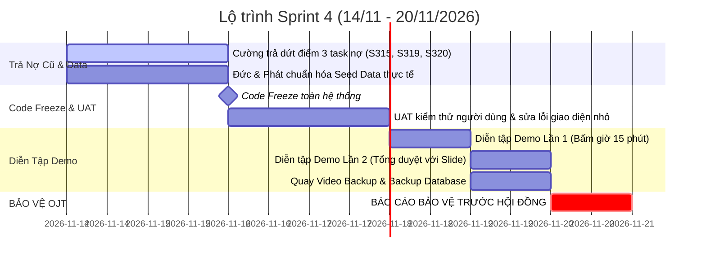

# 🎓 SPRINT 4 README — SPRINT CUỐI CÙNG: HOÀN THIỆN HỆ THỐNG, TẬP DƯỢT DEMO & BẢO VỆ OJT
> **Dự án:** Nền Tảng Đặt Vé Xe Khách & Điều Hành Vận Tải Liên Tỉnh TravelEasy (`traveleasy-platform`)  
> **Đơn vị:** OJT Đồ Án Tốt Nghiệp Nhóm 7 — FPT Polytechnic  
> **Thời gian thực hiện:** **14/11/2026 – 20/11/2026** *(Đúng 1 tuần — Kết thúc vào Thứ Sáu 20/11)*  
> **Trạng thái:** 🚀 **CHÍNH THỨC KHỞI ĐỘNG (FINAL RELEASE & DEFENSE SPRINT)**  
> **Quy mô Sprint 4:** **10 Tasks nhẹ nhàng | 29 Story Points | Toàn bộ 6 thành viên sẵn sàng bảo vệ**

---

## 🎯 1. ĐỊNH HƯỚNG CHIẾN LƯỢC SPRINT 4: "LÀM NHẸ NHÀNG — AN TOÀN TUYỆT ĐỐI — TỰ TIN BẢO VỆ"

Vì Sprint 4 là **Sprint cuối cùng** và sự kiện quan trọng nhất là **Buổi Báo Cáo Bảo Vệ Đồ Án OJT vào Thứ Sáu (20/11/2026)**, toàn đội thống nhất nguyên tắc hành động:

> 🛡️ **3 NGUYÊN TẮC VÀNG CỦA SPRINT 4:**
> 1. **CODE FREEZE (ĐÓNG BĂNG TÍNH NĂNG MỚI)**: Tuyệt đối không phát triển thêm bất kỳ tính năng phức tạp nào mới để tránh rủi ro vỡ hệ thống hoặc phát sinh bug không kiểm soát được trước ngày bảo vệ.
> 2. **XỬ LÝ DỨT ĐIỂM NỢ CŨ**: Trả sạch 3 task nợ của Sprint 3 (8 SP) trong 48 giờ đầu tiên.
> 3. **TẬP TRUNG TỐI ĐA CHO BUỔI BẢO VỆ**: Tinh chỉnh dữ liệu mẫu thực tế, chạy thử nghiệm kịch bản Demo Hub 15 phút, hoàn thiện Slide 25 trang, chuẩn bị video demo dự phòng offline (phòng ngừa rủi ro mạng chập chờn trước Hội đồng).

---

## 👥 2. MA TRẬN PHÂN BỔ STORY POINTS SPRINT 4 (TỔNG 29 SP)

| STT | Thành viên | Username | Vai trò trong Sprint 4 | Task phụ trách | Story Points |
| :---: | :--- | :--- | :--- | :--- | :---: |
| 1 | **Phạm Công Thành** | `@thanhphmcong1` | Team Leader / Điều phối Demo / Hạ tầng | `[S401]`, `[S402]` | **5 SP** |
| 2 | **Nguyễn Đại Phát** | `@phatnguyn146` | Admin & Thanh toán / Kịch bản VNPAY & GPS | `[S403]`, `[S404]` | **5 SP** |
| 3 | **Phạm Thanh Phong** | `@phmthanhphong17` | Backend Core / Demo Concurrency & POS Quầy | `[S405]`, `[S406]` | **4 SP** |
| 4 | **Trần Minh Đức** | `@minhdctrn13` | Fullstack / Seed Data Thực tế & Đổi Vé, P&L | `[S407]`, `[S408]` | **4 SP** |
| 5 | **Đoàn Nhật Cường** | `@joshliam` | Mobile & Hiện trường / Trả dứt điểm nợ Sprint 3 | `[S315]`, `[S319]`, `[S320]` | **8 SP** |
| 6 | **Phan Trung Kiên** | `@kienphantrung8` | QA & BA / Slide thuyết trình & Hồ sơ đồ án | `[S409]`, `[S410]` | **3 SP** |
| **TỔNG** | **TOÀN ĐỘI NHÓM 7** | - | **Sprint nhẹ nhàng, hướng đến điểm 10 Bảo vệ** | **10 Tasks** | **29 SP** |

---

## 📋 3. DANH MỤC CÔNG VIỆC CHI TIẾT (SPRINT 4 BACKLOG)

### ⚡ Nhóm 1: Trả Dứt Điểm Nợ Tồn Đọng Sprint 3 (Đoàn Nhật Cường — 8 SP)
1. **`[S315]` Code Review & Tối Ưu Hóa Hiệu Năng Truy Vấn CSDL (2 SP)**:
   - Chạy `EXPLAIN ANALYZE` trên các câu truy vấn tìm chuyến, khóa ghế và tra cứu vé.
   - Thêm Index PostgreSQL cho các cột tìm kiếm thường xuyên (`departure_time`, `route_id`, `seat_code`).
2. **`[S319]` Phân Công Tổ Lái & Kiểm Tra Điều Kiện Xuất Bến (3 SP)**:
   - Nối logic form điều hành tổ lái với backend: kiểm tra tài xế có nồng độ cồn = 0.00 mg/L và giờ lái xe liên tục < 4 giờ thì mới kích hoạt nút "Ký Duyệt Lệnh Xuất Bến".
3. **`[S320]` WebApp Quét QR Soát Vé & Điểm Danh Hành Khách Lên Xe (3 SP)**:
   - Kiểm thử camera quét mã QR vé trên điện thoại thật qua mạng nội bộ / HTTPS. Cung cấp fallback nhập mã vé 6 ký tự tức thì khi camera không khả dụng.

---

### 🎨 Nhóm 2: Chuẩn Hóa Dữ Liệu Demo & Giao Diện Thực Tế (Trần Minh Đức & Nguyễn Đại Phát — 9 SP)
4. **`[S407]` Dọn Dẹp Fixtures Dữ Liệu Mẫu Thực Tế (Không Dùng MockData) (2 SP — Đức)**:
   - Nạp dữ liệu 5 tuyến xe trọng điểm: Sài Gòn - Đà Lạt, Sài Gòn - Nha Trang, Hà Nội - Sa Pa, Sài Gòn - Cần Thơ, Hà Nội - Đà Nẵng với thông tin thực tế (tên nhà xe Sao Việt, Futa; biển kiểm soát 51B, 54B; tên tài xế, trạm dừng chân).
5. **`[S408]` Kịch Bản Demo Đổi Vé Chuyển Chuyến & Báo Cáo P&L (2 SP — Đức)**:
   - Thiết lập sẵn vé mẫu để thực hiện đổi vé trực tiếp trên sân khấu bảo vệ, minh họa cơ chế phụ thu chênh lệch giá vé và cập nhật sổ chi phí P&L.
6. **`[S403]` Rà Soát UAT & Tối Ưu Cổng Quản Trị Admin & Voucher Khuyến Mại (3 SP — Phát)**:
   - Kiểm tra trơn tru quy trình Admin duyệt nhà xe, quản lý kho voucher khuyến mại, cấp thêm lượt dùng và kiểm tra lịch sử biến động số dư ví.
7. **`[S404]` Kịch Bản Demo Thanh Toán Webhook VNPAY & GPS Live Tracking (2 SP — Phát)**:
   - Chuẩn bị sẵn QR VNPAY test và mô phỏng xe chạy phát tín hiệu SSE thời gian thực mượt mà trên bản đồ Leaflet.

---

### 🏆 Nhóm 3: Sức Khỏe Hệ Thống, Concurrency & In Vé Bến Xe (Phạm Công Thành & Phạm Thanh Phong — 9 SP)
8. **`[S401]` Tổng Duyệt Hạ Tầng Docker VPS, Demo Hub & Bộ Đo Sức Khỏe (3 SP — Thành)**:
   - Đảm bảo trang `/demo` hoạt động 1-click: kiểm tra kết nối HikariCP, bộ nhớ JVM, trạng thái Redis và chuyển đổi nhanh 3 vai trò (Khách, Nhà xe, Admin).
9. **`[S402]` Video Demo Dự Phòng Offline & Đóng Gói Release GitHub (2 SP — Thành)**:
   - Quay video Full HD 15 phút mô phỏng toàn bộ luồng demo không lỗi để backup nếu ngày bảo vệ gặp sự cố mạng wifi trường học. Đóng gói release tag `v1.0.0-final`.
10. **`[S405]` Kịch Bản Demo Khóa Ghế Concurrency Lock 10:00 Đa Luồng (2 SP — Phong)**:
    - Thiết lập 2 trình duyệt song song bấm cùng 1 ghế để hội đồng chứng kiến tận mắt 1 bên chọn được ghế (đồng hồ đếm ngược 10:00), 1 bên lập tức khóa màu vàng qua SSE.
11. **`[S406]` Kịch Bản Demo Bán Vé POS Tại Quầy & In Vé Nhiệt Khổ 80mm (2 SP — Phong)**:
    - Trình diễn giao diện POS bến xe bán vé tốc hành dưới 10 giây, xem trước bản in vé nhiệt có mã QR soát vé.

---

### 📑 Nhóm 4: Slide Thuyết Trình, Hồ Sơ Đồ Án & Diễn Tập (Phan Trung Kiên — 3 SP)
12. **`[S409]` Hoàn Thiện Slide Bảo Vệ OJT 25 Trang Chuẩn Nhận Diện TravelEasy (2 SP — Kiên)**:
    - Căn chỉnh slide PowerPoint, tích hợp biểu đồ kiến trúc hệ thống, thống kê Agile Trello và các màn hình then chốt.
13. **`[S410]` Đóng Gói Bộ Hồ Sơ Nghiệm Thu & In Ấn Thuyết Minh Đồ Án (1 SP — Kiên)**:
    - Đóng bìa tài liệu đồ án, biên bản bàn giao, danh sách mã nguồn và bảng điểm tự đánh giá nộp thư ký hội đồng.

---

## 📅 4. LỊCH TRÌNH THỰC THI TỪ THỨ BẢY ĐẾN THỨ SÁU BẢO VỆ

- **Thứ 7 – Chủ Nhật (14/11 – 15/11)**: Hoàn tất 3 task nợ của Cường; Chuẩn hóa bộ dữ liệu mẫu 5 tuyến xe trọng điểm.
- **Thứ Hai (16/11)**: **CHÍNH THỨC CODE FREEZE**. Nghiệm thu chuyển 3 task nợ của Cường vào Done. Không commit tính năng mới.
- **Thứ Ba (17/11)**: Rà soát UAT, kiểm tra tính thẩm mỹ giao diện, hoàn tất Slide thuyết trình 25 trang.
- **Thứ Tư (18/11)**: **Diễn tập Demo Lần 1 (Dry Run #1)** — Cả nhóm bấm giờ 15 phút trình bày theo kịch bản mẫu.
- **Thứ Năm (19/11)**: **Tổng duyệt Lần 2 (Dry Run #2)** — Quay video backup 15 phút, xuất file backup CSDL `.sql`, kiểm tra laptop, thiết bị di động quét QR và trang phục.
- **Thứ Sáu (20/11) — D-DAY**: **Chính thức Báo cáo Bảo vệ Đồ án Tốt nghiệp OJT trước Hội đồng Giảng viên**.
