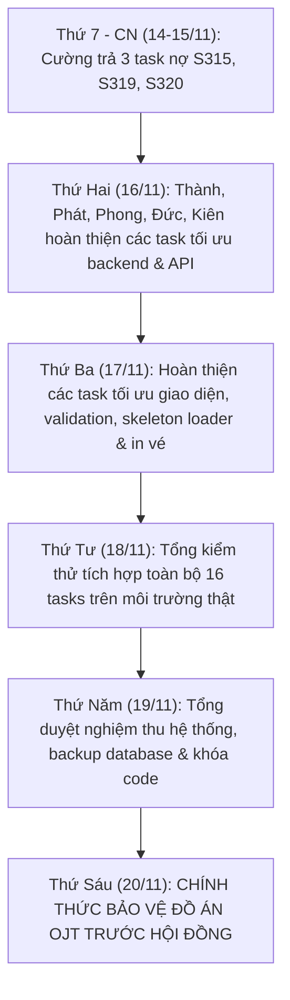

# 🎓 SPRINT 4 README — SPRINT CUỐI CÙNG: TỐI ƯU HÓA HỆ THỐNG, SỬA LỖI & CHUẨN BỊ BẢO VỆ OJT
> **Dự án:** Nền Tảng Đặt Vé Xe Khách & Điều Hành Vận Tải Liên Tỉnh TravelEasy (`traveleasy-platform`)  
> **Đơn vị:** OJT Đồ Án Tốt Nghiệp Nhóm 7 — FPT Polytechnic  
> **Thời gian thực hiện:** **14/11/2026 – 20/11/2026** *(Đúng 1 tuần — Kết thúc vào Thứ Sáu 20/11)*  
> **Trạng thái:** 🚀 **CHÍNH THỨC KHỞI ĐỘNG (STABILIZATION & SYSTEM POLISH SPRINT)**  
> **Quy mô Sprint 4:** **16 Tasks kỹ thuật | 34 Story Points | Toàn bộ 6 thành viên tham gia code, tối ưu & sửa lỗi**

---

## 🎯 1. ĐỊNH HƯỚNG SPRINT 4: "CHỈ TẬP TRUNG TỐI ƯU HÓA, SỬA LỖI & HOÀN THIỆN TÍNH NĂNG"

Toàn bộ 6 thành viên đều có nhiệm vụ kỹ thuật cụ thể (lập trình, tối ưu hóa truy vấn, sửa lỗi giao diện, chuẩn hóa dữ liệu và validation). Không tạo các task hành chính/soạn kịch bản, mỗi task có điểm Story Point nhỏ (1 - 2 SP) để hoàn thành nhanh chóng, dứt điểm.

---

## 👥 2. MA TRẬN PHÂN BỔ STORY POINTS SPRINT 4

| STT | Thành viên | Username | Trách nhiệm kỹ thuật Sprint 4 | Danh sách Task phụ trách | Tổng SP |
| :---: | :--- | :--- | :--- | :--- | :---: |
| 1 | **Phạm Công Thành** | `@thanhphmcong1` | DevOps & Hạ tầng / Bảo mật API / Nén bundle | `[S401]`, `[S402]`, `[S403]` | **5 SP** |
| 2 | **Nguyễn Đại Phát** | `@phatnguyn146` | Admin Portal / Bộ lọc tìm kiếm / Form Voucher | `[S404]`, `[S405]`, `[S406]` | **5 SP** |
| 3 | **Phạm Thanh Phong** | `@phmthanhphong17` | Backend Core / Redis Cache / Concurrency Lock / POS | `[S407]`, `[S408]`, `[S409]` | **5 SP** |
| 4 | **Trần Minh Đức** | `@minhdctrn13` | Fullstack / Đổi vé / Header Login State / In vé QR | `[S410]`, `[S411]`, `[S412]` | **5 SP** |
| 5 | **Phan Trung Kiên** | `@kienphantrung8` | Fullstack / Tối ưu Reviews / Validate SĐT-CCCD / Skeleton | `[S413]`, `[S414]`, `[S415]` | **5 SP** |
| 6 | **Đoàn Nhật Cường** | `@joshliam` | Mobile & Safety / Trả nợ Sprint 3 / Tối ưu Bản đồ GPS | `[S315]`, `[S319]`, `[S320]`, `[S416]` | **9 SP** |
| **TỔNG** | **TOÀN ĐỘI NHÓM 7** | - | **Tập trung tối ưu hóa & sửa lỗi dứt điểm** | **16 Tasks** | **34 SP** |

---

## 📋 3. DANH MỤC CHI TIẾT 16 TASKS SPRINT 4

### 1️⃣ Phạm Công Thành (DevOps & Backend System — 5 SP)
- **`[S401]` Tối ưu hóa bundle Vite & Cấu hình Gzip/Brotli compression cho Frontend (1 SP)**:
  - Loại bỏ các package thừa, chia chunk nhỏ (`vendor-chunk`), tối ưu thời gian First Contentful Paint (FCP) dưới 1.2s.
- **`[S402]` Tối ưu cơ chế kiểm tra kết nối HikariCP Pool & Bổ sung Graceful Shutdown (2 SP)**:
  - Cấu hình timeout pool (`connectionTimeout: 20000ms`, `maxLifetime: 1800000ms`), xử lý giải phóng connection sạch khi đóng ứng dụng.
- **`[S403]` Tối ưu bảo mật CORS, Content-Security-Policy (CSP) headers & Rate Limiting IP (2 SP)**:
  - Giới hạn origin CORS an toàn, thêm Security Headers chống XSS/Clickjacking và cấu hình bộ lọc Bucket4j chống spam brute-force.

---

### 2️⃣ Nguyễn Đại Phát (Admin Portal & Promotions — 5 SP)
- **`[S404]` Tối ưu bộ lọc tìm kiếm & Phân trang Server-side tại Admin Trips & Bookings (2 SP)**:
  - Hỗ trợ lọc theo mã đặt vé, số điện thoại khách hàng, khoảng ngày xuất bến mượt mà không bị reload lại trang.
- **`[S405]` Sửa lỗi hiển thị & Hoàn thiện bảng biến động số dư hoàn tiền tại `CancellationRefundPage` (1 SP)**:
  - Hiển thị chính xác tỷ lệ hoàn tiền (90%, 70%, 0%) tương ứng thời gian khách hủy vé, cập nhật trạng thái hoàn tiền minh bạch.
- **`[S406]` Tối ưu UX/UI form nhập Voucher khuyến mại & Bổ sung Validation mã giảm giá (2 SP)**:
  - Tự động convert mã voucher thành chữ in hoa (`uppercase`), kiểm tra điều kiện giá trị đơn tối thiểu (`min_order_value`) trước khi áp dụng.

---

### 3️⃣ Phạm Thanh Phong (Core Backend & Concurrency — 5 SP)
- **`[S407]` Tối ưu thời gian phản hồi API tìm chuyến `/api/v1/trips/search` bằng Redis Cache (2 SP)**:
  - Cache kết quả tìm kiếm các tuyến trọng điểm với TTL 60 giây, tự động xóa cache khi có sự thay đổi lịch trình hoặc đặt vé.
- **`[S408]` Xử lý ngoại lệ tranh chấp ghế (Concurrency Race Condition) trả về HTTP 409 Conflict chuẩn (2 SP)**:
  - Bắt lỗi khi 2 khách cùng bấm 1 ghế trong cùng mili-giây, trả về thông điệp tiếng Việt thân thiện: *"Ghế này vừa được chọn bởi khách hàng khác"*.
- **`[S409]` Tối ưu form bán vé nhanh tại quầy `PosTerminalPage`: Tính tiền thừa trả khách & Phím tắt nhanh (1 SP)**:
  - Bổ sung ô nhập tiền khách đưa, tự động tính tiền thối trả lại, phím tắt `Enter` để hoàn tất thanh toán trong 5 giây.

---

### 4️⃣ Trần Minh Đức (Fullstack Booking & Tickets — 5 SP)
- **`[S410]` Tối ưu hóa luồng Đổi vé (`TicketExchangePage`): Validate chênh lệch giá & Cập nhật sơ đồ ghế (2 SP)**:
  - Tính toán chính xác số tiền phụ thu khi đổi từ xe thường lên Limousine VIP, trả lại ghế cũ về `AVAILABLE` ngay lập tức.
- **`[S411]` Sửa lỗi đồng bộ trạng thái đăng nhập trên Header & Tự động ẩn banner nhắc nhở khi quá giờ (1 SP)**:
  - Đồng bộ state giữa các tab qua `storage event`, ẩn thanh nhắc nhở khởi hành màu vàng nếu thời gian xuất bến đã trôi qua.
- **`[S412]` Tối ưu giao diện xem chi tiết vé & In vé PDF/SVG mã QR sắc nét trên di động tại `MyTicketsPage` (2 SP)**:
  - Hiển thị QR Code rõ nét chuẩn ISO/IEC 18004, nút tải vé về máy hoặc in ấn trực tiếp không bị vỡ layout trên điện thoại.

---

### 5️⃣ Phan Trung Kiên (Fullstack / Data & UI Optimization — 5 SP)
- **`[S413]` Tối ưu UI/UX bảng đánh giá nhà xe (`ReviewsPage`): Bộ lọc sao, loại bỏ fake review & Nhãn xác thực (2 SP)**:
  - Thêm bộ lọc đánh giá 1-5 sao, hiển thị nhãn xanh *"Khách đã đi chuyến này"*, loại bỏ dữ liệu thử nghiệm không phù hợp.
- **`[S414]` Sửa lỗi & Bổ sung Validation toàn diện số điện thoại chuẩn Việt Nam và CCCD/Email (1 SP)**:
  - Kiểm tra regex đầu số di động Việt Nam (`03, 05, 07, 08, 09` đủ 10 số), định dạng CCCD 12 chữ số, hiển thị thông báo lỗi màu đỏ ngay dưới ô nhập.
- **`[S415]` Tối ưu hiệu năng tải trang tĩnh & Thêm Skeleton Loading mượt mà khi fetch chuyến xe tại `TripSearchPage` (2 SP)**:
  - Thay thế vòng quay loading thông thường bằng hiệu ứng khung xương (Skeleton loader), loại bỏ hiện tượng giật giật (layout shift) khi kết quả API trả về.

---

### 6️⃣ Đoàn Nhật Cường (Mobile & Driver Safety — 9 SP)
- **`[S315]` Code Review & Tối ưu hóa Index PostgreSQL các truy vấn tìm chuyến & ghế (2 SP — Nợ Sprint 3)**:
  - Chạy `EXPLAIN ANALYZE` và đánh composite index cho `(departure_time, route_id, status)` trên bảng `trips`.
- **`[S319]` Hoàn thiện Form phân công tổ lái & Kiểm định điều kiện xuất bến (3 SP — Nợ Sprint 3)**:
  - Nối form điều hành với backend: Chỉ cho phép duyệt xuất bến khi nồng độ cồn = `0.00 mg/L` và thời gian lái xe liên tục `< 4 giờ`.
- **`[S320]` WebApp Quét mã QR soát vé & Điểm danh hành khách bằng camera di động (3 SP — Nợ Sprint 3)**:
  - Xử lý quét camera trên điện thoại, hỗ trợ fallback gõ mã vé 6 ký tự tức thì khi môi trường không hỗ trợ camera.
- **`[S416]` Tối ưu bản đồ `LiveTrackingMapPage`: Bổ sung nút "Tự động căn chỉnh xe về tâm bản đồ" (Re-center) (1 SP)**:
  - Thêm nút floating button cho phép người dùng click để đưa vị trí xe đang chạy `51B-889.99` về chính giữa màn hình bản đồ Leaflet.

---

## 📅 4. KẾ HOẠCH TRIỂN KHAI THEO NGÀY

