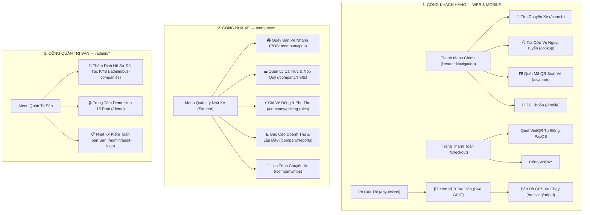

# 🧭 THIẾT KẾ LUỒNG NGHIỆP VỤ & ĐIỀU HƯỚNG TRẢI NGHIỆM SPRINT 3
> **Dự án:** Nền Tảng Đặt Vé Xe Khách & Quản Lý Nhà Xe Liên Tỉnh TravelEasy (`traveleasy-platform`)  
> **Mục tiêu:** Thiết kế luồng đi logic, tự nhiên, không ma sát (Zero Friction UX) cho các phân hệ trọng tâm Sprint 3.  
> **Nguyên tắc cốt lõi:**  
> * Khách hàng không phải tìm kiếm lòng vòng; các tính năng theo dõi lộ trình và vé xe xuất hiện đúng lúc, đúng chỗ.  
> * Nhân viên quầy bến xe thao tác siêu tốc (POS Mode) trong 3 click chuột hoặc phím tắt.  
> * Nhà xe quản lý ca trực độc lập, minh bạch tiền mặt đầu ca và chốt ca Z-Report.  
> * Quy trình thẩm định đối tác KYB tự động kích hoạt tài khoản và gửi email thông báo bảo mật.  

---

## 🗺️ 1. SƠ ĐỒ ĐIỀU HƯỚNG TỔNG THỂ (1-CLICK NAVIGATION MAP)

---

## 🚀 2. ĐIỂM CHẠM TIẾP CẬN TỰ NHIÊN (ZERO-FRICTION TOUCHPOINTS)

Để các tính năng mới **không bị giấu sâu trong menu**, hệ thống bố trí các điểm chạm trực quan:

### Điểm chạm 1: Nút xem vị trí xe thông minh ngay trên Vé Điện Tử
* Thay vì bắt khách phải tự tìm mã chuyến đi hoặc gõ URL `/tracking`, hệ thống gắn trực tiếp:
  * **Tại trang "Vé của tôi" (`/my-tickets`)**: Nút bấm màu xanh nổi bật **`[ 📍 Xem Xe Đang Tới Đâu (Live GPS) ]`**. Bấm vào là mở thẳng bản đồ vệ tinh xe đang chạy trên tuyến đường đón khách (`/tracking/:tripId`).
  * **Trong tin nhắn SMS & Email xác nhận vé**: Gửi kèm đường link rút gọn `traveleasy.vn/tracking/{tripId}` để khách mở trên điện thoại chỉ với 1 click.

### Điểm chạm 2: Quầy bán vé POS và Quản lý ca trực tách biệt cho nhân viên bến
* **Tại Cổng Nhà xe (`/company`)**:
  * Mục menu **`[ 🖨️ Quầy bán vé POS ]`** (`/company/pos`): Mở thẳng màn hình bán vé siêu tốc toàn màn hình (Full-screen Terminal) hỗ trợ phím tắt `F2` (Tìm chuyến), `F9` (In vé nhiệt 80mm).
  * Mục menu **`[ 💵 Quản lý Ca trực ]`** (`/company/shifts`): Nằm độc lập ở một trang riêng để nhân viên mở ca, ghi nhận tiền mặt và in phiếu Z-Report bàn giao tiền cho thủ quỹ mà không ảnh hưởng tới quầy bán.

### Điểm chạm 3: Email B2B tự động kích hoạt tài khoản đối tác
* Khi Admin bấm "Phê duyệt" đối tác nhà xe tại `/admin/bus-companies`, hệ thống tự động:
  * Khởi tạo mật khẩu ngẫu nhiên an toàn.
  * Gửi email HTML thương hiệu TravelEasy qua Google SMTP live tới email nhà xe kèm đường link đăng nhập 1-click vào `/company/login`.

---

## 🔄 3. LUỒNG NGHIỆP VỤ LOGIC CỦA CÁC PHÂN HỆ SPRINT 3

### 1. Phân hệ Quầy vé Bến xe của Nhà xe (`/company/pos`)
* **Mục đích:** Phục vụ khách vãng lai và người lớn tuổi mua vé trực tiếp tại quầy bến xe.
* **Luồng thao tác 3 bước (dưới 10 giây):**
  1. **Bước 1 — Chọn chuyến & Ghế:** Nhân viên chọn chuyến xe sắp xuất bến ➔ Click vào buồng ghế trống trên sơ đồ xe.
  2. **Bước 2 — Nhập thông tin & Thu tiền:** Nhập nhanh SĐT/Tên khách ➔ Chọn hình thức: `Tiền mặt (CASH)` hoặc `Quét VietQR tại quầy`.
  3. **Bước 3 — In vé nhiệt:** Bấm phím tắt **`F9`**, máy in bill nhiệt nhả vé giấy khổ 80mm có mã QR bảo mật.
  * **Khóa ghế đồng thời (Concurrency):** Ghế bán tại quầy lập tức chuyển màu đỏ trên Web/App của khách online qua kết nối SSE, chống 100% việc 2 người mua trùng 1 ghế.

### 2. Phân hệ Quản lý Ca trực & Bàn giao Tiền mặt (`/company/shifts`)
* **Mục đích:** Quản lý dòng tiền mặt phát sinh tại quầy, đảm bảo không thất thoát tiền vé.
* **Luồng vận hành:**
  1. **Đầu ca:** Nhân viên nhập số tiền lẻ thối ban đầu (Float Cash) và bấm **Mở ca**.
  2. **Trong ca:** Hệ thống tự động ghi nhận các giao dịch bán vé bằng tiền mặt từ phân hệ POS.
  3. **Cuối ca:** Nhân viên đếm tổng tiền mặt thực tế trong két, bấm **Kết ca (Z-Report)**. Hệ thống so khớp chênh lệch và in phiếu bàn giao nộp quỹ.

### 3. Phân hệ Bản đồ Định vị GPS Live Tracking (`/tracking/:tripId`)
* **Mục đích:** Giải tỏa tâm lý lo âu của hành khách khi chờ xe đón dọc đường hoặc tại bến.
* **Luồng kỹ thuật:**
  * Phương tiện truyền tọa độ GPS định kỳ về máy chủ qua API.
  * Phía khách hàng sử dụng công nghệ **Server-Sent Events (SSE)** để nhận luồng tọa độ liên tục mà không cần reload trang.
  * Bản đồ Leaflet hiển thị: Vị trí xe bus di chuyển, khoảng cách còn lại và thời gian dự kiến đón (ETA).

### 4. Phân hệ Quản trị Giá vé Động (`/company/pricing-rules`)
* **Mục đích:** Tối ưu hóa doanh thu cho nhà xe theo thời gian thực.
* **Cơ chế:** Nhà xe cài đặt quy tắc tự động tăng giá (+15% đến +30%) dịp Lễ Tết/Cuối tuần, hoặc giảm giá giờ thấp điểm cho các chuyến xe sắp chạy mà còn trống nhiều ghế.

### 5. Phân hệ Báo cáo Doanh thu & Tỷ lệ lấp đầy (`/company/reports`)
* **Mục đích:** Cung cấp số liệu tài chính trực quan cho chủ nhà xe.
* **Nội dung:** Biểu đồ doanh thu theo ngày/tháng, doanh thu phân loại theo tuyến đường, tỷ lệ lấp đầy ghế (Occupancy Rate) và tính năng xuất file Excel/CSV đối soát.

---

## 👥 4. PHÂN CÔNG THỰC HIỆN THEO MA TRẬN RACI SPRINT 3

| Thành viên | Phân hệ đảm nhận | Thư mục code chính |
|:---|:---|:---|
| **Phạm Công Thành** | **Leader & Architect**: Email B2B SMTP (`S302`), Docker VPS (`S303`), Demo Hub 15p & Slide (`S308`) | `backend/src/main/java/com/traveleasy/service/mail/`, `docker-compose.prod.yml`, `frontend/src/pages/admin/demo/` |
| **Phạm Thanh Phong** | **Core Booking & POS**: Concurrency Lock 10:00 (`S301`), Quầy bán vé POS in nhiệt 80mm (`S304`) | `backend/.../booking/`, `frontend/src/pages/company/pos/` |
| **Nguyễn Đại Phát** | **Admin & Vận hành**: GPS Live Tracking SSE (`S306`), Báo cáo doanh thu & lấp đầy (`S310`) | `frontend/src/pages/customer/tracking/`, `frontend/src/pages/company/reports/` |
| **Trần Minh Đức** | **Customer Portal**: Giá vé động (`S307`), Global Loading & SWR Cache 0ms (`S309`) | `frontend/src/pages/company/pricing-rules/`, `frontend/src/pages/customer/tickets/` |
| **Đoàn Nhật Cường** | **Mobile Specialist**: Quản lý ca trực tiền mặt Z-Report (`S305`), Soát vé QR di động (`/scanner`) | `frontend/src/pages/company/shifts/`, `frontend/src/pages/customer/scanner/` |
| **Phan Trung Kiên** | Thành viên (Miễn thực tập OJT) | Theo quy chế đào tạo |

---
*Tài liệu luồng nghiệp vụ được tinh gọn chuẩn hóa, phản ánh chính xác cấu trúc router và mã nguồn trong Sprint 3 của đề tài TravelEasy.*
