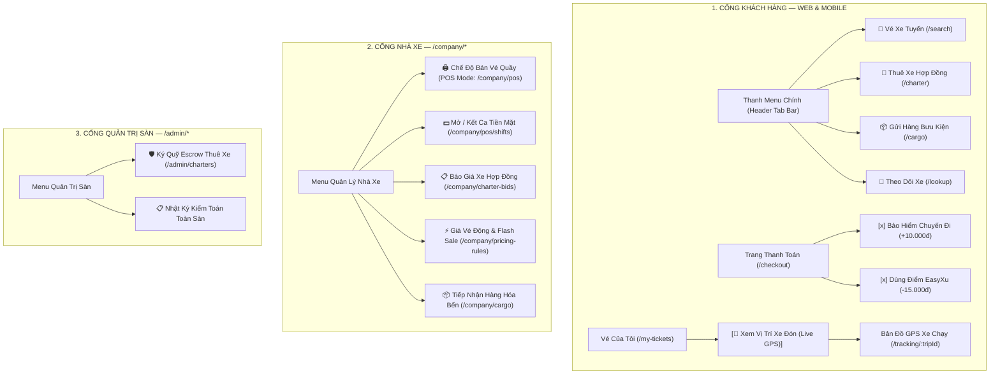
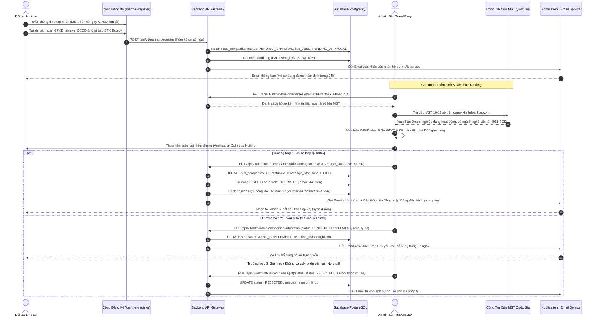

# 🧭 THIẾT KẾ LUỒNG NGHIỆP VỤ & ĐIỀU HƯỚNG TRẢI NGHIỆM SPRINT 4
> **Dự án:** Nền Tảng Đặt Vé Xe Khách & Quản Lý Nhà Xe Liên Tỉnh TravelEasy  
> **Mục tiêu:** Thiết kế luồng đi logic, tự nhiên, không phi lý, tiếp cận 1-click (Zero Friction UX) cho các phân hệ mở rộng Sprint 4.  
> **Nguyên tắc cốt lõi:**  
> * Khách hàng không phải tìm kiếm lòng vòng; các dịch vụ xuất hiện đúng lúc, đúng chỗ trong hành trình di chuyển.  
> * Nhân viên quầy bến xe thao tác siêu tốc (POS Mode) trong 3 click chuột.  
> * Sàn đứng giữa giữ tiền cọc an toàn (Escrow 30%) và điều phối minh bạch.

---

## 🗺️ 1. SƠ ĐỒ ĐIỀU HƯỚNG TỔNG THỂ (1-CLICK NAVIGATION MAP)

---

## 🚀 2. ĐIỂM CHẠM TIẾP CẬN TỰ NHIÊN (ZERO-FRICTION TOUCHPOINTS)

Để các tính năng mới **không bị giấu sâu trong menu**, hệ thống bố trí các điểm chạm (Touchpoints) trực quan:

### Điểm chạm 1: Thanh chuyển đổi dịch vụ ngay tại Header Trang Chủ
* Ngay đầu trang web và ứng dụng di động, thanh điều hướng dạng Tab Bar cho phép chuyển đổi 1-chạm giữa 4 nhu cầu lớn nhất:
  * `[ 🚌 Vé Xe Khách ]` ➔ Mặc định tìm chuyến xe tuyến cố định.
  * `[ 🚐 Thuê Xe Du Lịch ]` ➔ Mở ngay form đặt xe hợp đồng (`/charter`).
  * `[ 📦 Gửi Hàng Bưu Kiện ]` ➔ Mở ngay giao diện tính cước gửi hàng (`/cargo`).
  * `[ 📍 Tra Cứu & Định Vị ]` ➔ Nhập mã vé hoặc SĐT để xem lịch trình & vị trí xe.

### Điểm chạm 2: Nút xem vị trí xe thông minh ngay trên Vé Điện Tử
* Thay vì bắt khách phải tự tìm mã chuyến đi hoặc gõ URL `/tracking`, hệ thống gắn trực tiếp:
  * **Tại trang "Vé của tôi" (`/my-tickets`)**: Nút bấm màu xanh nổi bật **`[ 📍 Xem Xe Đang Tới Đâu (Live GPS) ]`**. Bấm vào là mở thẳng bản đồ vệ tinh xe đang chạy trên tuyến đường đón khách!
  * **Trong tin nhắn SMS & Email xác nhận vé**: Gửi kèm đường link rút gọn `traveleasy.vn/t/{ticketCode}` để khách mở trên điện thoại chỉ với 1 click.

### Điểm chạm 3: Tích hợp Bảo hiểm & Ví điểm ngay tại bước Thanh Toán (`/checkout`)
* Không bắt khách phải sang trang khác đăng ký bảo hiểm:
  * Tại bước xem lại giá vé, hệ thống hiển thị checkbox trực quan:  
    `[x] 🛡️ Bảo hiểm chuyến đi Bảo Việt (Bồi thường tới 400 triệu) — Chỉ +10.000đ/vé`.
  * Hiển thị số dư ví xu khả dụng:  
    `🪙 Dùng điểm thưởng EasyXu: Bạn có 20.000 Xu [Dùng 15.000 Xu để giảm 15.000đ]`.

---

## 🔄 3. LUỒNG NGHIỆP VỤ LOGIC CỦA 5 PHÂN HỆ SPRINT 4

### 1. Phân hệ Quầy vé Bến xe của Nhà xe (`/company/pos`)
* **Tại sao hợp lý:** Bến xe là nơi tập trung khách vãng lai và người lớn tuổi. Nhà xe thuê quầy tại bến và bố trí nhân viên của mình trực bán vé.
* **Luồng thao tác 3 bước (dưới 10 giây):**
  1. **Bước 1 — Chọn chuyến & Ghế:** Nhân viên chọn chuyến xe sắp xuất bến ➔ Click vào buồng ghế trống trên sơ đồ xe.
  2. **Bước 2 — Nhập thông tin & Thu tiền:** Nhập nhanh SĐT/Tên khách ➔ Chọn hình thức: `Tiền mặt (CASH)` hoặc `Quét VietQR tại quầy`.
  3. **Bước 3 — In vé nhiệt:** Bấm phím tắt **`F9`**, máy in bill nhiệt nhả vé giấy có mã QR bảo mật.
  * **Khóa ghế đồng thời (Concurrency):** Ghế bán tại quầy lập tức chuyển màu đỏ trên Web/App của khách online, chống 100% việc 2 người mua trùng 1 ghế.
  * **Quản lý ca trực (`/company/pos/shifts`):** Đầu ca nhân viên khai báo số tiền lẻ thối; hết ca bấm **Kết ca (Z-Report)** in phiếu tổng tiền nộp thủ quỹ.

---

### 2. Dịch vụ Thuê Xe Hợp Đồng Du Lịch (`/charter`)
* **Tại sao hợp lý:** Giải quyết nhu cầu thuê xe trọn gói cho công ty đi tour, trường học, đám cưới.
* **Luồng 2 kênh tiếp cận:**
  * **Kênh Online:** Khách lên `/charter` nhập: Điểm đón ➔ Điểm đến ➔ Ngày đi/về ➔ Chọn xe (16, 29, 45 chỗ) ➔ Gửi yêu cầu.
  * **Kênh Quầy Bến Xe:** Khách đoàn ghé thẳng quầy vé của nhà xe tại bến hỏi thuê ➔ Nhân viên quầy mở tab Hợp đồng, kiểm tra xe rảnh và in phiếu báo giá giữ xe ngay tại chỗ.
* **Cơ chế Đấu giá cạnh tranh & Ký quỹ an toàn (Escrow 30%):**
  * Các nhà xe có loại xe phù hợp gửi báo giá cạnh tranh kèm ảnh xe thực tế.
  * Khách chọn nhà xe ưng ý và **đặt cọc 30% trực tuyến**.
  * **Sàn Admin (`/admin/charters`) đứng giữa giữ tiền cọc**, chỉ giải ngân cho Nhà xe sau khi chuyến đi kết thúc an toàn, bảo vệ khách hàng khỏi rủi ro bị bùng cọc hoặc tráo xe cũ.

---

### 3. Dịch vụ Ký Gửi Hàng Hóa Bưu Kiện Hầm Xe (`/cargo`)
* **Tại sao hợp lý:** 40% doanh thu thực tế của các nhà xe đến từ hàng hóa bưu kiện gửi theo hầm xe.
* **Luồng vận hành khép kín:**
  1. Người gửi lên `/cargo` (hoặc mang hàng ra quầy bến xe): Nhập loại hàng (tài liệu, bưu kiện, xe máy, hoa quả), trọng lượng.
  2. Hệ thống tính cước tự động theo bảng giá quy chuẩn ➔ In phiếu dán thùng hàng có **Mã QR vận đơn (CG-2026-XXXXX)**.
  3. Xếp hàng vào hầm xe. Khi xe tới bến đến, hệ thống gửi tin nhắn SMS chứa **Mã OTP 6 số** cho người nhận.
  4. Người nhận ra bến đọc mã OTP ➔ Nhân viên quầy bến đối chiếu và bàn giao hàng.

---

### 4. Bản Đồ GPS Live Tracking Xe Chạy Thời Gian Thực (`/tracking/:tripId`)
* **Tại sao hợp lý:** Giải tỏa tâm lý lo âu của hành khách khi chờ xe đón dọc đường hoặc tại bến.
* **Luồng kỹ thuật:**
  * Xe khách truyền tọa độ GPS định kỳ về máy chủ qua API `/api/v1/tracking`.
  * Phía khách hàng sử dụng công nghệ **Server-Sent Events (SSE)** để nhận luồng tọa độ liên tục mà không cần refresh trang.
  * Bản đồ hiển thị: Vị trí xe bus di chuyển, khoảng cách còn lại và thời gian dự kiến đón (ETA) tính toán tự động.

---

### 5. Quản Trị Giá Vé Động & Gamification (`/company/pricing-rules` & `/rewards`)
* **Giá vé động:** Nhà xe cài đặt luật tự động tăng giá +20% dịp Lễ 30/4 - Tết, giảm giá Flash Sale -15% cho các chuyến xe đêm sắp chạy mà còn trống > 50% ghế để tối đa hóa doanh thu.
* **Ví EasyXu & Vòng quay may mắn:** Tích 2% giá trị mỗi vé hoàn thành thành điểm thưởng EasyXu (1 xu = 1 VNĐ); tặng vòng quay may mắn mỗi ngày trúng voucher giảm giá kích thích khách quay lại mua vé.

---

## 👥 4. PHÂN CÔNG THỰC HIỆN THEO MA TRẬN RACI SPRINT 4

| Thành viên | Phân hệ đảm nhận | Thư mục code chính |
|:---|:---|:---|
| **Phạm Công Thành** | **Leader & Architect** (0 task mới, review hạ tầng & CSDL) | `backend/src/main/java/com/traveleasy/security/`, `docs/` |
| **Nguyễn Đại Phát** | Quản trị Ký quỹ Escrow (`/admin/charters`) & Giá vé động (`/company/pricing-rules`) | `frontend/src/pages/admin/charters/`, `pages/company/pricing-rules/` |
| **Phạm Thanh Phong** | Quầy vé Bến xe POS (`/company/pos`), Ca trực (`/company/pos/shifts`), Backend GPS SSE & Cước hàng | `frontend/src/pages/company/pos/`, `backend/.../cargo/`, `backend/.../realtime/` |
| **Đoàn Nhật Cường** | Bản đồ GPS Live Tracking (`/tracking/:tripId`), Trung tâm hỗ trợ (`/support`) | `frontend/src/pages/customer/tracking/`, `pages/customer/support/` |
| **Trần Minh Đức** | Thuê xe hợp đồng (`/charter`), Gửi hàng (`/cargo`), Bảo hiểm (`/insurance`), Ví EasyXu (`/rewards`) | `frontend/src/pages/customer/charter/`, `cargo/`, `insurance/`, `rewards/` |

---

## 🏛️ 6. THIẾT KẾ ĐỘT PHÁ: QUY TRÌNH ONBOARDING NHÀ XE & THẨM ĐỊNH PHÁP NHÂN KYB CỦA ADMIN

Đáp ứng trực tiếp yêu cầu thẩm định chất lượng doanh nghiệp vận tải của Hội đồng giám khảo, luồng tiếp nhận đối tác nhà xe được chuẩn hóa toàn diện theo mô hình **KYB (Know Your Business) 4 Tầng**, giải quyết triệt để rủi ro nhà xe "ma", thiếu giấy phép kinh doanh vận tải hoặc gian lận tài khoản ngân hàng.

### 6.1 Sơ Đồ Tuần Tự (Sequence Diagram) Luồng Thẩm Định KYB

---

### 6.2 Bốn Tầng Thẩm Định Pháp Lý Của Admin (The 4-Layer KYB Protocol)

| Tầng thẩm định | Tiêu chí kiểm tra | Hành động kỹ thuật & Phương thức xác thực | Tiêu chuẩn Đạt (PASS) |
|:---|:---|:---|:---|
| **Tầng 1: Cú pháp & Toàn vẹn dữ liệu** | - Định dạng Mã số thuế - Định dạng CCCD - Số điện thoại Hotline - Kích thước file tài liệu | - Backend Regex Validation: `^[0-9]{10}(-[0-9]{3})?$` - Chặn file vượt quá 10MB hoặc sai định dạng PDF/PNG/JPG - Tự động kiểm tra trùng lặp trên CSDL và Blacklist vi phạm | Không lỗi cú pháp, tài liệu đọc được 100% 4 góc bản scan. |
| **Tầng 2: Đối chiếu CSDL Quốc Gia** | - Tính hợp pháp doanh nghiệp - Tình trạng nộp thuế - Mã ngành kinh doanh vận tải | - Tích hợp nút **1-Click Tra cứu Cổng Doanh Nghiệp Quốc Gia** (`dangkykinhdoanh.gov.vn`) và Cổng Tổng Cục Thuế (`tracuunnt.gdt.gov.vn`) - Đối chiếu Tên công ty & Địa chỉ trụ sở | - Doanh nghiệp ở trạng thái "Đang hoạt động" - Có mã ngành 4931 (Vận tải hành khách bằng xe buýt) hoặc 4932 (Vận tải hành khách đường bộ khác). |
| **Tầng 3: Giấy Phép Con Vận Tải** | - Giấy phép kinh doanh vận tải bằng xe ô tô do Sở GTVT cấp - Phù hiệu xe chạy tuyến | - Phóng to xem con dấu đỏ, chức danh người ký và ngày hết hạn - Đối chiếu số giấy phép trên cổng Sở GTVT tỉnh/thành phố | - Giấy phép còn hiệu lực tối thiểu 06 tháng tại thời điểm duyệt - Loại hình cấp phép: Tuyến cố định hoặc Hợp đồng du lịch. |
| **Tầng 4: Tài Khoản Quyết Toán Escrow** | - Tính chính chủ tài khoản ngân hàng - Phòng chống rửa tiền (AML) - Chống gian lận chuyển tiền | - Đối chiếu Tên chủ tài khoản ngân hàng thụ hưởng (`bank_account_owner`) với Tên Doanh nghiệp hoặc Tên Người đại diện pháp luật trên GPKD | Bắt buộc trùng khớp 100% tên pháp nhân hoặc người đại diện; tuyệt đối từ chối tài khoản cá nhân của bên thứ ba. |

---

### 6.3 Ba Tính Năng Nâng Cấp Đột Phá Được Thiết Kế Mới

1. **Auto-Check Mã Số Thuế & AI OCR Bóc Tách Giấy Phép:**
   - Khi nhà xe tải lên ảnh chụp Giấy phép ĐKKD, hệ thống tự động bóc tách (OCR) Mã số thuế, Tên doanh nghiệp và Địa chỉ để tự điền form, giảm 90% lỗi gõ nhầm.
   - Khi Admin duyệt, hệ thống tự động highlight màu xanh các trường thông tin khớp giữa bản scan và dữ liệu khai báo, highlight màu đỏ các trường có dấu hiệu bất thường.
2. **Onboarding Sandbox Mode (Chế độ Vận Hành Thử Nghiệm):**
   - Nhà xe sau khi được Admin phê duyệt sẽ được đưa vào chế độ `SANDBOX` trong 3 ngày đầu.
   - Tại chế độ này, nhà xe được thêm danh sách xe thực tế, cấu hình sơ đồ ghế, thiết lập trạm đón trả và tạo thử chuyến xe nội bộ để đội ngũ vận hành của sàn hỗ trợ kiểm thử chất lượng trước khi bấm nút **"Mở Bán Chính Thức (Go-Live)"**.
3. **Cơ Chế Phê Duyệt / Bác Bỏ Có Giải Trình Ký Số (Audit-Ready):**
   - Admin không thể từ chối bằng một thao tác click thông thường; hệ thống bắt buộc Admin chọn Lý do chuẩn mực (ví dụ: *"Giấy phép vận tải hết hiệu lực"*, *"Mã số thuế không tồn tại"*, *"Tài khoản ngân hàng không chính chủ"*) kèm giải trình chi tiết tối thiểu 20 ký tự.
   - Toàn bộ thao tác thẩm định được lưu vết vĩnh viễn (Admin ID, IP, Checksum, Timestamp), sẵn sàng xuất biên bản phục vụ các đoàn thanh tra giao thông vận tải hoặc kiểm toán độc lập.
