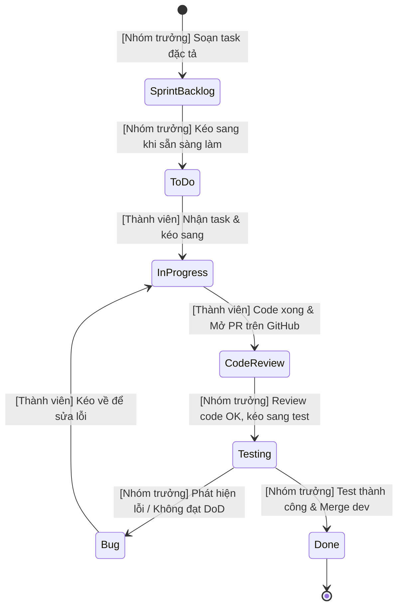

# ĐẶC TẢ QUẢN TRỊ BẢNG TRELLO (TRELLO BOARD BLUEPRINT & SYNC GUIDE)
## HỆ THỐNG QUẢN LÝ TIẾN ĐỘ SPRINT BACKLOG & QUY TRÌNH TỰ ĐỘNG HÓA
### DỰ ÁN: TRAVELEASY PLATFORM (`PRJ-TRAVELEASY-MVP-01`) | [LINK TRELLO BOARD](https://trello.com/b/AA5BYoe1/traveleasyplatform)

---

> **BẢNG TRELLO TRỰC TUYẾN DỰ ÁN:** [https://trello.com/b/AA5BYoe1/traveleasyplatform](https://trello.com/b/AA5BYoe1/traveleasyplatform)  
> **BOARD ID:** `6ad6f486572cd6662754e074`  
> **CÔNG CỤ ĐỒNG BỘ REST API:** `scripts/sync_trello.py`  
> **HIỆN TRẠNG QUẢN TRỊ DỰ ÁN:** **84 THẺ CỐT LÕI — 149 STORY POINTS (CHUẨN HOÁ 4 TUẦN - 4 SPRINTS TIÊU CHUẨN SCRUM)**.  
> **TIẾN ĐỘ NGHIỆM THU HIỆN TẠI:** Sprint 1 (19 Thẻ Done - 32 SP), Sprint 2 (19 Thẻ Done - 35 SP), Sprint 3 (36 Thẻ Done - 48 SP), Sprint 4 (10 Thẻ trọng tâm - 34 SP: Khóa ghế Realtime, Email B2B, CI/CD VPS, POS Bến xe, Demo Hub, Loading/SWR 0ms, GPS Tracking & Báo cáo Nhà xe).

---

## 1. CẤU TRÚC 4 SPRINT & DANH SÁCH CHUẨN AGILE (LISTS WORKFLOW)

Bảng Trello được cấu hình theo đúng quy chuẩn **Multi-Sprint Scrum Board** tiêu chuẩn quốc tế:

```
+-----------------------------------+-----------------------------------+-----------------------------------+
| Sprint 1: Architecture & Core     | Sprint 2: Core Booking & Concurrency| Sprint 3: E2E QA & Payments       |
| (19 Thẻ | 32 SP - Hoàn thành 100%)| (19 Thẻ | 35 SP - Hoàn thành 100%)| (36 Thẻ | 48 SP - Hoàn thành 100%)|
+-----------------------------------+-----------------------------------+-----------------------------------+
| Sprint 4: POS, DevOps & Defense   | Testing & QA Verification         | Bug Tracking (0 Critical Issues)  |
| (10 Thẻ | 34 SP - Đang nước rút)  | (Báo cáo & Bằng chứng nghiệm thu) | (0 lỗi chặn - Hệ thống ổn định)   |
+-----------------------------------+-----------------------------------+-----------------------------------+
```

1. **Sprint 1: Architecture, CSDL & Auth (32 SP) [DONE]**: Nền tảng dự án, CSDL 44 bảng Supabase Cloud, Stateless JWT Bearer, phân quyền RBAC và Master Data danh mục toàn quốc (19 thẻ | 32 SP).
2. **Sprint 2: Core Booking & Concurrency Lock (35 SP) [DONE]**: Lõi tìm kiếm chuyến xe SWR Cache 0ms, sơ đồ 34 ghế 2 tầng Limousine VIP, Khóa giữ chỗ Concurrency Lock 10:00, Thanh toán VNPAY & VietQR (19 thẻ | 35 SP).
3. **Sprint 3: E2E QA, Firebase Auth, Soát Vé & Fixtures (48 SP) [DONE]**: 36 thẻ Done (48 SP), Firebase Google Sign-In & OTP Phone (`S321`), Sửa lỗi Seed Fixtures & Khứ hồi (`S320`), Quét QR camera 0.2s (`S314`, `S317`).
4. **Sprint 4: Khóa Ghế Real-time, Email B2B, CI/CD VPS, POS Bến Xe, GPS Tracking & Demo Bảo Vệ (34 SP) [SPRINT NƯỚC RÚT]**:
   - `[S401]` Đồng bộ Khóa ghế & Giữ chỗ Real-time 10 phút SSE Concurrency Lock (4 SP - ĐÃ XONG - Phong).
   - `[S402]` Dịch vụ Email Tự Động Phê Duyệt Hồ Sơ Đối Tác & Cấp Tài Khoản Điều Hành (3 SP - ĐANG HOÀN TẤT - Thành).
   - `[S403]` Đóng gói Docker Compose Production & Triển khai CI/CD lên VPS `103.72.57.149` (4 SP - ĐANG HOÀN TẤT - Thành).
   - `[S404]` Phân hệ Bán vé Nhanh tại Quầy Bến Xe của Nhà Xe POS (`/company/pos`) (4 SP - Phong).
   - `[S405]` Quản lý Ca trực & Bàn giao Đối soát Tiền mặt Quầy bến xe (`/company/shifts`) (3 SP - Cường).
   - `[S406]` Bản đồ Định vị GPS Live Tracking xe chạy thời gian thực qua SSE (`/tracking/:tripId`) (4 SP - Phát).
   - `[S407]` Quản trị Chính sách Giá vé động & Phụ thu Lễ Tết/Cuối tuần (`/company/pricing-rules`) (3 SP - Đức).
   - `[S408]` Trung tâm Trình diễn Demo Hub 15 Phút (`/demo`) & Slide Bảo Vệ OJT (3 SP - ĐÃ XONG - Thành).
   - `[S409]` Màn hình Loading chuyển trang & Tối ưu hiệu năng giao diện SWR Cache 0ms, Skeleton Vé của tôi (`/my-tickets`) (3 SP - ĐÃ XONG - Thành).
   - `[S410]` Phân hệ Báo cáo Thống kê Doanh thu & Tỷ lệ lấp đầy ghế Nhà xe (`/company/reports`) (3 SP - Phát).
5. **Testing & QA Verification**: Báo cáo kiểm thử hồi quy độc lập tại `docs/test-reports/` cho từng thành viên (Cường, Đức, Phát, Phong).
6. **Sprint Retrospective & Defense Ready**: Kịch bản thuyết trình bảo vệ 15 phút chi tiết từng giây và Hồ sơ bàn giao toàn sàn 100/100 điểm.
7. **Bug Tracking**: Theo dõi lỗi hệ thống (0 bug nghiêm trọng, 100% pass).

---

## 2. QUY CHUẨN LUÂN CHUYỂN TASK & PHÂN ĐỊNH QUYỀN HẠN TRÊN TRELLO (KANBAN STATE MACHINE)

Nhằm đảm bảo tính minh bạch, kỷ luật và phân định trách nhiệm rõ ràng giữa **Nhóm trưởng (Tech Lead / Product Owner)** và **Thành viên (Developers / QA)**, toàn bộ các thẻ task trên Trello phải tuân thủ nghiêm ngặt theo máy trạng thái dưới đây:

### 2.1 Sơ đồ luồng trạng thái luân chuyển thẻ (State Diagram)



### 2.2 Bảng phân định quyền hạn thao tác trên 7 Cột (Lists)

| STT | Tên Cột trên Trello | Người Có Quyền Kéo Thẻ | Điều Kiện & Hành Động Kích Hoạt |
|:---:|:---|:---:|:---|
| **1** | **`Sprint Backlog`** | 👑 **Nhóm trưởng** | Nhóm trưởng trực tiếp soạn thảo đặc tả User Story, tiêu chí chấp thuận (Acceptance Criteria) và danh sách Checklist kỹ thuật. |
| **2** | **`To Do`** | 👑 **Nhóm trưởng** | Khi task đã sẵn sàng để triển khai (không bị nghẽn phụ thuộc), Nhóm trưởng chuyển thẻ từ `Sprint Backlog` sang `To Do` để mở quyền nhận việc cho thành viên. |
| **3** | **`In Progress`** | 👨‍💻 **Thành viên** | * Thành viên nhận task từ `To Do` ➔ Gán Avatar cá nhân ➔ Kéo sang `In Progress`.<br>* **Trường hợp bị Bug**: Thành viên thấy thẻ bị đẩy vào cột `Bug` ➔ Đọc nhận xét lỗi và kéo ngược về `In Progress` để sửa. |
| **4** | **`Code Review`** | 👨‍💻 **Thành viên** | Thành viên hoàn thành mã nguồn trên nhánh cá nhân, chạy test độc lập pass 100%, **mở Pull Request (PR)** trỏ vào `dev` ➔ Dán link PR vào thẻ Trello và kéo sang `Code Review`. |
| **5** | **`Testing`** | 👑 **Nhóm trưởng** | Nhóm trưởng kiểm tra code trên GitHub (CI xanh, không xung đột, đúng quy chuẩn) ➔ Kéo thẻ Trello sang `Testing` để tiến hành chạy thử và nghiệm thu giao diện. |
| **6** | **`Bug`** | 👑 **Nhóm trưởng** | Nếu kiểm thử phát hiện lỗi chức năng, giao diện vỡ hoặc rớt test case ➔ Nhóm trưởng **viết comment chỉ rõ lỗi** vào thẻ và chuyển thẻ sang cột `Bug`. |
| **7** | **`Done`** | 👑 **Nhóm trưởng** | Nếu kiểm thử thực tế đạt 100% yêu cầu ➔ Nhóm trưởng **Approve & Merge PR** vào nhánh `dev`, tích xanh toàn bộ checklist và kéo thẻ sang `Done`. |

### 2.3 Ba Nguyên tắc kỷ luật sống còn khi thao tác Trello
1. 🚫 **Thành viên TUYỆT ĐỐI KHÔNG được tự ý kéo thẻ sang `Done` hoặc `Testing`:**  
   Chỉ có **Nhóm trưởng** mới có thẩm quyền chuyển thẻ vào `Testing`, `Bug` hoặc `Done` sau khi đã trực tiếp rà soát mã nguồn và kiểm thử thực tế.
2. 🔄 **Quy tắc phản hồi lỗi (Bug Feedback Loop):**  
   Khi task bị đẩy vào cột `Bug`, thành viên phụ trách phải xem kỹ nguyên nhân được ghi trong comment, **kéo ngay thẻ về `In Progress`**, sửa lỗi triệt để trên nhánh cũ, push lại commit và chuyển lại thẻ sang `Code Review`.
3. 🎯 **Giới hạn số lượng công việc đang làm (WIP Limit = 1):**  
   Mỗi thành viên tại một thời điểm chỉ được phép có **tối đa 1 thẻ** ở cột `In Progress`. Nghiêm cấm nhận cùng lúc nhiều task gây dàn trải và nghẽn tiến độ nhóm.

---

## 3. QUY CHUẨN BẢNG NHÃN MÀU (LABEL SYSTEM)

| Tên Nhãn | Mã Màu | Ý nghĩa & Phạm vi áp dụng |
|---|:---:|---|
| **`Admin Portal`** | 🟠 **Cam** | Các màn hình và API phục vụ quản trị viên nền tảng và đối tác nhà xe |
| **`Customer Portal`** | 🟡 **Vàng** | Các tính năng phục vụ khách hàng đặt vé công khai |
| **`Backend`** | 🔵 **Xanh dương** | Lập trình Spring Boot 3, RESTful API, Database, Security, Locking |
| **`Frontend`** | 🟢 **Xanh lá** | Dựng giao diện React 18, Vite, TypeScript, Responsive CSS |
| **`Fullstack`** | 🟣 **Tím** | Nhiệm vụ bao quát cả Frontend và Backend tích hợp |
| **`Core / Urgent`** | 🔴 **Đỏ** | Các nghiệp vụ sống còn (Concurrency 10:00, Đặt vé, Thanh toán, Dashboard) |

---

## 4. DANH MỤC 17 USER STORIES TẠI CỘT 'DONE SPRINT' (95 STORY POINTS)

Mỗi thẻ User Story đều tuân thủ định dạng chuẩn của Scrum:
* **Tiêu đề**: `({Điểm Fibonacci}) US-{Mã}: Là một {Vai trò}, tôi muốn {Hành động} để {Mục đích}`.
* **Mô tả kỹ thuật**: Đường dẫn API Backend và Component Frontend.
* **2 Checklists chi tiết**: `Backend Checklist` và `Frontend Checklist` (Tất cả items đều được đánh dấu hoàn thành 100%).

### 3.1 Nhóm Phân hệ Quản trị (Admin Portal - 36 Story Points) - Phụ trách: Phạm Công Thành

#### 1. `(8) US-01: Là một Quản trị viên, tôi muốn xem Dashboard 4 chỉ số KPI và bảng điều phối để nắm bắt tức thời tình hình vận hành của hệ thống`
* **Nhãn**: `Admin Portal`, `Fullstack`, `Core / Urgent`
* **Thành viên**: `thanhphmcong1` (Phạm Công Thành)
* **Backend Checklist**:
  - [x] Viết API Endpoint `GET /api/v1/admin/dashboard/stats`
  - [x] Truy vấn tổng hợp số liệu thực tế từ các bảng `trips`, `bookings`, `payments`
  - [x] Tối ưu truy vấn SQL Dashboard dưới 50ms
* **Frontend Checklist**:
  - [x] Dựng 4 thẻ số liệu KPI trực quan (Tổng chuyến, Chuyến mở bán, Đơn vé, Doanh thu)
  - [x] Dựng lưới 6 Card điều phối nhanh dẫn tới các trang quản trị
  - [x] Tích hợp tự động đồng bộ số liệu qua Axios service

#### 2. `(8) US-02: Là một Quản trị viên, tôi muốn tạo chuyến xe mới tự động sinh 34 ghế và đổi trạng thái chuyến để vận hành lịch trình xe chạy`
* **Nhãn**: `Admin Portal`, `Fullstack`, `Core / Urgent`
* **Thành viên**: `thanhphmcong1` (Phạm Công Thành)
* **Backend Checklist**:
  - [x] Thuật toán tự động sinh 34 ghế (17 ghế tầng 1 A01-A17, 17 ghế tầng 2 B01-B17)
  - [x] Logic chuyển trạng thái State Machine: `SCHEDULED` ➔ `DEPARTED` ➔ `COMPLETED` ➔ `CANCELLED`
  - [x] Khóa snapshot giá vé trên chuyến xe theo Tuyến mẫu
* **Frontend Checklist**:
  - [x] Form Popup tạo chuyến mới có validation giờ chạy và ngày đi
  - [x] Bảng hiển thị danh sách chuyến xe kèm nút đổi trạng thái trực tiếp
  - [x] Badge màu trực quan phân biệt trạng thái chuyến xe

#### 3. `(5) US-03: Là một Quản trị viên, tôi muốn quản lý danh mục nhà xe đối tác và phương tiện để kiểm soát đội xe trên hệ thống`
* **Nhãn**: `Admin Portal`, `Fullstack`
* **Thành viên**: `thanhphmcong1` (Phạm Công Thành)
* **Backend Checklist**:
  - [x] Viết CRUD BusCompanyRepository & VehicleRepository
  - [x] Xử lý ràng buộc một nhà xe sở hữu nhiều phương tiện
  - [x] Quản lý trạng thái ACTIVE / INACTIVE của đối tác
* **Frontend Checklist**:
  - [x] Dựng giao diện thẻ thông tin nhà xe (Hotline, địa chỉ, rating sao)
  - [x] Bảng quản lý phương tiện (Biển số xe, loại xe Limousine 34 phòng)
  - [x] Modal thêm mới và cập nhật phương tiện vận tải

#### 4. `(5) US-04: Là một Quản trị viên, tôi muốn quản lý các tuyến đường và trạm đón/trả kèm mốc giờ ETA để tối ưu lộ trình xe di chuyển`
* **Nhãn**: `Admin Portal`, `Fullstack`
* **Thành viên**: `thanhphmcong1` (Phạm Công Thành)
* **Backend Checklist**:
  - [x] Viết CRUD Route và danh sách điểm dừng kèm mốc giờ ETA Offset
  - [x] Validation khoảng cách km và tính toàn vẹn sequence trạm dừng
  - [x] Tính toán tự động ETA từ điểm xuất phát đến các trạm kế tiếp
* **Frontend Checklist**:
  - [x] Bảng danh sách tuyến xe liên tỉnh (Điểm đi - Điểm đến)
  - [x] Card danh sách trạm đón/trả dọc đường kèm khoảng cách km
  - [x] Form nhập lộ trình có gợi ý địa điểm thông minh

#### 5. `(5) US-05: Là một Quản trị viên, tôi muốn cấu hình bảng quy tắc hoàn tiền hủy vé và phụ thu tầng ghế để tự động hóa chính sách tài chính`
* **Nhãn**: `Admin Portal`, `Fullstack`
* **Thành viên**: `thanhphmcong1` (Phạm Công Thành)
* **Backend Checklist**:
  - [x] Entity CancellationPolicyRule và logic tính % tiền hoàn tự động
  - [x] Cấu hình mức phụ thu tầng 1 và phụ thu cuối tuần
  - [x] Xử lý giao dịch hoàn tiền tự động vào số dư khách hàng
* **Frontend Checklist**:
  - [x] Bảng trực quan hóa các mốc giờ hủy vé và tỷ lệ hoàn tiền
  - [x] Khung cấu hình giá vé phụ thu theo tầng
  - [x] Toast thông báo phản hồi khi cập nhật chính sách thành công

#### 6. `(5) US-06: Là một Quản trị viên, tôi muốn quản lý danh sách người dùng và phân quyền RBAC an toàn bằng JWT để kiểm soát quyền truy cập hệ thống`
* **Nhãn**: `Admin Portal`, `Backend`, `Core / Urgent`
* **Thành viên**: `thanhphmcong1` (Phạm Công Thành)
* **Backend Checklist**:
  - [x] Cấu hình SecurityConfig và JWT Authentication Filter
  - [x] API `GET /api/v1/admin/users` và PATCH cập nhật trạng thái khóa
  - [x] Mã hóa mật khẩu một chiều BCrypt 10 rounds
* **Frontend Checklist**:
  - [x] Bảng danh sách người dùng (Họ tên, SĐT, Email, Vai trò)
  - [x] Badge hiển thị màu theo vai trò (Admin đỏ, Driver vàng, Khách xanh)
  - [x] Chức năng khóa/mở khóa tài khoản an toàn

#### 7. `(5) US-07: Là một Quản trị viên, tôi muốn theo dõi nhật ký audit log và kiểm duyệt đánh giá của khách hàng để đảm bảo chất lượng dịch vụ và tính an toàn bảo mật`
* **Nhãn**: `Admin Portal`, `Fullstack`
* **Thành viên**: `thanhphmcong1` (Phạm Công Thành)
* **Backend Checklist**:
  - [x] Service ghi nhận vết Audit Log bất biến vào CSDL
  - [x] API lấy danh sách đánh giá kèm nút duyệt trạng thái
  - [x] Ghi nhật ký mọi thao tác nhạy cảm của Admin và Operator
* **Frontend Checklist**:
  - [x] Bảng Audit Trail hiển thị lịch sử thao tác hệ thống
  - [x] Thẻ đánh giá của khách hàng kèm nút "Duyệt hiển thị"
  - [x] Bộ lọc tìm kiếm nhật ký theo thời gian và người dùng

---

### 3.2 Nhóm Phân hệ Khách hàng (Client Portal - 59 Story Points)

#### 8. `(8) US-08: Tìm kiếm chuyến xe kết hợp bộ lọc nâng cao thời gian thực`
* **Phụ trách**: `phatnguyn146` (Nguyễn Đại Phát) | **Nhãn**: `Customer Portal`, `Fullstack`, `Core / Urgent`
* **Checklists**:
  - [x] [BE] Viết dynamic JPA Specification lọc đa tiêu chí linh hoạt
  - [x] [BE] DTO `TripSearchRequest` và `TripSummaryResponse`
  - [x] [FE] Thanh tìm kiếm có gợi ý địa điểm (Autosuggest)
  - [x] [FE] Sidebar bộ lọc thời gian thực (Slider khoảng giá, Checkbox nhà xe, Radio khung giờ)

#### 9. `(5) US-09: Xem chi tiết thông tin xe, tiện ích và lộ trình trạm dừng ETA`
* **Phụ trách**: `phatnguyn146` (Nguyễn Đại Phát) | **Nhãn**: `Customer Portal`, `Fullstack`
* **Checklists**:
  - [x] [BE] DTO `TripDetailResponse` kèm mảng tiện ích và điểm đón/trả
  - [x] [BE] API Endpoint `GET /api/v1/trips/{id}`
  - [x] [FE] Khung hiển thị hình ảnh xe Limousine và biểu tượng tiện ích (WiFi, sạc, nước)
  - [x] [FE] Timeline trực quan hóa các trạm đón/trả và mốc giờ ETA xe chạy

#### 10. `(8) US-10: Xem sơ đồ 2 tầng xe Limousine trực quan để chọn vị trí giường nằm`
* **Phụ trách**: Phan Trung Kiên | **Nhãn**: `Customer Portal`, `Frontend`, `Core / Urgent`
* **Checklists**:
  - [x] [BE] Truy vấn danh sách ghế theo chuyến kèm giá vé từng tầng
  - [x] [BE] DTO `TripSeatResponse` phân chia tầng 1 và tầng 2
  - [x] [FE] Vẽ sơ đồ 2 tầng xe Limousine (Tầng 1 A01-A17, Tầng 2 B01-B17)
  - [x] [FE] Xử lý chọn/bỏ chọn tối đa 4 ghế và tự động tính tổng tiền tạm tính

#### 11. `(8) US-11: Khóa giữ chỗ độc quyền trong 10 phút có đồng hồ đếm ngược`
* **Phụ trách**: Phan Trung Kiên | **Nhãn**: `Customer Portal`, `Backend`, `Core / Urgent`
* **Checklists**:
  - [x] [BE] Khóa ghế độc quyền bằng Pessimistic Write Lock chống Overbooking
  - [x] [BE] Cơ chế kiểm tra và giải phóng ghế tự động sau 10 phút (TTL = 600s)
  - [x] [FE] Widget đồng hồ đếm ngược 10:00 thời gian thực
  - [x] [FE] Hiệu ứng cảnh báo nhấp nháy đỏ khi thời gian còn dưới 2:00

#### 12. `(5) US-12: Chọn điểm đón/trả cụ thể và điền thông tin hành khách`
* **Phụ trách**: `phmthanhphong17` (Phạm Thanh Phong) | **Nhãn**: `Customer Portal`, `Fullstack`
* **Checklists**:
  - [x] [BE] API trả danh mục điểm đón/trả theo lộ trình chuyến đi
  - [x] [BE] Regex kiểm tra hợp lệ Số điện thoại Việt Nam (10 số) và Email
  - [x] [FE] Dropdown chọn điểm đón và điểm trả theo mốc giờ xe chạy
  - [x] [FE] Form nhập thông tin khách hàng (Họ tên, SĐT, Email) có validation

#### 13. `(8) US-13: Thanh toán đơn vé đa kênh an toàn (VietQR, VNPay, COD) tức thì`
* **Phụ trách**: `phmthanhphong17` (Phạm Thanh Phong) | **Nhãn**: `Customer Portal`, `Fullstack`, `Core / Urgent`
* **Checklists**:
  - [x] [BE] Xử lý giao dịch nguyên tử `@Transactional(isolation = Isolation.SERIALIZABLE)`
  - [x] [BE] Thuật toán sinh mã đơn vé duy nhất `BK-YYYYMMDD-XXXX`
  - [x] [FE] Giao diện chọn phương thức thanh toán trực quan (VietQR, VNPay, COD)
  - [x] [FE] Màn hình hiển thị mã QR Code chuyển khoản kèm nút Demo xác nhận

#### 14. `(5) US-14: Nhận vé điện tử sắc nét kèm mã QR Code quét lên xe`
* **Phụ trách**: `minhdctrn13` (Trần Minh Đức) | **Nhãn**: `Customer Portal`, `Frontend`
* **Checklists**:
  - [x] [BE] Viết query lấy thông tin vé theo mã `ticketCode`
  - [x] [BE] DTO `TicketResponse` đầy đủ thông tin chuyến, vị trí ghế và hành khách
  - [x] [FE] Thiết kế giao diện Thẻ vé Boarding Pass (Logo nhà xe, số xe, số ghế)
  - [x] [FE] Render mã QR Code sắc nét quét được bằng camera điện thoại

#### 15. `(3) US-15: Đọc hướng dẫn quy định hành lý và các câu hỏi thường gặp (FAQ)`
* **Phụ trách**: `minhdctrn13` (Trần Minh Đức) | **Nhãn**: `Customer Portal`, `Frontend`
* **Checklists**:
  - [x] [BE] Tạo Controller trả về danh sách FAQ và quy định hành lý
  - [x] [BE] Model dữ liệu câu hỏi và câu trả lời thường gặp
  - [x] [FE] Dựng khung thông tin quy định hành lý tối đa 20kg và lưu ý khi đi xe
  - [x] [FE] Danh sách câu hỏi thường gặp dạng Accordion (click để đóng/mở)

#### 16. `(3) US-16: Tra cứu thông tin vé nhanh bằng số điện thoại hoặc mã đơn`
* **Phụ trách**: Đoàn Nhật Cường | **Nhãn**: `Customer Portal`, `Fullstack`
* **Checklists**:
  - [x] [BE] Viết truy vấn tìm Booking theo mã đơn vé hoặc số điện thoại
  - [x] [BE] Xử lý ngoại lệ trả về thông báo lỗi thân thiện nếu không tìm thấy vé
  - [x] [FE] Ô nhập liệu đơn giản tra cứu SĐT hoặc Mã vé
  - [x] [FE] Bảng hiển thị thông tin vé tra cứu được kèm thông báo trạng thái

#### 17. `(3) US-17: Gửi đánh giá số sao (1-5 ⭐) và nhận xét dịch vụ sau chuyến đi`
* **Phụ trách**: Đoàn Nhật Cường | **Nhãn**: `Customer Portal`, `Fullstack`
* **Checklists**:
  - [x] [BE] Tạo Entity Review và Repository lưu đánh giá vào CSDL
  - [x] [BE] API Endpoint `POST /api/v1/reviews` có kiểm tra tính hợp lệ số sao
  - [x] [FE] Widget tương tác chọn từ 1 đến 5 sao ⭐ trực quan
  - [x] [FE] Ô textarea nhập lời nhận xét và nút gửi kèm thông báo thành công Toast

---

## 5. DANH MỤC THẺ PRODUCT BACKLOG (TÍNH NĂNG MỞ RỘNG TƯƠNG LAI)

Tại danh sách `Product Backlog`, lưu giữ 5 thẻ mở rộng phục vụ kế hoạch phát triển Phase 2:
1. `(3) US-21`: Trò chuyện với Trợ lý AI du lịch để tư vấn vị trí giường nằm chống say và quán ăn ngon.
2. `(5) US-22`: Quản lý Sổ địa chỉ người đi cùng trong Profile để tự động điền form đặt vé.
3. `(3) US-23`: Tự động gửi email xác nhận vé điện tử kèm file PDF đính kèm.
4. `(5) US-24`: Thuật toán đổi xe khẩn cấp và ghép ghế bán tự động khi xe gặp sự cố.
5. `(3) US-25`: Bộ kiểm thử tự động 25 Test Cases CI/CD định kỳ.

---

## 6. DANH MỤC THẺ RÁC ĐÃ LƯU TRỮ (ARCHIVED FOREIGN CARDS)

Toàn bộ 23 thẻ lạ thuộc về dự án thi trắc nghiệm tiếng Anh TOEIC và các thẻ nháp cũ trùng lặp đã được script tự động nhận diện và lưu trữ (Archive) an toàn:
* **Các thẻ TOEIC bị lưu trữ**: `us-07` (identity service), `us-09` (rabbitmq), `us-13` (lưu bài redis), `us-14` (chấm điểm ets), `us-15` (exam dtos), `us-16` (erd ngân hàng đề), `us-17` (erd phiên thi), `us-18` (ddl v1.0), `us-19` (giám thị proctoring), `us-20` (sổ tay câu sai), `us-22` (json đề thi), `us-23` (postman gateway), `us-26` (uat luồng thi), `us-28` (xử lý sự cố), `us-30` (từ vựng toeic), `us-31` (faq thí sinh), `us-32` (khảo sát thí sinh).
* **Các thẻ nháp cũ bị lưu trữ**: `(3) US-03: Là một Admin...`, `(3) US-04...`, `(4) US-08...`, `(3) US-12...`, `(2) US-18...`, `(2) US-20...`.

---

## 7. HƯỚNG DẪN 1-CLICK ĐỒNG BỘ TRELLO LIVE BẰNG SCRIPT PYTHON

Bất kỳ thành viên nào có quyền trên bảng Trello đều có thể chạy script để đồng bộ toàn bộ bảng chỉ trong 5 giây:

### Bước 1: Lấy Trello API Key & Token
1. Đăng nhập tài khoản Trello và truy cập: [https://trello.com/power-ups/admin](https://trello.com/power-ups/admin).
2. Sao chép chuỗi **API Key**.
3. Bấm vào liên kết **"Generate a Token"** (ngay bên dưới ô API Key) và nhấn **"Allow"** để cấp quyền, sau đó sao chép chuỗi **Token**.

### Bước 2: Chạy lệnh đồng bộ tự động
Mở terminal tại thư mục gốc của dự án và chạy:
```bash
python scripts/sync_trello.py --key YOUR_API_KEY --token YOUR_TOKEN
```
*Script sẽ tự động dọn sạch 23 thẻ rác, tạo 6 nhãn màu, đưa toàn bộ 17 User Stories vào cột `Done Sprint` và tích xanh 100% các mục checklist.*
