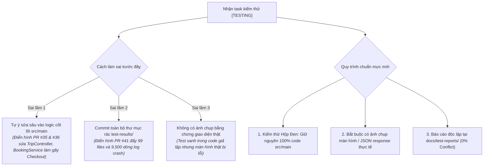
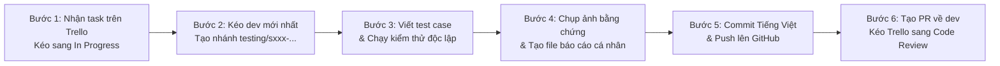

# 📘 SỔ TAY QUY TRÌNH KIỂM THỬ AN TOÀN & BÀN GIAO NGHIỆM THU DỰ ÁN (QA & ACCEPTANCE SOP)

> **Dự án**: Sàn Thương Mại Điện Tử & Đặt Vé Xe Khách Liên Tỉnh Trực Tuyến TravelEasy (`traveleasy-platform`)  
> **Đơn vị thực hiện**: OJT Đồ Án Tốt Nghiệp Nhóm 7  
> **Người ban hành / Phê duyệt**: Phạm Công Thành (Team Leader & System Architect — `thanhphmcong1`)  
> **Đối tượng áp dụng**: Toàn bộ thành viên nhóm 7 (Phát, Phong, Đức, Cường)  
> **Hiệu lực**: Áp dụng bắt buộc cho toàn bộ task kiểm thử từ Sprint 3 đến lễ bảo vệ đồ án Sprint 4  

> 🔗 **TÀI LIỆU LIÊN QUAN TRONG BỘ HỒ SƠ QA & TESTING:**  
> • 📋 **Hồ sơ nghiệm thu 34 trang**: [Biên bản nghiệm thu kiểm thử tính năng nội bộ](./BIEN_BAN_NGHIEM_THU_KIEM_THU_TINH_NANG_NHOM_7.md)  
> • 📊 **Kế hoạch & Báo cáo NFR**: [Kế hoạch & Kết quả kiểm thử toàn diện NFR & 25 Test Cases](./TEST_PLAN_AND_REPORT.md)  
> • 📂 **Thư mục báo cáo thành viên**: [docs/test-reports/](../test-reports/README.md)  
> • 💻 **Mã nguồn kiểm thử tự động**: [Backend Integration Tests](../../backend/src/test/java/com/traveleasy/integration/) | [Frontend E2E Specs](../../frontend/e2e/)  

---

## 📌 1. BỐI CẢNH THỰC TẾ & BÀI HỌC KINH NGHIỆM TỪ CÁC ĐỢT REVIEW PR

Trong quá trình vận hành Sprint 3, nhóm đã phát hiện nhiều vấn đề nghiêm trọng khi các thành viên thực hiện task kiểm thử (`[TESTING]`):



> [!CAUTION]
> ### 3 BÀI HỌC KỸ THUẬT XƯƠNG MÁU:
> 1. **Không can thiệp mã nguồn ngoài phạm vi (Scope Creep)**: Task kiểm thử tuyệt đối **KHÔNG ĐƯỢC TỰ Ý TÁI CẤU TRÚC CODE CHÍNH**. Việc Phong sửa logic khóa ghế trong `BookingService` suýt nữa đã biến toàn bộ tính năng đặt vé trên web thành lỗi `409 Conflict` và gây nguy cơ kẹt chết ghế trong Database.
> 2. **Kiểm thử phải có bằng chứng trực quan (Visual Evidence)**: Không thể nghiệm thu một tính năng chỉ qua lời nói "em test rồi chạy tốt". Mọi task giao diện bắt buộc phải có ảnh chụp trình duyệt; mọi task API bắt buộc phải có JSON response và mã HTTP thực tế.
> 3. **Giữ gìn vệ sinh kho chứa (Git Hygiene)**: Không bao giờ `git add .` một cách bừa bãi. Thư mục rác tạm thời như `test-results/`, `playwright-report/` phải được đưa vào `.gitignore` ngay lập tức.

---

## 🏛️ 2. TRIẾT LÝ KIỂM THỬ AN TOÀN (NON-INVASIVE TESTING)

1. **Kiểm thử viên là Người Thẩm Định Độc Lập (Auditor), không phải Thợ Sửa Mã Nguồn**:
   * Mục tiêu của task kiểm thử là: **Phát hiện lỗi, đo lường độ ổn định và ghi nhận báo cáo**, chứ không phải tự ý đập đi xây lại cấu trúc mã nguồn.
2. **Quy định ranh giới can thiệp tệp tin (File Boundary Rules)**:
   * ✅ **ĐƯỢC PHÉP TẠO / SỬA**:
     * Thư mục kiểm thử: `backend/src/test/java/com/traveleasy/integration/`
     * Thư mục kịch bản E2E: `frontend/e2e/`
     * Thư mục báo cáo cá nhân: `docs/test-reports/<tên-bạn>/` (và `docs/test-reports/<tên-bạn>/screenshots/`)
     * Thư mục ảnh chụp bằng chứng chung: `docs/screenshots/`
   * ❌ **TUYỆT ĐỐI CẤM SỬA (NẾU CHƯA CÓ LỆNH TỪ LEADER)**:
     * Logic nghiệp vụ Backend: `backend/src/main/java/**`
     * Giao diện người dùng: `frontend/src/**`
     * Cấu hình bảo mật & CSDL: `SecurityConfig.java`, `init.sql`, Supabase RPC
   * ⚠️ **Trường hợp phát hiện Bug trong mã nguồn chính**:
     * Ghi nhận mã lỗi vào báo cáo (Ví dụ: `BUG-S317-01: Trang chủ bị tràn chiều ngang trên mobile 375px`).
     * **Dừng lại, không tự sửa code `src/`**, báo cáo trực tiếp cho Trưởng nhóm Phạm Công Thành trên Trello để Leader phân công thành viên phụ trách module đó khắc phục.

> [!TIP]
> ### 💡 PHÁT HIỆN RA BUG LÀ ĐÓNG GÓP LỚN, KHÔNG PHẢI THẤT BẠI!
> **Giải tỏa hiểu lầm phổ biến**: Nhiều bạn lầm tưởng *"Nếu test phát hiện lỗi trong hệ thống thì task kiểm thử của mình bị coi là thất bại/bị phạt nên phải cố sửa code sản phẩm để test xanh"*.  
> **Sự thật hoàn toàn ngược lại**: Nhiệm vụ cao nhất của QA/Tester là phát hiện lỗ hổng trước khi bàn giao cho Hội đồng chấm đồ án. Việc tìm ra Bug, ghi nhận báo cáo chi tiết kèm ảnh chụp và các bước tái hiện (Steps to Reproduce) **ĐƯỢC CHẤM ĐẠT ĐIỂM TỐI ĐA (DoD = PASS)**. Tuyệt đối không được vì muốn test case xanh mà tự ý sửa đè code `src/main` làm hỏng hệ thống!

---

## 🔬 3. QUY CHUẨN KỸ THUẬT THEO TỪNG LOẠI TASK KIỂM THỬ

### 3.1. Đối với task Kiểm thử Backend (`[BE][Sxxx]`)
* **Công nghệ chuẩn**: Spring Boot Test (`@SpringBootTest`), `MockMvc`, `JUnit 5`.
* **Cấu hình môi trường**: Bắt buộc sử dụng `@ActiveProfiles("test")` và `@AutoConfigureMockMvc`.
* **Cách ly dữ liệu (Data Isolation)**:
  ```java
  @BeforeEach
  void setUp() {
      cleanDatabase(); // Xóa sạch dữ liệu thử nghiệm trước mỗi test
      initFixtures();  // Nạp bộ dữ liệu mẫu độc lập
  }

  @AfterEach
  void tearDown() {
      cleanDatabase(); // Dọn dẹp CSDL sau khi test xong
  }
  ```
* **3 Trụ cột kịch bản bắt buộc (Three Pillars)**:
  1. **Luồng chuẩn (Happy Path)**: Dữ liệu hợp lệ $\rightarrow$ Trả về `HTTP 200 OK`, JSON bọc trong `ApiResponse<T>`.
  2. **Dữ liệu biên & Ngoại lệ (Edge Cases & Validation)**: Dữ liệu âm, chuỗi rỗng, vượt quá ký tự, xung đột dữ liệu $\rightarrow$ Trả về `400 Bad Request` hoặc `409 Conflict` kèm thông điệp tiếng Việt thân thiện, không bao giờ để văng mã lỗi `500 Internal Server Error`.
  3. **Bảo mật & Phân quyền (Security & RBAC)**: Thử gọi API khi không có JWT Token hoặc sai Role $\rightarrow$ Bắt buộc trả về `401 Unauthorized` hoặc `403 Forbidden`.
* **Lệnh thực thi trên Terminal (PowerShell)**:
  ```powershell
  # Chạy riêng 1 test class của bạn (Cực nhanh & Độc lập):
  .\gradlew.bat test --tests com.traveleasy.integration.S310ApiIntegrationTest

  # Xem báo cáo HTML chi tiết sau khi chạy:
  start backend/build/reports/tests/test/index.html
  ```

---

### 3.2. Đối với task Kiểm thử Frontend (`[FE][Sxxx]`)
* **Công nghệ**: Playwright E2E (`@playwright/test`) hoặc Kiểm thử thủ công trên trình duyệt thực tế.
* **Lệnh thực thi Playwright trên Terminal**:
  ```powershell
  cd frontend
  # Chạy có giao diện trực quan (Headed mode):
  npx playwright test e2e/S312-acceptance.spec.ts --headed

  # Chạy kiểm thử chế độ tự động ngầm (Headless):
  npx playwright test e2e/S312-acceptance.spec.ts
  ```
* **Ma trận 3 độ phân giải bắt buộc (Cross-Viewport Testing)**:
  | Thiết bị mô phỏng | Độ phân giải (Viewport) | Trọng tâm kiểm tra |
  | :--- | :---: | :--- |
  | **Desktop Full HD** | `1920 x 1080` | Bố cục tổng quan, hiển thị bảng dữ liệu, Sidebar, Header |
  | **Tablet (iPad)** | `768 x 1024` | Thanh điều hướng co giãn, menu ẩn/hiện, sơ đồ 34 ghế |
  | **Mobile (iPhone / Android)** | `375 x 667` hoặc `412 x 915` | **Không bị tràn ngang (No horizontal scroll)**, nút bấm vừa ngón tay, modal căn giữa |
* **Kiểm tra khả năng tiếp cận (Accessibility - a11y)**:
  * Phím `Tab` và `Shift + Tab` phải di chuyển mượt mà qua các ô input, button.
  * Khi focus vào phần tử phải có viền sáng nhận diện (`ring-2 ring-blue-500`).

---

## 📸 4. QUY CHUẨN THU THẬP BẰNG CHỨNG NGHIỆM THU (EVIDENCE STANDARDS)

Một task kiểm thử **không có bằng chứng xác thực sẽ bị coi là CHƯA HOÀN THÀNH (FAIL DoD)**. Bằng chứng được phân loại như sau:

### 4.1. Bằng chứng kiểm thử Giao diện (Screenshots)
* **Thư mục lưu trữ**: `docs/screenshots/`
* **Quy tắc đặt tên file**:
  ```text
  screenshot_<vai_trò>_<tính_năng>_<trạng_thái>.png
  ```
  * *Ví dụ chuẩn*:
    * `screenshot_customer_checkout_vietqr_modal.png` (Màn hình khách quét mã VietQR)
    * `screenshot_customer_mobile_home_375px.png` (Trang chủ trên iPhone)
    * `screenshot_company_trips_modal_create.png` (Modal tạo chuyến xe cổng Nhà xe)
* **Kích thước & Dung lượng**:
  * Chụp rõ nét khu vực thao tác hoặc toàn màn hình (`Full Page`).
  * Dung lượng mỗi ảnh khuyến nghị **< 500 KB** (sử dụng định dạng PNG hoặc JPG).

### 4.2. Bằng chứng kiểm thử API Backend (Terminal & JSON)
* Copy trực tiếp chuỗi JSON Response nhận được từ Postman hoặc terminal MockMvc dán vào báo cáo:
  ```json
  {
    "success": true,
    "message": "Tạo đơn đặt vé thành công!",
    "data": {
      "bookingCode": "BK-20261106-9981",
      "totalAmount": 640000.0,
      "status": "PENDING"
    },
    "timestamp": "2026-11-06T09:00:00"
  }
  ```
* Log đầu ra Terminal thành công:
  ```text
  > Task :test
  S310ApiIntegrationTest > DoD 1: Đặt vé VNPAY & COD PASSED
  S310ApiIntegrationTest > DoD 3: Webhook HMAC-SHA512 PASSED
  BUILD SUCCESSFUL
  ```

---

## 🚀 5. QUY TRÌNH 6 BƯỚC THỰC HIỆN TASK & NỘP PR (ZERO-CONFLICT WORKFLOW)

Mọi thành viên nhóm bắt buộc phải tuân theo đúng 6 bước dưới đây khi làm bất kỳ task kiểm thử nào:



### Bước 1: Tiếp nhận task trên Trello
* Đọc kỹ User Story và checklist Acceptance Criteria trong thẻ Trello.
* Kéo thẻ từ **`To Do`** sang **`In Progress`**.

### Bước 2: Chuẩn bị nhánh Git độc lập
* Đảm bảo cập nhật mã nguồn mới nhất từ `origin/dev`:
  ```bash
  git checkout dev
  git pull origin dev
  ```
* Tạo nhánh kiểm thử riêng đúng cú pháp:
  ```bash
  git checkout -b testing/<mã-thẻ>-<tên-bạn>-<mô-tả-ngắn>
  # Ví dụ chuẩn:
  git checkout -b testing/s310-phong-kiem-thu-thanh-toan
  git checkout -b testing/s317-cuong-kiem-thu-responsive
  ```

### Bước 3: Viết kịch bản & Chạy kiểm thử
* Tạo file test trong thư mục `backend/src/test/` hoặc `frontend/e2e/`.
* Chạy kiểm thử trên máy cá nhân, đảm bảo 100% test case xanh.

### Bước 4: Lập Báo cáo Nghiệm thu độc lập
* Copy file mẫu `docs/test-reports/TEMPLATE_TEST_REPORT.md` vào **đúng thư mục cá nhân của mình**:
  * Nguyễn Đại Phát $\rightarrow$ `docs/test-reports/phat/Sxxx_TEST_REPORT.md`
  * Phạm Thanh Phong $\rightarrow$ `docs/test-reports/phong/Sxxx_TEST_REPORT.md`
  * Trần Minh Đức $\rightarrow$ `docs/test-reports/duc/Sxxx_TEST_REPORT.md`
  * Đoàn Nhật Cường $\rightarrow$ `docs/test-reports/cuong/Sxxx_TEST_REPORT.md`
* Điền đầy đủ thông tin: Bảng kịch bản kiểm thử, Bằng chứng thực thi, Bug phát hiện (nếu có).

### Bước 5: Kiểm tra vệ sinh mã nguồn (Git Hygiene) & Commit
* **CẢNH BÁO QUAN TRỌNG**: Kiểm tra `git status` trước khi add, tuyệt đối không commit thư mục rác `test-results/` hay `node_modules`.
* Lệnh dọn dẹp và chỉ add các file hợp lệ:
  ```powershell
  # 1. Kiểm tra trạng thái các file:
  git status

  # 2. Nếu lỡ dính thư mục rác test-results, gỡ ngay khỏi git tracking:
  git rm -r --cached docs/test-reports/*/test-results/ 2>$null
  git rm -r --cached frontend/test-results/ 2>$null

  # 3. Chỉ add các thư mục thuộc phạm vi kiểm thử được phép:
  git add backend/src/test/ frontend/e2e/ docs/test-reports/<tên-bạn>/ docs/screenshots/

  # 4. Commit bằng Tiếng Việt có dấu đầy đủ theo chuẩn Conventional Commits:
  git commit -m "test(sprint3): nộp báo cáo kiểm thử thẻ [Sxxx] đạt chuẩn DoD"
  git push origin testing/<mã-thẻ>-<tên-bạn>-<mô-tả-ngắn>
  ```

### Bước 6: Tạo Pull Request & Chờ Leader nghiệm thu
* Tạo PR trên GitHub: Base là `dev`, Compare là nhánh của bạn.
* Đặt tiêu đề PR chuẩn mực: `[TESTING] [Sxxx] Tên thẻ kiểm thử - Tên Bạn`
* Kéo thẻ Trello từ **`In Progress`** sang **`Code Review`** hoặc **`Testing`**, dán link PR vào thẻ.
* Trưởng nhóm Phạm Công Thành sẽ rà soát:
  * Nếu đạt 5 tiêu chí DoD: Leader bấm **Merge Pull Request** và kéo thẻ sang **`Done Sprint 3`**.
  * Nếu có lỗi/vi phạm quy chuẩn: Leader gửi Comment yêu cầu điều chỉnh (Request Changes).

---

## 🏆 6. BỘ TIÊU CHÍ DEFINITION OF DONE (DoD 5 TIÊU CHÍ BẮT BUỘC)

Một Pull Request kiểm thử chỉ được Trưởng nhóm phê duyệt khi thỏa mãn đồng thời **5 tiêu chí DoD** sau:

| STT | Tiêu chí DoD | Mô tả chi tiết | Đánh giá |
| :---: | :--- | :--- | :---: |
| **1** | **Bảo toàn mã nguồn (No Invasive Changes)** | Tuyệt đối không tự ý sửa đổi code nghiệp vụ trong `src/main` hoặc `frontend/src`. Nếu phát hiện bug, ghi nhận vào Bug Report, không tự sửa. | Bắt buộc ⭐️ |
| **2** | **Đầy đủ bằng chứng (Proof of Work)** | Có ảnh chụp màn hình thực tế trong `docs/screenshots/` hoặc log terminal JSON response chứng minh tính năng pass. | Bắt buộc ⭐️ |
| **3** | **Báo cáo đúng thư mục (Zero Conflict)** | File báo cáo Markdown nằm đúng thư mục `docs/test-reports/<tên-bạn>/`, không sửa đè file của thành viên khác. | Bắt buộc ⭐️ |
| **4** | **Kho mã nguồn sạch (Git Hygiene)** | Nhánh sạch sẽ (`mergeable: true`), không commit file rác `test-results/`, `playwright-report/` hay file log hệ thống. | Bắt buộc ⭐️ |
| **5** | **Commit Tiếng Việt chuẩn mực** | Commit message viết bằng Tiếng Việt có dấu đầy đủ theo đúng format `type(scope): mô tả hành động`. | Bắt buộc ⭐️ |

---

## 📋 7. BẢNG CHECKLIST 6 BƯỚC TỰ KIỂM TRA TRƯỚC KHI MỞ PR (PRE-PR SELF-CHECK)

Trước khi gõ lệnh `git push` và mở PR, thành viên dành **1 phút** trả lời 6 câu hỏi tự kiểm tra:

| STT | Câu hỏi tự kiểm tra (Self-Check Question) | Cách kiểm tra nhanh | Trạng thái đạt |
|:---:|:---|:---|:---:|
| 1 | Tôi có vô tình sửa file nào trong `src/main/` hoặc `frontend/src/` không? | Gõ `git diff --name-only dev` xem danh sách file | Không có file nào thuộc `src/main/` |
| 2 | Tôi có commit nhầm thư mục rác `test-results/` hay file log nặng không? | Gõ `git status` kiểm tra các file đang staged | Không có file rác |
| 3 | Tôi đã có ảnh chụp màn hình hoặc trích dẫn JSON minh chứng chưa? | Kiểm tra đường dẫn ảnh trong file báo cáo | Ảnh hiển thị rõ ràng |
| 4 | Báo cáo của tôi đã đặt đúng thư mục `docs/test-reports/<tên-tôi>/` chưa? | Kiểm tra đường dẫn file `Sxxx_TEST_REPORT.md` | Đúng thư mục cá nhân |
| 5 | Nhánh của tôi có đang bị xung đột (conflict) với `dev` không? | Gõ `git fetch origin` và `git merge origin/dev` | Báo `Already up to date` hoặc không conflict |
| 6 | Commit message đã viết bằng Tiếng Việt có dấu chuẩn chưa? | Gõ `git log -1 --oneline` kiểm tra | Tiếng Việt chuẩn mực |

---

*Tài liệu này là quy chuẩn kỹ thuật bắt buộc của Đồ án OJT Nhóm 7. Mọi thành viên có trách nhiệm đọc kỹ và tuân thủ tuyệt đối.*
