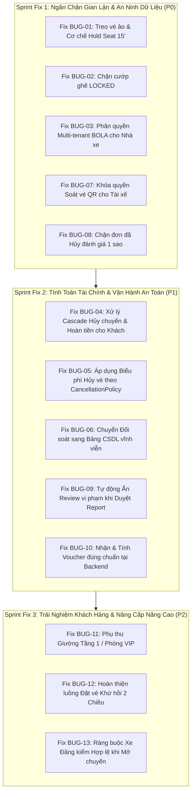

# BẢN RÀ SOÁT & ĐÁNH GIÁ LỖ HỔNG LOGIC NGHIỆP VỤ HỆ THỐNG TRAVELEASY
> **Tài liệu kiểm toán nghiệp vụ thực chiến (OJT Production-Readiness Audit)**  
> **Phiên bản:** 1.0.0 — Dành cho giai đoạn nghiệm thu & chuẩn bị vận hành thương mại  
> **Mục tiêu:** Nhận diện toàn diện các lỗ hổng logic, xung đột dữ liệu, gian lận nghiệp vụ và rủi ro vận hành thực tế so với các sàn bán vé xe khách hàng đầu (Vexere, FUTA Bus Lines).

---

## MỤC LỤC TỔNG QUAN

- [1. Danh sách 13 Lỗ hổng Nghiệp vụ Trọng yếu](#1-danh-sách-13-lỗ-hổng-nghiệp-vụ-trọng-yếu)
- [2. Phân tích Chi tiết Từng Lỗ hổng & Hướng Dẫn Khắc Phục (Step-by-Step)](#2-phân-tích-chi-tiết-từng-lỗ-hổng--hướng-dẫn-khắc-phục)
  - [LỖ HỔNG 1: "Treo vé ảo / Giữ chỗ ma" khi thanh toán Online (Ghost Booking)](#lỗ-hổng-1-treo-vé-ảo--giữ-chỗ-ma-khi-thanh-toán-online-ghost-booking)
  - [LỖ HỔNG 2: Cướp ghế đang được giữ chỗ thanh toán (Concurrent Seat Stealing)](#lỗ-hổng-2-cướp-ghế-đang-được-giữ-chỗ-thanh-toán-concurrent-seat-stealing)
  - [LỖ HỔNG 3: Nhà xe đối thủ có thể can thiệp chuyến của nhau (BOLA / Multi-Tenant Isolation)](#lỗ-hổng-3-nhà-xe-đối-thủ-có-thể-can-thiệp-chuyến-của-nhau-bola--multi-tenant-isolation)
  - [LỖ HỔNG 4: Hủy chuyến xe bỏ rơi hành khách & Không kích hoạt Hoàn tiền](#lỗ-hổng-4-hủy-chuyến-xe-bỏ-rơi-hành-khách--không-kích-hoạt-hoàn-tiền)
  - [LỖ HỔNG 5: Hủy vé sát giờ phạt 0đ & Thiếu Pipeline Hoàn tiền tự động](#lỗ-hổng-5-hủy-vé-sát-giờ-phạt-0đ--thiếu-pipeline-hoàn-tiền-tự-động)
  - [LỖ HỔNG 6: Dữ liệu Quyết toán Đối soát Tài chính lưu tạm trên RAM (In-Memory Settlement)](#lỗ-hổng-6-dữ-liệu-quyết-toán-đối-soát-tài-chính-lưu-tạm-trên-ram-in-memory-settlement)
  - [LỖ HỔNG 7: Endpoint Soát vé QR công khai, ai cũng tự Check-in được](#lỗ-hổng-7-endpoint-soát-vé-qr-công-khai-ai-cũng-tự-check-in-được)
  - [LỖ HỔNG 8: Khách đã Hủy vé vẫn có thể Đánh giá 1 sao Dìm hàng Nhà xe](#lỗ-hổng-8-khách-đã-hủy-vé-vẫn-có-thể-đánh-giá-1-sao-dìm-hàng-nhà-xe)
  - [LỖ HỔNG 9: Duyệt Báo cáo Vi phạm không Ẩn Đánh giá Độc hại](#lỗ-hổng-9-duyệt-báo-cáo-vi-phạm-không-ẩn-đánh-giá-độc-hại)
  - [LỖ HỔNG 10: Voucher kiểm tra trên UI nhưng bị Bỏ quên khi Đặt vé Backend](#lỗ-hổng-10-voucher-kiểm-tra-trên-ui-nhưng-bị-bỏ-quên-khi-đặt-vé-backend)
  - [LỖ HỔNG 11: Định giá Đồng nhất - Không có Phụ thu Giường Tầng 1 / Phòng VIP](#lỗ-hổng-11-định-giá-đồng-nhất---không-có-phụ-thu-giường-tầng-1--phòng-vip)
  - [LỖ HỔNG 12: Đặt vé Khứ Hồi chỉ hiển thị Nút UI, Thiếu Luồng Xử lý 2 Chiều](#lỗ-hổng-12-đặt-vé-khứ-hồi-chỉ-hiển-thị-nút-ui-thiếu-luồng-xử-lý-2-chiều)
  - [LỖ HỔNG 13: Gán Biển số Tự do, Không Kiểm tra Hồ sơ Giấy tờ Xe Hợp lệ](#lỗ-hổng-13-gán-biển-số-tự-do-không-kiểm-tra-hồ-sơ-giấy-tờ-xe-hợp-lệ)
- [3. Kế hoạch Lộ trình Khắc phục (Remediation Roadmap)](#3-kế-hoạch-lộ-trình-khắc-phục-remediation-roadmap)

---

## 1. DANH SÁCH 13 LỖ HỔNG NGHIỆP VỤ TRỌNG YẾU

| Mã Lỗ Hổng | Tên Lỗ Hổng Nghiệp Vụ | Mức Độ | Module Ảnh Hưởng | Hậu Quả Thực Tế |
| :--- | :--- | :---: | :--- | :--- |
| **BUG-LOGIC-01** | Treo vé ảo khi chọn thanh toán Online | **CRITICAL** | `BookingService`, `PaymentService` | Bị đối thủ spam giữ hết ghế xe mà không cần trả tiền |
| **BUG-LOGIC-02** | Cướp ghế đang được giữ chỗ thanh toán (Bypass LOCKED) | **CRITICAL** | `BookingService`, `SeatRealtimeService` | 2 khách tranh chấp cùng 1 ghế, khách đang điền form bị cướp mất ghế |
| **BUG-LOGIC-03** | Nhà xe này sửa/xóa được chuyến của nhà xe khác (BOLA) | **CRITICAL** | `CompanyManagementController` | Nhà xe đối thủ cố tình xóa hoặc phá hoại lịch chạy của nhau |
| **BUG-LOGIC-04** | Hủy chuyến xe bỏ rơi hành khách, vé vẫn ISSUED | **CRITICAL** | `AdminTripService`, `TripRepository` | Khách ra bến mới biết xe hủy, không được hoàn tiền hay thông báo |
| **BUG-LOGIC-05** | Hủy vé sát giờ phạt 0đ & Thiếu luồng hoàn tiền tự động | **HIGH** | `BookingService`, `CancellationPolicy` | Nhà xe chịu lỗ vì khách hủy trước 1 phút; khách không nhận lại tiền |
| **BUG-LOGIC-06** | Dữ liệu đối soát tài chính lưu RAM (Biến mất khi Restart) | **HIGH** | `AdminManagementService`, `CompanyController` | Mất toàn bộ lịch sử thanh toán giải ngân, rủi ro pháp lý kế toán |
| **BUG-LOGIC-07** | Endpoint Soát vé QR công khai, khách tự check-in được | **HIGH** | `BookingController`, `SecurityConfig` | Khách hoặc người ngoài tự gửi API check-in mà không qua tài xế |
| **BUG-LOGIC-08** | Khách đã hủy vé vẫn vào đánh giá 1 sao phá hoại | **HIGH** | `PublicContentController` | Đánh giá ảo dìm uy tín nhà xe từ đơn hàng đã hủy |
| **BUG-LOGIC-09** | Duyệt báo cáo vi phạm không ẩn đánh giá độc hại | **MEDIUM** | `AdminManagementService`, `ReviewRepository` | Bình luận xúc phạm, spam quảng cáo vẫn hiển thị trên sàn |
| **BUG-LOGIC-10** | Áp dụng Voucher trên UI nhưng Backend tính giá gốc | **MEDIUM** | `BookingService`, `CreateBookingRequest` | Khách bị trừ tiền gốc; mã giảm giá bị dùng vô hạn lần không trừ lượt |
| **BUG-LOGIC-11** | Bán cào bằng 1 giá cho cả tầng 1, tầng 2 và phòng VIP | **MEDIUM** | `BookingService`, `TripSeat`, `SeatType` | Thất thu doanh thu phụ thu tiện ích giường VIP của nhà xe |
| **BUG-LOGIC-12** | Nút Khứ hồi trên UI bỏ qua ngày về khi tìm kiếm | **MEDIUM** | `SearchTripBar.tsx`, `SchedulePage.tsx` | Khách không thể đặt vé 2 chiều trong cùng 1 lần thanh toán |
| **BUG-LOGIC-13** | Gán biển số xe tự do, không kiểm tra thẩm định giấy tờ | **MEDIUM** | `AdminTripService`, `VehicleRepository` | Xe hết hạn đăng kiểm / bảo hiểm vẫn được chạy chở khách |

---

## 2. PHÂN TÍCH CHI TIẾT TỪNG LỖ HỔNG & HƯỚNG DẪN KHẮC PHỤC

### LỖ HỔNG 1: "Treo vé ảo / Giữ chỗ ma" khi thanh toán Online (Ghost Booking)
* **Tệp tin:** `backend/src/main/java/com/traveleasy/service/customer/BookingService.java` (dòng 100-135)
* **Nguyên nhân code:**
  Khi người dùng tạo đơn chọn thanh toán VNPAY / PayOS / VietQR, hệ thống ngay lập tức set:
  ```java
  booking.setStatus(BookingStatus.CONFIRMED);
  for (TripSeat seat : requestedSeats) seat.setStatus(SeatStatus.BOOKED);
  ticket.setStatus(TicketStatus.ISSUED);
  ```
* **Rủi ro:** Khách chỉ cần mở trang thanh toán VNPAY rồi tắt trình duyệt. Đơn đã được chốt, vé đã xuất, ghế đã chuyển sang xám (BOOKED) vĩnh viễn dù nhà xe không nhận được 1 đồng nào.
* **Cách khắc phục:**
  1. Nếu `paymentMethod != COD`, khởi tạo:
     - `Booking.status = BookingStatus.PENDING_PAYMENT`
     - `TripSeat.status = SeatStatus.LOCKED`
     - `Booking.paymentDeadline = LocalDateTime.now().plusMinutes(15)`
     - `Ticket.status = TicketStatus.PENDING`
  2. Chỉ khi nhận được Callback thành công từ VNPAY (`responseCode == "00"`) hoặc Webhook PayOS (`status == "PAID"`) mới nâng cấp lên `CONFIRMED` và `BOOKED`.
  3. Viết Scheduled Job chạy mỗi 1 phút: quét các đơn `PENDING_PAYMENT` quá hạn 15 phút $\rightarrow$ Hủy đơn, nhả ghế về `AVAILABLE`, broadcast SSE cập nhật màu ghế cho người dùng.

---

### LỖ HỔNG 2: Cướp ghế đang được giữ chỗ thanh toán (Concurrent Seat Stealing)
* **Tệp tin:** `backend/src/main/java/com/traveleasy/service/customer/BookingService.java` (dòng 61-65)
* **Nguyên nhân code:**
  Trong vòng lặp kiểm tra ghế khả dụng của `createBooking`:
  ```java
  for (TripSeat seat : requestedSeats) {
      if (seat.getStatus() == SeatStatus.BOOKED) {
          throw new AppException(ErrorCode.SEAT_ALREADY_BOOKED, "Ghế đã có người đặt");
      }
  }
  ```
  Code chỉ kiểm tra `BOOKED`, hoàn toàn **không kiểm tra `SeatStatus.LOCKED`**!
* **Rủi ro:** Khi khách hàng A chọn ghế và sang bước nhập thông tin/thanh toán, `SeatRealtimeService` đã khóa ghế A thành `LOCKED` (màu vàng). Khách B mở app gọi API đặt vé trực tiếp thì hệ thống vẫn cho phép khách B mua thành công, cướp trắng ghế của khách A!
* **Cách khắc phục:**
  1. Thêm cột `holder_session_id` và `locked_until` vào bảng `trip_seats`.
  2. Bổ sung kiểm tra trong `createBooking`:
     ```java
     if (seat.getStatus() == SeatStatus.BOOKED) {
         throw new AppException(ErrorCode.SEAT_ALREADY_BOOKED, "Ghế " + seat.getSeatCode() + " đã có người mua vé!");
     }
     if (seat.getStatus() == SeatStatus.LOCKED) {
         boolean isOwner = sessionId != null && sessionId.equals(seat.getHolderSessionId()) 
                 && seat.getLockedUntil() != null && seat.getLockedUntil().isAfter(LocalDateTime.now());
         if (!isOwner) {
             throw new AppException(ErrorCode.VALIDATION_ERROR, "Ghế " + seat.getSeatCode() + " đang được người khác giữ chỗ thanh toán!");
         }
     }
     ```

---

### LỖ HỔNG 3: Nhà xe đối thủ có thể can thiệp chuyến của nhau (BOLA / Multi-Tenant Isolation)
* **Tệp tin:** `backend/src/main/java/com/traveleasy/controller/company/CompanyManagementController.java` (dòng 112-131)
* **Nguyên nhân code:**
  Các API cập nhật và xóa chuyến xe:
  ```java
  @PutMapping("/trips/{id}")
  public ApiResponse<TripResponse> updateCompanyTrip(@PathVariable Long id, @Valid @RequestBody UpdateTripRequest request) {
      return ApiResponse.success(adminTripService.updateTrip(id, request));
  }
  @DeleteMapping("/trips/{id}")
  public ApiResponse<Void> deleteCompanyTrip(@PathVariable Long id) {
      adminTripService.deleteTrip(id);
      return ApiResponse.success(null);
  }
  ```
  Code không nhận `Authentication`, không kiểm tra chuyến xe có ID `{id}` có thuộc về nhà xe của tài khoản đang đăng nhập hay không!
* **Rủi ro:** Tài khoản Operator của Nhà xe A có thể gửi ID chuyến xe của Nhà xe B để sửa giờ, tăng giá vé đột biến, hoặc xóa luôn chuyến của đối thủ!
* **Cách khắc phục:**
  1. Trích xuất `busCompanyId` từ tài khoản đăng nhập: `Long currentCompanyId = resolveTargetCompanyId(null, authentication);`
  2. Trong `AdminTripService`, trước khi cập nhật/xóa, kiểm tra:
     ```java
     if (!currentUser.hasRole("ADMIN") && !trip.getBusCompany().getId().equals(currentCompanyId)) {
         throw new AppException(ErrorCode.FORBIDDEN, "Bạn không có quyền can thiệp chuyến xe của nhà xe khác!");
     }
     ```

---

### LỖ HỔNG 4: Hủy chuyến xe bỏ rơi hành khách & Không kích hoạt Hoàn tiền
* **Tệp tin:** `backend/src/main/java/com/traveleasy/service/admin/AdminTripService.java` (dòng 131-136)
* **Nguyên nhân code:**
  Khi nhà xe hoặc Admin hủy chuyến:
  ```java
  public TripResponse updateTripStatus(Long tripId, TripStatus status) {
      Trip trip = tripRepository.findById(tripId)...;
      trip.setStatus(status);
      return tripService.mapToTripResponse(tripRepository.save(trip));
  }
  ```
  Hệ thống chỉ cập nhật duy nhất 1 dòng trạng thái trên bảng `trips`.
* **Rủi ro:** Các vé đã bán (`CONFIRMED`, `ISSUED`) vẫn nằm nguyên vẹn. Khách hàng không hề biết chuyến đã bị hủy cho đến khi ra đến bến xe; tiền vé của khách vẫn bị treo không được hoàn lại.
* **Cách khắc phục:**
  Khi `status == TripStatus.CANCELLED`:
  1. Tìm toàn bộ `Booking` thuộc `tripId` đang ở trạng thái `CONFIRMED`.
  2. Chuyển trạng thái sang `CANCELLED_BY_OPERATOR`.
  3. Tự động sinh bản ghi `RefundTransaction` hoàn trả 100% số tiền vé cho hành khách.
  4. Bắn thông báo khẩn qua WebSocket / SSE / Email cho toàn bộ hành khách đã mua vé.

---

### LỖ HỔNG 5: Hủy vé sát giờ phạt 0đ & Thiếu Pipeline Hoàn tiền tự động
* **Tệp tin:** `backend/src/main/java/com/traveleasy/service/customer/BookingService.java` (dòng 165-207)
* **Nguyên nhân code:**
  Hệ thống chỉ kiểm tra:
  ```java
  if (booking.getTrip().getDepartureTime().isBefore(LocalDateTime.now())) {
      throw new AppException(ErrorCode.VALIDATION_ERROR, "Chuyến xe đã khởi hành, không thể hủy");
  }
  ```
* **Rủi ro:** Khách hủy vé trước giờ xe chạy 5 phút vẫn được chấp nhận hủy thành công mà không mất bất kỳ đồng phí nào. Ngoài ra, code chỉ cập nhật trạng thái `CANCELLED` trong CSDL mà không có mã tích hợp hoàn tiền tự động (Refund) về thẻ/tài khoản ngân hàng của khách.
* **Cách khắc phục:**
  1. Tính khoảng cách thời gian từ hiện tại đến `departureTime`:
     - $\ge 24$ tiếng: Thu phí hủy 10% (Hoàn lại 90%).
     - Từ 12 đến 24 tiếng: Thu phí hủy 50% (Hoàn lại 50%).
     - Dưới 12 tiếng: Phí hủy 100% (Không hỗ trợ hủy hoàn tiền trực tuyến).
  2. Bổ sung bảng `refund_requests` để theo dõi tiến trình hoàn tiền qua cổng thanh toán (VNPAY Refund API / VietQR Refund).

---

### LỖ HỔNG 6: Dữ liệu Quyết toán Đối soát Tài chính lưu tạm trên RAM (In-Memory Settlement)
* **Tệp tin:** `backend/src/main/java/com/traveleasy/service/admin/AdminManagementService.java` (dòng 685)
* **Nguyên nhân code:**
  ```java
  private final Map<String, Map<String, Object>> settlementOverrides = new ConcurrentHashMap<>();
  ```
* **Rủi ro:** Toàn bộ thông tin chốt đối soát doanh thu sàn (phí sàn 10%), mã giao dịch ngân hàng chuyển tiền cho đối tác nhà xe (`payoutTxHash`), và ghi chú kế toán đều lưu tạm trong RAM. Mỗi lần khởi động lại server hoặc deploy phiên bản mới thì toàn bộ dữ liệu tài chính này bốc hơi hoàn toàn.
* **Cách khắc phục:**
  Tạo 2 bảng CSDL chính thức:
  - `settlement_periods`: Kỳ đối soát (Mã kỳ, Nhà xe, Từ ngày, Đến ngày, Tổng doanh thu, Hoa hồng sàn, Thực chi, Trạng thái PENDING/RECONCILED/PAID).
  - `settlement_trips`: Chi tiết các chuyến xe và số vé bán ra trong kỳ đối soát đó.

---

### LỖ HỔNG 7: Endpoint Soát vé QR công khai, ai cũng tự Check-in được
* **Tệp tin:** `backend/src/main/java/com/traveleasy/controller/customer/BookingController.java` (dòng 51-55)
* **Nguyên nhân code:**
  ```java
  @PostMapping("/check-in/{ticketCode}")
  public ApiResponse<VerifiedTicketResponse> checkInTicket(@PathVariable String ticketCode)
  ```
* **Rủi ro:** Endpoint này không yêu cầu đăng nhập và không giới hạn quyền tài xế. Bất kỳ ai có được mã vé (ví dụ: `TK-20261103-XXXX-01`) đều có thể tự gửi request check-in từ xa.
* **Cách khắc phục:**
  1. Thêm phân quyền bắt buộc: `@PreAuthorize("hasRole('OPERATOR') or hasRole('ADMIN')")`.
  2. Kiểm tra tài xế soát vé phải thuộc đúng nhà xe của chuyến đi:
     `if (!operatorCompanyId.equals(ticket.getBooking().getTrip().getBusCompany().getId())) throw FORBIDDEN`.
  3. Ghi vết: `checked_in_by = currentOperatorEmail`, `checked_in_at = LocalDateTime.now()`.

---

### LỖ HỔNG 8: Khách đã Hủy vé vẫn có thể Đánh giá 1 sao Dìm hàng Nhà xe
* **Tệp tin:** `backend/src/main/java/com/traveleasy/controller/customer/PublicContentController.java` (dòng 368-375)
* **Nguyên nhân code:**
  ```java
  if (booking.getStatus() == BookingStatus.COMPLETED) {
      isCompleted = true;
  } else if (trip != null && trip.getDepartureTime().isBefore(now)) {
      isCompleted = true; // LỖI Ở ĐÂY: Quá giờ là cho đánh giá bất kể đơn vé đã hủy!
  }
  ```
* **Rủi ro:** Kẻ xấu đặt vé xong bấm HỦY VÉ ngay lập tức, đợi đến sau giờ xe khởi hành là có thể vào viết đánh giá tiêu cực 1 sao vu khống nhà xe, làm rớt điểm uy tín của đối tác.
* **Cách khắc phục:**
  Bổ sung điều kiện chặn đứng đầu hàm:
  ```java
  if (booking.getStatus() == BookingStatus.CANCELLED) {
      return ApiResponse.error("Đơn vé đã bị hủy, không thể gửi đánh giá cho chuyến đi này!");
  }
  // Khuyến nghị nâng cao: Chỉ cho phép đánh giá khi vé đã được soát lên xe (TicketStatus.USED)
  ```

---

### LỖ HỔNG 9: Duyệt Báo cáo Vi phạm không Ẩn Đánh giá Độc hại
* **Tệp tin:** `backend/src/main/java/com/traveleasy/service/admin/AdminManagementService.java` (dòng 522-531)
* **Nguyên nhân code:**
  Khi Admin xử lý báo cáo đánh giá vi phạm (`APPROVED`), code chỉ cập nhật:
  ```java
  report.setStatus("APPROVED");
  reviewReportRepository.save(report);
  ```
  Nhưng **không hề cập nhật bản ghi đánh giá gốc trên bảng `reviews`**!
* **Rủi ro:** Dù Admin đã duyệt báo cáo và xác nhận bình luận đó chứa ngôn từ xúc phạm hoặc quảng cáo sai sự thật, bình luận độc hại vẫn tiếp tục hiển thị công khai trên website.
* **Cách khắc phục:**
  Khi report chuyển sang `APPROVED`, tự động tìm đánh giá gốc và set: `review.setStatus("HIDDEN")` hoặc `reviewRepository.delete(review)`, đồng thời xóa cache `public_reviews`.

---

### LỖ HỔNG 10: Voucher kiểm tra trên UI nhưng bị Bỏ quên khi Đặt vé Backend
* **Tệp tin:** `backend/src/main/java/com/traveleasy/dto/booking/CreateBookingRequest.java` & `BookingService.java`
* **Nguyên nhân code:**
  - `PublicContentController` có API kiểm tra mã voucher (`/promotions/check-voucher`).
  - Nhưng DTO `CreateBookingRequest` **hoàn toàn không có trường `voucherCode`**!
  - Trong `BookingService.createBooking`, tổng tiền vé luôn được tính thuần túy: `totalAmount = totalAmount.add(trip.getPrice())`.
* **Rủi ro:** Khách nhập mã giảm giá trên giao diện nhìn thấy giảm tiền, nhưng khi bấm "Thanh toán", đơn hàng vẫn tạo với 100% giá gốc. Mặt khác, trường `used_count` trong bảng `promotions` không bao giờ tăng, dẫn đến mã giảm giá bị lợi dụng vô hạn.
* **Cách khắc phục:**
  1. Thêm trường `voucherCode` vào `CreateBookingRequest`.
  2. Trong `BookingService`, tính toán lại số tiền giảm hợp lệ tại server, lưu `discount_amount` và `final_amount` vào bảng `bookings`.
  3. Tăng `used_count` của promotion và lưu vết mã voucher đã sử dụng vào đơn.

---

### LỖ HỔNG 11: Định giá Đồng nhất - Không có Phụ thu Giường Tầng 1 / Phòng VIP
* **Tệp tin:** `backend/src/main/java/com/traveleasy/service/customer/BookingService.java` (dòng 71)
* **Nguyên nhân code:**
  Hệ thống tính tiền bằng cách cộng dồn giá chung của chuyến: `totalAmount = totalAmount.add(trip.getPrice())`.
* **Rủi ro:** Trên thực tế, giường tầng dưới (tầng 1) luôn có giá cao hơn giường tầng trên từ 20.000đ - 50.000đ do không rung lắc. Ghế hàng đầu hoặc phòng VIP Limousine cũng có phụ thu riêng. Bán cào bằng làm giảm doanh thu của nhà xe và mất tính cạnh tranh.
* **Cách khắc phục:**
  Áp dụng công thức tính giá theo từng ghế:
  $$\text{SeatPrice} = \text{Trip.basePrice} + \text{SeatType.surcharge}$$

---

### LỖ HỔNG 12: Đặt vé Khứ Hồi chỉ hiển thị Nút UI, Thiếu Luồng Xử lý 2 Chiều
* **Tệp tin:** `frontend/src/components/SearchTripBar.tsx` (dòng 367-425) & `SchedulePage.tsx`
* **Nguyên nhân code:**
  Nút "+ Thêm ngày về" cho phép chọn `returnDate` và truyền qua `onSearch(origin, destination, departureDate, returnDate)`. Tuy nhiên, trang `SchedulePage.tsx` chỉ dùng `departureDate` để lọc danh sách chuyến, hoàn toàn bỏ qua `returnDate` và không có giao diện chọn chuyến về.
* **Rủi ro:** Người dùng muốn đặt vé khứ hồi phải đặt 2 lần riêng biệt, dễ xảy ra tình trạng đã mua được vé đi nhưng chuyến về lại hết vé, buộc phải hủy vé đi.
* **Cách khắc phục:**
  Xây dựng luồng State Machine 2 bước:
  1. **Bước 1:** Chọn chuyến đi $\rightarrow$ Chọn ghế đi.
  2. **Bước 2:** Hệ thống tự động đảo chiều lộ trình (`origin` $\leftrightarrow$ `destination`), hiển thị danh sách chuyến ngày về $\rightarrow$ Chọn ghế về.
  3. **Bước 3:** Gộp cả 2 chuyến vào một màn hình thanh toán duy nhất.

---

### LỖ HỔNG 13: Gán Biển số Tự do, Không Kiểm tra Hồ sơ Giấy tờ Xe Hợp lệ
* **Tệp tin:** `backend/src/main/java/com/traveleasy/service/admin/AdminTripService.java` (dòng 51-61) & `Trip.java`
* **Nguyên nhân code:**
  Trường `licensePlate` trong thực thể `Trip` chỉ là một chuỗi ký tự tự do (`String licensePlate`), không liên kết với bảng `vehicles` và không kiểm tra trạng thái tuân thủ `compliance_status`.
* **Rủi ro:** Nhà xe có thể nhập biển số xe bất kỳ, kể cả xe chưa nộp 4 loại giấy tờ bắt buộc (Cà vẹt, Đăng kiểm, Bảo hiểm, Phù hiệu Sở GTVT) hoặc xe đã quá hạn kiểm định, vi phạm nghiêm trọng quy chuẩn an toàn vận tải.
* **Cách khắc phục:**
  1. Thay thế `licensePlate` bằng quan hệ `@ManyToOne Vehicle vehicle`.
  2. Khi tạo hoặc cập nhật chuyến, kiểm tra điều kiện tiên quyết:
     `if (vehicle.getComplianceStatus() != ComplianceStatus.VERIFIED) throw ErrorCode.VEHICLE_NOT_COMPLIANT`.
     `if (vehicle.getInspectionExpiryDate().isBefore(trip.getDepartureTime().toLocalDate())) throw ErrorCode.VEHICLE_INSPECTION_EXPIRED`.

---

## 3. KẾ HOẠCH LỘ TRÌNH KHẮC PHỤC (REMEDIATION ROADMAP)

Để đảm bảo dự án OJT đạt chất lượng thương mại và có thể vận hành ổn định trong môi trường thực tế, lộ trình khắc phục được chia thành 3 giai đoạn:



---
*Tài liệu này được tạo và lưu trữ cố định tại:* `docs/06-business-logic-audits/BUSINESS_LOGIC_AUDIT_REPORT.md`  
*Sẵn sàng để tra cứu, báo cáo tiến độ với Giảng viên/Doanh nghiệp OJT và thực hiện fix lần lượt theo kế hoạch.*
