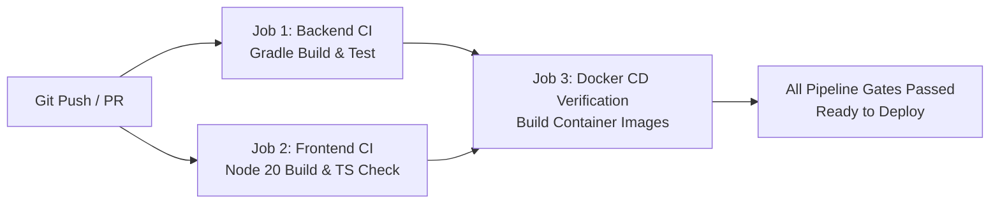

# HƯỚNG DẪN CÀI ĐẶT & TRIỂN KHAI HỆ THỐNG TRAVELEASY PLATFORM
## CẨM NANG DEVOPS, DOCKER COMPOSE, CI/CD PIPELINE & MÔI TRƯỜNG CLOUD
### MÃ DỰ ÁN: `PRJ-TRAVELEASY-MVP-01` | MÔ HÌNH VẬN HÀNH: VEXERE PLATFORM

---

> **MỤC TIÊU TÀI LIỆU:** Hướng dẫn toàn diện quy trình thiết lập môi trường phát triển (Local Development) và triển khai đóng gói container hóa (Production Docker Containers) cho mọi thành viên và hội đồng thẩm định.

---

## 1. YÊU CẦU MÔI TRƯỜNG HỆ THỐNG (SYSTEM PREREQUISITES)

Để đảm bảo hệ thống vận hành tối ưu, máy chủ hoặc máy tính phát triển cần đáp ứng các thông số sau:
* **Hệ điều hành**: Windows 10/11 (hỗ trợ WSL2), Ubuntu Linux 22.04 LTS hoặc macOS (Apple Silicon / Intel).
* **Java Development Kit (JDK)**: **Java 21 LTS** (Khuyến nghị dùng [Eclipse Temurin 21](https://adoptium.net/temurin/releases/?version=21)).
* **Node.js**: Phiên bản **Node 20 LTS** hoặc **Node 22 LTS** kèm `npm` v10+.
* **Docker & Docker Compose**: Docker Engine v24+ và Docker Compose v2.20+.
* **Git**: Phiên bản 2.40+ hỗ trợ phân nhánh và Conventional Commits.
* **Cơ sở dữ liệu (Tùy chọn)**: MySQL 8.0 Community Server (nếu không dùng Docker).

---

## 2. BỐN PHƯƠNG THỨC TRIỂN KHAI HỆ THỐNG (DEPLOYMENT MODES)

### 🌟 PHƯƠNG THỨC 1: Khởi chạy 1-Click với Docker Compose (KHUYẾN NGHỊ NGHIỆM THU)
Phương thức này tự động đóng gói và khởi chạy toàn bộ 3 dịch vụ: Cơ sở dữ liệu MySQL 8.0 (kèm tự động nạp 36 bảng CSDL và dữ liệu mẫu `init.sql`), Máy chủ Backend Spring Boot 3 và Giao diện Frontend React Nginx.

```bash
# Bước 1: Clone kho mã nguồn từ GitHub
git clone https://github.com/phamcongthanhvn2k6/traveleasy-platform.git
cd traveleasy-platform

# Bước 2: Khởi chạy toàn bộ hệ sinh thái chỉ với 1 câu lệnh
docker compose up -d --build

# Bước 3: Kiểm tra trạng thái các container đang chạy
docker compose ps
```

* **Địa chỉ truy cập các dịch vụ**:
  - **Frontend Application (Khách hàng & Admin)**: `http://localhost:3000`
  - **Backend RESTful API & Swagger UI**: `http://localhost:8080/swagger-ui.html`
  - **MySQL Database Server**: Cổng `3306`, Database: `traveleasy_db`, User: `traveleasy_user`, Mật khẩu: `traveleasy_password`.

* **Lệnh xem nhật ký thời gian thực (Live Logs)**:
```bash
docker compose logs -f backend
docker compose logs -f frontend
```

* **Dừng và thu hồi tài nguyên**:
```bash
docker compose down
```

---

### ⚡ PHƯƠNG THỨC 2: Khởi chạy Zero-Setup với Dev Profile (H2 In-Memory DB)
Dành cho việc kiểm tra code nhanh chóng mà không cần cài đặt hoặc khởi động bất kỳ phần mềm cơ sở dữ liệu nào:

#### 1. Khởi chạy Backend:
```bash
cd backend
# Trên Windows PowerShell:
.\gradlew.bat bootRun --args='--spring.profiles.active=dev'

# Trên Linux / macOS:
./gradlew bootRun --args='--spring.profiles.active=dev'
```
*Backend tự động tạo cấu trúc bảng trong bộ nhớ RAM và sẵn sàng tại `http://localhost:8080`.*

#### 2. Khởi chạy Frontend:
```bash
cd frontend
npm install
npm run dev
```
*Giao diện mở tại `http://localhost:5173` (tự động điều hướng gọi API về port 8080).*

---

### ☁️ PHƯƠNG THỨC 3: Triển khai Kết nối Supabase Cloud PostgreSQL
Dành cho 6 thành viên trong nhóm làm việc phân tán, cùng chia sẻ chung một cơ sở dữ liệu đám mây để dữ liệu luôn đồng bộ:

1. Đăng nhập vào [Supabase Console](https://supabase.com/dashboard/project/ctvcwhdepzyvqsncbslf/database/schemas).
2. Cập nhật biến môi trường kết nối trong file `.env`:
```properties
SPRING_DATASOURCE_URL=jdbc:postgresql://db.ctvcwhdepzyvqsncbslf.supabase.co:5432/postgres
SPRING_DATASOURCE_USERNAME=postgres
SPRING_DATASOURCE_PASSWORD=your_supabase_password
SPRING_JPA_DATABASE_PLATFORM=org.hibernate.dialect.PostgreSQLDialect
```
3. Khởi chạy Backend và Frontend như bình thường.

---

### 🛠️ PHƯƠNG THỨC 4: Triển khai Thủ công với MySQL 8.0 Vật lý
Dành cho máy chủ phát triển cục bộ có sẵn dịch vụ MySQL 8.0:

1. **Khởi tạo Cơ sở dữ liệu**:
```sql
CREATE DATABASE IF NOT EXISTS traveleasy_db CHARACTER SET utf8mb4 COLLATE utf8mb4_unicode_ci;
CREATE USER IF NOT EXISTS 'traveleasy_user'@'localhost' IDENTIFIED BY 'traveleasy_password';
GRANT ALL PRIVILEGES ON traveleasy_db.* TO 'traveleasy_user'@'localhost';
FLUSH PRIVILEGES;
```
2. **Nạp dữ liệu mẫu 36 bảng chuẩn**:
```bash
mysql -u traveleasy_user -ptraveleasy_password traveleasy_db < init.sql
```
3. **Cấu hình file `backend/src/main/resources/application.properties`**:
```properties
spring.datasource.url=jdbc:mysql://localhost:3306/traveleasy_db?useSSL=false&serverTimezone=UTC&allowPublicKeyRetrieval=true
spring.datasource.username=traveleasy_user
spring.datasource.password=traveleasy_password
spring.jpa.hibernate.ddl-auto=validate
```
4. **Khởi chạy Backend & Frontend**:
```bash
# Terminal 1: Backend
cd backend && .\gradlew.bat bootRun

# Terminal 2: Frontend
cd frontend && npm run dev
```

---

## 3. DANH SÁCH TÀI KHOẢN THỬ NGHIỆM CÓ SẴN (PRE-SEEDED ACCOUNTS)

Hệ thống đã nạp sẵn 4 tài khoản đại diện cho 4 vai trò trên CSDL:

| Vai trò người dùng | Địa chỉ Email đăng nhập | Mật khẩu chuẩn | Mục đích kiểm thử / Demo |
|---|---|---|---|
| **Quản trị viên Hệ thống (`ROLE_ADMIN`)** | `admin@traveleasy.vn` | `Admin@2026` | Quản trị toàn hệ thống, xem KPI Dashboard, duyệt chính sách |
| **Nhà xe Đối tác (`ROLE_OPERATOR`)** | `operator.futa@traveleasy.vn` | `Password123!` | Quản lý đội xe, tạo chuyến, kiểm tra khách đặt của FUTA |
| **Tài xế Xe khách (`ROLE_DRIVER`)** | `driver.futa1@traveleasy.vn` | `Password123!` | Xem danh sách hành khách lên xe, quét mã QR soát vé |
| **Khách hàng Cá nhân (`ROLE_CUSTOMER`)** | `customer@gmail.com` | `Password123!` | Tìm kiếm chuyến, chọn ghế, khóa 10 phút, đặt vé, nhận vé QR |

---

## 4. QUY TRÌNH TỰ ĐỘNG HÓA CI/CD PIPELINE (GITHUB ACTIONS)

Tệp cấu hình `.github/workflows/ci-cd.yml` tự động giám sát mọi Pull Request và Push vào nhánh `main` và `dev`:



### Chi tiết 3 công đoạn kiểm định:
1. **Job `backend-ci`**:
   - Thiết lập môi trường Java 21 Temurin.
   - Cấp quyền thực thi và chạy `./gradlew bootJar --no-daemon`.
   - Đóng gói file `.jar` và lưu trữ dưới dạng Artifact.
2. **Job `frontend-ci`**:
   - Thiết lập môi trường Node.js 20 LTS.
   - Chạy `npm install` và `npm run build` (kiểm tra type-checking TypeScript và tối ưu hóa bundle).
   - Lưu trữ thư mục `dist/` dưới dạng Artifact.
3. **Job `docker-cd-verification`**:
   - Chạy sau khi cả 2 jobs trên thành công.
   - Kiểm tra tính hợp lệ của cấu trúc `docker compose config`.
   - Biên dịch Docker Image cho cả 3 container dịch vụ để đảm bảo không có lỗi cấu hình môi trường.

---

## 5. HƯỚNG DẪN XỬ LÝ SỰ CỐ DEVOPS THƯỜNG GẶP (TROUBLESHOOTING)

### 5.1 Trùng cổng dịch vụ (Port Conflict 8080 hoặc 3000)
* **Triệu chứng**: Thông báo lỗi `Bind for 0.0.0.0:8080 failed: port is already allocated`.
* **Cách khắc phục**:
  - Kiểm tra tiến trình đang chiếm cổng trên Windows:
    ```powershell
    netstat -ano | findstr :8080
    taskkill /PID <PID_NUMBER> /F
    ```
  - Hoặc chỉnh sửa cổng công khai trong file `docker-compose.yml`:
    ```yaml
    ports:
      - "8081:8080" # Đổi cổng ngoài thành 8081
    ```

### 5.2 Lỗi CORS khi gọi API từ Frontend
* **Triệu chứng**: Lỗi `Cross-Origin Request Blocked` trên Console trình duyệt.
* **Cách khắc phục**: Kiểm tra cấu hình `CorsConfig.java` trong `backend/src/main/java/com/traveleasy/config/CorsConfig.java`. Đảm bảo các origin `http://localhost:3000` và `http://localhost:5173` nằm trong danh sách `allowedOrigins`.

### 5.3 Lỗi MySQL `Access denied for user` trong Docker
* **Triệu chứng**: Backend không thể kết nối tới container cơ sở dữ liệu.
* **Cách khắc phục**: Đảm bảo tệp `.env` đồng bộ thông số với `docker-compose.yml`. Khi thay đổi mật khẩu database, cần xóa volume cũ để MySQL nạp lại dữ liệu khởi tạo:
  ```bash
  docker compose down -v
  docker compose up -d --build
  ```
