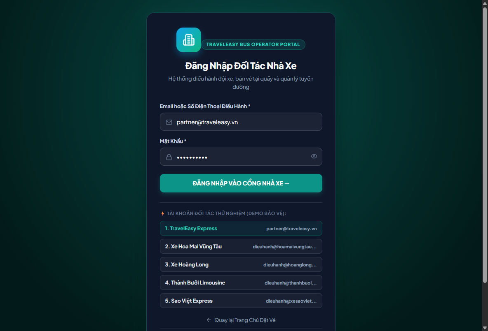
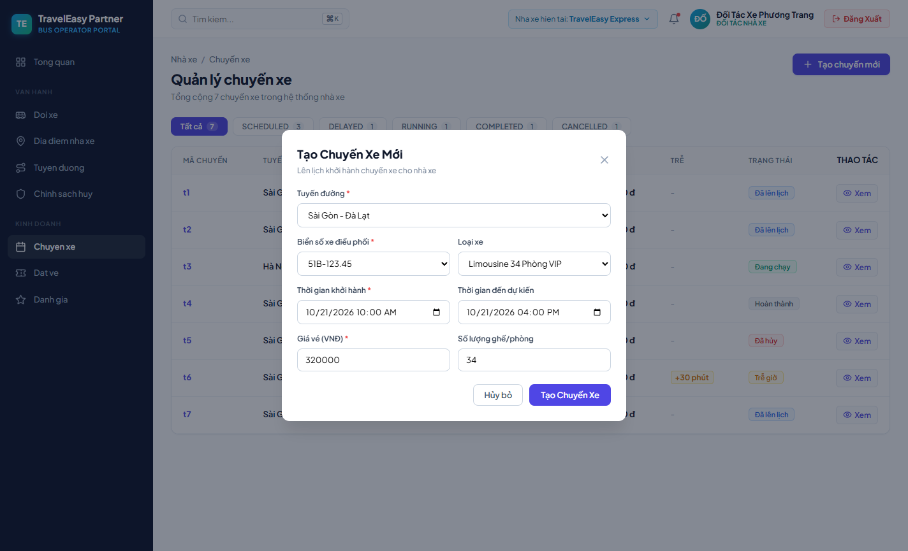
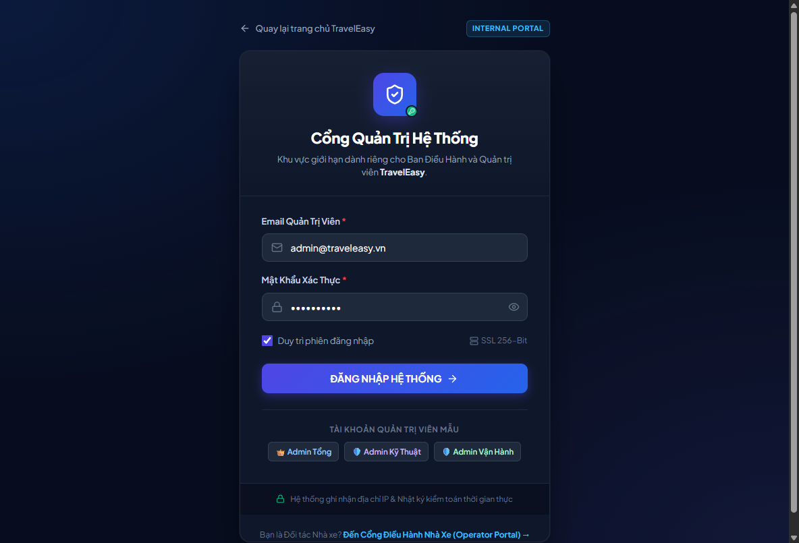
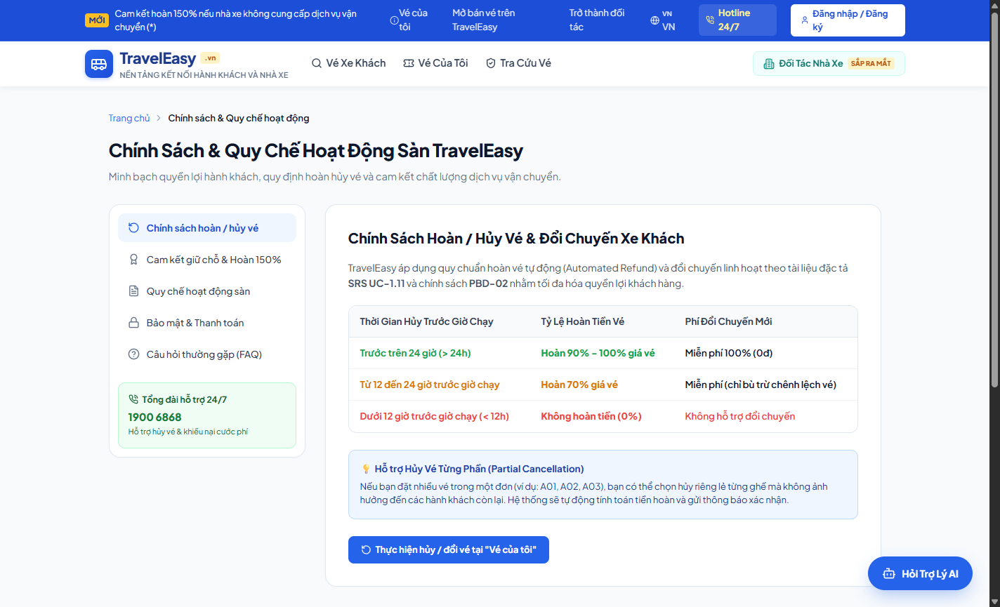
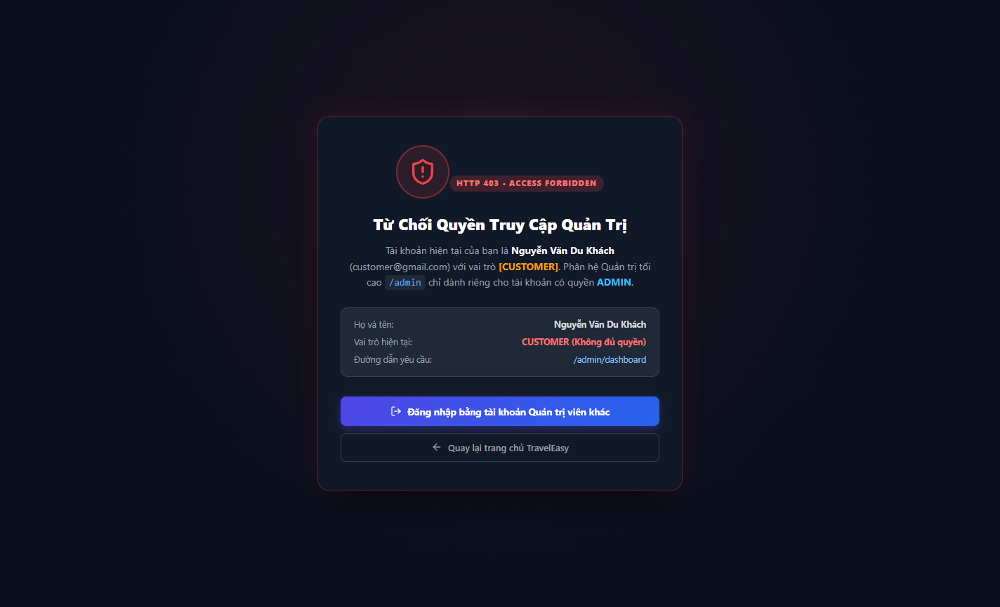

# CẨM NANG HƯỚNG DẪN SỬ DỤNG & VẬN HÀNH TRAVELEASY PLATFORM
## TÀI LIỆU HƯỚNG DẪN CHI TIẾT DÀNH CHO KHÁCH HÀNG, ĐỐI TÁC NHÀ XE & QUẢN TRỊ VIÊN
### MÃ DỰ ÁN: `PRJ-TRAVELEASY-MVP-01` | MÔ HÌNH VẬN HÀNH: VEXERE PLATFORM

---

> **MỤC TIÊU TÀI LIỆU:** Cung cấp hướng dẫn toàn diện từ A-Z cho cả 3 đối tượng người dùng trong hệ sinh thái TravelEasy Platform, kèm hình ảnh minh chứng thực tế trên từng giao diện màn hình.

---

## PHẦN 1: HƯỚNG DẪN DÀNH CHO KHÁCH HÀNG (CUSTOMER PORTAL)

### 1.1 Tìm kiếm chuyến xe & Áp dụng bộ lọc thông minh
1. **Truy cập Trang chủ** (`http://localhost:3000/`):
   - Tại thanh tìm kiếm trung tâm (Hero Search Bar), chọn **Nơi xuất phát** (ví dụ: *TP. Hồ Chí Minh* hoặc *Hà Nội*).
   - Chọn **Nơi đến** (ví dụ: *Đà Lạt*, *Nha Trang*, *Cần Thơ*, *Sa Pa*).
   - Chọn **Ngày đi** và nhấn nút **"Tìm chuyến xe"**.
2. **Sử dụng Bộ lọc đa tiêu chí (Smart Filter)**:
   - **Khoảng giá**: Kéo thanh trượt để lọc chuyến xe theo ngân sách (từ 200.000đ đến 500.000đ).
   - **Khung giờ chạy**: Chọn Sáng (06:00 - 12:00), Chiều (12:00 - 18:00) hoặc Đêm (18:00 - 24:00).
   - **Loại xe**: Chọn *Limousine VIP 34 phòng*, *Giường nằm tiêu chuẩn*, hoặc *Cabin Cung điện*.
   - **Nhà xe ưa thích**: Tích chọn *Phương Trang (FUTA)*, *Thành Bưởi*, *Sao Việt*, hoặc *Kumho Samco*.
   - *Minh chứng giao diện*: 

### 1.2 Xem chi tiết chuyến xe & Chọn vị trí giường nằm 2 tầng
1. **Xem thông tin chi tiết**:
   - Nhấn vào chuyến xe mong muốn để xem tiện ích đi kèm: WiFi tốc độ cao, cổng sạc Type-C, nước uống, chăn gối khử khuẩn.
   - Xem lộ trình trạm dừng dọc đường kèm giờ đến dự kiến (ETA) chính xác.
2. **Chọn ghế trên sơ đồ 34 phòng Limousine**:
   - Hệ thống hiển thị 2 tầng xe riêng biệt:
     - **Tầng 1 (Dưới - Ký hiệu A01 đến A17)**: Vị trí êm ái, chống say xe, phù hợp người lớn tuổi và trẻ nhỏ.
     - **Tầng 2 (Trên - Ký hiệu B01 đến B17)**: Không gian thoáng đãng, ngắm cảnh đường trường.
   - **Quy ước màu sắc trên sơ đồ**:
     - **Màu Xanh**: Ghế trống đang mở bán (`AVAILABLE`), có thể bấm chọn.
     - **Màu Cam**: Ghế bạn đang chọn (`SELECTED`).
     - **Màu Xám**: Ghế đã được người khác đặt trước (`BOOKED`).
   - *Lưu ý*: Mỗi hành khách được chọn tối đa 4 ghế trong một lượt đặt vé.

### 1.3 Khóa giữ chỗ độc quyền 10 phút & Điền thông tin hành khách
1. **Đồng hồ đếm ngược giữ chỗ (10:00)**:
   - Ngay khi bấm "Tiếp tục", hệ thống kích hoạt cơ chế khóa bi quan (**Pessimistic Lock**) trong vòng 600 giây. Không ai khác có thể chọn trùng ghế của bạn trong thời gian này.
   - Khi đồng hồ còn dưới 2 phút, cảnh báo nhấp nháy đỏ sẽ nhắc nhở hoàn tất giao dịch.
2. **Điền thông tin liên hệ**:
   - Nhập Họ và tên hành khách.
   - Nhập Số điện thoại (10 chữ số) để nhận mã vé và tài xế liên hệ khi đón xe.
   - Nhập Email để nhận vé điện tử định dạng chuẩn.
   - Chọn điểm đón và điểm trả thực tế trong danh sách trạm dừng.
   - *Minh chứng giao diện*: 

### 1.4 Thanh toán trực tuyến đa kênh an toàn
Hệ thống hỗ trợ 3 phương thức thanh toán linh hoạt:
1. **Chuyển khoản Ngân hàng (VietQR)**:
   - Màn hình hiển thị mã QR động chứa đầy đủ thông tin: Ngân hàng thụ hưởng, Số tài khoản, Số tiền chính xác và Nội dung chuyển khoản tự động (`BK-...`).
   - Mở ứng dụng ngân hàng bất kỳ, quét mã QR và xác nhận chuyển tiền.
   - Nút *"Xác nhận đã chuyển khoản"* hoặc *"Thanh toán thử nghiệm (Demo)"* giúp nghiệm thu giao dịch ngay lập tức.
   - *Minh chứng giao diện*: 
2. **Cổng thanh toán VNPay**:
   - Hỗ trợ thanh toán qua thẻ ATM nội địa, thẻ quốc tế Visa/Mastercard hoặc ứng dụng ngân hàng.
   - *Minh chứng giao diện*: 
3. **Thanh toán tiền mặt khi lên xe (COD)**: Dành cho khách đặt chỗ giữ vé trước.

### 1.5 Nhận vé điện tử Boarding Pass & Xuất trình khi lên xe
- Ngay sau khi thanh toán thành công, hệ thống xuất **Thẻ vé điện tử (Boarding Pass)** với đầy đủ:
  - Tên nhà xe và Logo nhận diện.
  - Tuyến đường di chuyển, Biển số xe, Giờ xe xuất bến.
  - Vị trí giường nằm (`A03`, `A04`) và Thông tin hành khách.
  - **Mã QR Code bảo mật**: Quét được trực tiếp bằng camera điện thoại của tài xế hoặc nhân viên phụ xe để soát vé lên xe nhanh chóng.
  - Hỗ trợ nút **"In vé"** và **"Tải vé PDF"**.
- *Minh chứng giao diện*: 

### 1.6 Tra cứu vé & Quản lý lịch sử chuyến đi
- **Tra cứu không cần đăng nhập**: Vào mục *"Tra cứu vé"* trên thanh điều hướng, nhập Số điện thoại hoặc Mã đơn vé (`BK-...`), hệ thống hiển thị tức thời trạng thái vé.
- **Mục "Vé của tôi"**: Người dùng đã đăng nhập có thể xem toàn bộ lịch sử các chuyến đi sắp khởi hành hoặc đã hoàn thành, thực hiện đổi ngày đi hoặc bấm hủy vé theo chính sách.
- *Minh chứng giao diện*: 

---

## PHẦN 2: HƯỚNG DẪN DÀNH CHO ĐỐI TÁC NHÀ XE (PARTNER OPERATOR PORTAL)

### 2.1 Đăng nhập Portal Đối tác
- Truy cập: `http://localhost:3000/company/login`
- Đăng nhập với tài khoản nhà xe được cấp (ví dụ: `operator.futa@traveleasy.vn` / `Password123!`).
- Hệ thống áp dụng Auth Guard ngăn chặn truy cập trái phép từ tài khoản khách hàng thông thường.
- *Minh chứng giao diện*: 

### 2.2 Giám sát KPI Điều hành Nhà xe
- Dashboard hiển thị các chỉ số vận hành thời gian thực:
  - Tổng số chuyến xe đang vận hành trong ngày.
  - Tỷ lệ lấp đầy ghế bình quân (Occupancy Rate).
  - Tổng doanh thu bán vé đã ghi nhận.
- *Minh chứng giao diện*: 

### 2.3 Quản lý Đội xe & Biển số phương tiện
1. Vào mục **"Quản lý Đội xe"** (`/company/vehicles`):
   - Xem danh sách xe thuộc sở hữu của nhà xe kèm loại xe (*Limousine 34 phòng*), sức chứa và trạng thái hoạt động.
2. Thêm phương tiện mới:
   - Nhấn *"Thêm xe mới"*, nhập biển số xe (ví dụ: `51B-999.88`), chọn sơ đồ ghế mẫu và ngày kiểm định.
   - *Minh chứng giao diện*: 

### 2.4 Quản lý Tuyến đường & Điểm dừng đón/trả
- Cấu hình các tuyến vận chuyển chính và trạm dừng dọc đường.
- Thiết lập thời gian di chuyển dự kiến giữa từng chặng để hệ thống tự động tính ETA cho khách hàng.
- *Minh chứng giao diện*: 

### 2.5 Tạo Chuyến xe mở bán & Giám sát sơ đồ ghế
1. Nhấn nút **"Tạo chuyến xe mới"**:
   - Chọn tuyến đường, chọn phương tiện vận chuyển và giờ xuất bến.
   - Nhập giá vé niêm yết (ví dụ: 290.000đ).
   - Hệ thống tự động khởi tạo 34 bản ghi ghế tương ứng trên CSDL MySQL.
2. Cập nhật trạng thái chuyến xe:
   - Chuyển từ `SCHEDULED` (Đang mở bán) ➔ `DEPARTED` (Xe đã xuất bến) ➔ `COMPLETED` (Hoàn thành hành trình).
- *Minh chứng giao diện*: 

---

## PHẦN 3: HƯỚNG DẪN DÀNH CHO QUẢN TRỊ VIÊN NỀN TẢNG (PLATFORM ADMIN PORTAL)

### 3.1 Đăng nhập Quản trị viên
- Truy cập: `http://localhost:3000/admin/login`
- Đăng nhập bằng tài khoản Quản trị cấp cao: `admin@traveleasy.vn` / `Admin@2026`.
- *Minh chứng giao diện*: 

### 3.2 Trung tâm Điều hành Admin Dashboard (Hub)
- Giám sát toàn cục 4 chỉ số KPI then chốt của toàn nền tảng:
  1. **Tổng số chuyến xe**: Toàn bộ lịch trình đang chạy trên toàn quốc.
  2. **Chuyến xe đang mở bán**: Các chuyến còn ghế khả dụng phục vụ đặt vé.
  3. **Tổng đơn đặt vé**: Số lượng giao dịch thành công.
  4. **Doanh thu thực nhận**: Tổng tiền luân chuyển trên sàn thương mại điện tử.
- Lưới 6 thẻ điều phối nhanh hỗ trợ chuyển trang quản trị tức thời.
- *Minh chứng giao diện*: 

### 3.3 Quản trị Danh mục Nhà xe Đối tác & Phê duyệt
- Quản lý danh bạ các đối tác vận tải: Hotline, Địa chỉ trụ sở, Đánh giá trung bình sao.
- Bật/Tắt trạng thái hợp tác (`ACTIVE` / `INACTIVE`).
- *Minh chứng giao diện*: 

### 3.4 Quản trị Tuyến đường Liên tỉnh & Địa điểm (Locations)
- Chuẩn hóa danh mục điểm đón/trả: Bến xe Miền Tây, Bến xe An Sương, Bến xe Liên tỉnh Đà Lạt, Bến xe Phía Nam Nha Trang, Bến xe Mỹ Đình...
- *Minh chứng giao diện*: 

### 3.5 Quản trị Tài khoản Người dùng & Phân quyền RBAC
- Quản lý danh sách người dùng toàn sàn với Badge màu phân định vai trò:
  - `ROLE_ADMIN` (Màu Đỏ): Quản trị viên tối cao.
  - `ROLE_OPERATOR` (Màu Cam): Đối tác điều hành nhà xe.
  - `ROLE_DRIVER` (Màu Vàng): Tài xế vận hành chuyến.
  - `ROLE_CUSTOMER` (Màu Xanh): Khách hàng cá nhân.
- Khóa/Mở khóa tài khoản khi phát hiện dấu hiệu vi phạm chính sách.
- *Minh chứng giao diện*: 

### 3.6 Cấu hình Chính sách Hủy vé & Hoàn tiền tự động
- Thiết lập bảng quy tắc hoàn tiền theo mốc thời gian:
  - Trước giờ chạy > 24 giờ: Khách được hoàn **90%** giá vé (phí xử lý 10%).
  - Từ 12 đến 24 giờ: Khách được hoàn **70%** giá vé (phí xử lý 30%).
  - Dưới 12 giờ trước giờ chạy: **0% hoàn tiền** (đảm bảo quyền lợi cho nhà xe).
- *Minh chứng giao diện*: 

### 3.7 Kiểm soát Vết Nhật ký Audit Log & Duyệt Đánh giá
- Mọi thao tác nhạy cảm (đổi giá vé, hủy chuyến, đổi trạng thái thanh toán) đều được lưu trữ vĩnh viễn vào bảng `audit_logs` cùng địa chỉ IP và mã nhân sự.
- Kiểm duyệt các đánh giá 1-5 sao của khách hàng trước khi cho phép hiển thị công khai trên hồ sơ nhà xe.
- *Minh chứng giao diện*: 

---

## PHẦN 4: HƯỚNG DẪN XỬ LÝ SỰ CỐ & CÂU HỎI THƯỜNG GẶP (FAQ & TROUBLESHOOTING)

1. **Khách hàng thanh toán nhưng bị mất mạng Internet thì vé có bị hủy không?**
   - Không. Khi quét mã VietQR thành công, giao dịch được đối soát tự động qua mã đơn hàng `BK-...`. Khi mạng kết nối lại, khách hàng chỉ cần vào mục *"Tra cứu vé"* nhập số điện thoại là sẽ thấy vé ở trạng thái đã thanh toán.
2. **Nếu khách hàng không thanh toán trong 10 phút thì sao?**
   - Hệ thống tự động giải phóng ghế đã khóa về trạng thái `AVAILABLE` để các khách hàng khác tiếp tục đặt chỗ, tránh tình trạng chiếm giữ ảo.
3. **Làm sao để đổi vé sang chuyến xe khác?**
   - Khách hàng đăng nhập vào tài khoản, chọn vé cần đổi trong mục *"Vé của tôi"*, bấm *"Đổi chuyến"* và chọn chuyến mới. Hệ thống sẽ tính phần chênh lệch giá vé và hoàn tất đổi vé ngay lập tức.
