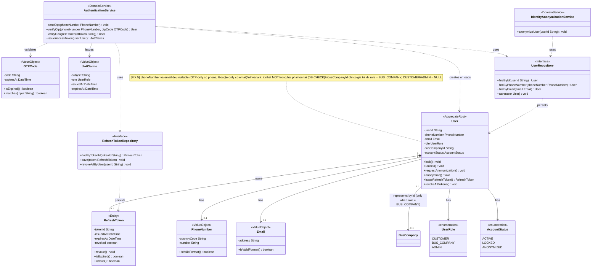

# CLASS DIAGRAM — HỆ THỐNG VEXERE CLONE (v2 — đã hợp nhất Patch)
### Bản hợp nhất: `Class_Diagram_Vexere.md` (gốc) + `Patch v2` (Giá vé / RouteTemplate / BusCompanyLocationConfig)

> Đây là bản **canonical duy nhất** — không cần đọc song song 2 file nữa. Mọi thay đổi từ Patch v2 đã được merge trực tiếp vào đúng vị trí tương ứng trong cấu trúc gốc, đồng thời **đánh dấu `[PATCH v2]`** tại mọi điểm bị sửa/thêm để bạn dễ diff lại với bản gốc nếu cần.
>
> Quy ước ID: mọi thuộc tính `xxxId` là Typed ID (Value Object bọc UUID/String theo khuyến nghị DDD) nhưng không vẽ thành class riêng để tránh phình sơ đồ (xem Phần 6.3 mục 1).

---

## PHẦN 0. CHANGELOG PATCH v2 (giữ lại để truy vết)

| Loại thay đổi | Chi tiết |
|---|---|
| Aggregate mới | `RouteTemplate` (chứa `RouteTemplateSeatPrice`, `RouteTemplateStop`), `BusCompanyLocationConfig` |
| Aggregate bị sửa | `Trip` (+ `routeTemplateId`, + Entity con `TripSeatPrice`, + method `createFromRouteTemplate()`, `getSeatPrice()`), `TripPoint` (đổi tham chiếu `Location` → `BusCompanyLocationConfig`), `Location` (+ `provinceName`/`districtName`/`wardName`) |
| Domain Service bị ảnh hưởng | `TripPointGenerationService` — đổi từ "gọi Maps API sinh điểm dừng" sang "clone điểm dừng + bảng giá từ RouteTemplate tại thời điểm tạo Trip"; `BookingOrchestrationService` — không đổi signature, chỉ đổi nguồn tính `totalAmount` (đọc từ `TripSeatPrice` thay vì số tiền không rõ nguồn gốc) |
| Repository mới | `RouteTemplateRepository`, `BusCompanyLocationConfigRepository` |
| Class chủ động KHÔNG tạo | `BusCompanyStop` — dùng `BusCompanyLocationConfig` thay thế (xem Rule B, Phần 5) |
| Business Rule mới | Rule A/B/C/D — xem Phần 5 |

---

## PHẦN 1. PHÂN TÍCH TÀI LIỆU (giữ nguyên từ bản gốc)

### 1.1 Nguồn tài liệu đã đọc
- SRS_Vexere.md, domain.md (Domain Model gốc), 6 Sequence Diagram (SD-01 → SD-06)
- `Database_Design_Vexere.md` (nguồn phát sinh Patch v2 — phát hiện giá vé chưa có nguồn sự thật rõ ràng)

### 1.2 Mâu thuẫn / lỗ hổng đã sửa giữa Domain Model và Sequence Diagram

| # | Mâu thuẫn / Lỗ hổng | Nguồn phát hiện | Cách xử lý |
|---|---|---|---|
| 1 | `PaymentProcessingService`/`RefundProcessingService` dùng trong SD-01/02/04 nhưng không có trong Domain Model | SD-01, SD-02, SD-04 | Bổ sung chính thức 2 Domain Service này |
| 2 | `TripManagementService` (SD-03), `QRCodeEncoder` (SD-06) là Application/Infra, không phải Domain | SD-03, SD-06 | Loại khỏi Domain; `reassignVehicle()` gán vào `Trip`; chỉ giữ `Ticket.buildQrContent()` |
| 3 | `ReviewReportRepository` tồn tại độc lập nhưng `ReviewReport` chỉ là Entity con của `Review` | Domain Model 5.7 vs 9 | Loại bỏ `ReviewReportRepository`, dùng `ReviewRepository.findReviewsWithPendingReport()` |
| 4 | `CancellationPolicy`, `Location`, `SeatType`, `Banner`, `PaymentGatewayConfig`, `NotificationGatewayConfig` có Repository nhưng chưa khai báo là Aggregate | Domain Model 5 vs 9 | Công nhận 6 lớp là Aggregate Root độc lập |
| 5 | `Vehicle` là Entity trong `BusCompany`, nhưng `VehicleSeatLayout` lại tham chiếu 1-1 (vi phạm biên Aggregate) | Domain Model 5.3 vs 5.8 vs 9 | Nâng `Vehicle` thành Aggregate Root độc lập |
| 6 | Tên `SeatPositionAssignment` bị dùng trùng cho 2 khái niệm khác nhau | Domain Model 3 vs 5.3 | Tách thành `TemplateSeatSlot` và `SeatPositionAssignment` |
| 7 | `RefreshToken` là Entity con của `User` nhưng cần xác thực mỗi request | SD-05 | Giữ composition về khái niệm, chấp nhận `RefreshTokenRepository` là ngoại lệ thực dụng |
| 8 | `BookingOrchestrationService` vừa gọi đồng bộ vừa phản ứng bất đồng bộ cho cùng 1 hành động | SD-01 bước 5 | Chủ đích kiến trúc — 2 đường độc lập, ghi chú rõ |

### 1.3 Use Case chỉ có trong SRS mà Sequence Diagram chưa vẽ
UC-1.1, 1.3–1.5, 1.10 (một phần), 1.12, 1.14, 1.15, toàn bộ UC-2.x (trừ 2.5), toàn bộ UC-3.x — vẫn được thiết kế Class đầy đủ dựa trên Domain Model + SRS trực tiếp.

---

## PHẦN 2. LIỆT KÊ CLASS (đã cập nhật số lượng theo Patch v2)

### Aggregate Roots (19)
`User` · `Vehicle` · `BusCompany` · `VehicleSeatLayout` · `SeatLayoutTemplate` · `SeatType` · `Location` · `Trip` · `CancellationPolicy` · `Booking` · `PaymentTransaction` · `RefundTransaction` · `Review` · `Banner` · `PaymentGatewayConfig` · `NotificationGatewayConfig` · `AuditLog` · **`RouteTemplate`** `[PATCH v2]` · **`BusCompanyLocationConfig`** `[PATCH v2]`

### Entities con (Composition trong Aggregate) (13)
`RefreshToken` (trong User) · `SeatPositionAssignment` (trong VehicleSeatLayout) · `TemplateSeatSlot` (trong SeatLayoutTemplate) · `TripPoint` (trong Trip) · `TripSeat` (trong Trip) · **`TripSeatPrice`** `[PATCH v2]` (trong Trip) · **`TripShuttleService`** `[NEW]` (trong Trip) · `Ticket` (trong Booking) · **`RescheduleRecord`** `[NEW]` (trong Booking) · `ReviewReport` (trong Review) · **`RouteTemplateSeatPrice`** `[PATCH v2]` (trong RouteTemplate) · **`RouteTemplateStop`** `[PATCH v2]` (trong RouteTemplate) · **`RouteTemplateShuttleService`** `[NEW]` (trong RouteTemplate)

### Value Objects (13)
`PhoneNumber` · `Email` · `Money` · `GeoCoordinate` · `SeatCode` · `SeatPosition` · `QRCode` · `OTPCode` · `PassengerInfo` · `TripSchedule` · `CancellationRule` · `AuditDetail` · `JwtClaims`

### Domain Service (14 — không đổi số lượng, 2 service đổi trách nhiệm)
`SeatHoldService` · `SeatRemappingService` · `BookingOrchestrationService` **[hành vi tính totalAmount đổi — PATCH v2]** · `PaymentProcessingService` · `PaymentReconciliationService` · `RefundCalculationService` · `RefundProcessingService` · `CancellationPolicyResolutionService` · `NotificationDispatchService` · **`TripDelayReportService`** `[D6]` · `TripPointGenerationService` **[trách nhiệm tính TripPoint.eta & TripShuttleService]** · `ReviewModerationService` · `AuthenticationService` · `IdentityAnonymizationService`

### Repository Interface (20)
`UserRepository` · `RefreshTokenRepository` · `VehicleRepository` · `BusCompanyRepository` · `VehicleSeatLayoutRepository` · `SeatLayoutTemplateRepository` · `SeatTypeRepository` · `LocationRepository` · `TripRepository` · `CancellationPolicyRepository` · `BookingRepository` · `PaymentTransactionRepository` · `RefundTransactionRepository` · `ReviewRepository` · `BannerRepository` · `PaymentGatewayConfigRepository` · `NotificationGatewayConfigRepository` · `AuditLogRepository` · **`RouteTemplateRepository`** `[PATCH v2]` · **`BusCompanyLocationConfigRepository`** `[PATCH v2]`

### Enum (23)
`BookingStatus` · `TicketStatus` · `PaymentStatus` · `RefundStatus` · `TripStatus` · `SeatStatus` · `ReviewStatus` · `ReviewReportStatus` · `UserRole` · `AccountStatus` · `BusCompanyStatus` · `VehicleType` · `PaymentGatewayType` · **`RouteTemplateStatus`** `[PATCH v2]` · **`RouteStopType`** `[PATCH v2]` · **`BusCompanyLocationConfigStatus`** `[PATCH v3]` · **`SeatAssignmentStatus`** `[PATCH v3]` · **`ShuttleType`** `[NEW]` · **`ShuttlePricingType`** `[NEW]` · **`LocationStatus`** `[FIX 7]` · **`VehicleStatus`** `[FIX 4]` · **`CancellationReason`** `[FIX 4]` · **`VehicleSeatLayoutStatus`** `[D4]`

> **`SeatType` KHÔNG phải Enum** — là **Aggregate Root** (bảng `seat_types` + `SeatTypeRepository`, Admin CRUD, mở rộng được tại runtime). `NotificationType`/`NotificationChannel` là metadata tầng Application/Infrastructure, **không** thuộc Domain enum canonical.

---

## PHẦN 3. TRÁCH NHIỆM TỪNG CLASS

### 3.1 Identity & Access (giữ nguyên bản gốc)

| Class | Trách nhiệm chính |
|---|---|
| `User` | Đại diện danh tính, vòng đời tài khoản, phát hành Refresh Token mới. **`[FIX 1]`** Giữ `busCompanyId` (nullable) — **chỉ có giá trị khi `role = BUS_COMPANY`**, xác định Nhà xe mà tài khoản đại diện; là nguồn của `currentUser.busCompanyId` trong Rule O3 |
| `RefreshToken` | Xác nhận hiệu lực phiên đăng nhập dài hạn |
| `AuthenticationService` | Điều phối xác thực: OTP (rate limit, khóa tạm), Google ID Token |
| `IdentityAnonymizationService` | Thực thi PDPD right-to-be-forgotten, xuyên nhiều Aggregate |
| `UserRepository`, `RefreshTokenRepository` | Truy xuất theo vai trò Aggregate Root (RefreshToken là ngoại lệ thực dụng) |

### 3.2 Fleet & Seat Catalog

| Class | Trách nhiệm chính |
|---|---|
| `BusCompany` | Hồ sơ pháp nhân nhà xe: phê duyệt, đình chỉ, gán chính sách hủy mặc định |
| `Vehicle` | Phương tiện vật lý — vòng đời riêng, tham chiếu `busCompanyId` bằng ID. **`[D2]`** **Không** giữ `vehicleSeatLayoutId` — quan hệ 1-1 do `VehicleSeatLayout.vehicleId` (NOT NULL, UNIQUE) nắm giữ, tránh hai nguồn sự thật và FK cycle. **`[OWNERSHIP]`** Thuộc đúng 1 BusCompany; chỉ `Trip` của **cùng** BusCompany được sử dụng (Rule O2 — DB trigger enforce); `busCompanyId` immutable `[FIX 1]` |
| `SeatLayoutTemplate` | Sơ đồ mẫu do Admin công bố có kích thước giới hạn (`maxFloor`, `maxRows`, `maxColumns`) |
| `TemplateSeatSlot` | 1 ô vị trí trống trong sơ đồ mẫu (thỏa điều kiện `floor <= maxFloor`, `row <= maxRows`, `column <= maxColumns`) |
| `VehicleSeatLayout` | Sơ đồ ghế thực tế của 1 xe cụ thể — khi tạo từ `SeatLayoutTemplate`, tự động clone toàn bộ `TemplateSeatSlot` thành `SeatPositionAssignment` |
| `SeatPositionAssignment` | 1 vị trí ghế đã gán `SeatType` và trạng thái cấu hình lâu dài `status` (`ACTIVE`, `BROKEN`, `DISABLED`, `MAINTENANCE`) |
| `SeatType` | Danh mục loại ghế chuẩn hóa, chỉ Admin CRUD |
| `Location` | Location là Shared Master Data do Admin quản lý. Location lưu thông tin địa điểm dùng chung cho toàn hệ thống và thuộc tính hành chính (provinceName, districtName, wardName) phục vụ tìm kiếm. Location không biết BusCompany |

### 3.2b Route Template & Location Configuration `[PATCH v2 — MỚI]`

| Class | Trách nhiệm chính |
|---|---|
| `RouteTemplate` | Khuôn mẫu 1 tuyến cố định của Nhà xe (VD "HCM → Kon Tum") — sở hữu bảng giá theo loại ghế và danh sách điểm dừng chuẩn. Nắm giữ `originLocationId` và `destinationLocationId` làm Default Representative Locations (phục vụ đại diện, phân loại, quản trị, SEO, fallback **khi không có Search Context**). **`[FIX 4]`** Representative Pickup/Dropoff trên Search Result Card được chọn ĐỘNG từ `RouteTemplateStop` theo Search Context: **Pickup = stop khớp đầu tiên cho phép đón, Dropoff = stop khớp cuối cùng cho phép trả** (`acceptsPickup`/`acceptsDropoff` trên Config). Là nguồn sự thật (source of truth) cho giá vé và lịch trình. **`[OWNERSHIP]`** Thuộc đúng 1 BusCompany (`busCompanyId`) — là mốc xác định chủ sở hữu của `Trip` tạo từ nó (Rule O3). **`[FIX 1]`** `busCompanyId` immutable sau khi tạo |
| `RouteTemplateSeatPrice` | Giá vé theo 1 loại ghế trong 1 RouteTemplate — UNIQUE(`routeTemplateId`, `seatTypeCode`) |
| `RouteTemplateStop` | 1 điểm dừng chuẩn trong tuyến — tham chiếu `BusCompanyLocationConfig` (không trỏ thẳng `Location`), có `estimatedTravelDurationFromPreviousStopMinutes` do Routing API tính (Stop 1 = 0, Nhà xe không có quyền chỉnh sửa/ghi đè) — UNIQUE(`routeTemplateId`, `sequence`). **`[OWNERSHIP]`** `busCompanyLocationConfigId` bắt buộc thuộc **cùng BusCompany** với `RouteTemplate` cha — Config của Nhà xe khác là INVALID (Rule O1 — DB trigger enforce) |
| `RouteTemplateShuttleService` `[NEW]` | Cấu hình xe trung chuyển mẫu (Đón `PICKUP` / Trả `DROPOFF` độc lập, tối đa 0..1 PICKUP và 0..1 DROPOFF cho mỗi RouteTemplate — `UNIQUE(routeTemplateId, shuttleType)`) — sở hữu `referenceStopId` do **Nhà xe tự chọn thủ công** từ các `RouteTemplateStop` thuộc tuyến mẫu (NOT NULL), `shuttleOffsetMinutes`, `coverageAreaDescription` (văn bản mô tả), `pricingType` (FREE/PAID). **`[INTEGRITY FIX]`** `referenceStopId` bắt buộc thuộc đúng RouteTemplate cha — DB enforce bằng Composite FK `(referenceStopId, routeTemplateId)` |
| `BusCompanyLocationConfig` | Cấu hình riêng của 1 Nhà xe tại 1 `Location` dùng chung (tên hiển thị, trạng thái `status` ACTIVE/DISABLED, hướng dẫn gặp tài xế, cổng, platform, landmark...) — UNIQUE(`busCompanyId`, `locationId`). Đây là lớp thay thế cho ý tưởng "BusCompanyStop" — vì nhu cầu dữ liệu thật là cấu hình-theo-Nhà-xe-tại-1-điểm, không phải một loại điểm dừng riêng. **`[OWNERSHIP]`** Là dữ liệu **RIÊNG** của đúng 1 BusCompany — chỉ dữ liệu thuộc cùng Nhà xe được tham chiếu (Rule O1). Lưu ý `Location` bên dưới vẫn là **Shared Master Data** — nhiều Nhà xe cùng trỏ tới 1 Location qua Config riêng (Rule O5). **`[FIX 1]`** `busCompanyId` **immutable** vô điều kiện sau khi tạo. **`[D3]`** `locationId` **immutable-after-use theo ngữ nghĩa EVER USED**: mang marker write-once `locationLockedAt` — `null` thì còn sửa được; được set khi `RouteTemplateStop` **đầu tiên** tham chiếu và từ đó **bất biến vĩnh viễn** — **kể cả khi toàn bộ Stop bị xóa sau đó** (marker không bao giờ reset). Đổi Location = tạo Config mới |

### 3.3 Trip & Seat Inventory (Core Domain)

| Class | Trách nhiệm chính |
|---|---|
| `Trip` | Aggregate trung tâm — quản lý vòng đời chuyến chạy với giờ xuất phát gốc `TripSchedule.baseDepartureTime`, giữ snapshot chính sách hủy áp dụng, sở hữu toàn bộ `TripSeat`/`TripPoint`/`TripShuttleService`/`TripSeatPrice`. Snapshot từ `RouteTemplate`: snapshot `originLocationId`, snapshot `destinationLocationId`, snapshot `TripPoint`, snapshot `TripShuttleService`, snapshot `TripSeatPrice`. Expose `getSeatPrice()` cho `BookingOrchestrationService` đọc. **`[OWNERSHIP]`** Chủ sở hữu xác định qua `RouteTemplate` (không mang `busCompanyId` riêng); `vehicleId` (O2) và `cancellationPolicyId` (O4) bắt buộc thuộc cùng BusCompany — DB trigger enforce; `routeTemplateId` (O3) do Application kiểm tra quyền |
| `TripPoint` | 1 điểm dừng trên hành trình, snapshot từ `RouteTemplateStop`. **`[D6]`** `eta` là **ETA GỐC BẤT BIẾN** — tính một lần khi tạo Trip (dồn tuần tự từng đoạn theo sequence từ `baseDepartureTime`), **không bao giờ** UPDATE. Khi trễ chuyến chỉ SET `TripSchedule.delayMinutes`; giờ thực tế = `eta + delayMinutes` (tính khi đọc). **`[FIX 2]`** Đồng thời **snapshot thông tin vận hành** từ `BusCompanyLocationConfig` tại thời điểm tạo Trip (`displayName`, `acceptsPickup`, `acceptsDropoff`, `contactPhone`, `driverMeetingInstructions`, `gate`, `platform`, `landmark`) — mọi luồng hiển thị **đọc từ TripPoint**, KHÔNG đọc live từ Config; `busCompanyLocationConfigId` chỉ để trace nguồn |
| `TripShuttleService` `[NEW]` | Snapshot dịch vụ xe trung chuyển trên chuyến (tối đa 0..1 PICKUP và 0..1 DROPOFF cho mỗi Trip — UNIQUE(`tripId`, `shuttleType`)), `displayTime` được snapshot tính từ `TripPoint(referenceStop).eta +/- shuttleOffsetMinutes`. **`[INTEGRITY FIX]`** `referenceStopId` bắt buộc là `TripPoint` của đúng Trip cha — DB enforce bằng Composite FK `(referenceStopId, tripId)` |
| `TripSeat` | Đơn vị tồn kho có thể bán — nắm giữ `SeatStatus`. **`[M3]`** `status` là **persistent inventory state / projection**, **không** lưu TTL và **không** quyết định hiệu lực Hold |
| `TripSeatPrice` `[PATCH v2 — MỚI]` | Giá vé theo loại ghế, **snapshot bất biến** tại thời điểm tạo Trip từ `RouteTemplateSeatPrice` — UNIQUE(`tripId`, `seatTypeCode`) |
| `CancellationPolicy` | Bộ quy tắc hoàn tiền — Aggregate Root độc lập, dùng chung bởi nhiều Trip/BusCompany. **`[OWNERSHIP]`** Thuộc đúng 1 BusCompany (`ownerBusCompanyId`) — chỉ `Trip` của **cùng** BusCompany được áp dụng; Policy của Nhà xe khác là INVALID (Rule O4 — DB trigger enforce). **`[INTEGRITY FIX]`** **Immutable-After-Use**: khi `lockedAt == null` (chưa Trip nào dùng) Policy vẫn **sửa được** bình thường; `lockedAt` được set khi Trip đầu tiên tham chiếu, từ đó Policy **bất biến** — thay đổi chính sách phải tạo Policy mới (Copy-on-Write). DB dùng **trigger row-level** trên `cancellation_rules` chặn UPDATE/DELETE rule của Policy đã khóa → Refund của Trip cũ luôn dùng đúng rule tại thời điểm tạo Trip |
| `SeatHoldService` | Điều phối Soft/Hard Hold. **`[M3]`** Đồng bộ giữa **Redis** (Source of Truth cho Hold + TTL) và **`TripSeat.status`** (persistent projection) |
| `SeatRemappingService` | Thuật toán ghép ghế bán tự động, thao tác xuyên Trip + nhiều Booking |
| `TripDelayReportService` `[D6]` | Ghi nhận trễ chuyến bằng cách **SET** `TripSchedule.delayMinutes` = **tổng** số phút trễ hiện tại (không cộng dồn). **Không** sửa `TripPoint.eta` — giờ thực tế dẫn xuất khi đọc: `eta + delayMinutes`. Loại bỏ hoàn toàn nguy cơ double-count |
| `TripPointGenerationService` | **`[PATCH v3 — chuẩn hóa hoàn toàn]`** Đọc `RouteTemplateStop` (đã có `estimatedTravelDurationFromPreviousStopMinutes` từ Routing API) và giờ xuất phát gốc `TripSchedule.baseDepartureTime` khi khởi tạo Trip để tự động cộng dồn tuần tự từng đoạn theo sequence sinh snapshot `TripPoint.eta` (`cloneStopsFromRouteTemplate`), đồng thời snapshot `RouteTemplateShuttleService` thành `TripShuttleService` kèm giờ hiển thị `displayTime` (`cloneShuttleServicesFromRouteTemplate`) |
| `CancellationPolicyResolutionService` | Xác định policy áp dụng cho 1 Trip mới tạo |

### 3.4 Booking, Payment & Refund (Core Domain)

| Class | Trách nhiệm chính |
|---|---|
| `Booking` | Aggregate Root trung tâm giao dịch đặt chỗ — sở hữu `Ticket` và `RescheduleRecord`, kiểm soát vòng đời đơn hàng và trạng thái tổng thể. Ràng buộc `Booking.tripId == Ticket.tripId` cho 100% vé trong đơn — **được Database enforce bằng Composite FK** `tickets(booking_id, trip_id) → bookings(id, trip_id)`; thuộc về đúng 1 `Trip` duy nhất, `Booking.tripId` immutable |
| `Ticket` | Bằng chứng hợp lệ cho 1 hành khách/1 ghế. `Ticket.tripId` luôn bằng `Booking.tripId` và **immutable sau khi tạo** (Composite FK + REVOKE UPDATE chặn mọi thay đổi). **`[D7]`** Giữ **`seatPrice` (Money)** — snapshot **bất biến** copy từ `TripSeatPrice` tại thời điểm **Issue Ticket**; `TripSeatPrice` là nguồn để **tính** giá lúc issue, còn `Ticket.seatPrice` là **bản ghi lịch sử** dùng cho hoàn tiền/đối soát (không suy ngược từ `TripSeatPrice`). **`[D5]`** ACTIVE := `status IN (ISSUED, CHECKED_IN)`; `COMPLETED` là terminal, **không** active. Terminal State: `CANCELLED` với `cancellationReason` phân biệt `CUSTOMER_CANCELLATION` (hủy chủ động) và `RESCHEDULED` (Old Ticket được thay thế bởi New Ticket trong New Booking) |
| `RescheduleRecord` `[NEW]` | Entity con thuộc Old Booking — lưu vết `oldTicketId` → `newTicketId` và `oldBookingId` → `newBookingId`, chứa đầy đủ thông tin chuyến cũ/mới, ghế cũ/mới, chênh lệch tài chính, tham chiếu giao dịch nộp thêm (`paymentTxnRef` khi phát sinh surcharge). Các khoản hoàn tiền (nếu có) được tạo thành **1..N bản ghi `RefundTransaction`** độc lập theo financial lineage, liên kết trực tiếp với Ticket qua `ticketId`, không lưu scalar `refundTransactionId` trong record. **`[HIGH-1]`** `newTicketId` có thể **NULL trong Phase 1** (RescheduleRecord được tạo trước khi New Ticket tồn tại — New Ticket được tạo ở **Phase 2A** Finalize); bắt buộc có giá trị **sau khi Finalize thành công**. NULL chỉ đại diện operation đang PENDING, không phải Reschedule thành công. **`[PBD-04]`** `newTicketId != null` là dấu hiệu duy nhất xác nhận Reschedule đã finalized thành công. PBD-04 chỉ block khi tồn tại record với `newTicketId IS NOT NULL`; record có `newTicketId IS NULL` (attempt trước bị rollback/hết hạn) không block PBD-04 |
| `BookingOrchestrationService` | Điều phối luồng Hold→Booking→Payment→Ticket, Hủy vé từng phần (`cancelPartialBooking()`) và Đổi vé tạo Booking mới (`rescheduleTicketsToNewBooking()`). Enforce PBD-04: chỉ block khi vé đã có Reschedule finalized (`new_ticket_id IS NOT NULL`) |
| `PaymentTransaction` | Giao dịch với cổng thứ ba — idempotent, pessimistic lock. **Cardinality:** 1 `Booking` có **0..N** giao dịch — **tối đa 1** `INITIAL` (Partial UNIQUE) + **0..N** `RESCHEDULE_SURCHARGE`. Có thể **0** giao dịch khi Booking chờ thanh toán hoặc New Booking từ Reschedule có `totalNetAdjustment <= 0` |
| `PaymentProcessingService` | Điều phối khởi tạo giao dịch + xử lý IPN |
| `PaymentReconciliationService` | Cron định kỳ, dùng lại `PaymentProcessingService` |
| `RefundTransaction` | Giao dịch hoàn tiền — hỗ trợ liên kết trực tiếp với từng `Ticket` khi Hủy vé từng phần (`ticketId`) hoặc vé cũ khi Đổi vé hoàn tiền thừa tại Phase 1 (`ticketId = oldTicketId`, do New Ticket chưa tồn tại ở Phase 1); kiểm soát hạn mức hoàn tiền cộng dồn với Pessimistic Lock. `REQUESTED`/`PROCESSING`/`COMPLETED` chiếm hạn mức; `FAILED` không chiếm. RefundCompleted ≠ Booking CANCELLED. **Canonical Rule:** Booking COMPLETED không cho phép tạo yêu cầu Refund mới, nhưng không ngăn RefundTransaction đã tồn tại tiếp tục xử lý và hoàn tất bất đồng bộ. **`[HIGH-2]`** `paymentTxnRef` và `bookingId` là 2 quan hệ độc lập (không có Composite FK). Với Rescheduled Ticket, một lần hoàn vé có thể sinh **nhiều `RefundTransaction`** phân bổ theo financial lineage (mới nhất trước: `RESCHEDULE_SURCHARGE` trước, sau đó đến `INITIAL`), mỗi record trỏ đúng 1 `paymentTxnRef` |
| `RefundCalculationService` | Phép tính thuần túy: số tiền hoàn = **`Ticket.seatPrice`** (snapshot bất biến — **`[D7]`**) × tỷ lệ theo policy + thời điểm hủy (cho toàn booking hoặc từng ticket). **Không** suy ngược giá từ `TripSeatPrice` |
| `RefundProcessingService` | Điều phối tạo `RefundTransaction` với đầy đủ transaction boundary (Lock→SUM→Validate→INSERT trong 1 DB transaction). Áp dụng cho tất cả luồng: Full Cancel, Partial Cancel, Reschedule Refund |

### 3.5 Review, Notification, Admin Config & Audit (giữ nguyên bản gốc)

| Class | Trách nhiệm chính |
|---|---|
| `Review` | Đánh giá của khách — hiển thị công khai ngay (post-moderation) |
| `ReviewReport` | Report vi phạm từ Nhà xe, SLA 48h |
| `ReviewModerationService` | Quy trình quyết định Approve/Reject report |
| `NotificationDispatchService` | Consumer thuần túy của hầu hết Domain Event |
| `Banner` | Nội dung quảng cáo trang chủ |
| `PaymentGatewayConfig`, `NotificationGatewayConfig` | Cấu hình kỹ thuật tích hợp bên thứ ba. **`[FIX 3]`** `PaymentGatewayConfig` được **resolve theo `gatewayType`** bởi `PaymentProcessingService` (`findByType()`); `PaymentTransaction` **không** giữ tham chiếu trực tiếp tới Config |
| `AuditLog` | Bản ghi bất biến, append-only |

---

## PHẦN 4. CLASS DIAGRAM (Mermaid) — 6 CONTEXT GROUPS / DIAGRAMS

> **`[FIX 6]` Lưu ý về cách nhóm sơ đồ:** 6 mục dưới đây là **6 nhóm sơ đồ phục vụ trình bày** (Context Groups), được chia để mỗi khối Mermaid đủ nhỏ để đọc. **Không** đồng nghĩa hệ thống chỉ có 6 Bounded Context — danh sách Bounded Context chính thức được định nghĩa trong `domain.md` (Phần Bounded Context) và có thể nhiều hơn 6. Việc nhóm sơ đồ ở đây không gộp/tách Bounded Context nào.

### 4.1 Identity & Access Context (không đổi so với bản gốc)

### 4.2 Fleet & Seat Catalog Context (`Location` cập nhật `[PATCH v2]`)

```mermaid
classDiagram
    class BusCompany {
        <<AggregateRoot>>
        -busCompanyId String
        -name String
        -hotline PhoneNumber
        -status BusCompanyStatus
        -defaultCancellationPolicyId String
        +approve() void
        +suspend() void
        +setDefaultCancellationPolicy(policyId String) void
    }

    class Vehicle {
        <<AggregateRoot>>
        -vehicleId String
        -busCompanyId String
        -plateNumber String
        -vehicleType VehicleType
        -status VehicleStatus
        +retire() void
    }
    note for Vehicle "[D2] KHONG giu vehicleSeatLayoutId.\nQuan he 1-1 do VehicleSeatLayout.vehicleId (NOT NULL, UNIQUE) nam giu.\nGan layout = tao VehicleSeatLayout voi vehicleId tuong ung."

    class SeatLayoutTemplate {
        <<AggregateRoot>>
        -templateId String
        -name String
        -maxFloor int
        -maxRows int
        -maxColumns int
        -status String
        +publish() void
        +deprecate() void
    }

    class TemplateSeatSlot {
        <<Entity>>
        -slotId String
        -position SeatPosition
        -seatCode SeatCode
    }

    class VehicleSeatLayout {
        <<AggregateRoot>>
        -layoutId String
        -vehicleId String
        -sourceTemplateId String
        -status VehicleSeatLayoutStatus
        +assignSeatType(seatCode SeatCode, seatTypeCode String) void
        +updateSeatStatus(seatCode SeatCode, status SeatAssignmentStatus) void
        +finalizeLayout() void
    }

    class SeatPositionAssignment {
        <<Entity>>
        -assignmentId String
        -position SeatPosition
        -seatCode SeatCode
        -seatTypeCode String
        -status SeatAssignmentStatus
    }

    class SeatAssignmentStatus {
        <<enumeration>>
        ACTIVE
        BROKEN
        DISABLED
        MAINTENANCE
    }

    class SeatType {
        <<AggregateRoot>>
        -seatTypeCode String
        -label String
        -status String
        +deprecate() void
    }

    class Location {
        <<AggregateRoot>>
        -locationId String
        -name String
        -coordinate GeoCoordinate
        -provinceName String
        -districtName String
        -wardName String
        -status LocationStatus
        +archive() void
    }

    class SeatCode {
        <<ValueObject>>
        -code String
    }

    class SeatPosition {
        <<ValueObject>>
        -floor int
        -row int
        -column int
    }

    class GeoCoordinate {
        <<ValueObject>>
        -latitude double
        -longitude double
    }

    class VehicleType {
        <<enumeration>>
        SEATED
        SLEEPER
        LIMOUSINE
    }

    class LocationStatus {
        <<enumeration>>
        ACTIVE
        ARCHIVED
    }

    class VehicleStatus {
        <<enumeration>>
        ACTIVE
        INACTIVE
    }

    class VehicleSeatLayoutStatus {
        <<enumeration>>
        CONFIGURING
        FINALIZED
    }

    class BusCompanyStatus {
        <<enumeration>>
        PENDING_APPROVAL
        ACTIVE
        SUSPENDED
    }

    class ShuttleType {
        <<enumeration>>
        PICKUP
        DROPOFF
    }

    class ShuttlePricingType {
        <<enumeration>>
        FREE
        PAID
    }

    class BusCompanyRepository {
        <<Interface>>
        +findById(id String) BusCompany
        +findPendingApproval() List
        +save(company BusCompany) void
    }

    class VehicleRepository {
        <<Interface>>
        +findById(id String) Vehicle
        +findByBusCompany(busCompanyId String) List
        +save(vehicle Vehicle) void
    }

    class SeatLayoutTemplateRepository {
        <<Interface>>
        +findPublished() List
        +save(template SeatLayoutTemplate) void
    }

    class VehicleSeatLayoutRepository {
        <<Interface>>
        +findByVehicle(vehicleId String) VehicleSeatLayout
        +save(layout VehicleSeatLayout) void
    }

    class SeatTypeRepository {
        <<Interface>>
        +findAll() List
        +findByCode(code String) SeatType
        +save(seatType SeatType) void
    }

    class LocationRepository {
        <<Interface>>
        +findAll() List
        +findById(id String) Location
        +save(location Location) void
    }

    BusCompany "1" --> "1" PhoneNumber : has
    Vehicle "0..*" --> "1" BusCompany : belongs to by id
    VehicleSeatLayout "0..1" --> "1" Vehicle : belongs to by id (vehicleId NOT NULL UNIQUE)
    VehicleSeatLayout --> VehicleSeatLayoutStatus : has
    Vehicle --> VehicleType : has
    Vehicle --> VehicleStatus : has
    SeatLayoutTemplate "1" *-- "1..*" TemplateSeatSlot : contains
    TemplateSeatSlot "1" --> "1" SeatPosition : has
    TemplateSeatSlot "1" --> "1" SeatCode : has
    VehicleSeatLayout "1" *-- "1..*" SeatPositionAssignment : contains
    VehicleSeatLayout "0..*" ..> SeatLayoutTemplate : cloned from by id
    SeatPositionAssignment "1" --> "1" SeatPosition : has
    SeatPositionAssignment "1" --> "1" SeatCode : has
    SeatPositionAssignment "0..*" --> "1" SeatType : references by id
    SeatPositionAssignment --> SeatAssignmentStatus : has
    Location "1" --> "1" GeoCoordinate : has
    Location --> LocationStatus : has
```

### 4.2b Route Template & Location Configuration Context `[PATCH v2 — MỚI]`

> **Ghi chú kiến trúc (Issue #7 - Nghiệp vụ thực tế Vexere):** 
> - `originLocationId` và `destinationLocationId` là **Default Representative Locations** của toàn tuyến (dùng cho phân loại, quản trị, SEO, fallback khi không có Search Context). KHÔNG bắt buộc là stop đầu hay stop cuối.
> - **Representative Pickup/Dropoff Stop** trên Search Result Card được lựa chọn ĐỘNG từ danh sách `RouteTemplateStop` theo Search Context. **`[FIX 4]` Thuật toán canonical:** Pickup = stop khớp **đầu tiên** (`sequence` nhỏ nhất trong vùng Điểm đi) **VÀ** cho phép đón (`acceptsPickup = true`); Dropoff = stop khớp **cuối cùng** (`sequence` lớn nhất trong vùng Điểm đến) **VÀ** cho phép trả (`acceptsDropoff = true`). `TRANSIT_ONLY` bị loại. Nếu một trong hai tập rỗng (kể cả khi có stop đúng địa giới nhưng không cho đón/trả) hoặc `sequence(Pickup) >= sequence(Dropoff)` thì RouteTemplate **không khớp** search đó. Khi đã có Search Context thì **không** dùng `originLocationId`/`destinationLocationId` làm representative.
> - `TripPoint` chỉ là runtime snapshot của `RouteTemplateStop` được khởi tạo SAU KHI `Trip` được sinh ra để phục vụ vận hành chuyến (ETA real-time, booking, tracking...). `TripPoint` KHÔNG tham gia Search.

> **Ghi chú kiến trúc (Issue #8 - Soft Disable / Grandfather Rule):**
> - `BusCompanyLocationConfig` áp dụng cơ chế **Soft Disable (Grandfather Rule)**: Khi chuyển sang `DISABLED`, hệ thống chỉ ngăn không cho chọn Config này khi tạo mới hoặc cập nhật `RouteTemplateStop`.
> - Các `RouteTemplateStop` đã tham chiếu trước đó, các `Trip` đã tạo, và các snapshot `TripPoint` giữ nguyên 100% không bị ảnh hưởng (bảo vệ tính toàn vẹn lịch sử).
> - KHÔNG tồn tại cơ chế cascade update, không tự động chuyển Config, không xóa dữ liệu cũ, không chặn hành động `DISABLED` khi đang có dữ liệu cũ tham chiếu.

```mermaid
classDiagram
    class RouteTemplate {
        <<AggregateRoot>>
        -routeTemplateId String
        -busCompanyId String
        -name String
        -originLocationId String
        -destinationLocationId String
        -status RouteTemplateStatus
        +updateSeatPrice(seatTypeCode String, price Money) void
        +addStop(stop RouteTemplateStop) void
        +reorderStops(newSequence List) void
        +publish() void
        +deprecate() void
    }

    class RouteTemplateSeatPrice {
        <<Entity>>
        -seatTypeCode String
        -price Money
    }

    class RouteTemplateStop {
        <<Entity>>
        -sequence int
        -busCompanyLocationConfigId String
        -estimatedTravelDurationFromPreviousStopMinutes int
        -stopType RouteStopType
    }

    class RouteTemplateShuttleService {
        <<Entity>>
        -shuttleType ShuttleType
        -referenceStopId String
        -shuttleOffsetMinutes int
        -coverageAreaDescription String
        -pricingType ShuttlePricingType
        -feeAmount Money
    }

    class RouteTemplateStatus {
        <<enumeration>>
        DRAFT
        PUBLISHED
        DEPRECATED
    }

    class RouteStopType {
        <<enumeration>>
        PICKUP
        DROPOFF
        PICKUP_AND_DROPOFF
        TRANSIT_ONLY
    }

    class BusCompanyLocationConfig {
        <<AggregateRoot>>
        -busCompanyId String
        -locationId String
        -locationLockedAt DateTime
        -displayName String
        -status BusCompanyLocationConfigStatus
        -acceptsPickup boolean
        -acceptsDropoff boolean
        -note String
        -contactPhone PhoneNumber
        -driverMeetingInstructions String
        -gate String
        -platform String
        -landmark String
        +markLocationUsed() void
        +isLocationLocked() boolean
        +updateConfig() void
        +enablePickup() void
        +disablePickup() void
        +enableDropoff() void
        +disableDropoff() void
    }
    note for BusCompanyLocationConfig "[D3] locationLockedAt = marker WRITE-ONCE cho ngu nghia EVER USED.\nnull       -> chua TUNG duoc RouteTemplateStop nao dung -> locationId con sua duoc.\nnon-null   -> da TUNG duoc dung -> locationId BAT BIEN VINH VIEN.\nmarkLocationUsed() chi set duoc dung 1 lan; KHONG BAO GIO reset ve null,\nke ca khi toan bo RouteTemplateStop tham chieu da bi xoa.\nDoi Location sau khi lock = tao Config moi (Copy-on-Write).\n[FIX 1] busCompanyId bat bien VO DIEU KIEN (khac locationId - chi khoa sau khi dung)."

    class BusCompanyLocationConfigStatus {
        <<enumeration>>
        ACTIVE
        DISABLED
    }

    class RouteTemplateRepository {
        <<Interface>>
        +findByBusCompany(busCompanyId String) List
        +findById(id String) RouteTemplate
        +save(routeTemplate RouteTemplate) void
    }

    class BusCompanyLocationConfigRepository {
        <<Interface>>
        +findByBusCompanyAndLocation(busCompanyId String, locationId String) BusCompanyLocationConfig
        +findByBusCompany(busCompanyId String) List
        +save(config BusCompanyLocationConfig) void
    }

    RouteTemplate "1" *-- "1..*" RouteTemplateSeatPrice : contains
    RouteTemplate "1" *-- "1..*" RouteTemplateStop : contains
    RouteTemplate "1" *-- "0..1" RouteTemplateShuttleService : PICKUP
    RouteTemplate "1" *-- "0..1" RouteTemplateShuttleService : DROPOFF
    RouteTemplateShuttleService "0..*" --> "1" RouteTemplateStop : referenceStop
    RouteTemplate --> RouteTemplateStatus : has
    RouteTemplateSeatPrice "0..*" --> "1" SeatType : references by id
    RouteTemplateStop --> RouteStopType : has
    RouteTemplateStop "0..*" --> "1" BusCompanyLocationConfig : references by id
    RouteTemplate "0..*" --> "1" BusCompany : owned by id
    BusCompanyLocationConfig "0..*" --> "1" BusCompany : configured by id
    BusCompanyLocationConfig "0..*" --> "1" Location : configures by id
    BusCompanyLocationConfig --> BusCompanyLocationConfigStatus : has
    note for RouteTemplate "originLocationId & destinationLocationId la Default Representative Locations (fallback khi khong co Search Context)\n[FIX 4] Representative Stop chon DONG theo Search Context:\nPickup = stop khop dau tien CHO PHEP DON (acceptsPickup=true)\nDropoff = stop khop cuoi cung CHO PHEP TRA (acceptsDropoff=true)\nTRANSIT_ONLY bi loai"
    note for BusCompanyLocationConfig "Soft Disable (Grandfather Rule): DISABLED chỉ ngăn dùng cho dữ liệu mới\nDữ liệu RouteTemplateStop cũ & TripPoint snapshot giữ nguyên\nKhông cascade, không tự động chuyển Config"
```

### 4.3 Trip & Seat Inventory Context (Core Domain) — `[PATCH v2 — đã hợp nhất, thay thế bản 4.3 gốc]`

```mermaid
classDiagram
    class Trip {
        <<AggregateRoot>>
        -tripId String
        -routeTemplateId String
        -originLocationId String
        -destinationLocationId String
        -vehicleId String
        -schedule TripSchedule
        -status TripStatus
        -cancellationPolicyId String
        +createFromRouteTemplate(routeTemplate RouteTemplate, vehicleId String, baseDepartureTime DateTime) Trip
        +getSeatPrice(seatTypeCode String) Money
        +markSeatSoftHeld(seatCode SeatCode) void
        +markSeatHardHeld(seatCode SeatCode) void
        +markSeatBooked(seatCode SeatCode) void
        +releaseSeat(seatCode SeatCode) void
        +reassignVehicle(newVehicleId String, newSeats List) void
        +reportDelay(totalDelayMinutes int) void
        +cancel() void
        +complete() void
    }
    note for Trip "[D6] reportDelay SET schedule.delayMinutes = TONG so phut tre (absolute).\nKHONG cong don. KHONG sua TripPoint.eta.\nKhong ton tai applyDelay() - method cu mang nghia mutate ETA da bi XOA."

    class TripPoint {
        <<Entity>>
        -tripPointId String
        -busCompanyLocationConfigId String
        -sequence int
        -eta DateTime
        -displayName String
        -acceptsPickup boolean
        -acceptsDropoff boolean
        -contactPhone String
        -driverMeetingInstructions String
        -gate String
        -platform String
        -landmark String
        +effectiveEta(delayMinutes int) DateTime
    }
    note for TripPoint "[D6] eta la SNAPSHOT BAT BIEN - khong co setter, khong co recalculateEta().\neffectiveEta(delayMinutes) la DERIVED READ-ONLY: tra ve eta + delayMinutes,\nKHONG ghi de field eta. Moi field snapshot con lai (displayName, acceptsPickup,\nacceptsDropoff, contactPhone, driverMeetingInstructions, gate, platform, landmark)\ncung bat bien sau Create Trip - DB trigger enforce."

    class TripShuttleService {
        <<Entity>>
        -tripShuttleServiceId String
        -shuttleType ShuttleType
        -referenceStopId String
        -shuttleOffsetMinutes int
        -coverageAreaDescription String
        -pricingType ShuttlePricingType
        -feeAmount Money
        -displayTime DateTime
    }

    class TripSeat {
        <<Entity>>
        -seatCode SeatCode
        -status SeatStatus
        -seatTypeCode String
        +hold() void
        +book() void
        +release() void
    }

    class TripSeatPrice {
        <<Entity>>
        -seatTypeCode String
        -price Money
    }

    class CancellationPolicy {
        <<AggregateRoot>>
        -policyId String
        -ownerBusCompanyId String
        -lockedAt DateTime
        -rules List~CancellationRule~
        +addRule(rule CancellationRule) void
        +lock() void
        +isLocked() boolean
        +resolveRefundPercentage(hoursBeforeDeparture int) double
    }

    class CancellationRule {
        <<ValueObject>>
        -hoursBeforeDeparture int
        -refundPercentage double
    }

    class TripSchedule {
        <<ValueObject>>
        -baseDepartureTime DateTime
        -delayMinutes int
        +actualDepartureTime() DateTime
    }

    class TripStatus {
        <<enumeration>>
        SCHEDULED
        DELAYED
        RUNNING
        COMPLETED
        CANCELLED
    }

    class SeatStatus {
        <<enumeration>>
        AVAILABLE
        SOFT_HELD
        HARD_HELD
        BOOKED
    }

    class SeatHoldService {
        <<DomainService>>
        +softHold(tripId String, seatCode SeatCode) void
        +convertToHardHold(tripId String, seatCode SeatCode, userId String) void
        %% [M3] Source of Truth phan vai (canonical):
        %%   Redis            -> Source of Truth cho temporary Hold + TTL validity
        %%                       (Soft/Hard Hold, SETNX, Lua script atomic, chong double-booking)
        %%   TripSeat.status  -> Persistent inventory state / projection trong Database
        %%   => KHONG phai hai nguon su that canh tranh nhau; day la hai vai tro khac nhau.
        %% [M3] Trach nhiem dong bo cua SeatHoldService:
        %%   Hold duoc tao          -> set TripSeat.status = SOFT_HELD / HARD_HELD
        %%   Hold het han / release -> dong bo TripSeat.status = AVAILABLE (eventual consistency)
        %% [M3] Cau hoi "ghe con Hold hop le khong?" -> PHAI hoi Redis,
        %%      KHONG duoc chi doc TripSeat.status.
        %% [M3] Redis key het han KHONG tu dong doi Database -> buoc dong bo la BAT BUOC.
    }

    class SeatRemappingService {
        <<DomainService>>
        +handleBusChanged(tripId String, newVehicleId String) void
        +applyManualAssignment(ticketId String, newSeatCode SeatCode) void
    }

    class TripDelayReportService {
        <<DomainService>>
        +reportDelay(tripId String, totalDelayMinutes int) void
    }
    note for TripDelayReportService "[D6] SET tong so phut tre (absolute), KHONG cong don\nKHONG sua TripPoint.eta\neffectiveEta = TripPoint.eta + Trip.delayMinutes (tinh khi doc)"

    class TripPointGenerationService {
        <<DomainService>>
        +cloneStopsFromRouteTemplate(tripId String, routeTemplateId String, baseDepartureTime DateTime) List~TripPoint~
        +cloneShuttleServicesFromRouteTemplate(tripId String, routeTemplateId String, tripPoints List~TripPoint~) List~TripShuttleService~
    }

    class CancellationPolicyResolutionService {
        <<DomainService>>
        +resolvePolicy(busCompanyId String, overridePolicyId String) CancellationPolicy
    }

    class TripRepository {
        <<Interface>>
        +findById(tripId String) Trip
        +search(criteria Object) List
        +save(trip Trip) void
    }

    class CancellationPolicyRepository {
        <<Interface>>
        +findById(policyId String) CancellationPolicy
        +findDefaultByBusCompany(busCompanyId String) CancellationPolicy
        +save(policy CancellationPolicy) void
    }

    Trip "1" *-- "1..*" TripPoint : contains
    Trip "1" *-- "1..*" TripSeat : contains
    Trip "1" *-- "1..*" TripSeatPrice : contains
    Trip "1" *-- "0..1" TripShuttleService : PICKUP
    Trip "1" *-- "0..1" TripShuttleService : DROPOFF
    TripShuttleService "0..*" --> "1" TripPoint : referenceStop
    Trip "1" --> "1" TripSchedule : has
    Trip --> TripStatus : has
    Trip "0..*" --> "1" CancellationPolicy : applies by id
    Trip "0..*" --> "1" Vehicle : operated by id
    Trip "0..*" --> "1" RouteTemplate : created from by id
    TripSeat --> SeatStatus : has
    note for TripSeat "[M3] TripSeat.status = PERSISTENT INVENTORY STATE (projection).\nRedis = Source of Truth cho temporary Hold + TTL validity.\nDay la HAI VAI TRO khac nhau, KHONG phai hai nguon su that canh tranh.\n---\nA) Hard Hold con hieu luc : Redis ACTIVE  -> status = HARD_HELD\nB) Hard Hold het han      : Redis EXPIRED -> dong bo status = AVAILABLE\nC) Thanh toan thanh cong  : Hold release  -> status = BOOKED (ben vung, khong theo TTL)\n---\nRedis key het han KHONG tu dong doi DB: buoc dong bo la BAT BUOC (eventual consistency)."
    TripSeatPrice "0..*" --> "1" SeatType : references by id
    TripPoint "0..*" --> "1" BusCompanyLocationConfig : references by id
    CancellationPolicy "1" *-- "1..*" CancellationRule : contains
    SeatHoldService ..> Trip : coordinates
    SeatHoldService ..> TripRepository : uses
    SeatRemappingService ..> Trip : coordinates
    SeatRemappingService ..> VehicleSeatLayoutRepository : uses
    SeatRemappingService ..> BookingRepository : uses
    TripDelayReportService ..> Trip : coordinates
    TripPointGenerationService ..> RouteTemplate : reads
    TripPointGenerationService ..> Trip : coordinates
    CancellationPolicyResolutionService ..> CancellationPolicyRepository : uses
```

### 4.4 Booking, Payment & Refund Context (Core Domain) — `[PATCH v2: BookingOrchestrationService đọc thêm Trip]`

```mermaid
classDiagram
    class Booking {
        <<AggregateRoot>>
        -bookingId String
        -userId String
        -tripId String
        -status BookingStatus
        -totalAmount Money
        +confirmAndIssueTickets(tripInfo Object) void
        +cancel(refundAmount Money) void
        +cancelTicket(ticketId String, refundAmount Money) void
        +rescheduleTicketToNewBooking(ticketId String, newTripId String, newSeatCode SeatCode, newPrice Money) RescheduleRecord
        +markFailed() void
        +expire() void
        +markRefunded(refundId String) void
        +reassignSeat(ticketId String, newSeatCode SeatCode) void
        +complete() void
    }

    class Ticket {
        <<Entity>>
        -ticketId String
        -bookingId String
        -tripId String
        -seatCode SeatCode
        -seatPrice Money
        -passengerInfo PassengerInfo
        -qrCode QRCode
        -status TicketStatus
        -cancellationReason CancellationReason
        -cancelledAt DateTime
        -refundAmount Money
        +buildQrContent(tripInfo Object) void
        +checkIn() void
        +cancel(refund Money, reason CancellationReason) void
    }
    note for Ticket "[D7] seatPrice = SNAPSHOT BAT BIEN, copy tu TripSeatPrice.price cua\nseatType tuong ung TAI THOI DIEM ISSUE TICKET (Booking -> CONFIRMED).\nSau khi issue, doi TripSeatPrice KHONG anh huong Ticket da phat hanh.\nTripSeatPrice = source de TINH gia luc issue; Ticket.seatPrice = ban ghi LICH SU.\nRefundCalculationService doc Ticket.seatPrice (KHONG suy nguoc tu TripSeatPrice).\nDB trigger tg_ticket_price_immutable chan moi UPDATE seat_price_amount/currency.\n[D5] ACTIVE := status IN (ISSUED, CHECKED_IN). COMPLETED la terminal, KHONG active.\nChi Ticket ISSUED moi duoc Partial Cancellation / Reschedule."

    class CancellationReason {
        <<enumeration>>
        CUSTOMER_CANCELLATION
        RESCHEDULED
    }

    class RescheduleRecord {
        <<Entity>>
        -rescheduleRecordId String
        -rescheduleOperationId String
        -oldTicketId String
        -newTicketId String
        -oldBookingId String
        -newBookingId String
        -oldTripId String
        -oldSeatCode SeatCode
        -oldSeatPrice Money
        -newTripId String
        -newSeatCode SeatCode
        -newSeatPrice Money
        -fareDifference Money
        -rescheduleFee Money
        -netAdjustmentAmount Money
        -paymentTxnRef String
        -rescheduledAt DateTime
    }

    class PassengerInfo {
        <<ValueObject>>
        -fullName String
        -phoneNumber PhoneNumber
    }

    class QRCode {
        <<ValueObject>>
        -content String
    }

    class Money {
        <<ValueObject>>
        -amount decimal
        -currency String
        +add(other Money) Money
        +isZero() boolean
    }

    class BookingStatus {
        <<enumeration>>
        PENDING_PAYMENT
        CONFIRMED
        FAILED
        EXPIRED
        CANCELLED
        COMPLETED
    }

    class TicketStatus {
        <<enumeration>>
        ISSUED
        CHECKED_IN
        COMPLETED
        CANCELLED
    }

    class PaymentTransaction {
        <<AggregateRoot>>
        -txnRef String
        -bookingId String
        -txnType String
        -gatewayType PaymentGatewayType
        -amount Money
        -status PaymentStatus
        +markSuccess() void
        +markFailed() void
    }

    class PaymentStatus {
        <<enumeration>>
        PENDING_PAYMENT
        SUCCESS
        FAILED
        EXPIRED
    }

    class RefundTransaction {
        <<AggregateRoot>>
        -refundId String
        -paymentTxnRef String
        -bookingId String
        -ticketId String
        -amount Money
        -status RefundStatus
        +markCompleted() void
        +markFailed() void
    }

    class RefundStatus {
        <<enumeration>>
        REQUESTED
        PROCESSING
        COMPLETED
        FAILED
    }

    class BookingOrchestrationService {
        <<DomainService>>
        +createBooking(userId String, tripId String, seatCode SeatCode, passengerInfo PassengerInfo) Booking
        +confirmAndIssueTickets(bookingId String) void
        +cancelPartialBooking(bookingId String, ticketIds List~String~) void
        +rescheduleTicketsToNewBooking(oldBookingId String, ticketIds List~String~, newTripId String, newSeatCodes List~SeatCode~) Booking
        +handlePaymentFailed(bookingId String) void
        +handleSeatHardHoldExpired(tripId String, seatCode SeatCode) void
        +releaseSeatOnTicketCancellation(bookingId String, ticketId String) void
        +handleRefundCompleted(bookingId String, refundId String) void
        %% [FIX 10] Event semantics:
        %% TicketCancelled -> releaseSeatOnTicketCancellation + Refund for that ticket; Booking stays CONFIRMED if active tickets remain.
        %% BookingCancelled -> only when 100% tickets are CANCELLED.
        %% [ARCH] rescheduleTicketsToNewBooking la Reschedule Core dung chung cho Customer va Operator.
        %%      Customer: tu chon Ticket, Trip moi, Seat moi qua UI.
        %%      Operator (Nhan vien Nha xe ho tro): chon thay mat khach qua giao dien Operator.
        %%      Khong co business rule Reschedule rieng cho tung actor.
        %%      Neu totalNetAdjustment > 0, Operator tao PaymentTransaction PENDING_PAYMENT de Customer thanh toan sau.
        %%      Ca hai actor ap dung day du PBD-01, PBD-02, PBD-03, PBD-04.
        %% [PENDING_PAYMENT semantics] newBooking = PENDING_PAYMENT co nghia:
        %%      Ghe moi dang duoc giu tam thoi (Hard Hold TTL = 600 giay), payment chua hoan tat.
        %%      Khong phai trang thai luu tru vinh vien.
        %%      Khi TTL het ma payment chua SUCCESS: ghe moi giai phong, newBooking khong duoc finalize,
        %%      Old Ticket van ACTIVE, Reschedule attempt chua thanh cong (new_ticket_id = NULL, PBD-04 khong bi block).
        %% [D1] rescheduleTicketsToNewBooking sinh 1 rescheduleOperationId (UUID) cho ca thao tac.
        %%      Moi RescheduleRecord tao ra deu mang cung gia tri nay. Tra ve newBooking.
        %%      Giao dich tai chinh tao theo TONG operation: SUM(netAdjustmentAmount).
        %%      rescheduleOperationId la BUSINESS-OPERATION IDENTITY, KHONG dong nghia mot DB transaction:
        %%      [HIGH-2] 3 nhánh totalNetAdjustment:
        %%      Nhánh A (totalNetAdjustment > 0 — cần thu thêm):
        %%        Phase 1 (DB Tx 1): Validate → Hold Seat → CREATE newBooking(PENDING_PAYMENT) →
        %%          CREATE PaymentTransaction(PENDING_PAYMENT, RESCHEDULE_SURCHARGE) → CREATE RescheduleRecord(newTicketId=NULL) → COMMIT. Chờ IPN.
        %%        Phase 2A — Finalize (DB Tx 2, IPN success):
        %%          CREATE New Ticket → UPDATE RescheduleRecord.newTicketId → Old Ticket CANCELLED(RESCHEDULED) → New Ticket ISSUED →
        %%          Old seat AVAILABLE → New seat BOOKED → newBooking → CONFIRMED (PaymentSucceeded) → COMMIT.
        %%        Phase 2B — Rollback (DB Tx 2, timeout/failed):
        %%          Release held seat → Old Ticket ACTIVE → newBooking → FAILED → COMMIT. newTicketId giữ NULL.
        %%      Nhánh B (totalNetAdjustment == 0 — không chênh lệch):
        %%        Phase 1: Validate → Hold Seat → CREATE newBooking(PENDING_PAYMENT) → KHÔNG tạo PaymentTransaction →
        %%          CREATE RescheduleRecord(newTicketId=NULL) → COMMIT. Không chờ Payment Gateway.
        %%        Phase 2A — Finalize (DB Tx 2, ngay lập tức):
        %%          CREATE New Ticket → UPDATE RescheduleRecord.newTicketId → Old Ticket CANCELLED(RESCHEDULED) → New Ticket ISSUED →
        %%          Old seat AVAILABLE → New seat BOOKED → newBooking → CONFIRMED (RescheduleFinalized) → COMMIT.
        %%      Nhánh C (totalNetAdjustment < 0 — cần hoàn tiền):
        %%        Phase 1 (DB Tx 1): Validate → Hold Seat → CREATE newBooking(PENDING_PAYMENT) →
        %%          KHÔNG tạo PaymentTransaction surcharge →
        %%          CREATE RescheduleRecord(newTicketId=NULL) →
        %%          CREATE một hoặc nhiều RefundTransaction (ticketId = oldTicketId do New Ticket chưa tồn tại ở Phase 1)
        %%            theo financial lineage [HIGH-2] (Cumulative Refund Invariant; mỗi RefundTransaction trỏ đúng 1 payment_txn_ref) → COMMIT.
        %%        Điều kiện tiến hành Phase 2A: RefundTransaction được tạo thành công.
        %%          KHÔNG chờ RefundTransaction.COMPLETED.
        %%        Phase 2A — Finalize (DB Tx 2, ngay lập tức):
        %%          CREATE New Ticket → UPDATE RescheduleRecord.newTicketId → Old Ticket CANCELLED(RESCHEDULED) → New Ticket ISSUED →
        %%          Old seat AVAILABLE → New seat BOOKED → newBooking → CONFIRMED (RescheduleFinalized) → COMMIT.
        %%        Transaction boundary chính thức: Create RefundTransaction (Phase 1) → Finalize Reschedule → COMMIT.
        %%        Sau COMMIT: Gateway/IPN cập nhật RefundTransaction async: REQUESTED → PROCESSING → COMPLETED hoặc FAILED.
        %%        [HIGH-2] Không rollback Reschedule chỉ vì Refund chậm/FAILED.
        %%          Nếu Refund FAILED, Reschedule đã hoàn tất không tự động quay ngược vé — xử lý ở tầng tài chính riêng.
        %%          Tuyệt đối không dùng IPN refund success / refund completed làm điều kiện Finalize Reschedule.
        %% [D5] Precondition: cancelPartialBooking va rescheduleTicketsToNewBooking chi chap nhan Ticket o trang thai ISSUED.
        %%      CHECKED_IN / COMPLETED / CANCELLED deu bi tu choi.
        %% [PBD-04] Precondition: Mỗi Ticket chỉ được Reschedule thành công tối đa 1 lần.
        %%          Chỉ block khi Ticket đã có một Reschedule FINALIZED/COMPLETED thành công:
        %%          Tồn tại RescheduleRecord với oldTicketId = ticketId AND newTicketId IS NOT NULL -> REJECT.
        %%          Chỉ tồn tại record với newTicketId IS NULL (Phase 2B rollback/failed) -> PASS, vẫn cho phép Reschedule lại.
        %%          New Ticket sau khi tạo không được Reschedule tiếp.
    }

    class PaymentProcessingService {
        <<DomainService>>
        +initiatePayment(bookingId String, amount Money, gatewayType PaymentGatewayType) String
        +handleIPN(payload Object) void
        +confirmSuccess(txnRef String) void
        +confirmFailed(txnRef String) void
    }

    class PaymentReconciliationService {
        <<DomainService>>
        +reconcilePendingTransactions() void
    }

    class RefundCalculationService {
        <<DomainService>>
        +calculateRefundAmount(now DateTime, departureTime DateTime, policy CancellationPolicy) Money
        +calculateTicketRefund(now DateTime, departureTime DateTime, ticket Ticket, policy CancellationPolicy) Money
    }

    class RefundProcessingService {
        <<DomainService>>
        %% ALL refund paths (Full Cancel, Partial Cancel, Reschedule Refund) MUST use these methods.
        %% Each method executes within a DB transaction with Pessimistic Lock:
        %% BEGIN TX → SELECT payment_transactions WHERE txn_ref IN (...) ORDER BY txn_ref FOR UPDATE
        %% → SUM existing refunds WHERE status IN (REQUESTED, PROCESSING, COMPLETED)
        %% → FAILED does NOT count toward limit
        %% → VALIDATE sum+allocated <= original
        %% [HIGH-2] Rule phân bổ Refund theo Financial Lineage (Rescheduled Ticket):
        %%   - Rescheduled Ticket có thể có nhiều PaymentTransaction trong lineage (INITIAL + SURCHARGE).
        %%   - processTicketRefund phân bổ số tiền hoàn theo thứ tự deterministic (mới nhất trước):
        %%     1. RESCHEDULE_SURCHARGE gần nhất trước
        %%     2. Sau đó mới đến PaymentTransaction nguồn trước đó trong lineage (ngược dần về INITIAL)
        %%   - Tạo 1 hoặc NHIỀU RefundTransaction (mỗi record trỏ đúng 1 paymentTxnRef).
        %%   - KHÔNG thêm bảng PaymentAllocation. Giữ nguyên cumulative refund invariant trên từng payment source.
        %%   - VD: B2 cần hoàn 480k → #1: 100k trỏ PAY_SURCHARGE; #2: 380k trỏ PAY_INITIAL.
        +processRefund(bookingId String, refundAmount Money) void
        +processTicketRefund(ticketId String, refundAmount Money) void
    }

    class BookingRepository {
        <<Interface>>
        +findById(bookingId String) Booking
        +findByUser(userId String) List
        +save(booking Booking) void
    }

    class PaymentTransactionRepository {
        <<Interface>>
        +findByTxnRef(txnRef String) PaymentTransaction
        +findByBookingId(bookingId String) List
        +findPendingOlderThan(minutes int) List
        +save(txn PaymentTransaction) void
    }

    class RefundTransactionRepository {
        <<Interface>>
        +findById(refundId String) RefundTransaction
        +save(refund RefundTransaction) void
    }

    Booking "1" *-- "1..*" Ticket : contains
    Booking "1" *-- "0..*" RescheduleRecord : logs
    RescheduleRecord --> Ticket : oldTicketId ref
    RescheduleRecord --> Ticket : newTicketId ref
    Ticket "1" --> "1" PassengerInfo : has
    Ticket "1" --> "1" Money : seatPrice (snapshot tu TripSeatPrice khi issue)
    Ticket "1" --> "0..1" QRCode : has
    Ticket --> TicketStatus : has
    Ticket --> CancellationReason : cancellationReason
    Booking --> BookingStatus : has
    Booking "1" --> "1" Money : totalAmount
    Booking "0..*" --> "1" Trip : for trip by id
    PaymentTransaction --> PaymentStatus : has
    PaymentTransaction "1" --> "1" Money : amount
    PaymentTransaction "0..*" --> "1" Booking : pays for by id
    note for PaymentTransaction "Cardinality: 1 Booking co 0..N PaymentTransaction.\nToi da 1 txnType=INITIAL (Partial UNIQUE tren booking_id WHERE txn_type='INITIAL')\n+ 0..N txnType=RESCHEDULE_SURCHARGE.\n0 giao dich khi: Booking cho thanh toan, hoac New Booking tu Reschedule co totalNetAdjustment <= 0."
    Ticket "1" --> "0..*" RefundTransaction : has refund history (0..N)
    RefundTransaction --> RefundStatus : has
    RefundTransaction "0..*" --> "1" PaymentTransaction : refunds by id
    note for RefundTransaction "Quan he voi Ticket: 1 Ticket (dac biet la Rescheduled Ticket) co the lien ket 0..N RefundTransaction ve mat lich su tai chinh.\nTrong Reschedule Refund tai Phase 1: RefundTransaction.ticketId = oldTicketId (do New Ticket chua ton tai).\nNew Ticket sau khi tao se truy nguoc lineage: newTicket -> RescheduleRecord -> oldTicket de xac dinh refund history.\nMoi RefundTransaction tro dung 1 PaymentTransaction source qua paymentTxnRef.\nKhong dong nhat RefundTransaction voi RescheduleRecord.\nKhong coi refundTransactionId la source duy nhat de reconstruct financial lineage.\nCanonical Rule: Booking COMPLETED khong cho phep tao yeu cau Refund moi, nhung khong ngan RefundTransaction da ton tai tiep tuc xu ly va hoan tat bat dong bo."
    BookingOrchestrationService ..> Booking : coordinates
    BookingOrchestrationService ..> Trip : reads seat price
    BookingOrchestrationService ..> PaymentProcessingService : calls directly
    PaymentProcessingService ..> PaymentTransaction : coordinates
    PaymentProcessingService ..> PaymentTransactionRepository : uses
    PaymentReconciliationService ..> PaymentProcessingService : reuses
    RefundProcessingService ..> RefundTransaction : coordinates
    RefundProcessingService ..> PaymentTransactionRepository : uses
    RefundCalculationService ..> CancellationPolicy : reads
    %% [FIX 3] PaymentTransaction chi luu gatewayType : PaymentGatewayType (khong giu FK toi PaymentGatewayConfig).
    %% PaymentProcessingService resolve config qua PaymentGatewayConfigRepository.findByType(gatewayType).
    %% PaymentGatewayType / PaymentGatewayConfigRepository duoc khai bao o so do 4.5 Admin Config.
```

### 4.5 Review, Notification, Admin Config & Audit Context

> **Ghi chú kiến trúc (Issue #4 - Review & ReviewReport Moderation):**
> - **Ticket - Review Cardinality:** `Ticket 1 ---> 0..1 Review`. Mỗi Ticket chỉ tạo tối đa 01 Review (Flow: Booking -> Completed -> Ticket -> Review). Edit Review nếu cần, tuyệt đối không tạo Review thứ 2 cho cùng 1 Ticket.
> - **Review - ReviewReport Cardinality:** `Review 1 ---> 0..* ReviewReport`. Một Review có thể có nhiều `ReviewReport` theo thời gian để lưu toàn bộ lịch sử moderation (Audit, History, Anti-spam).
> - **Ràng buộc PENDING:** Tại một thời điểm, một Review chỉ có tối đa 01 `ReviewReport` ở trạng thái PENDING (`PENDING_ADMIN_DECISION`).
> - **Quy tắc Re-report sau khi REJECTED:** Khi một Report bị Admin `REJECTED`, Nhà xe ĐƯỢC PHÉP tạo ReviewReport mới trong tương lai. Mỗi lần report mới LUÔN được tạo thành bản ghi `ReviewReport` mới, KHÔNG reopen hay cập nhật bản ghi cũ.

```mermaid
classDiagram
    class Review {
        <<AggregateRoot>>
        -reviewId String
        -ticketId String
        -rating int
        -comment String
        -status ReviewStatus
        +hide() void
        +restore() void
    }

    class ReviewReport {
        <<Entity>>
        -reportId String
        -reportedByBusCompanyId String
        -status ReviewReportStatus
        +approve() void
        +reject() void
    }

    class ReviewStatus {
        <<enumeration>>
        PUBLIC
        HIDDEN_PENDING_REVIEW
        HIDDEN_PERMANENT
    }

    class ReviewReportStatus {
        <<enumeration>>
        SUBMITTED
        PENDING_ADMIN_DECISION
        APPROVED
        REJECTED
    }

    class ReviewModerationService {
        <<DomainService>>
        +decideReport(reportId String, decision String) void
    }

    class NotificationDispatchService {
        <<DomainService>>
        +notifyBookingConfirmed(bookingId String) void
        +notifyTicketIssued(bookingId String) void
        +notifyRefundCompleted(bookingId String) void
        +notifySeatRemapped(tripId String, mappingDetails Object) void
        +notifyTripDelayed(tripId String) void
        +notifyReviewDecision(reviewId String) void
    }

    class Banner {
        <<AggregateRoot>>
        -bannerId String
        -status String
        +publish() void
        +archive() void
    }

    class PaymentGatewayConfig {
        <<AggregateRoot>>
        -configId String
        -gatewayType PaymentGatewayType
        -encryptedApiKey String
        +activate() void
        +deactivate() void
    }

    class NotificationGatewayConfig {
        <<AggregateRoot>>
        -configId String
        -channel String
        +testConnection() boolean
        +activate() void
    }

    class AuditLog {
        <<AggregateRoot>>
        -auditLogId String
        -detail AuditDetail
        +constructor_only_append() void
    }

    class AuditDetail {
        <<ValueObject>>
        -actorUserId String
        -ipAddress String
        -action String
        -timestamp DateTime
    }

    class PaymentGatewayType {
        <<enumeration>>
        VNPAY
        MOMO
        ZALOPAY
    }

    class ReviewRepository {
        <<Interface>>
        +findByTicket(ticketId String) Review
        +findByBusCompany(busCompanyId String) List
        +findReviewsWithPendingReport() List
        +save(review Review) void
    }

    class BannerRepository {
        <<Interface>>
        +findPublished() List
        +save(banner Banner) void
    }

    class PaymentGatewayConfigRepository {
        <<Interface>>
        +findByType(type PaymentGatewayType) PaymentGatewayConfig
        +save(config PaymentGatewayConfig) void
    }

    class NotificationGatewayConfigRepository {
        <<Interface>>
        +findActive() List
        +save(config NotificationGatewayConfig) void
    }

    class AuditLogRepository {
        <<Interface>>
        +append(log AuditLog) void
        +findAll(filter Object) List
    }

    Review "1" *-- "0..*" ReviewReport : contains history
    Review --> ReviewStatus : has
    ReviewReport --> ReviewReportStatus : has
    AuditLog "1" --> "1" AuditDetail : has
    PaymentGatewayConfig --> PaymentGatewayType : has
    %% [FIX 3] PaymentTransaction chi luu gatewayType (xem so do Booking & Payment).
    %% PaymentProcessingService resolve PaymentGatewayConfig theo gatewayType qua PaymentGatewayConfigRepository.findByType().
    %% Khong ton tai association truc tiep PaymentTransaction --> PaymentGatewayConfig.
    ReviewModerationService ..> ReviewReport : decides
    ReviewModerationService ..> ReviewRepository : uses
    NotificationDispatchService ..> ReviewRepository : reads
    NotificationDispatchService ..> BookingRepository : reads
    NotificationDispatchService ..> TripRepository : reads
```

---

## PHẦN 5. BUSINESS RULE MỚI / SỬA TỪ PATCH (CẬP NHẬT)

| # | Rule | Ghi chú |
|---|---|---|
| A | Khi tạo Trip, hệ thống **copy nguyên trạng** bảng giá (`RouteTemplateSeatPrice` → `TripSeatPrice`) và điểm dừng (`RouteTemplateStop` → `TripPoint`) từ `RouteTemplate` tại đúng thời điểm tạo — **snapshot bất biến**, cùng nguyên tắc đã áp dụng cho `CancellationPolicy`. Sửa `RouteTemplate` sau đó **không** ảnh hưởng Trip đã tạo | Trực tiếp giải quyết Missing Information #1 của Database Design (giá vé không có nguồn sự thật) |
| B | Location là Shared Master Data do Admin quản lý. Location không chứa ownerType hay ownerBusCompanyId | Xóa ownerType và ownerBusCompanyId khỏi Location |
| C | BusCompanyLocationConfig lưu cấu hình riêng của từng Nhà xe tại từng Location, bao gồm: status (ACTIVE/DISABLED), displayName, pickup/dropoff configuration, meeting instructions, gate, platform, landmark. RouteTemplateStop luôn tham chiếu BusCompanyLocationConfig, không bao giờ tham chiếu trực tiếp Location. Không tạo BusCompanyStop | Lưu cấu hình theo nhà xe tại từng điểm dừng |
| D | Card kết quả tìm kiếm KHÔNG sử dụng bất kỳ cờ "default display". Card hiển thị Pickup Point và Dropoff Point dựa trên RouteTemplateStop khớp với điều kiện tìm kiếm của người dùng. Nếu người dùng tìm theo Province thì hệ thống chọn RouteTemplateStop đầu tiên và cuối cùng thuộc Province đó. Nếu người dùng tìm theo District thì chỉ hiển thị RouteTemplateStop thuộc District đó | Quyết định bởi thuật toán tìm kiếm |
| E | Sau khi người dùng chọn chuyến, hệ thống tự động chọn Pickup Point và Dropoff Point đúng với RouteTemplateStop đã dùng để hiển thị card tìm kiếm. Người dùng vẫn có thể đổi sang điểm khác nếu Nhà xe cho phép | Auto-select theo kết quả tìm kiếm |
| F | Thời lượng giữa hai stop liên tiếp biểu diễn bằng `estimatedTravelDurationFromPreviousStopMinutes` (Stop 1 luôn bằng 0, NOT NULL). Duration lấy trực tiếp từ Routing API khi cấu hình/cập nhật `RouteTemplate` — **Nhà xe không có quyền tự chỉnh sửa/ghi đè**. Bỏ giờ tuyệt đối (`plannedArrivalTime`) | Thay thế hoàn toàn cách tính giờ tuyệt đối cũ |
| G | **`[D6]`** Khi khởi tạo Trip với `TripSchedule.baseDepartureTime`, `TripPointGenerationService` dồn tuần tự thời lượng từng đoạn theo sequence (`TripPoint[1].eta = baseDepartureTime`, `TripPoint[i].eta = TripPoint[i-1].eta + duration[i]`) để sinh snapshot `TripPoint.eta` **bất biến**. Khi trễ chuyến: **SET** `TripSchedule.delayMinutes` = **tổng** số phút trễ hiện tại (không cộng dồn) và **KHÔNG** sửa `TripPoint.eta`; giờ thực tế = `eta + delayMinutes` tính **khi đọc**. Không gọi lại Routing API | Chuẩn hóa luồng sinh ETA + loại bỏ nguy cơ double-count |
| H | **`[NEW]`** Dịch vụ Xe trung chuyển (`RouteTemplateShuttleService` -> `TripShuttleService`): Pickup và Dropoff độc lập (tối đa 0..1 PICKUP và 0..1 DROPOFF cho mỗi RouteTemplate, `UNIQUE(routeTemplateId, shuttleType)`), sở hữu `referenceStop` do **Nhà xe tự chọn thủ công** từ các `RouteTemplateStop` thuộc tuyến (NOT NULL). Coverage area là văn bản mô tả, không tạo Location entity. Snapshot `displayTime = TripPoint(referenceStop).eta +/- shuttleOffsetMinutes` | Chuẩn hóa mô hình Shuttle Service |
| I | SeatLayoutTemplate quy định kích thước tối đa (`maxFloor`, `maxRows`, `maxColumns`). Mọi TemplateSeatSlot thuộc template phải thỏa `floor <= maxFloor`, `rowNumber <= maxRows`, `columnNumber <= maxColumns` (validate ở Domain/Application Layer) | Giới hạn khung hình không gian cho sơ đồ mẫu |
| J | Khi Nhà xe tạo VehicleSeatLayout từ SeatLayoutTemplate, hệ thống tự động clone toàn bộ `TemplateSeatSlot` thành `SeatPositionAssignment` tương ứng. Nhà xe chỉ chỉnh sửa loại ghế (`seatTypeCode`) và trạng thái ghế thay vì tạo lại từng vị trí | Clone hoàn chỉnh cấu trúc ghế ngay khi khởi tạo |
| K | `SeatPositionAssignment` giữ trạng thái cấu hình ghế lâu dài trên xe (`status`: ACTIVE, BROKEN, DISABLED, MAINTENANCE). Trạng thái này hoàn toàn độc lập với trạng thái tồn kho vé real-time `TripSeat.status` | Quản lý tình trạng vật lý/vận hành của từng ghế trên phương tiện |

**`[FIX 13]`** Toàn bộ Business Rule **1–40** trong Domain Model hiện hành được **giữ đồng bộ** (bao gồm Rule 37 — Partial Cancellation, Rule 38 — Reschedule New Booking, Rule 39 — Financial Adjustment, Rule 40). Không reset numbering, không xóa Rule 37–40.

---

## PHẦN 6. ĐÁNH GIÁ THIẾT KẾ

### 6.1 DDD
- Mỗi Aggregate có đúng 1 Repository, không Repository nào trỏ vào Entity con. Tham chiếu chéo Aggregate luôn bằng ID (`by id`) — bao gồm cả các Aggregate mới (`RouteTemplateStop → BusCompanyLocationConfig`, `Trip → RouteTemplate`).
- **Snapshot pattern nhất quán:** `TripSeatPrice`/`TripPoint`/`TripShuttleService` (snapshot từ `RouteTemplate`) áp dụng đúng nguyên tắc đã có sẵn với `CancellationPolicy` snapshot trên `Trip` — không phát minh pattern mới, tái dùng pattern đã được duyệt.
- Invariant vẫn được bảo vệ đúng vị trí: `Trip.createFromRouteTemplate()` là factory method của chính Aggregate Root, không Domain Service nào tự ý ghép `TripSeatPrice`/`TripPoint`/`TripShuttleService` từ bên ngoài.

### 6.2 SOLID
| Nguyên tắc | Đánh giá sau Patch v3 |
|---|---|
| **SRP** | `TripPointGenerationService` sau patch **đơn giản hơn** (tính toán dồn duration theo sequence, không gọi Routing API runtime) — cải thiện SRP. |
| **OCP** | `RouteTemplateSeatPrice` & `RouteTemplateShuttleService` là Entity con dạng danh sách trong `RouteTemplate` — thêm loại ghế hoặc dịch vụ shuttle mới không cần sửa `RouteTemplate`, chỉ thêm phần tử. |
| **DIP** | `TripPointGenerationService` sau patch chỉ phụ thuộc `RouteTemplate`/`Trip` (Domain Model), không còn phụ thuộc external API adapter nào khi sinh Trip — **cải thiện** DIP. |

---

## PHẦN 7. BÁO CÁO ĐỒNG BỘ THIẾT KẾ KẾT CẤU (SYNCHRONIZATION REPORT)

1. **Đồng bộ 100% 4 tài liệu cốt lõi:**
   - `SRS_Vexere.md`: Đã cập nhật Use Case, định nghĩa, và loại bỏ quyền sửa duration của Nhà xe.
   - `domain.md`: Đã cập nhật Bounded Context, Entities, Enums, Mermaid Class Diagram, và Domain Services.
   - `class_diagram.md`: Đã cập nhật toàn bộ class, số lượng class, thuộc tính, phương thức, Rule F, G, H, và Mermaid Diagram.
   - `database_design.md`: Đã đồng bộ cấu trúc bảng `route_template_stops`, `trips`, `trip_points`, bổ sung `route_template_shuttle_services` và `trip_shuttle_services`.

2. **Xác nhận giải quyết toàn bộ lỗ hổng:**
   - Không tồn tại 2 nguồn sự thật cho giờ xuất phát (chỉ có `TripSchedule.baseDepartureTime` / `trips.base_departure_time`).
   - Stop 1 của `RouteTemplateStop` luôn bằng `0` (NOT NULL).
   - Duration lấy trực tiếp từ Routing API, Nhà xe không có quyền chỉnh sửa/ghi đè.
   - `referenceStop` của Shuttle do Nhà xe tự chọn thủ công khi cấu hình (NOT NULL), không suy luận/mặc định.
   - Shuttle pricing V1 hỗ trợ `FREE`, không khóa mở rộng `PAID` ở V2. Không tạo Voucher/Discount system.