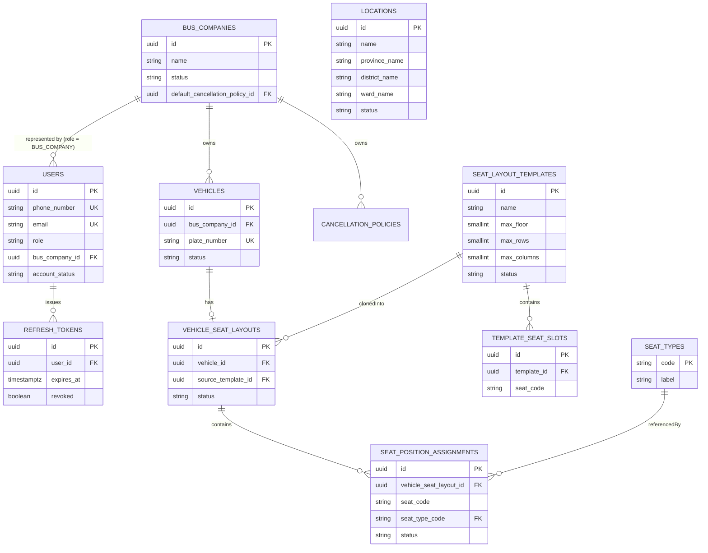
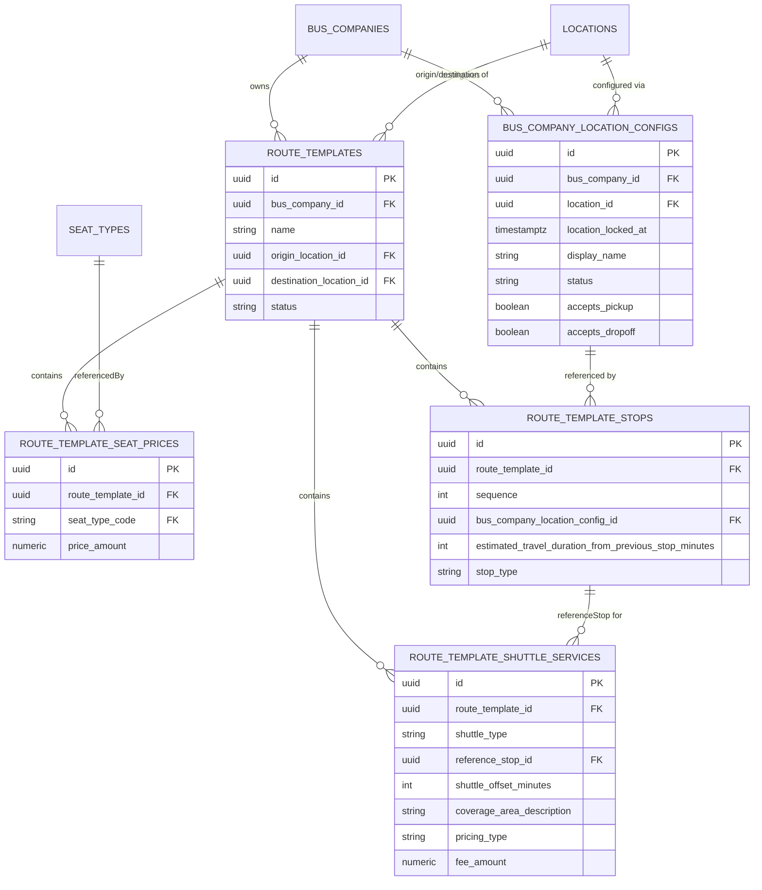
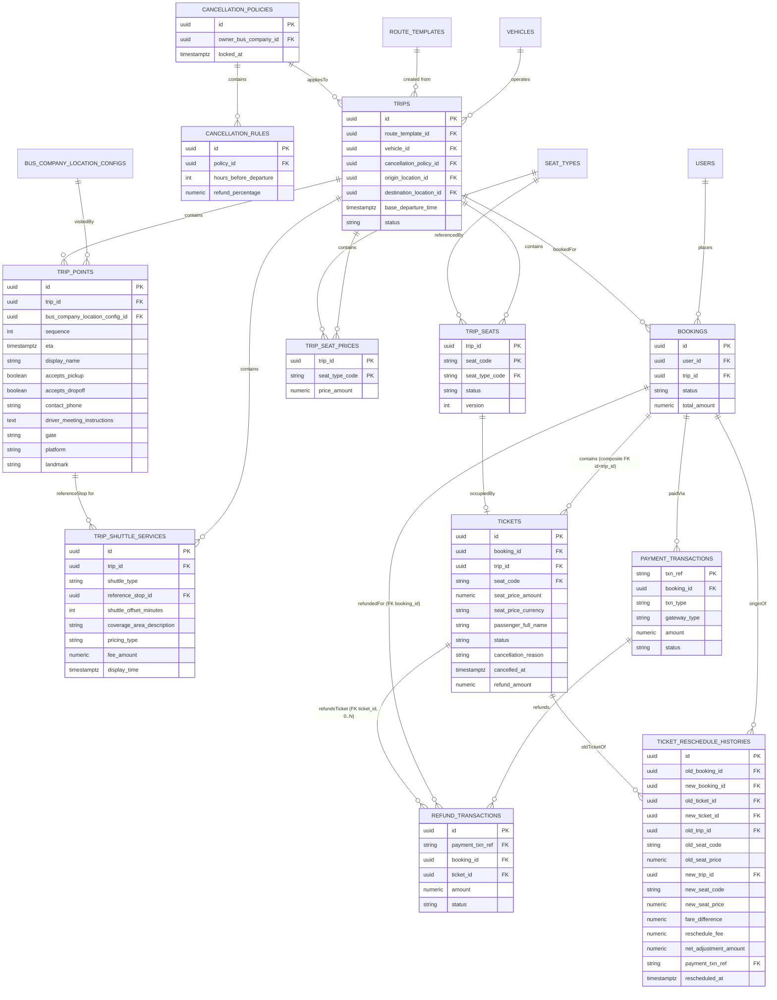
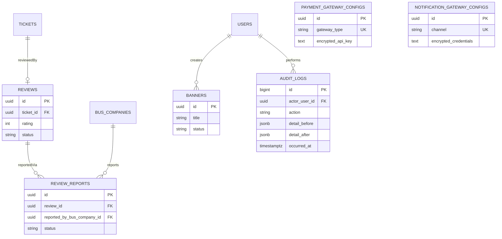

# DATABASE DESIGN (ERD) — HỆ THỐNG VEXERE CLONE (v2 — đã đồng bộ với Class Diagram v2)
### (Production Level — PostgreSQL, dựa trên SRS + Domain Model + Class Diagram v2 [CANONICAL] + 6 Sequence Diagram)

> **Class Diagram (`class_diagram.md`) là Single Source of Truth.** Tài liệu này đã được rà soát và đồng bộ lại toàn bộ theo đúng Class Diagram v2 (bản đã hợp nhất Patch: RouteTemplate / RouteTemplateSeatPrice / RouteTemplateStop / BusCompanyLocationConfig / TripSeatPrice). Mọi điểm thay đổi so với bản Database Design gốc được đánh dấu `[SYNC v2]`. Mọi Issue đã được Class Diagram giải quyết được đánh dấu `[ĐÃ GIẢI QUYẾT]`. Mọi Issue Class Diagram chưa giải quyết được **giữ nguyên**, không tự phát minh giải pháp — xem đầy đủ tại **Synchronization Report** ở cuối tài liệu.
>
> Không viết SQL CREATE TABLE, không viết Entity Java, không viết API. Chỉ thiết kế Database.
> RDBMS mục tiêu: **PostgreSQL** (dùng JSONB, Partial Unique Index, Range Partition — những tính năng MySQL không hỗ trợ đầy đủ). Nếu buộc dùng MySQL, các Partial Unique Index ở dưới cần thay bằng generated column + unique index hoặc kiểm tra ở tầng ứng dụng — sẽ ghi chú tại từng chỗ liên quan.

---

## BƯỚC 1. PHÂN TÍCH TÀI LIỆU & MÂU THUẪN

### 1.1 Nguồn sự thật (Source of Truth) được chọn cho từng lớp thông tin

| Loại thông tin | Tài liệu đúng nhất | Lý do |
|---|---|---|
| Aggregate Boundary, Repository | **Class Diagram** | Đã tự sửa 8 lỗi/mâu thuẫn nội tại của Domain Model gốc (xem class_diagram.md Phần 1.2) — là bản đã hiệu chỉnh mới nhất |
| Trạng thái/State Machine | **Domain Model Phần 8, 13** | Class Diagram kế thừa nguyên vẹn, không đổi |
| Luồng gọi, thứ tự bước, Event | **Sequence Diagram** | Chi tiết nhất, đã dùng để verify Class Diagram |
| Business Rule | **SRS** | Nguồn gốc duy nhất, Domain Model/Class Diagram chỉ diễn giải lại |

### 1.2 Mâu thuẫn phát hiện khi thiết kế Database — trạng thái sau khi đồng bộ Class Diagram v2

| # | Mâu thuẫn / Lỗ hổng | Trạng thái | Xử lý |
|---|---|---|---|
| 1 | **Không có trường Giá vé** trong SRS/Domain Model/Class Diagram gốc — `trips.base_fare` chỉ là ASSUMPTION tạm | ✅ **[ĐÃ GIẢI QUYẾT bởi Class Diagram v2]** | Class Diagram v2 bổ sung `RouteTemplate → RouteTemplateSeatPrice → (snapshot) → Trip → TripSeatPrice`. **Xóa cột `trips.base_fare`**, thay bằng bảng `trip_seat_prices` (snapshot) + `route_template_seat_prices` (nguồn gốc). Xem Bước 2 Nhóm F. |
| 2 | `RefreshToken` là Entity con của `User` nhưng có Repository riêng | Không đổi — Class Diagram v2 giữ nguyên quyết định "ngoại lệ thực dụng" | Giữ nguyên thiết kế bảng `refresh_tokens` như bản gốc |
| 3 | `Trip` không có cột `origin`/`destination` tường minh, phải denormalize để tối ưu tìm kiếm | ✅ **[ĐÃ GIẢI QUYẾT/NÂNG CẤP bởi Class Diagram v2]** | Class Diagram v2 chính thức đưa `originLocationId`/`destinationLocationId` thành **thuộc tính Domain của `Trip`** (không còn là "mẹo denormalize" riêng của DB nữa — nay là quyết định nghiệp vụ: Trip snapshot 2 điểm này từ `RouteTemplate` lúc tạo). Database Design chỉ việc phản ánh đúng, không cần tự biện minh performance nữa. |
| 4 | `ReviewReport` — được report lại sau khi bị từ chối hay không | ✅ **[ĐÃ GIẢI QUYẾT theo Quyết định Nghiệp vụ]** | Xác nhận Quyết định Nghiệp vụ chính thức: Mỗi Ticket có tối đa 1 Review (`UNIQUE(ticket_id)`). 1 Review có thể có nhiều ReviewReport theo thời gian (Review 1-N ReviewReport). Partial UNIQUE Index `(review_id) WHERE status='PENDING_ADMIN_DECISION'` bảo đảm tối đa 1 report ở trạng thái PENDING tại một thời điểm. Sau khi Admin `REJECTED`, Nhà xe được phép gửi ReviewReport mới (tạo bản ghi mới hoàn toàn, không reopen bản ghi cũ). |
| 5 | `AuditDetail` VO thiếu `before/after` so với Business Rule 31 | Không đổi — Class Diagram v2 giữ nguyên `AuditDetail` như bản gốc (`actorUserId, ipAddress, action, timestamp`, không có before/after) | Giữ nguyên `detail_before`/`detail_after` (JSONB) đã bổ sung trước đó — đây là mở rộng hợp lý theo Business Rule 31, không mâu thuẫn với Class Diagram (Class Diagram không cấm mở rộng VO khi ánh xạ sang bảng chi tiết hơn) |

### 1.3 Mâu thuẫn MỚI phát hiện khi đồng bộ với Class Diagram v2 `[SYNC v2]`

| # | Mâu thuẫn / Lỗ hổng | Trạng thái | Xử lý |
|---|---|---|---|
| 6 | Class Diagram v2 xóa `ownerType`/`ownerBusCompanyId` khỏi `Location` nhưng phương thức `LocationRepository.findVisibleTo(busCompanyId)` cũ còn sót lại | ✅ **[ĐÃ GIẢI QUYẾT]** | **Xóa bỏ hoàn toàn method `findVisibleTo(busCompanyId)` khỏi `LocationRepository`**. Refactor sang `BusCompanyLocationConfigRepository.findByBusCompany(busCompanyId)` để truy vấn danh sách cấu hình địa điểm do Nhà xe cài đặt từ bảng `bus_company_location_configs`. Bảng `locations` giữ nguyên là Shared Master Data dùng chung toàn hệ thống. |
| 7 | `RouteTemplate.originLocationId`/`destinationLocationId` và `RouteTemplateStop` không có ràng buộc đồng bộ | ✅ **[ĐÃ GIẢI QUYẾT theo Nghiệp vụ thực tế Vexere]** | **Xác nhận thiết kế chủ đích**: `origin_location_id` và `destination_location_id` là **Default Representative Locations** (Search Anchors) của toàn tuyến (đại diện, phân loại, quản trị, SEO, fallback). Representative Pickup/Dropoff trên Card được lựa chọn **ĐỘNG từ `route_template_stops`** theo Search Context (Province/District/Ward). `trip_points` là runtime snapshot tạo sau khi sinh Trip, KHÔNG tham gia Search. KHÔNG tạo CHECK constraint hay Trigger đồng bộ. |
| 8 | `BusCompanyLocationConfigStatus` (ACTIVE/DISABLED) — Xử lý khi config bị chuyển `DISABLED` trong khi còn `route_template_stops`/`trip_points` tham chiếu | ✅ **[ĐÃ GIẢI QUYẾT theo Quyết định Nghiệp vụ]** | **Xác nhận nguyên tắc Soft Disable (Grandfather Rule)**: `status = DISABLED` chỉ áp dụng chặn tham chiếu cho dữ liệu mới ở tầng Application Service (khi tạo mới/chỉnh sửa `route_template_stops`). Các `route_template_stops` cũ, `trips` cũ và snapshot `trip_points` giữ nguyên 100% không bị ảnh hưởng. KHÔNG cascade update, KHÔNG tự động thay Config, KHÔNG thêm Trigger hay CHECK constraint ở Database (Database chỉ giữ FK `RESTRICT` chống DELETE vật lý). |

### 1.3 Xác nhận: KHÔNG có quan hệ N-N "thuần túy" nào bị bỏ sót
Toàn bộ hệ thống chỉ có 1 quan hệ N-N **có thuộc tính riêng** (rich many-to-many), được mô hình đúng bằng Entity con theo Domain Model — không cần bảng bridge "trần" (không thuộc tính):
- `VehicleSeatLayout` N-N `SeatType` → qua `SeatPositionAssignment` (thuộc tính: `seatCode`, `position`)

> **[SYNC v2 — ĐÃ SỬa]** `Trip` không còn có quan hệ N-N trực tiếp với `Location`. `TripPoint` không phải bridge table cho Trip↔Location; `TripPoint` là snapshot runtime tham chiếu `BusCompanyLocationConfig` (không trực tiếp `Location`). Chuỗi đúng: `Trip → TripPoint → BusCompanyLocationConfig → Location`.

---

## BƯỚC 2 & 3 & 4. DANH SÁCH BẢNG — CỘT — KHÓA

> Ký hiệu: PK = Primary Key · FK = Foreign Key · UK = Unique Key · CK = Composite Key · NK = Natural Key candidate

### NHÓM A — IDENTITY & ACCESS

#### A1. `users` — Bảng chính (Aggregate Root: User)
*Lý do tồn tại:* đại diện danh tính đăng nhập, gốc của mọi tham chiếu `userId` xuyên hệ thống.

| Column | Type | Nullable | Unique | Default | Business meaning |
|---|---|---|---|---|---|
| id (PK) | UUID | No | — | gen_random_uuid() | Định danh User |
| phone_number (UK, NK) | VARCHAR(20) | Yes | Yes (partial, WHERE NOT NULL) | — | SĐT dùng đăng nhập OTP — nullable vì tài khoản Google-only có thể không có SĐT |
| email (UK, NK) | VARCHAR(255) | Yes | Yes (partial, WHERE NOT NULL) | — | Email dùng đăng nhập Google — nullable vì tài khoản OTP-only |
| role | VARCHAR(20) | No | — | 'CUSTOMER' | CUSTOMER / BUS_COMPANY / ADMIN |
| bus_company_id (FK) | UUID | Yes | — | NULL | **`[FIX 1]`** FK → bus_companies.id. **Chỉ có giá trị khi `role = 'BUS_COMPANY'`** — là Nhà xe mà tài khoản này đại diện. Bắt buộc `NULL` với CUSTOMER/ADMIN. Đây là nguồn dữ liệu cho `currentUser.busCompanyId` mà Rule O3 (authorization) sử dụng |
| account_status | VARCHAR(20) | No | — | 'ACTIVE' | ACTIVE / LOCKED / ANONYMIZED |
| created_at | TIMESTAMPTZ | No | — | now() | Audit |
| updated_at | TIMESTAMPTZ | No | — | now() | Audit |
| anonymized_at | TIMESTAMPTZ | Yes | — | NULL | Thời điểm hoàn tất Right-to-be-Forgotten (Rule 35) |
| version | INT | No | — | 0 | Optimistic Lock (khóa/mở khóa đồng thời) |

**Constraint đặc biệt:** `CHECK (phone_number IS NOT NULL OR email IS NOT NULL)` — phải có ít nhất 1 kênh định danh.
**Constraint `[FIX 1]`:** ràng buộc `bus_company_id` chỉ tồn tại đúng với role BUS_COMPANY — Database enforce trực tiếp, không phụ thuộc Application:
```sql
ALTER TABLE users
  ADD CONSTRAINT ck_users_bus_company_role
  CHECK (
    (role = 'BUS_COMPANY' AND bus_company_id IS NOT NULL)
    OR
    (role <> 'BUS_COMPANY' AND bus_company_id IS NULL)
  );
```
**FK `[FIX 1]`:** `bus_company_id -> bus_companies.id ON DELETE RESTRICT` — không xóa Nhà xe khi còn tài khoản đại diện.
**Mô hình:** 1 User role BUS_COMPANY thuộc **đúng 1** BusCompany; 1 BusCompany có thể có nhiều User đại diện (`BusCompany 1 - 0..* User`). **Không** tạo bảng mapping riêng, **không** dynamic multi-tenant membership.
**Khóa:** PK = `id` (surrogate, vì cả 2 candidate key `phone_number`/`email` đều nullable, không thể làm PK). Candidate Key: `phone_number`, `email` (không gộp — đúng Rule 26, hai luồng độc lập, KHÔNG có Unique constraint chéo giữa 2 cột).

#### A2. `refresh_tokens` — Bảng phụ (Entity con của User, ngoại lệ thực dụng)
*Lý do tồn tại:* xác thực phiên đăng nhập dài hạn, tách bảng vì tần suất đọc/ghi độc lập với `users`.

| Column | Type | Nullable | Unique | Default | Business meaning |
|---|---|---|---|---|---|
| id (PK) | UUID | No | — | gen_random_uuid() | Token ID |
| user_id (FK) | UUID | No | — | — | FK → users.id |
| issued_at | TIMESTAMPTZ | No | — | now() | Thời điểm phát hành |
| expires_at | TIMESTAMPTZ | No | — | — | Hết hạn (7-30 ngày) |
| revoked | BOOLEAN | No | — | false | Đã thu hồi (logout) |

**FK:** `user_id -> users.id ON DELETE CASCADE` (token vô nghĩa nếu User không còn).

---

### NHÓM B — FLEET & SEAT CATALOG

#### B1. `bus_companies` — Bảng chính (Aggregate Root: BusCompany)
| Column | Type | Nullable | Unique | Default | Business meaning |
|---|---|---|---|---|---|
| id (PK) | UUID | No | — | gen_random_uuid() | |
| name | VARCHAR(255) | No | — | — | Tên nhà xe |
| hotline | VARCHAR(20) | No | — | — | SĐT liên hệ |
| status | VARCHAR(20) | No | — | 'PENDING_APPROVAL' | PENDING_APPROVAL / ACTIVE / SUSPENDED |
| default_cancellation_policy_id (FK) | UUID | Yes | — | NULL | FK → cancellation_policies.id |
| created_at, updated_at | TIMESTAMPTZ | No | — | now() | |
| version | INT | No | — | 0 | Optimistic Lock |

**FK:** `default_cancellation_policy_id -> cancellation_policies.id ON DELETE RESTRICT`.

#### B2. `vehicles` — Bảng chính (Aggregate Root độc lập — đã tách khỏi BusCompany theo Class Diagram)
| Column | Type | Nullable | Unique | Default | Business meaning |
|---|---|---|---|---|---|
| id (PK) | UUID | No | — | gen_random_uuid() | |
| bus_company_id (FK) | UUID | No | — | — | FK → bus_companies.id |
| plate_number (UK, NK) | VARCHAR(20) | No | Yes | — | Biển số — Natural Key ứng viên, không chọn làm PK vì có thể cần đổi biển |
| vehicle_type | VARCHAR(20) | No | — | — | SEATED / SLEEPER / LIMOUSINE |
| status | VARCHAR(20) | No | — | 'ACTIVE' | ACTIVE / INACTIVE — **`[FIX 4]`** ánh xạ enum canonical `VehicleStatus`. `Vehicle.retire()` chuyển `ACTIVE → INACTIVE`; xe INACTIVE không được chọn cho `Trip` mới, `Trip` đã tạo giữ nguyên |
| created_at, updated_at | TIMESTAMPTZ | No | — | now() | |
| version | INT | No | — | 0 | |

**FK:** `bus_company_id -> bus_companies.id ON DELETE RESTRICT` (không xóa nhà xe khi còn xe).

#### B3. `seat_layout_templates` — Bảng chính (Aggregate Root)
| Column | Type | Nullable | Unique | Default | Business meaning |
|---|---|---|---|---|---|
| id (PK) | UUID | No | — | gen_random_uuid() | |
| name | VARCHAR(255) | No | — | — | |
| max_floor | SMALLINT | No | — | 1 | Số tầng tối đa (> 0) **[SYNC v3]** |
| max_rows | SMALLINT | No | — | — | Số hàng tối đa (> 0) **[SYNC v3]** |
| max_columns | SMALLINT | No | — | — | Số cột tối đa (> 0) **[SYNC v3]** |
| status | VARCHAR(20) | No | — | 'DRAFT' | DRAFT / PUBLISHED / DEPRECATED |
| created_at, updated_at | TIMESTAMPTZ | No | — | now() | |
| created_by (FK) | UUID | No | — | — | FK → users.id (Admin tạo) |

**Constraints:** `CHECK (max_floor > 0 AND max_rows > 0 AND max_columns > 0)`.

#### B4. `template_seat_slots` — Bảng phụ (Entity con của SeatLayoutTemplate)
| Column | Type | Nullable | Unique | Default | Business meaning |
|---|---|---|---|---|---|
| id (PK) | UUID | No | — | gen_random_uuid() | |
| template_id (FK, CK) | UUID | No | — | — | FK → seat_layout_templates.id |
| seat_code (CK) | VARCHAR(10) | No | — | — | VD 'A5' |
| floor | SMALLINT | No | — | 1 | Tầng (tầng ứng dụng validate floor <= max_floor) |
| row_number | SMALLINT | No | — | — | Hàng (tầng ứng dụng validate row_number <= max_rows) |
| column_number | SMALLINT | No | — | — | Cột (tầng ứng dụng validate column_number <= max_columns) |

**Khóa:** UNIQUE composite (`template_id`, `seat_code`). **FK:** `template_id -> seat_layout_templates.id ON DELETE CASCADE`.

#### B5. `vehicle_seat_layouts` — Bảng chính (Aggregate Root — quan hệ 1-1 với Vehicle)
| Column | Type | Nullable | Unique | Default | Business meaning |
|---|---|---|---|---|---|
| id (PK) | UUID | No | — | gen_random_uuid() | |
| vehicle_id (FK, UK) | UUID | No | Yes | — | FK → vehicles.id — **`[D2]`** `NOT NULL` + `UNIQUE` là **cơ chế duy nhất** đảm bảo 1-1. `NOT NULL` → layout luôn thuộc đúng 1 xe (không có layout mồ côi); `UNIQUE` → mỗi xe tối đa 1 layout. **IMMUTABLE sau khi tạo** — không chuyển layout sang xe khác |
| source_template_id (FK) | UUID | No | — | — | FK → seat_layout_templates.id |
| status | VARCHAR(20) | No | — | 'CONFIGURING' | CONFIGURING / FINALIZED — **`[D4]`** ánh xạ enum canonical `VehicleSeatLayoutStatus` |
| created_at, updated_at | TIMESTAMPTZ | No | — | now() | |
| version | INT | No | — | 0 | |

**FK:** `vehicle_id -> vehicles.id ON DELETE CASCADE`; `source_template_id -> seat_layout_templates.id ON DELETE RESTRICT`.

**`[D2]` Quan hệ 1-1 — thiết kế canonical (MỘT CHIỀU):**

```text
vehicles                      vehicle_seat_layouts
  id (PK)  <──────────────── vehicle_id (FK, NOT NULL, UNIQUE)
```

Cột `vehicles.vehicle_seat_layout_id` **đã bị xóa** (xem B2). Lý do: hai FK trỏ ngược nhau tạo **cycle** và cho phép trạng thái mâu thuẫn (`vehicle.layout_id = L1` trong khi `L1.vehicle_id = V2`) mà DB không phát hiện được.

| Thuộc tính cần đảm bảo | Được đảm bảo bởi |
|---|---|
| Mỗi Vehicle có **tối đa 1** layout | `UNIQUE (vehicle_id)` |
| Mỗi layout thuộc **đúng 1** Vehicle | `NOT NULL` + FK |
| **Không** hai xe dùng chung 1 layout | Layout chỉ mang một `vehicle_id` |
| **Không** ownership ambiguity | Chỉ tồn tại **một** nguồn sự thật |
| **Không** FK cycle | Quan hệ một chiều → insert 1 pha: `vehicles` → `vehicle_seat_layouts` |

**Trigger bất biến chủ sở hữu layout:**
```sql
CREATE TRIGGER tg_layout_vehicle_immutable
  BEFORE UPDATE ON vehicle_seat_layouts
  FOR EACH ROW EXECUTE FUNCTION trg_owner_immutable('vehicle_id');
```

**Cardinality canonical:** `Vehicle "1" → "0..1" VehicleSeatLayout`. Xe vừa tạo **chưa có** layout (`0`); sau khi Nhà xe cấu hình thì có đúng `1`. Trước đây prose ghi "1-1" nhưng cột lại nullable — nay thống nhất **0..1** ở cả 4 tài liệu.

**Truy vấn layout của một xe:** `SELECT * FROM vehicle_seat_layouts WHERE vehicle_id = :vehicleId`.

**Lưu ý nghiệp vụ:** Khi tạo `vehicle_seat_layouts` từ `source_template_id`, hệ thống tự động clone toàn bộ `template_seat_slots` tương ứng sang `seat_position_assignments` (Ví dụ 34 slots -> 34 records). Sau đó Nhà xe chỉ việc chỉnh sửa `seat_type_code` và `status` cho từng vị trí **[SYNC v3]**.

#### B6. `seat_position_assignments` — Bảng bridge (VehicleSeatLayout N-N SeatType, có thuộc tính)
| Column | Type | Nullable | Unique | Default | Business meaning |
|---|---|---|---|---|---|
| id (PK) | UUID | No | — | gen_random_uuid() | |
| vehicle_seat_layout_id (FK, CK) | UUID | No | — | — | FK → vehicle_seat_layouts.id |
| seat_code (CK) | VARCHAR(10) | No | — | — | |
| floor | SMALLINT | No | — | — | |
| row_number | SMALLINT | No | — | — | |
| column_number | SMALLINT | No | — | — | |
| seat_type_code (FK) | VARCHAR(30) | No | — | — | FK → seat_types.code |
| status | VARCHAR(20) | No | — | 'ACTIVE' | ACTIVE / BROKEN / DISABLED / MAINTENANCE (trạng thái cấu hình lâu dài của ghế trên xe, phân biệt với TripSeat.status) **[SYNC v3]** |

**Khóa:** UNIQUE composite (`vehicle_seat_layout_id`, `seat_code`). **FK:** `vehicle_seat_layout_id ON DELETE CASCADE`; `seat_type_code ON DELETE RESTRICT`.

#### B7. `seat_types` — Bảng danh mục (Aggregate Root, reference data)
| Column | Type | Nullable | Unique | Default | Business meaning |
|---|---|---|---|---|---|
| code (PK, NK) | VARCHAR(30) | No | — | — | Natural Key luôn — VD 'VIP', 'STANDARD' |
| label | VARCHAR(100) | No | — | — | Tên hiển thị |
| status | VARCHAR(20) | No | — | 'ACTIVE' | ACTIVE / DEPRECATED |
| created_at, updated_at | TIMESTAMPTZ | No | — | now() | |

#### B8. `locations` — Bảng chính (Aggregate Root) `[SYNC v2 — sửa theo Class Diagram Rule B]`
*Thay đổi so với bản gốc:* **Xóa** `owner_type`, `owner_bus_company_id` và CHECK constraint liên quan — Class Diagram v2 khẳng định `Location` là **Shared Master Data do Admin quản lý**, không còn khái niệm sở hữu theo Nhà xe (Rule B). **Thêm** 3 cột hành chính phục vụ tìm kiếm (Rule H — không tạo Aggregate Province/District/Ward riêng).

| Column | Type | Nullable | Unique | Default | Business meaning |
|---|---|---|---|---|---|
| id (PK) | UUID | No | — | gen_random_uuid() | |
| name | VARCHAR(255) | No | — | — | |
| latitude | NUMERIC(9,6) | No | — | — | |
| longitude | NUMERIC(9,6) | No | — | — | |
| province_name | VARCHAR(100) | No | — | — | **[SYNC v2]** Phục vụ tìm kiếm theo Tỉnh (Rule D) |
| district_name | VARCHAR(100) | No | — | — | **[SYNC v2]** Phục vụ tìm kiếm theo Huyện (Rule D) |
| ward_name | VARCHAR(100) | Yes | — | NULL | **[SYNC v2]** Phục vụ tìm kiếm theo Xã — nullable vì không phải Location nào cũng cần tới cấp Xã |
| status | VARCHAR(20) | No | — | 'ACTIVE' | ACTIVE / ARCHIVED — **`[FIX 7 — ĐÃ ĐỒNG BỘ]`** Class Diagram đã khai báo tường minh `status : LocationStatus` và enum `LocationStatus {ACTIVE, ARCHIVED}`; Domain Model liệt kê `LocationStatus` trong Phần Enum. Method `Location.archive()` chuyển `ACTIVE → ARCHIVED`. Location `ARCHIVED` không được chọn cho `BusCompanyLocationConfig` mới; dữ liệu đã tham chiếu giữ nguyên (không cascade) |
| created_at, updated_at | TIMESTAMPTZ | No | — | now() | |

**FK:** Không còn FK nào tới `bus_companies` (đã xóa `owner_bus_company_id`).
**[ĐÃ ĐỒNG BỘ - Issue #6]** Bảng `locations` hoàn toàn là Shared Master Data Catalog (`findAll()`, `findById()`). Logic lấy danh sách điểm đón/trả do Nhà xe sử dụng được thực hiện qua `BusCompanyLocationConfigRepository.findByBusCompany(busCompanyId)` trên bảng `bus_company_location_configs`.

---

### NHÓM F — ROUTE TEMPLATE & LOCATION CONFIGURATION `[SYNC v2 — hoàn toàn MỚI theo Class Diagram v2]`

#### F1. `route_templates` — Bảng chính (Aggregate Root MỚI)
*Lý do tồn tại:* khuôn mẫu 1 tuyến cố định của Nhà xe — nguồn sự thật (source of truth) cho giá vé và lịch trình chuẩn, giải quyết dứt điểm Missing Information #1.

| Column | Type | Nullable | Unique | Default | Business meaning |
|---|---|---|---|---|---|
| id (PK) | UUID | No | — | gen_random_uuid() | |
| bus_company_id (FK) | UUID | No | — | — | FK → bus_companies.id |
| name | VARCHAR(255) | No | — | — | VD "HCM - Kon Tum" |
| origin_location_id (FK) | UUID | No | — | — | FK → locations.id |
| destination_location_id (FK) | UUID | No | — | — | FK → locations.id — **[ĐÃ GIẢI QUYẾT - Issue #7]** Search Anchor của toàn tuyến, không cần đồng bộ/CHECK với `route_template_stops` |
| status | VARCHAR(20) | No | — | 'DRAFT' | DRAFT / PUBLISHED / DEPRECATED |
| created_at, updated_at | TIMESTAMPTZ | No | — | now() | |
| version | INT | No | — | 0 | Optimistic Lock |

**FK:** `bus_company_id ON DELETE RESTRICT`; `origin_location_id`/`destination_location_id ON DELETE RESTRICT`.
**[ĐÃ ĐỒNG BỘ - Issue #7]** `origin_location_id` và `destination_location_id` đóng vai trò là Search Anchors (Search Indexes) của toàn tuyến phục vụ tìm kiếm/hiển thị card/filter tỉnh thành; `route_template_stops` quản lý điểm dừng vận hành thực tế. Chủ đích thiết kế không dùng CHECK/Trigger đồng bộ.

#### F2. `route_template_seat_prices` — Bảng phụ (Entity con của RouteTemplate)
*Lý do tồn tại:* lưu giá vé theo từng loại ghế của tuyến — nguồn gốc để `trip_seat_prices` snapshot khi tạo Trip.

| Column | Type | Nullable | Unique | Default | Business meaning |
|---|---|---|---|---|---|
| id (PK) | UUID | No | — | gen_random_uuid() | |
| route_template_id (FK, CK) | UUID | No | — | — | FK → route_templates.id |
| seat_type_code (FK, CK) | VARCHAR(30) | No | — | — | FK → seat_types.code |
| price_amount | NUMERIC(14,2) | No | — | — | Money VO — amount |
| price_currency | CHAR(3) | No | — | 'VND' | Money VO — currency |

**Khóa:** UNIQUE composite (`route_template_id`, `seat_type_code`). **FK:** `route_template_id ON DELETE CASCADE`; `seat_type_code ON DELETE RESTRICT`.

#### F3. `route_template_stops` — Bảng phụ (Entity con của RouteTemplate)
*Lý do tồn tại:* danh sách điểm dừng chuẩn của tuyến theo thứ tự `sequence`. **`[FIX 8]`** Bảng **không** lưu giờ đến tuyệt đối và **không** cho Nhà xe nhập tay thời gian — mỗi stop lưu `estimated_travel_duration_from_previous_stop_minutes` (thời lượng đoạn từ stop liền trước), **lấy tự động từ Routing API** khi cấu hình/cập nhật Tuyến mẫu; Stop 1 (`sequence = 1`) luôn bằng 0 (NOT NULL); **Nhà xe không có quyền chỉnh sửa/ghi đè** giá trị này.

| Column | Type | Nullable | Unique | Default | Business meaning |
|---|---|---|---|---|---|
| id (PK) | UUID | No | — | gen_random_uuid() | |
| route_template_id (FK, CK) | UUID | No | — | — | FK → route_templates.id |
| sequence (CK) | SMALLINT | No | — | — | Thứ tự điểm dừng trong tuyến |
| bus_company_location_config_id (FK) | UUID | No | — | — | FK → bus_company_location_configs.id — **KHÔNG** trỏ thẳng `locations.id` (đúng Rule C) |
| estimated_travel_duration_from_previous_stop_minutes | INT | No | — | 0 | Thời lượng di chuyển dự kiến từ stop liền trước đến stop hiện tại (phút), stop đầu tiên (sequence=1) luôn bằng 0 (NOT NULL), lấy từ Routing API, Nhà xe không có quyền tự chỉnh sửa/ghi đè |
| stop_type | VARCHAR(20) | No | — | — | PICKUP / DROPOFF / PICKUP_AND_DROPOFF / TRANSIT_ONLY |

**Constraint đặc biệt:** `CHECK (sequence > 1 OR estimated_travel_duration_from_previous_stop_minutes = 0)`
**Khóa:** UNIQUE composite (`route_template_id`, `sequence`). **FK:** `route_template_id ON DELETE CASCADE`; `bus_company_location_config_id ON DELETE RESTRICT`.
**UNIQUE (bổ sung để làm FK target) `[INTEGRITY FIX]`:** `UNIQUE (id, route_template_id)` — dư thừa về logic (`id` đã là PK) nhưng bắt buộc để `route_template_shuttle_services` tham chiếu bằng Composite FK, đảm bảo `referenceStop` luôn thuộc đúng RouteTemplate cha. Không thay đổi PK hiện tại.
```sql
ALTER TABLE route_template_stops
  ADD CONSTRAINT uq_rt_stops_id_template UNIQUE (id, route_template_id);
```

**Ràng buộc Ownership — Rule O1 (Database-enforced trigger) `[OWNERSHIP]`:**
Một `route_template_stops` thuộc RouteTemplate của BusCompany A **chỉ được** tham chiếu `bus_company_location_configs` của **cùng BusCompany A**. Không thể enforce bằng Composite FK vì `route_template_stops` không mang `bus_company_id` — và **không được thêm cột dư thừa chỉ để phục vụ constraint**. Vì cả `route_templates` và `bus_company_location_configs` đều đã có sẵn `bus_company_id`, trigger chỉ cần lookup, **không thay đổi schema**:

```sql
CREATE OR REPLACE FUNCTION trg_rt_stop_config_same_company()
RETURNS TRIGGER AS $$
DECLARE
  v_template_company UUID;
  v_config_company   UUID;
BEGIN
  SELECT bus_company_id INTO v_template_company
  FROM route_templates WHERE id = NEW.route_template_id;

  SELECT bus_company_id INTO v_config_company
  FROM bus_company_location_configs WHERE id = NEW.bus_company_location_config_id;

  IF v_template_company IS DISTINCT FROM v_config_company THEN
    RAISE EXCEPTION
      'Ownership violation: RouteTemplate % thuoc BusCompany %, khong the tham chieu BusCompanyLocationConfig % thuoc BusCompany %.',
      NEW.route_template_id, v_template_company,
      NEW.bus_company_location_config_id, v_config_company
      USING ERRCODE = '23514';
  END IF;

  RETURN NEW;
END;
$$ LANGUAGE plpgsql;

CREATE TRIGGER tg_rt_stop_config_same_company
  BEFORE INSERT OR UPDATE OF route_template_id, bus_company_location_config_id
  ON route_template_stops
  FOR EACH ROW
  EXECUTE FUNCTION trg_rt_stop_config_same_company();
```

| # | Kịch bản | Kết quả DB |
|---|---|---|
| 1 | `RouteTemplate A` + `Config A-X` (cùng BusCompany A) | **PASS** |
| 2 | `RouteTemplate A` + `Config B-X` (Config của BusCompany B) | **REJECT** — ERRCODE 23514 |
| 3 | `Location X` được dùng bởi cả `Config A-X` và `Config B-X` | **PASS** — Location là Shared Master Data, **không** áp ownership |

> **Lưu ý về Location:** Trigger chỉ so sánh chủ sở hữu ở tầng `BusCompanyLocationConfig`. `Location` bên dưới Config vẫn là dữ liệu dùng chung — nhiều BusCompany có thể cùng trỏ tới một `Location`. **Không thêm `bus_company_id` vào `locations`.**

#### F4. `bus_company_location_configs` — Bảng chính (Aggregate Root MỚI)
*Lý do tồn tại:* cấu hình riêng của 1 Nhà xe tại 1 Location dùng chung (Rule C) — thay thế hoàn toàn ý tưởng "BusCompanyStop" (chủ động không tạo, đúng yêu cầu ban đầu).

| Column | Type | Nullable | Unique | Default | Business meaning |
|---|---|---|---|---|---|
| id (PK) | UUID | No | — | gen_random_uuid() | |
| bus_company_id (FK, CK) | UUID | No | — | — | FK → bus_companies.id |
| location_id (FK, CK) | UUID | No | — | — | FK → locations.id (dữ liệu dùng chung). **`[D3]`** **Immutable-After-Use (EVER USED)**: sửa được khi `location_locked_at IS NULL`; **bất biến vĩnh viễn** ngay khi đã từng có Stop tham chiếu — đổi Location = tạo Config mới |
| location_locked_at **`[D3]`** | TIMESTAMPTZ | Yes | — | NULL | **Write-once marker**. NULL = Config **chưa từng** được `RouteTemplateStop` nào sử dụng → `location_id` còn sửa được. NOT NULL = đã **từng** được sử dụng → `location_id` khóa vĩnh viễn. Do trigger tự set khi Stop đầu tiên tham chiếu; **không bao giờ** reset về NULL, kể cả khi toàn bộ Stop bị xóa |
| display_name | VARCHAR(255) | No | — | — | Tên hiển thị riêng của Nhà xe cho điểm này |
| status | VARCHAR(20) | No | — | 'ACTIVE' | ACTIVE (được chọn cho RouteTemplateStop mới) / DISABLED (Soft Disable — chặn chọn cho dữ liệu mới, dữ liệu cũ giữ nguyên) |
| accepts_pickup | BOOLEAN | No | — | true | |
| accepts_dropoff | BOOLEAN | No | — | true | |
| note | TEXT | Yes | — | NULL | |
| contact_phone | VARCHAR(20) | Yes | — | NULL | |
| driver_meeting_instructions | TEXT | Yes | — | NULL | |
| gate | VARCHAR(50) | Yes | — | NULL | |
| platform | VARCHAR(50) | Yes | — | NULL | |
| landmark | VARCHAR(255) | Yes | — | NULL | |
| created_at, updated_at | TIMESTAMPTZ | No | — | now() | |
| version | INT | No | — | 0 | |

**Khóa:** UNIQUE composite (`bus_company_id`, `location_id`). **FK:** `bus_company_id ON DELETE RESTRICT`; `location_id ON DELETE RESTRICT`.
**[ĐÃ GIẢI QUYẾT - Issue #8 - Quyết định Nghiệp vụ]** Nguyên tắc Soft Disable (Grandfather Rule): `status = DISABLED` chỉ áp dụng chặn chọn khi tạo mới hoặc cập nhật `route_template_stops` ở tầng Application Layer. Các `route_template_stops` cũ, `trips` cũ và snapshot `trip_points` đã tham chiếu trước đó vẫn giữ nguyên 100% không bị ảnh hưởng. KHÔNG cascade update, KHÔNG tự động chuyển Config, KHÔNG thêm Trigger hay CHECK constraint cho riêng cơ chế Soft Disable (DB duy trì FK `RESTRICT` chống DELETE vật lý). Việc chuyển `ACTIVE → DISABLED` luôn được phép kể cả khi đang có dữ liệu cũ tham chiếu.

**`[D3]` `location_id` — Immutable-After-Use theo ngữ nghĩa EVER USED (write-once marker):**

Soft Disable bảo vệ trường hợp **ngừng dùng** Config, nhưng không chặn được việc **đổi `location_id`** — thao tác này khiến mọi `route_template_stops` đang trỏ Config đó (và các tuyến/lịch sử liên quan) âm thầm chuyển sang địa điểm khác.

> [!IMPORTANT]
> **Vì sao không dùng `EXISTS(SELECT ... FROM route_template_stops)`:** điều kiện đó chỉ phản ánh trạng thái **hiện tại**. Nếu toàn bộ Stop tham chiếu bị xóa (hoặc CASCADE khi xóa RouteTemplate), Config sẽ **"mở khóa" trở lại** và cho phép đổi `location_id` — trong khi trên thực tế nó **đã từng** định danh địa điểm cho dữ liệu lịch sử. Ngữ nghĩa đúng phải là **EVER USED**, không phải *currently used*.

Cơ chế canonical gồm **hai trigger**:

```sql
-- (1) Danh dau da SU DUNG (write-once). Chay khi Stop tham chieu Config.
CREATE OR REPLACE FUNCTION trg_mark_config_location_locked()
RETURNS TRIGGER AS $$
BEGIN
  UPDATE bus_company_location_configs
     SET location_locked_at = now()
   WHERE id = NEW.bus_company_location_config_id
     AND location_locked_at IS NULL;   -- chi set lan dau, khong ghi de
  RETURN NEW;
END;
$$ LANGUAGE plpgsql;

CREATE TRIGGER tg_mark_config_location_locked
  AFTER INSERT OR UPDATE OF bus_company_location_config_id ON route_template_stops
  FOR EACH ROW EXECUTE FUNCTION trg_mark_config_location_locked();

-- (2) Chan doi location_id sau khi da khoa + chan reset marker.
CREATE OR REPLACE FUNCTION trg_config_location_immutable_after_use()
RETURNS TRIGGER AS $$
BEGIN
  IF NEW.location_id IS DISTINCT FROM OLD.location_id
     AND OLD.location_locked_at IS NOT NULL THEN
    RAISE EXCEPTION
      'BusCompanyLocationConfig % da TUNG duoc RouteTemplateStop su dung (locked at %): location_id la IMMUTABLE vinh vien. Hay tao Config moi cho Location khac.',
      OLD.id, OLD.location_locked_at
      USING ERRCODE = '23514';
  END IF;

  -- Marker la WRITE-ONCE: da set thi khong duoc xoa hoac sua
  IF OLD.location_locked_at IS NOT NULL
     AND NEW.location_locked_at IS DISTINCT FROM OLD.location_locked_at THEN
    RAISE EXCEPTION
      'location_locked_at la WRITE-ONCE: khong the reset hoac thay doi (% -> %).',
      OLD.location_locked_at, NEW.location_locked_at
      USING ERRCODE = '23514';
  END IF;

  RETURN NEW;
END;
$$ LANGUAGE plpgsql;

CREATE TRIGGER tg_config_location_immutable_after_use
  BEFORE UPDATE ON bus_company_location_configs
  FOR EACH ROW EXECUTE FUNCTION trg_config_location_immutable_after_use();
```

| # | Kịch bản | Kết quả |
|---|---|---|
| 1 | Đổi `location_id` của Config **chưa từng** được dùng (`location_locked_at IS NULL`) | **PASS** — giai đoạn cấu hình nháp |
| 2 | Đổi `location_id` của Config **đang** có Stop tham chiếu | **REJECT** (23514) |
| 3 | Sửa `display_name`/`gate`/`platform`... của Config đã dùng | **PASS** — chỉ ảnh hưởng dữ liệu mới; `trip_points` cũ đã snapshot nên không đổi |
| 4 | Chuyển `ACTIVE → DISABLED` khi đang có Stop cũ | **PASS** — đúng Soft Disable |
| 5 | **Xóa hết Stop** tham chiếu → rồi đổi `location_id` | **REJECT** (23514) — `location_locked_at` vẫn NOT NULL. **Đây chính là lỗ hổng mà `EXISTS` không chặn được** |
| 6 | `UPDATE ... SET location_locked_at = NULL` (cố tình mở khóa) | **REJECT** (23514) — marker là write-once |
| 7 | Stop mới tham chiếu Config đã khóa từ trước | **PASS** — marker giữ nguyên giá trị lần khóa đầu tiên |

#### F5. `route_template_shuttle_services` — Bảng phụ (Entity con của RouteTemplate) `[NEW]`
*Lý do tồn tại:* Cấu hình Dịch vụ Xe trung chuyển mẫu của Tuyến mẫu (Đón `PICKUP` và Trả `DROPOFF` độc lập). Bắt buộc sở hữu `reference_stop_id` do **Nhà xe tự chọn thủ công** từ các `route_template_stops` thuộc tuyến (NOT NULL).

| Column | Type | Nullable | Unique | Default | Business meaning |
|---|---|---|---|---|---|
| id (PK) | UUID | No | — | gen_random_uuid() | |
| route_template_id (FK) | UUID | No | — | — | FK → route_templates.id |
| shuttle_type | VARCHAR(20) | No | — | — | PICKUP / DROPOFF |
| reference_stop_id (FK) | UUID | No | — | — | FK → route_template_stops.id — mốc thời gian do Nhà xe chọn thủ công (NOT NULL) |
| shuttle_offset_minutes | INT | No | — | 0 | Số phút lệch so với ETA của referenceStop |
| coverage_area_description | TEXT | No | — | — | Phạm vi phục vụ (văn bản mô tả, không tạo Location entity mới) |
| pricing_type | VARCHAR(20) | No | — | 'FREE' | FREE / PAID |
| fee_amount | NUMERIC(12,2) | Yes | — | NULL | Số tiền phí nếu pricing_type = 'PAID' |
| created_at, updated_at | TIMESTAMPTZ | No | — | now() | |

**Constraint đặc biệt:** `CHECK (pricing_type = 'FREE' OR fee_amount IS NOT NULL)`; `UNIQUE (route_template_id, shuttle_type)` (mỗi RouteTemplate có tối đa 0..1 PICKUP và 0..1 DROPOFF shuttle)
**FK:** `(reference_stop_id, route_template_id) -> route_template_stops(id, route_template_id) ON DELETE RESTRICT ON UPDATE RESTRICT` (**Composite FK — thay thế FK đơn `reference_stop_id` cũ**); `route_template_id ON DELETE CASCADE`.

**Ràng buộc referenceStop Parent Ownership (Database-enforced) `[INTEGRITY FIX]`:**
Invariant `RouteTemplateShuttleService.referenceStop ∈ RouteTemplate.routeTemplateId` được Database enforce trực tiếp — không phụ thuộc Application Layer:
```sql
-- Tiền đề: route_template_stops đã có UNIQUE (id, route_template_id) làm FK target (xem F3)
ALTER TABLE route_template_shuttle_services
  ADD CONSTRAINT fk_rt_shuttle_refstop_same_template
  FOREIGN KEY (reference_stop_id, route_template_id)
  REFERENCES route_template_stops (id, route_template_id)
  ON DELETE RESTRICT
  ON UPDATE RESTRICT;
```
Cơ chế bảo vệ:
- Shuttle của `RouteTemplate A` trỏ `reference_stop_id` thuộc `RouteTemplate B` → cặp `(stopB, A)` không tồn tại trong `route_template_stops(id, route_template_id)` → **DB reject** (`foreign_key_violation`, SQLSTATE 23503).
- Áp dụng cho cả INSERT lẫn UPDATE, mọi code path (batch job, migration, SQL thủ công).

**Không thay đổi business rule:** `reference_stop_id` vẫn do **Nhà xe tự chọn thủ công**, vẫn NOT NULL, PICKUP/DROPOFF vẫn độc lập, vẫn tối đa 0..1 mỗi loại. Constraint chỉ thu hẹp tập giá trị hợp lệ về đúng các stop thuộc tuyến của chính shuttle đó.

---

### NHÓM C — TRIP & SEAT INVENTORY (Core Domain)

#### C1. `cancellation_policies` — Bảng chính (Aggregate Root — chính thức hóa theo Class Diagram)
| Column | Type | Nullable | Unique | Default | Business meaning |
|---|---|---|---|---|---|
| id (PK) | UUID | No | — | gen_random_uuid() | |
| owner_bus_company_id (FK) | UUID | No | — | — | FK → bus_companies.id |
| locked_at | TIMESTAMPTZ | Yes | — | NULL | **`[INTEGRITY FIX]`** Thời điểm Policy bị "khóa" — được set khi `Trip` đầu tiên tham chiếu Policy này. `NULL` = chưa Trip nào dùng, còn sửa được. `NOT NULL` = **bất biến vĩnh viễn**, mọi thay đổi phải tạo Policy mới (Copy-on-Write) |
| created_at, updated_at | TIMESTAMPTZ | No | — | now() | |
| version | INT | No | — | 0 | |

#### C2. `cancellation_rules` — Bảng phụ (VO collection, Entity con)
| Column | Type | Nullable | Unique | Default | Business meaning |
|---|---|---|---|---|---|
| id (PK) | UUID | No | — | gen_random_uuid() | |
| policy_id (FK, CK) | UUID | No | — | — | FK → cancellation_policies.id |
| hours_before_departure (CK) | INT | No | — | — | Mốc giờ trước khởi hành |
| refund_percentage | NUMERIC(5,2) | No | — | — | 0-100 |

**Khóa:** UNIQUE composite (`policy_id`, `hours_before_departure`). **CHECK:** `refund_percentage BETWEEN 0 AND 100`. **FK:** `policy_id ON DELETE CASCADE`.

**Cơ chế Immutable-After-Use / Copy-on-Write `[INTEGRITY FIX]`:**
Vấn đề được giải quyết: trước đây `Trip.cancellation_policy_id` được gọi là "snapshot" nhưng thực chất chỉ là FK — sửa `cancellation_rules` của Policy P sẽ làm thay đổi **hồi tố** tỷ lệ hoàn tiền của các Trip cũ đang trỏ tới P.

Giải pháp (không thêm bảng, không thêm Aggregate):

| Bước | Hành vi |
|---|---|
| 1 | Policy **chưa từng được Trip nào sử dụng** (`locked_at IS NULL`): Nhà xe được **thêm/sửa/xóa** `cancellation_rules` bình thường theo nghiệp vụ hiện tại |
| 2 | Khi `TripCreationService` tạo `Trip` tham chiếu Policy P, trong cùng transaction set `cancellation_policies.locked_at = now()` nếu đang `NULL` |
| 3 | Policy có `locked_at IS NOT NULL` → **bất biến vĩnh viễn**: DB từ chối mọi UPDATE/DELETE trên `cancellation_rules` thuộc Policy đó |
| 4 | Nhà xe muốn "sửa" Policy đã locked → `CancellationPolicyResolutionService` tạo **Policy mới** (`locked_at = NULL`) với bộ rule mới. Các Trip từ thời điểm đó trở đi trỏ tới Policy mới |
| 5 | Trip cũ giữ nguyên `cancellation_policy_id` trỏ tới Policy cũ (đã locked) → Refund luôn đọc đúng bộ rule tại thời điểm Trip được tạo |
| 6 | **`[FIX 5]`** `trips.cancellation_policy_id` immutable **ngay khi Trip được tạo** — Policy bị khóa (`locked_at`) từ thời điểm **Trip đầu tiên** tham chiếu, không chờ đến Booking đầu tiên |

**Enforce ở tầng Database — Row-level Trigger (không dùng REVOKE toàn bảng):**
Không thể dùng `REVOKE UPDATE, DELETE ON cancellation_rules` vì như vậy sẽ khóa cả Policy **chưa từng được sử dụng** — vi phạm quy tắc nghiệp vụ #1. Thay bằng trigger row-level chỉ chặn đúng các rule thuộc Policy đã khóa:

```sql
CREATE OR REPLACE FUNCTION trg_block_locked_policy_rules()
RETURNS TRIGGER AS $$
DECLARE
  v_locked_at TIMESTAMPTZ;
BEGIN
  -- OLD.policy_id dùng cho cả UPDATE và DELETE
  SELECT locked_at INTO v_locked_at
  FROM cancellation_policies
  WHERE id = OLD.policy_id;

  IF v_locked_at IS NOT NULL THEN
    RAISE EXCEPTION
      'CancellationPolicy % da duoc Trip su dung (locked_at=%): khong the sua/xoa CancellationRule. Hay tao Policy moi (Copy-on-Write).',
      OLD.policy_id, v_locked_at
      USING ERRCODE = '23514';
  END IF;

  RETURN CASE WHEN TG_OP = 'DELETE' THEN OLD ELSE NEW END;
END;
$$ LANGUAGE plpgsql;

CREATE TRIGGER tg_cancellation_rules_immutable_after_use
  BEFORE UPDATE OR DELETE ON cancellation_rules
  FOR EACH ROW
  EXECUTE FUNCTION trg_block_locked_policy_rules();
```

Bổ sung trigger bảo vệ chính cờ khóa — `locked_at` chỉ được set một lần từ `NULL`, không được reset hay đổi giá trị:

```sql
CREATE OR REPLACE FUNCTION trg_policy_locked_at_write_once()
RETURNS TRIGGER AS $$
BEGIN
  IF OLD.locked_at IS NOT NULL AND NEW.locked_at IS DISTINCT FROM OLD.locked_at THEN
    RAISE EXCEPTION
      'locked_at cua CancellationPolicy % la write-once, khong the thay doi hay reset.', OLD.id
      USING ERRCODE = '23514';
  END IF;
  RETURN NEW;
END;
$$ LANGUAGE plpgsql;

CREATE TRIGGER tg_policy_locked_at_write_once
  BEFORE UPDATE ON cancellation_policies
  FOR EACH ROW
  EXECUTE FUNCTION trg_policy_locked_at_write_once();
```

> Hai trigger này **chỉ** bảo vệ đúng invariant Immutable-After-Use, không mang thêm nghiệp vụ nào khác và không thay đổi schema ngoài cột `locked_at` đã có.

**Ma trận verification:**

| # | Kịch bản | Kết quả DB |
|---|---|---|
| 1 | `UPDATE cancellation_rules` của Policy có `locked_at IS NULL` | **PASS** — Policy chưa dùng vẫn sửa được |
| 2 | `DELETE FROM cancellation_rules` của Policy có `locked_at IS NULL` | **PASS** |
| 3 | `INSERT` rule mới vào Policy có `locked_at IS NULL` | **PASS** |
| 4 | `UPDATE cancellation_rules` của Policy có `locked_at IS NOT NULL` | **REJECT** — trigger raise exception (ERRCODE 23514) |
| 5 | `DELETE FROM cancellation_rules` của Policy có `locked_at IS NOT NULL` | **REJECT** — trigger raise exception |
| 6 | `UPDATE cancellation_policies SET locked_at = NULL` (reset cờ khóa để lách) | **REJECT** — trigger write-once |
| 7 | Tạo Policy mới (Copy-on-Write) rồi INSERT bộ rule mới | **PASS** — luồng canonical khi Nhà xe đổi chính sách |
| 8 | `DELETE FROM cancellation_policies` khi đã có Trip tham chiếu | **REJECT** — FK `ON DELETE RESTRICT` |

**Phân định lớp bảo vệ:**

| Lớp | Được bảo vệ bằng | Phạm vi chính xác |
|---|---|---|
| **Database (trigger)** | `tg_cancellation_rules_immutable_after_use` trên `cancellation_rules` | Chặn UPDATE/DELETE rule **của Policy đã khóa** từ mọi code path (app, batch job, migration, SQL thủ công). Rule của Policy chưa khóa **không bị ảnh hưởng** |
| **Database (trigger)** | `tg_policy_locked_at_write_once` trên `cancellation_policies` | `locked_at` là write-once — không thể reset về `NULL` để lách cơ chế khóa |
| **Database (CHECK)** | `CHECK (locked_at IS NULL OR locked_at <= now())` | Chống set `locked_at` ở tương lai |
| **Database (FK)** | `trips.cancellation_policy_id ON DELETE RESTRICT` | Policy đang được Trip tham chiếu không bị xóa vật lý |
| **Application** | `TripCreationService` set `locked_at = now()` trong cùng transaction tạo Trip đầu tiên; `CancellationPolicyResolutionService` kiểm tra `locked_at` và điều hướng Copy-on-Write | **Việc set `locked_at`** (DB không tự biết thời điểm Trip tham chiếu) và cung cấp UX đúng thay vì để Nhà xe nhận lỗi trigger thô |

> **Ranh giới trách nhiệm:** Application chịu trách nhiệm **đánh dấu** thời điểm khóa (`locked_at`). Database chịu trách nhiệm **thực thi** tính bất biến sau khi đã khóa — một khi `locked_at` được set, không code path nào sửa được rule của Policy đó.

`ON DELETE RESTRICT` từ `trips.cancellation_policy_id` đảm bảo Policy đã có Trip tham chiếu không thể bị xóa vật lý.

#### C3. `trips` — Bảng chính (Aggregate Root trung tâm) `[SYNC v2 — thêm route_template_id, XÓA base_fare]`
*Thay đổi so với bản gốc:* **Xóa** cột `base_fare` (ASSUMPTION tạm thời, nay đã được Class Diagram v2 giải quyết dứt điểm bằng `trip_seat_prices`). **Thêm** `route_template_id`. Cột `origin_location_id`/`destination_location_id` **giữ nguyên** nhưng nay có ý nghĩa khác: không còn là "mẹo denormalize" của riêng Database nữa, mà là snapshot thuộc tính Domain chính thức của `Trip` (Class Diagram v2 dòng `-originLocationId String`, `-destinationLocationId String`).

| Column | Type | Nullable | Unique | Default | Business meaning |
|---|---|---|---|---|---|
| id (PK) | UUID | No | — | gen_random_uuid() | |
| route_template_id (FK) | UUID | No | — | — | **[SYNC v2 — MỚI]** FK → route_templates.id — Trip luôn được tạo từ 1 RouteTemplate (`createFromRouteTemplate()`) |
| vehicle_id (FK) | UUID | No | — | — | FK → vehicles.id |
| cancellation_policy_id (FK) | UUID | No | — | — | FK → cancellation_policies.id — **snapshot thực sự bất biến** `[INTEGRITY FIX]`: Policy được "khóa" (`locked_at`) ngay khi Trip đầu tiên tham chiếu; từ thời điểm đó `cancellation_rules` của Policy đã khóa không thể bị UPDATE/DELETE (DB trigger row-level) → Refund của Trip luôn đọc đúng bộ rule tại thời điểm tạo Trip. Policy chưa được Trip nào dùng vẫn sửa được bình thường. Thay đổi chính sách đã khóa = tạo Policy mới (Copy-on-Write, xem C1/C2) |
| origin_location_id (FK) | UUID | No | — | — | Snapshot từ `RouteTemplate.originLocationId` tại thời điểm tạo Trip |
| destination_location_id (FK) | UUID | No | — | — | Snapshot từ `RouteTemplate.destinationLocationId` tại thời điểm tạo Trip |
| base_departure_time | TIMESTAMPTZ | No | — | — | |
| delay_minutes | INT | No | — | 0 | **`[D6]`** **TỔNG số phút trễ hiện tại** của chuyến (absolute, **không** phải delta). Báo trễ → **SET** giá trị mới, **không** cộng dồn. VD: báo trễ 15' rồi báo lại 25' → `delay_minutes = 25` (không phải 40). `CHECK (delay_minutes >= 0)` |
| status | VARCHAR(20) | No | — | 'SCHEDULED' | SCHEDULED/DELAYED/RUNNING/COMPLETED/CANCELLED |
| created_at, updated_at | TIMESTAMPTZ | No | — | now() | |
| version | INT | No | — | 0 | Optimistic Lock — quan trọng vì nhiều luồng ghi (delay, remap, cancel) |

**FK:** `route_template_id ON DELETE RESTRICT`; `vehicle_id ON DELETE RESTRICT`; `cancellation_policy_id ON DELETE RESTRICT`; `origin/destination_location_id ON DELETE RESTRICT`.

**Ràng buộc Ownership — Rule O2 / O3 / O4 (Database-enforced trigger) `[OWNERSHIP]`:**
`Trip` không mang cột `bus_company_id` riêng (và **không được thêm** — sẽ là cột dư thừa). Chủ sở hữu của Trip được xác định qua `RouteTemplate` mà nó được tạo ra (`Trip` luôn tạo từ đúng 1 RouteTemplate — Rule O3). Từ mốc đó, `Vehicle` và `CancellationPolicy` bắt buộc phải thuộc cùng BusCompany. Cả ba bảng tham chiếu (`route_templates`, `vehicles`, `cancellation_policies`) đều đã có sẵn cột chủ sở hữu nên trigger chỉ cần lookup, **không thay đổi schema**:

```sql
CREATE OR REPLACE FUNCTION trg_trip_same_company_ownership()
RETURNS TRIGGER AS $$
DECLARE
  v_template_company UUID;
  v_vehicle_company  UUID;
  v_policy_company   UUID;
BEGIN
  -- Chủ sở hữu chuẩn của Trip = chủ sở hữu RouteTemplate (Rule O3)
  SELECT bus_company_id INTO v_template_company
  FROM route_templates WHERE id = NEW.route_template_id;

  SELECT bus_company_id INTO v_vehicle_company
  FROM vehicles WHERE id = NEW.vehicle_id;

  SELECT owner_bus_company_id INTO v_policy_company
  FROM cancellation_policies WHERE id = NEW.cancellation_policy_id;

  -- Rule O2: Trip chỉ dùng Vehicle của cùng BusCompany
  IF v_vehicle_company IS DISTINCT FROM v_template_company THEN
    RAISE EXCEPTION
      'Ownership violation (O2): Vehicle % thuoc BusCompany %, khong khop BusCompany % cua RouteTemplate %.',
      NEW.vehicle_id, v_vehicle_company, v_template_company, NEW.route_template_id
      USING ERRCODE = '23514';
  END IF;

  -- Rule O4: Trip chỉ áp dụng CancellationPolicy của cùng BusCompany
  IF v_policy_company IS DISTINCT FROM v_template_company THEN
    RAISE EXCEPTION
      'Ownership violation (O4): CancellationPolicy % thuoc BusCompany %, khong khop BusCompany % cua RouteTemplate %.',
      NEW.cancellation_policy_id, v_policy_company, v_template_company, NEW.route_template_id
      USING ERRCODE = '23514';
  END IF;

  RETURN NEW;
END;
$$ LANGUAGE plpgsql;

CREATE TRIGGER tg_trip_same_company_ownership
  BEFORE INSERT OR UPDATE OF route_template_id, vehicle_id, cancellation_policy_id
  ON trips
  FOR EACH ROW
  EXECUTE FUNCTION trg_trip_same_company_ownership();
```

| # | Kịch bản | Rule | Kết quả DB |
|---|---|---|---|
| 3 | `Trip A` + `Vehicle A` (cùng BusCompany A) | O2 | **PASS** |
| 4 | `Trip A` + `Vehicle B` | O2 | **REJECT** — ERRCODE 23514 |
| 5 | `Trip A` + `RouteTemplate A` | O3 | **PASS** — RouteTemplate là mốc xác định chủ sở hữu |
| 6 | `Trip A` + `RouteTemplate B` | O3 | **REJECT** — Trip tạo từ RouteTemplate B trở thành Trip của BusCompany B; nếu Vehicle/Policy vẫn của A thì trigger chặn ngay |
| 7 | `Trip A` + `Policy A` | O4 | **PASS** |
| 8 | `Trip A` + `Policy B` | O4 | **REJECT** — ERRCODE 23514 |

> **Về Rule O3:** Vì `Trip` xác định chủ sở hữu **thông qua** `RouteTemplate`, quan hệ Trip↔RouteTemplate luôn đồng nhất về ownership theo định nghĩa. Điều Rule O3 thực sự ngăn chặn là Nhà xe A tạo Trip từ RouteTemplate của Nhà xe B — đây là **kiểm tra quyền (authorization)** giữa người dùng đăng nhập và RouteTemplate, thuộc trách nhiệm **Application Layer** (`TripCreationService` xác thực `routeTemplate.busCompanyId == currentUser.busCompanyId`). Database bảo vệ phần hệ quả: mọi thành phần còn lại của Trip phải khớp BusCompany của RouteTemplate đó.

#### C4. `trip_points` — Bảng phụ, snapshot từ `route_template_stops` + `bus_company_location_configs` (Entity con của Trip) `[SYNC v2 — đổi FK]` `[FIX 2 — snapshot đầy đủ]`
*Thay đổi so với bản gốc:* **Không còn là bảng bridge Trip N-N Location trực tiếp.** Class Diagram v2 đổi tham chiếu từ `locationId` sang `busCompanyLocationConfigId`. Đây là bảng **snapshot** tại thời điểm tạo Trip (giống nguyên tắc `TripSeatPrice`).

**`[FIX 2]` Chốt semantics snapshot — quan trọng:** `TripPoint` là snapshot **lịch trình + thông tin vận hành cần bảo toàn lịch sử**. Toàn bộ dữ liệu hiển thị/vận hành được **sao chép giá trị** từ `bus_company_location_configs` tại thời điểm tạo Trip. Ứng dụng khi hiển thị chuyến đi **PHẢI đọc từ `trip_points`**, **KHÔNG** join sang `bus_company_location_configs` để lấy các field đã snapshot. Cột `bus_company_location_config_id` được giữ **chỉ để truy vết nguồn gốc cấu hình (lineage)**, không dùng làm nguồn hiển thị.

| Column | Type | Nullable | Unique | Default | Business meaning |
|---|---|---|---|---|---|
| id (PK) | UUID | No | — | gen_random_uuid() | |
| trip_id (FK, CK) | UUID | No | — | — | FK → trips.id |
| bus_company_location_config_id (FK) | UUID | No | — | — | **[SYNC v2]** FK → bus_company_location_configs.id. **`[FIX 2]`** Chỉ dùng để **trace nguồn cấu hình**, KHÔNG dùng để đọc dữ liệu hiển thị |
| sequence (CK) | SMALLINT | No | — | — | Thứ tự điểm dừng — copy từ `route_template_stops.sequence` |
| eta | TIMESTAMPTZ | No | — | — | **`[D6]` ETA GỐC — BẤT BIẾN.** Tính **một lần duy nhất** khi tạo Trip bằng cách dồn tuần tự thời lượng các đoạn `route_template_stops` theo sequence từ `trips.base_departure_time`. **KHÔNG BAO GIỜ** được UPDATE — kể cả khi trễ chuyến. Giờ dự kiến thực tế = `eta + trips.delay_minutes` (tính tại query time). Không gọi lại Routing API (Rule G) |
| display_name | VARCHAR(255) | No | — | — | **`[FIX 2]`** Snapshot `bus_company_location_configs.display_name` |
| accepts_pickup | BOOLEAN | No | — | — | **`[FIX 2]`** Snapshot — điểm này có cho đón trực tiếp tại thời điểm tạo Trip |
| accepts_dropoff | BOOLEAN | No | — | — | **`[FIX 2]`** Snapshot — điểm này có cho trả trực tiếp tại thời điểm tạo Trip |
| contact_phone | VARCHAR(20) | Yes | — | NULL | **`[FIX 2]`** Snapshot hotline đón của Nhà xe tại điểm này |
| driver_meeting_instructions | TEXT | Yes | — | NULL | **`[FIX 2]`** Snapshot hướng dẫn gặp tài xế |
| gate | VARCHAR(50) | Yes | — | NULL | **`[FIX 2]`** Snapshot số cổng |
| platform | VARCHAR(50) | Yes | — | NULL | **`[FIX 2]`** Snapshot số nền/bến đỗ |
| landmark | VARCHAR(255) | Yes | — | NULL | **`[FIX 2]`** Snapshot mốc nhận biết |

**Khóa:** UNIQUE composite (`trip_id`, `sequence`). **FK:** `trip_id ON DELETE CASCADE`; `bus_company_location_config_id ON DELETE RESTRICT`.
**Bất biến snapshot `[FIX 2]`:** các cột snapshot ở trên là **immutable sau khi Trip được tạo** — cùng nguyên tắc với `trip_seat_prices` (xem Bước 7, Invariant #5). Sửa `bus_company_location_configs` sau đó **không** ảnh hưởng `trip_points` đã tạo (không cascade update) — đây chính là cơ chế hiện thực hóa **Soft Disable / Grandfather Rule**: Config chuyển `DISABLED` chỉ chặn chọn cho dữ liệu mới, chuyến đi cũ giữ nguyên 100% thông tin đã snapshot.
**Không lưu master data của `Location`:** tên tỉnh/huyện/xã, tọa độ vẫn đọc live từ `locations` qua Config — đây là dữ liệu địa lý dùng chung, không mang tính lịch sử vận hành.
**UNIQUE (bổ sung để làm FK target) `[INTEGRITY FIX]`:** `UNIQUE (id, trip_id)` — dư thừa về logic (`id` đã là PK) nhưng bắt buộc để `trip_shuttle_services` tham chiếu bằng Composite FK, đảm bảo `referenceStop` luôn thuộc đúng Trip cha. Không thay đổi PK hiện tại.
```sql
ALTER TABLE trip_points
  ADD CONSTRAINT uq_trip_points_id_trip UNIQUE (id, trip_id);
```
**`[FIX 9]` Quy tắc đọc dữ liệu hiển thị (canonical — thay thế hoàn toàn ghi chú cũ):** Sau khi `Trip` được tạo, mọi luồng hiển thị/vận hành **PHẢI đọc 8 field snapshot** (`display_name`, `accepts_pickup`, `accepts_dropoff`, `contact_phone`, `driver_meeting_instructions`, `gate`, `platform`, `landmark`) **trực tiếp từ `trip_points`** — **KHÔNG** join `bus_company_location_configs` để lấy lại các field này. Cột `bus_company_location_config_id` chỉ phục vụ **lineage/trace nguồn gốc**, không dùng để đọc dữ liệu hiển thị. Hệ quả: Nhà xe sửa hoặc `DISABLED` Config sau đó **không** làm thay đổi thông tin của các `Trip` đã tạo (không cascade). Config hiện hành chỉ dùng khi tạo **dữ liệu mới**.

**`[D6]` Delay & ETA — semantics canonical (TOTAL DELAY + IMMUTABLE ETA):**

> [!WARNING]
> Thiết kế trước đây ghi *"cộng `delay_minutes` vào `eta` hiện tại"* — tức **mutate ETA tại chỗ**. Cách này **double-count** khi báo trễ nhiều lần: báo 15 phút (eta += 15), sau đó cập nhật thành 25 phút (eta += 25) → tổng cộng 40 phút thay vì 25. Semantics dưới đây loại bỏ hoàn toàn lớp lỗi này.

| Thành phần | Semantics canonical |
|---|---|
| `trips.delay_minutes` | **TỔNG** số phút trễ hiện tại (absolute). Báo trễ = **SET**, không cộng dồn |
| `trip_points.eta` | **ETA GỐC, BẤT BIẾN**. Ghi một lần khi tạo Trip, **không bao giờ** UPDATE |
| Giờ dự kiến thực tế | **Tính tại query time**, không lưu trữ |

```text
eta_goc(point[1]) = trips.base_departure_time
eta_goc(point[i]) = eta_goc(point[i-1]) + duration[i]        -- luc tao Trip, MOT LAN

effective_eta(point) = trip_points.eta + (trips.delay_minutes * INTERVAL '1 minute')
```

**Đọc lịch trình thực tế của chuyến:**
```sql
SELECT p.sequence,
       p.display_name,
       p.eta                                                   AS scheduled_eta,
       p.eta + (t.delay_minutes * INTERVAL '1 minute')          AS effective_eta,
       t.delay_minutes
FROM trip_points p
JOIN trips t ON t.id = p.trip_id
WHERE p.trip_id = :tripId
ORDER BY p.sequence;
```

**Trigger bảo vệ ETA bất biến** — biến tuyên bố "immutable" thành enforcement thực tế:
```sql
CREATE OR REPLACE FUNCTION trg_trip_point_eta_immutable()
RETURNS TRIGGER AS $$
BEGIN
  IF NEW.eta IS DISTINCT FROM OLD.eta THEN
    RAISE EXCEPTION
      'trip_points.eta la BAT BIEN: khong duoc UPDATE. Bao tre chuyen bang cach SET trips.delay_minutes; gio thuc te = eta + delay_minutes.'
      USING ERRCODE = '23514';
  END IF;
  RETURN NEW;
END;
$$ LANGUAGE plpgsql;

CREATE TRIGGER tg_trip_point_eta_immutable
  BEFORE UPDATE ON trip_points
  FOR EACH ROW EXECUTE FUNCTION trg_trip_point_eta_immutable();
```

**Ví dụ chống double-count** (`base_departure_time = 08:00`, point[2].eta gốc = `09:30`):

| Thao tác | `delay_minutes` | `point[2].eta` (lưu) | `effective_eta` hiển thị |
|---|---|---|---|
| Tạo Trip | 0 | 09:30 | 09:30 |
| Báo trễ 15 phút | **SET 15** | 09:30 *(không đổi)* | 09:45 |
| Cập nhật lại: trễ 25 phút | **SET 25** | 09:30 *(không đổi)* | **09:55** ✔ |
| Hết trễ (chạy bù) | **SET 0** | 09:30 *(không đổi)* | 09:30 ✔ |

Với semantics cũ, bước 3 sẽ cho `10:10` (sai) và bước 4 **không thể** khôi phục về giờ gốc.

**Nhất quán với `TripSchedule.actualDepartureTime()`:** `actualDepartureTime = base_departure_time + delay_minutes`. Vì `point[1].eta = base_departure_time`, ta luôn có `effective_eta(point[1]) = actualDepartureTime` — hai công thức không thể lệch nhau.

**Trạng thái `TripStatus.DELAYED`** phản ánh `delay_minutes > 0`; khi Nhà xe `SET 0` trở lại, Trip quay về `SCHEDULED`/`RUNNING` theo dòng thời gian.

#### C5. `trip_seats` — Bảng phụ tần suất cao nhất hệ thống (Entity con của Trip, "chiến trường" chống double-booking)
| Column | Type | Nullable | Unique | Default | Business meaning |
|---|---|---|---|---|---|
| trip_id (PK, FK) | UUID | No | — | — | FK → trips.id |
| seat_code (PK) | VARCHAR(10) | No | — | — | Natural identity theo Domain Model (tripId, seatCode) |
| seat_type_code (FK) | VARCHAR(30) | No | — | — | FK → seat_types.code |
| status | VARCHAR(20) | No | — | 'AVAILABLE' | AVAILABLE/SOFT_HELD/HARD_HELD/BOOKED. **`[M3]`** Đây là **persistent inventory state / projection** — **KHÔNG** lưu TTL và **KHÔNG** phải nguồn quyết định một Hold còn hiệu lực hay không (xem mục `[M3]` bên dưới) |
| version | INT | No | — | 0 | Optimistic Lock bắt buộc — lớp phòng thủ thứ 2 sau Redis distributed lock |

**Khóa:** PRIMARY KEY composite (`trip_id`, `seat_code`) — dùng đúng Natural Key theo Domain Model, không cần surrogate `id`. **FK:** `trip_id ON DELETE CASCADE`; `seat_type_code ON DELETE RESTRICT`.

**`[M3]` Phân vai Source of Truth — Redis Hold vs `trip_seats.status` (canonical):**

| Thành phần | Vai trò | Lưu gì |
|---|---|---|
| **Redis** | **Source of Truth** cho Hold tạm thời + **TTL validity** | `hold key` + TTL (Soft Hold 180s / Hard Hold 600s); quyết định Hold còn hiệu lực hay đã hết hạn; atomicity phân tán chống double-booking |
| **`trip_seats.status`** | **Persistent inventory state / projection** | Trạng thái bền vững phục vụ truy vấn/hiển thị/vận hành: `AVAILABLE` / `SOFT_HELD` / `HARD_HELD` / `BOOKED` |

> [!IMPORTANT]
> Database **không** lưu TTL của Hold và **không** phải nơi quyết định hiệu lực Hold. Đây là **hai vai trò khác nhau**, **không** phải hai nguồn sự thật cạnh tranh nhau. Câu hỏi *"ghế còn Hold hợp lệ không?"* phải được trả lời từ **Redis**, không phải bằng cách đọc `trip_seats.status`.

**Hold hết hạn — luồng đồng bộ bắt buộc:**
```text
Redis: hold key het han / bi giai phong
        ↓
Hold khong con hieu luc
        ↓
Application synchronization (bat buoc, KHONG tu dong)
        ↓
UPDATE trip_seats SET status = 'AVAILABLE' WHERE trip_id = ? AND seat_code = ?
```
Redis key biến mất **không** tự động ghi đè `trip_seats.status`. Bước đồng bộ là **bắt buộc**, yêu cầu ở mức **eventual consistency** — không để tồn tại lâu dài trạng thái lệch: *Redis không còn Hold* nhưng *DB vẫn `HARD_HELD`*.

**Ba kịch bản canonical (đồng bộ 4 tài liệu):**

| Kịch bản | Redis | `trip_seats.status` |
|---|---|---|
| **A — Hard Hold còn hiệu lực** | Hard Hold ACTIVE, TTL chưa hết | `HARD_HELD` — ghế **chưa** được coi là Available |
| **B — Hard Hold hết hạn** | Hold EXPIRED / key không còn | đồng bộ → `AVAILABLE` — ghế được phép tham gia Hold/Booking mới |
| **C — Thanh toán thành công** | Hold được finalize / release | `BOOKED` — tồn kho bền vững, **không** phụ thuộc TTL Redis; `Ticket` → `ISSUED` |

**`[M3]` Không thay đổi schema:** **KHÔNG** thêm cột lưu TTL Redis, **KHÔNG** thêm bảng Hold/Reservation/Lock, **KHÔNG** đổi PK/FK của `trip_seats`, **KHÔNG** đổi Optimistic Lock (`version`). Toàn bộ các lớp chống double-booking hiện có **giữ nguyên**: Redis atomic operation (lớp chính cho concurrent Hold) + Optimistic Lock trên `trip_seats` + PK composite `(trip_id, seat_code)` + Partial Unique Index `tickets(trip_id, seat_code) WHERE status <> 'CANCELLED'` (lớp phòng thủ persistence).

#### C6. `trip_shuttle_services` — Bảng phụ, snapshot từ `route_template_shuttle_services` (Entity con của Trip) `[NEW]`
| trip_id (FK) | UUID | No | — | — | FK → trips.id |
| shuttle_type | VARCHAR(20) | No | — | — | PICKUP / DROPOFF |
| reference_stop_id (FK) | UUID | No | — | — | FK → trip_points.id — referenceStop tương ứng trên chuyến |
| shuttle_offset_minutes | INT | No | — | 0 | Số phút lệch so với ETA của referenceStop |
| coverage_area_description | TEXT | No | — | — | Phạm vi phục vụ (văn bản mô tả) |
| pricing_type | VARCHAR(20) | No | — | 'FREE' | FREE / PAID |
| fee_amount | NUMERIC(12,2) | Yes | — | NULL | Số tiền phí nếu pricing_type = 'PAID' |
| display_time | TIMESTAMPTZ | No | — | — | Thời gian hiển thị trung chuyển, snapshot tính từ TripPoint(referenceStop).eta +/- shuttle_offset_minutes |
| created_at, updated_at | TIMESTAMPTZ | No | — | now() | |

**Constraint đặc biệt:** `CHECK (pricing_type = 'FREE' OR fee_amount IS NOT NULL)`; `UNIQUE (trip_id, shuttle_type)` (mỗi Trip có tối đa 0..1 PICKUP và 0..1 DROPOFF shuttle — defense-in-depth)
**FK:** `(reference_stop_id, trip_id) -> trip_points(id, trip_id) ON DELETE RESTRICT ON UPDATE RESTRICT` (**Composite FK — thay thế FK đơn `reference_stop_id` cũ**); `trip_id ON DELETE CASCADE`.

**Ràng buộc referenceStop Parent Ownership (Database-enforced) `[INTEGRITY FIX]`:**
Invariant `TripShuttleService.referenceStop ∈ Trip.tripId` được Database enforce trực tiếp:
```sql
-- Tiền đề: trip_points đã có UNIQUE (id, trip_id) làm FK target (xem C4)
ALTER TABLE trip_shuttle_services
  ADD CONSTRAINT fk_trip_shuttle_refstop_same_trip
  FOREIGN KEY (reference_stop_id, trip_id)
  REFERENCES trip_points (id, trip_id)
  ON DELETE RESTRICT
  ON UPDATE RESTRICT;
```
Cơ chế bảo vệ: Shuttle của `Trip A` trỏ `reference_stop_id` thuộc `Trip B` → cặp `(pointB, A)` không tồn tại → **DB reject** (SQLSTATE 23503). Áp dụng cho cả INSERT lẫn UPDATE.
**Không thay đổi business rule:** referenceStop vẫn snapshot từ `route_template_shuttle_services.reference_stop_id` tương ứng, vẫn NOT NULL, PICKUP/DROPOFF độc lập, tối đa 0..1 mỗi loại.

#### C7. `trip_seat_prices` — Bảng phụ MỚI (Entity con của Trip) `[SYNC v2 — MỚI, giải quyết Missing Information #1]`
*Lý do tồn tại:* **snapshot bất biến** giá vé theo loại ghế tại thời điểm tạo Trip, copy từ `route_template_seat_prices`. Đây chính là bảng giải quyết dứt điểm lỗ hổng "không có nguồn giá vé" đã ghi nhận ở Bước 1.

| Column | Type | Nullable | Unique | Default | Business meaning |
|---|---|---|---|---|---|
| trip_id (PK, FK) | UUID | No | — | — | FK → trips.id |
| seat_type_code (PK, FK) | VARCHAR(30) | No | — | — | FK → seat_types.code |
| price_amount | NUMERIC(14,2) | No | — | — | Money VO — amount, copy từ `route_template_seat_prices` lúc tạo Trip |
| price_currency | CHAR(3) | No | — | 'VND' | Money VO — currency |

**Khóa:** PRIMARY KEY composite (`trip_id`, `seat_type_code`) — nhất quán với pattern composite key đã dùng ở `trip_seats`. **FK:** `trip_id ON DELETE CASCADE`; `seat_type_code ON DELETE RESTRICT`.
**`[D7]` Business Rule A — Snapshot BẤT BIẾN (Database-enforced):** giá trong bảng này **bất biến** sau khi Trip được tạo. Nếu Nhà xe sửa `route_template_seat_prices` về sau, các Trip đã tạo **không** bị ảnh hưởng.

> [!IMPORTANT]
> Trước đây quy tắc này chỉ được ghi là "enforce ở tầng ứng dụng". Theo **D7**, mọi snapshot cấp Trip phải được **Database enforce** — nếu không, một code path sai / batch job / migration vẫn có thể sửa giá của chuyến đã bán vé.

```sql
CREATE OR REPLACE FUNCTION trg_trip_seat_price_immutable()
RETURNS TRIGGER AS $$
BEGIN
  RAISE EXCEPTION
    'trip_seat_prices la SNAPSHOT BAT BIEN (D7): khong duoc UPDATE/DELETE sau khi Trip duoc tao. Muon doi gia -> tao Trip moi.'
    USING ERRCODE = '23514';
END;
$$ LANGUAGE plpgsql;

CREATE TRIGGER tg_trip_seat_price_immutable
  BEFORE UPDATE OR DELETE ON trip_seat_prices
  FOR EACH ROW EXECUTE FUNCTION trg_trip_seat_price_immutable();
```

> [!NOTE]
> Trigger chỉ chặn `UPDATE`/`DELETE`, **không** chặn `INSERT` — nên luồng tạo Trip (clone từ `route_template_seat_prices`) vẫn hoạt động bình thường. Khi xóa Trip, các dòng này bị dọn qua `ON DELETE CASCADE` ở tầng constraint (không đi qua row-level DELETE trigger của app role).

---

### NHÓM D — BOOKING, PAYMENT & REFUND (Core Domain)

#### D1. `bookings` — Bảng chính (Aggregate Root)
| Column | Type | Nullable | Unique | Default | Business meaning |
|---|---|---|---|---|---|
| id (PK) | UUID | No | — | gen_random_uuid() | |
| user_id (FK) | UUID | No | — | — | FK → users.id |
| trip_id (FK) | UUID | No | — | — | FK → trips.id (Chuyến xe duy nhất của Booking — 100% vé trong booking bắt buộc thuộc trip này) |
| status | VARCHAR(20) | No | — | 'PENDING_PAYMENT' | PENDING_PAYMENT/CONFIRMED/FAILED/EXPIRED/CANCELLED/COMPLETED |
| total_amount | NUMERIC(14,2) | No | — | — | |
| currency | CHAR(3) | No | — | 'VND' | |
| created_at, updated_at | TIMESTAMPTZ | No | — | now() | |
| version | INT | No | — | 0 | |

**FK:** `user_id ON DELETE RESTRICT`; `trip_id ON DELETE RESTRICT`.
**UNIQUE (bổ sung để làm FK target):** `UNIQUE (id, trip_id)` — ràng buộc này **dư thừa về mặt logic** (vì `id` đã là PK nên cặp `(id, trip_id)` hiển nhiên duy nhất), nhưng **bắt buộc phải khai báo** để PostgreSQL cho phép bảng `tickets` tham chiếu bằng Composite Foreign Key. Không thay đổi PK hiện tại (`id` vẫn là PK duy nhất).
```sql
ALTER TABLE bookings
  ADD CONSTRAINT uq_bookings_id_trip UNIQUE (id, trip_id);
```
**Invariant:** `bookings.trip_id` đại diện cho chuyến đi duy nhất của đơn đặt vé. Toàn bộ các bản ghi `tickets` thuộc cùng một `booking_id` bắt buộc phải có `tickets.trip_id == bookings.trip_id` — **được Database enforce bằng Composite FK** (xem D2). Khi đổi vé sang chuyến đi mới, hệ thống tạo bản ghi `bookings` mới với `trip_id = newTripId`.
**Bất biến cột `trip_id`:** `bookings.trip_id` không được phép UPDATE sau khi đơn được tạo (REVOKE UPDATE trên cột cho app role). Kết hợp với `ON UPDATE RESTRICT` của Composite FK ở `tickets`, không tồn tại đường nào làm lệch `trip_id` giữa Booking và Ticket.

#### D2. `tickets` — Bảng phụ (Entity con của Booking)
| Column | Type | Nullable | Unique | Default | Business meaning |
|---|---|---|---|---|---|
| id (PK) | UUID | No | — | gen_random_uuid() | |
| booking_id (FK) | UUID | No | — | — | FK → bookings.id |
| trip_id (FK, CK) | UUID | No | — | — | FK → trips.id (được gán tại thời điểm tạo Ticket, không bao giờ thay đổi sau đó) |
| seat_code (CK) | VARCHAR(10) | No | — | — | Mã ghế của vé |
| seat_price_amount **`[D7]`** | NUMERIC(14,2) | No | — | — | **Money VO — snapshot BẤT BIẾN.** Copy từ `trip_seat_prices.price_amount` của `seat_type_code` tương ứng **tại thời điểm Issue Ticket**. Đổi `trip_seat_prices` về sau **không** ảnh hưởng vé đã phát hành. Đây là **nguồn sự thật cho hoàn tiền/đối soát** — không suy ngược từ `trip_seat_prices` |
| seat_price_currency **`[D7]`** | CHAR(3) | No | — | 'VND' | **Money VO** — đơn vị tiền tệ, snapshot cùng lúc với `seat_price_amount` |
| passenger_full_name | VARCHAR(255) | No | — | — | PassengerInfo VO — họ tên |
| passenger_phone_number | VARCHAR(20) | No | — | — | PassengerInfo VO — SĐT |
| qr_content | TEXT | Yes | — | NULL | QRCode VO — chuỗi mã hóa |
| status | VARCHAR(20) | No | — | 'ISSUED' | ISSUED/CHECKED_IN/COMPLETED/CANCELLED. **`[D5]`** **ACTIVE** := `status IN ('ISSUED','CHECKED_IN')`. `COMPLETED` là **terminal**, **KHÔNG** tính là active. Chỉ vé `ISSUED` mới được Partial Cancellation / Reschedule |
| cancellation_reason | VARCHAR(30) | Yes | — | NULL | Lý do hủy: `CUSTOMER_CANCELLATION` (hủy chủ động) hoặc `RESCHEDULED` (Old Ticket bị thay thế khi đổi chuyến). NULL nếu Ticket chưa bị hủy. |
| cancelled_at | TIMESTAMPTZ | Yes | — | NULL | Thời điểm vé bị hủy (nếu có) |
| refund_amount | NUMERIC(14,2) | Yes | — | NULL | Số tiền đã hoàn cho vé này khi hủy lẻ. **`[D7]`** Luôn `<= seat_price_amount` |
| created_at, updated_at | TIMESTAMPTZ | No | — | now() | |
| version | INT | No | — | 0 | |

**FK:** `(booking_id, trip_id) -> bookings(id, trip_id) ON DELETE CASCADE ON UPDATE RESTRICT` (**Composite FK — thay thế FK đơn `booking_id` cũ**); `(trip_id, seat_code) -> trip_seats(trip_id, seat_code) ON DELETE RESTRICT` (composite FK).
**Ràng buộc chống double-booking ở tầng DB (phòng thủ thứ 3):** Partial Unique Index `(trip_id, seat_code) WHERE status <> 'CANCELLED'`.

**Ràng buộc Booking-Ticket Trip Uniformity (Database-enforced — Composite Foreign Key):**
Invariant `tickets.trip_id == bookings.trip_id` **không còn phụ thuộc vào Application Layer**. Database tự động từ chối mọi bản ghi `tickets` có `trip_id` khác `trip_id` của Booking cha:
```sql
-- Tiền đề: bookings đã có UNIQUE (id, trip_id) làm FK target (xem D1)
ALTER TABLE tickets
  ADD CONSTRAINT fk_tickets_booking_trip
  FOREIGN KEY (booking_id, trip_id)
  REFERENCES bookings (id, trip_id)
  ON DELETE CASCADE
  ON UPDATE RESTRICT;
```
Cơ chế bảo vệ:
- **INSERT sai:** `Ticket(booking_id = B, trip_id = T2)` trong khi `Booking B.trip_id = T1` → cặp `(B, T2)` không tồn tại trong `bookings(id, trip_id)` → **DB reject** (`foreign_key_violation`, SQLSTATE 23503).
- **UPDATE sai:** Đổi `tickets.trip_id` từ T1 sang T2 mà giữ nguyên `booking_id` → cặp mới không tồn tại → **DB reject**. Đổi `booking_id` sang New Booking mà giữ `trip_id` cũ → cũng **DB reject**.
- **Bảo vệ hai chiều:** `ON UPDATE RESTRICT` chặn mọi thay đổi `bookings.trip_id` khi đã có `tickets` tham chiếu.
- **Phạm vi bảo vệ:** mọi code path — kể cả batch job, migration script, repository khác hay thao tác SQL thủ công — đều bị chặn ở tầng persistence.

**Bất biến cột `trip_id` (phòng thủ bổ sung):** `tickets.trip_id` được gán một lần tại thời điểm INSERT và immutable — REVOKE UPDATE trên cột cho app role. Kết hợp Composite FK + REVOKE UPDATE, không tồn tại đường nào biến Old Ticket thành Ticket của New Booking.

**Tương thích Reschedule:** Đổi chuyến tạo `bookings` mới (`trip_id = newTripId`) rồi INSERT `tickets` mới với cặp `(newBookingId, newTripId)` — cặp này hợp lệ với Composite FK. Old Ticket giữ nguyên `(oldBookingId, oldTripId)`, chỉ đổi `status = CANCELLED` và `cancellation_reason = 'RESCHEDULED'` — không đụng đến cột FK nên không vi phạm ràng buộc.

**`[D7]` `seat_price` — Snapshot BẤT BIẾN tại thời điểm Issue Ticket:**

| Thuộc tính | Giá trị canonical |
|---|---|
| **Nguồn** | `trip_seat_prices.price_amount` / `price_currency` của `seat_type_code` ứng với ghế |
| **Thời điểm** | **Issue Ticket** (Booking → `CONFIRMED` sau `PaymentSucceeded` khi `totalNetAdjustment > 0`, hoặc sau `RescheduleFinalized` khi `totalNetAdjustment <= 0`) |
| **Sau đó** | **Immutable** |
| **Enforce** | DB trigger `tg_ticket_price_immutable` |

> [!IMPORTANT]
> **Vì sao Ticket phải giữ snapshot riêng thay vì join `trip_seat_prices` khi cần?**
> Giá vé đã bán phải phản ánh **số tiền khách thực trả**, độc lập với giá hiện hành của chuyến. Dù `trip_seat_prices` đã bất biến sau khi tạo Trip, việc buộc implementation join ngược để suy ra giá vé tạo ra hai rủi ro: (1) mọi luồng hoàn tiền/đối soát phải tự ghép `seat_code → seat_type_code → price`, dễ sai; (2) nếu về sau có nghiệp vụ giá theo khuyến mãi/phụ thu, giá vé thực trả sẽ khác giá bảng. Snapshot tại Ticket loại bỏ cả hai.

```sql
-- Rang buoc gia tri
ALTER TABLE tickets
  ADD CONSTRAINT ck_ticket_seat_price_non_negative
  CHECK (seat_price_amount >= 0);

ALTER TABLE tickets
  ADD CONSTRAINT ck_ticket_refund_within_price
  CHECK (refund_amount IS NULL OR refund_amount <= seat_price_amount);

-- Bat bien sau khi issue
CREATE OR REPLACE FUNCTION trg_ticket_price_immutable()
RETURNS TRIGGER AS $$
BEGIN
  IF NEW.seat_price_amount   IS DISTINCT FROM OLD.seat_price_amount
  OR NEW.seat_price_currency IS DISTINCT FROM OLD.seat_price_currency THEN
    RAISE EXCEPTION
      'tickets.seat_price la SNAPSHOT BAT BIEN (D7): khong duoc UPDATE sau khi ve duoc phat hanh. Ve % giu dung gia khach da tra.',
      OLD.id
      USING ERRCODE = '23514';
  END IF;
  RETURN NEW;
END;
$$ LANGUAGE plpgsql;

CREATE TRIGGER tg_ticket_price_immutable
  BEFORE UPDATE ON tickets
  FOR EACH ROW EXECUTE FUNCTION trg_ticket_price_immutable();
```

**Quy tắc đọc giá vé (canonical):** mọi luồng hoàn tiền, đối soát, hiển thị lịch sử đơn hàng và tính `RescheduleRecord.old_seat_price` **PHẢI đọc `tickets.seat_price_amount`** — **KHÔNG** join `trip_seat_prices` để suy ngược. `trip_seat_prices` chỉ được đọc **một lần duy nhất** tại thời điểm issue để điền giá trị này.

**Ghi chú triển khai (JPA/Hibernate):** `booking_id` và `trip_id` ánh xạ bằng `@JoinColumn(insertable = false, updatable = false)` trong quan hệ `@ManyToOne` tới `Booking`, giữ nguyên 2 cột scalar để ghi giá trị khi INSERT. Không cần đổi PK hay thêm Entity/bảng mới.

**Ghi chú MySQL:** MySQL hỗ trợ Composite FK tương đương — cần index `(id, trip_id)` trên `bookings` (UNIQUE) làm FK target, cú pháp giữ nguyên.

#### D3. `payment_transactions` — Bảng chính (Aggregate Root độc lập)
| Column | Type | Nullable | Unique | Default | Business meaning |
|---|---|---|---|---|---|
| txn_ref (PK, NK) | VARCHAR(64) | No | — | — | Natural Key — mã tham chiếu cổng thanh toán |
| booking_id (FK) | UUID | No | — | — | FK → bookings.id (Partial UNIQUE: 1 booking có 1 thanh toán ban đầu + N thanh toán nộp thêm khi đổi vé) |
| txn_type | VARCHAR(20) | No | — | 'INITIAL' | INITIAL / RESCHEDULE_SURCHARGE |
| gateway_type | VARCHAR(20) | No | — | — | VNPAY/MOMO/ZALOPAY |
| amount | NUMERIC(14,2) | No | — | — | |
| currency | CHAR(3) | No | — | 'VND' | |
| status | VARCHAR(20) | No | — | 'PENDING_PAYMENT' | PENDING_PAYMENT/SUCCESS/FAILED/EXPIRED |
| created_at, updated_at | TIMESTAMPTZ | No | — | now() | |
| version | INT | No | — | 0 | Kết hợp với SELECT...FOR UPDATE (Pessimistic Lock) khi xử lý IPN theo đúng SD-01 |

**FK:** `booking_id ON DELETE RESTRICT`.
**Constraint:** Partial Unique Index `(booking_id) WHERE txn_type = 'INITIAL'` (đảm bảo 1 booking chỉ có 1 giao dịch thanh toán ban đầu).
**UNIQUE `(txn_ref, booking_id)` — `[HIGH-2: KHÔNG CÒN DÙNG LÀM FK TARGET]`:** Ràng buộc này trước đây tồn tại **chỉ** để làm FK target cho Composite FK `refund_transactions(payment_txn_ref, booking_id)`, nhằm ép `refund.booking_id == payment.booking_id`. **`[HIGH-2]`** Composite FK đó **đã bị gỡ bỏ** (xem D4) vì nó chặn nhầm luồng Refund hợp lệ của **Rescheduled Ticket** — New Ticket thuộc New Booking nhưng financial source có thể là `PaymentTransaction` của **Old Booking**. Có thể giữ lại UNIQUE này như một index phụ trợ vô hại, nhưng nó **không còn là ràng buộc bắt buộc** của thiết kế. Không thay đổi PK hiện tại.
```sql
-- [HIGH-2] Khong con bat buoc. Giu lai chi nhu index phu tro (optional).
-- ALTER TABLE payment_transactions
--   ADD CONSTRAINT uq_payment_txnref_booking UNIQUE (txn_ref, booking_id);
```

#### D4. `refund_transactions` — Bảng chính (Aggregate Root độc lập)
| Column | Type | Nullable | Unique | Default | Business meaning |
|---|---|---|---|---|---|
| id (PK) | UUID | No | — | gen_random_uuid() | |
| payment_txn_ref (FK) | VARCHAR(64) | No | — | — | FK → payment_transactions.txn_ref |
| booking_id (FK) | UUID | No | — | — | FK → bookings.id |
| ticket_id (FK) | UUID | Yes | — | NULL | FK → tickets.id (liên kết vé khi Refund gắn với Ticket cụ thể: Partial Cancellation là Ticket bị hủy; Reschedule Refund tại Phase 1 là **`old_ticket_id`** vì New Ticket chưa tồn tại). **`[HIGH-2]`** `ticket_id` là **anchor** của Ticket mà khoản refund phát sinh từ lineage của nó. New Ticket sau khi tạo ở Phase 2A sẽ truy ngược lineage qua `new_ticket -> ticket_reschedule_histories -> old_ticket` để xác định các `RefundTransaction` đã phát sinh trên old ticket. Với **Full Booking Refund**, `ticket_id` vẫn được phép `NULL` — giữ nguyên semantics hiện tại, **không** biến mọi Refund thành Ticket-only |
| amount | NUMERIC(14,2) | No | — | — | CHECK >= 0 |
| currency | CHAR(3) | No | — | 'VND' | |
| status | VARCHAR(20) | No | — | 'REQUESTED' | REQUESTED/PROCESSING/COMPLETED/FAILED |
| created_at, updated_at | TIMESTAMPTZ | No | — | now() | |
| version | INT | No | — | 0 | |

**FK `[HIGH-2 — ĐÃ TÁCH LẠI THÀNH 2 FK ĐƠN]`:** `payment_txn_ref -> payment_transactions(txn_ref) ON DELETE RESTRICT ON UPDATE RESTRICT`; `booking_id -> bookings(id) ON DELETE RESTRICT`; `ticket_id -> tickets(id) ON DELETE SET NULL`.

**`[HIGH-2]` GỠ BỎ Composite FK `(payment_txn_ref, booking_id)` — lý do bắt buộc:**

> [!WARNING]
> Thiết kế trước đây enforce `refund_transactions.booking_id == payment_transactions.booking_id` bằng Composite FK. Ràng buộc này **quá chặt** và **chặn nhầm** một luồng Refund hoàn toàn hợp lệ: Refund một **New Ticket** sinh từ Reschedule. New Ticket thuộc **New Booking**, nhưng phần lớn giá trị tài chính của nó được **carry forward** từ Old Ticket — tức financial source thực sự là `PaymentTransaction` của **Old Booking**. Với Composite FK cũ, cặp `(payment gốc của Old Booking, New Booking)` không tồn tại → DB reject → **không thể hoàn tiền đúng** cho vé đã đổi chuyến.

```sql
-- [HIGH-2] GO BO rang buoc qua chat nay:
-- ALTER TABLE refund_transactions
--   ADD CONSTRAINT fk_refund_payment_booking_consistent
--   FOREIGN KEY (payment_txn_ref, booking_id)
--   REFERENCES payment_transactions (txn_ref, booking_id);

-- [HIGH-2] THAY BANG 2 FK don (van dam bao referential integrity):
ALTER TABLE refund_transactions
  ADD CONSTRAINT fk_refund_payment
  FOREIGN KEY (payment_txn_ref) REFERENCES payment_transactions (txn_ref)
  ON DELETE RESTRICT ON UPDATE RESTRICT;

ALTER TABLE refund_transactions
  ADD CONSTRAINT fk_refund_booking
  FOREIGN KEY (booking_id) REFERENCES bookings (id)
  ON DELETE RESTRICT;
```

> [!IMPORTANT]
> **Gỡ Composite FK KHÔNG có nghĩa là bỏ kiểm soát tài chính.** Refund **không** được phép trỏ tới một `PaymentTransaction` bất kỳ. Payment source phải **thuộc financial lineage hợp lệ** của Ticket/Booking đang được hoàn — điều kiện này được **Application Layer** xác thực (xem thuật toán bên dưới), còn **Database** tiếp tục bảo vệ hạn mức bằng Cumulative Refund Invariant trên **từng payment source**.

**`[HIGH-2]` Ticket-level Financial Lineage — Application-level Resolution (KHÔNG materialize):**

Financial lineage được **tái dựng từ dữ liệu đã tồn tại**, **không** tạo bảng/entity allocation mới:

```text
Ticket (anchor: refund_transactions.ticket_id)
   │
   ├── carriedValue = tickets.seat_price_amount        <- gia tri nghiep vu cua chinh Ticket
   │
   └── truy nguoc qua ticket_reschedule_histories:
         WHERE new_ticket_id = :ticketId
           -> old_ticket_id       (Ticket ngay truoc trong chuoi)
           -> payment_txn_ref     (RESCHEDULE_SURCHARGE cua operation, neu co)
         Lap lai de-quy tren old_ticket_id cho den khi khong con record
         -> dung tai Ticket goc (Original Ticket)
   │
   └── lich su hoan tien (Refund History xuyen suot lineage):
         SELECT r.*
         FROM lineage l
         JOIN refund_transactions r ON r.ticket_id = l.ticket_id
         -> bao gom ca Refund tren old_ticket (phat sinh tai Phase 1 Reschedule khi totalNetAdjustment < 0)
            va Refund tren new_ticket (khi ve moi bi huy sau do)
```

**Pseudo-query truy ngược chuỗi lineage (recursive CTE):**
```sql
-- Truy nguoc toan bo chuoi Ticket: T3 -> T2 -> T1 (Multiple Reschedule)
WITH RECURSIVE lineage AS (
    SELECT :ticketId AS ticket_id, 0 AS depth
  UNION ALL
    SELECT h.old_ticket_id, l.depth + 1
    FROM lineage l
    JOIN ticket_reschedule_histories h ON h.new_ticket_id = l.ticket_id
)
SELECT * FROM lineage ORDER BY depth;
```

**Xác định tập Payment source hợp lệ của một Ticket:**
```sql
-- 1. Payment cua Booking chua Ticket goc trong chuoi (INITIAL)
-- 2. Cac RESCHEDULE_SURCHARGE gan voi tung mat xich trong chuoi
SELECT DISTINCT p.txn_ref, p.txn_type, p.amount
FROM lineage l
JOIN tickets  t ON t.id = l.ticket_id
JOIN payment_transactions p
  ON  p.booking_id = t.booking_id
  AND p.status     = 'SUCCESS'
WHERE p.txn_type = 'INITIAL'
UNION
SELECT DISTINCT p.txn_ref, p.txn_type, p.amount
FROM lineage l
JOIN ticket_reschedule_histories h ON h.new_ticket_id = l.ticket_id
JOIN payment_transactions p        ON p.txn_ref = h.payment_txn_ref
WHERE h.payment_txn_ref IS NOT NULL;
```

**`[HIGH-2]` Ví dụ canonical (bắt buộc đồng bộ 4 tài liệu):**

```text
Booking A  (Payment INITIAL = 700k)
├── Ticket A  = 100k
├── Ticket B  = 500k
└── Ticket C  = 100k
            │
            │ Reschedule rieng Ticket B
            ▼
Booking B  (Payment RESCHEDULE_SURCHARGE = 100k)
└── New Ticket B2 = 600k

Financial lineage cua B2:
    500k  <- carriedValue = Old Ticket B.seatPrice
  + 100k  <- RESCHEDULE_SURCHARGE cua chinh operation nay
  -------
    600k  = New Ticket B2.seatPrice
```

| Điểm bắt buộc đúng | Diễn giải |
|---|---|
| `carriedValue(oldTicket) = oldTicket.seat_price_amount` | **Ticket.seatPrice** là nguồn xác định giá trị carry forward — **KHÔNG** dùng `payment.amount` (700k) hay `bookings.total_amount` |
| Ticket A và Ticket C | **KHÔNG** thuộc financial lineage của B2, dù cùng Booking A |
| `RESCHEDULE_SURCHARGE = 100k` | Chỉ là **một phần** financial basis của B2, **KHÔNG** phải toàn bộ |
| Refund B2 | Phải resolve lineage → xét Payment INITIAL (phần liên quan tới Ticket B = 500k) **và** surcharge 100k; **không** kết luận trần refund = 100k |
| Payment INITIAL = 700k | **KHÔNG** được coi toàn bộ 700k thuộc về B2 — 700k là payment chung của Booking A cho cả 3 vé |

**`[HIGH-2]` Ràng buộc Refund Payment Source & Rule Phân bổ theo Financial Lineage (Application-enforced):**
- Với **Normal Ticket**: payment source hợp lệ = `PaymentTransaction` thuộc chính `Booking` của Ticket đó.
- Với **Rescheduled Ticket**: Một Rescheduled Ticket có thể sở hữu **nhiều `PaymentTransaction` trong financial lineage** (ví dụ: `Payment INITIAL` của Old Booking và `Payment RESCHEDULE_SURCHARGE` của New Booking).
- **Chốt Business Rule Phân bổ Refund theo Financial Lineage:**
  - **1 Ticket → Nhiều `RefundTransaction`:** Một Rescheduled Ticket có thể tạo nhiều `RefundTransaction` nếu số tiền cần refund phải phân bổ từ nhiều `PaymentTransaction` trong financial lineage.
  - **Mỗi `RefundTransaction` chỉ trỏ 1 Payment source:** Mỗi `RefundTransaction` chỉ tham chiếu đúng một `PaymentTransaction` qua `payment_txn_ref`.
  - **Hạn mức từng Payment source:** Tổng số tiền Refund của từng `PaymentTransaction` không được vượt quá phần tiền còn được phép refund của `PaymentTransaction` đó (`remaining_limit = payment.amount - SUM(status IN ('REQUESTED', 'PROCESSING', 'COMPLETED'))`).
  - **Phạm vi Lineage hợp lệ:** Refund chỉ được phân bổ vào các `PaymentTransaction` thuộc financial lineage hợp lệ của Ticket đang refund.
  - **Giới hạn theo Ticket Lineage:** Không coi toàn bộ `Payment INITIAL` của Booking cũ là tiền của Rescheduled Ticket; phải giới hạn theo financial lineage của Ticket (chỉ tối đa phần giá trị vé gốc `oldTicket.seat_price_amount`, không lấy phần tiền của các vé khác trong Booking cũ).
  - **Không thêm bảng/cột mới:** Không thêm bảng `PaymentAllocation`, không thêm field mới để lưu allocation. Allocation là logic nghiệp vụ do Application Layer tính toán từ financial lineage hiện có. Nếu cần nhiều source thì tạo nhiều `RefundTransaction`, mỗi record ứng với một `PaymentTransaction` source.
  - **Thứ tự phân bổ deterministic (mới nhất trước):**
    1. `RESCHEDULE_SURCHARGE` gần nhất trước.
    2. Sau đó mới đến `PaymentTransaction` nguồn trước đó trong lineage (truy ngược dần về `INITIAL`).
    - Tiếp tục phân bổ đến khi đủ số tiền cần refund.
    - Nếu một source chỉ còn một phần hạn mức refund thì chỉ phân bổ phần còn lại vào source đó, phần thiếu tiếp tục chuyển sang source kế tiếp trong lineage.
- **Ví dụ canonical bắt buộc đúng:**
  - **Ví dụ 1 (Hủy vé đã đổi — Rescheduled Ticket Cancellation):**
    - Booking A: Ticket B = 500k, Ticket A = 100k, Ticket C = 100k. Payment INITIAL = 700k.
    - B đổi sang B2 = 600k, Payment RESCHEDULE_SURCHARGE = 100k.
    - Khi B2 cần refund 480k:
      - `PAY_SURCHARGE` = 100k (còn hạn mức 100k)
      - `PAY_INITIAL` lineage hợp lệ = 500k (phần của Ticket B, không lấy 200k của A/C)
      - Refund cần = 480k
      → `RefundTransaction` #1: 100k → trỏ `PAY_SURCHARGE` (`ticket_id = B2.id`)
      → `RefundTransaction` #2: 380k → trỏ `PAY_INITIAL` (`ticket_id = B2.id`)
  - **Ví dụ 2 (Reschedule Refund giảm giá vé — Phase 1):**
    - Old Ticket B = 500k $\rightarrow$ Đổi sang vé mới giá 400k $\rightarrow$ Refund chênh lệch cần = 100k.
    - Phase 1: New Ticket chưa tồn tại $\rightarrow$ Tạo `RefundTransaction`: `ticket_id = Old Ticket B`, `amount = 100k`, `payment_txn_ref =` Payment source hợp lệ trong lineage.
    - Phase 2A: Tạo New Ticket B2, cập nhật `ticket_reschedule_histories.new_ticket_id = B2.id`, Finalize Reschedule.
    - *Semantics:* New Ticket B2 sau khi tạo sẽ truy ngược lineage qua `ticket_reschedule_histories` để nhận biết khoản hoàn 100k đã phát sinh trên Old Ticket B. `ticket_id` tại Phase 1 bắt buộc là `oldTicketId`, **không dùng `newTicketId`**.
- **Cấm** cho phép Refund trỏ tới `PaymentTransaction` **không** chứng minh được quan hệ lineage — đây vẫn là vi phạm nghiệp vụ, được kiểm soát chặt chẽ ở Application Layer.
- Giá trị hoàn tối đa cho một Ticket **không vượt quá** financial basis của chính Ticket đó (`carriedValue + adjustment` của lineage), **trừ đi** phần đã bị các RefundTransaction trước đó trong cùng lineage tiêu hao.

**Không thay đổi:** cumulative refund invariant trên **từng payment source**, semantics `REQUESTED`/`PROCESSING`/`COMPLETED` chiếm hạn mức và `FAILED` không chiếm, Pessimistic Lock, Full/Partial Cancellation, `RefundCompleted ≠ Booking CANCELLED`, cột `ticket_id` (nullable cho Full Booking Refund). `payment_txn_ref` và `booking_id` vẫn là 2 FK độc lập, không khôi phục Composite FK cũ. **Không** thêm bảng/entity Payment Allocation nào.

**Invariant Constraint — Cumulative Refund + Pessimistic Lock (bắt buộc ở Application Layer):**
Mọi luồng tạo RefundTransaction (Full Cancellation, Partial Cancellation, Reschedule `netAdjustment < 0`, Rescheduled Ticket Cancellation) đều phải thực hiện trong DB transaction theo trình tự bắt buộc:
```sql
BEGIN TRANSACTION
  -- Bước 1: Pessimistic Lock trên tất cả bản ghi thanh toán nguồn liên quan theo thứ tự xác định (chống deadlock)
  SELECT * FROM payment_transactions WHERE txn_ref IN (:source_txn_refs) ORDER BY txn_ref FOR UPDATE;
  
  -- Với mỗi payment source i được phân bổ số tiền allocated_amount_i:
  -- Bước 2: Tính tổng đã hoàn trên payment source i (chỉ tính REQUESTED + PROCESSING + COMPLETED)
  -- FAILED không chiếm hạn mức và không được đưa vào SUM
  SELECT SUM(amount)
  FROM refund_transactions
  WHERE payment_txn_ref = :txn_ref_i
    AND status IN ('REQUESTED', 'PROCESSING', 'COMPLETED');
    
  -- Bước 3: Kiểm tra hạn mức từng source & hạn mức lineage
  -- existing_sum + allocated_amount_i <= payment_transactions.amount
  -- Nếu vi phạm: ROLLBACK và throw exception
  
  -- Bước 4: Ghi bản ghi RefundTransaction riêng cho source i
  INSERT INTO refund_transactions (id, booking_id, payment_txn_ref, ticket_id, amount, status, ...)
  VALUES (gen_random_uuid(), :booking_id, :txn_ref_i, :ticket_id, :allocated_amount_i, 'REQUESTED', ...);
COMMIT;
```
Không có code path nào tạo RefundTransaction nằm ngoài transaction boundary này. `RefundProcessingService.processRefund()` và `processTicketRefund()` đều tuân thủ cơ chế này.

#### D5. `ticket_reschedule_histories` — Bảng phụ MỚI (Entity con của Old Booking) `[NEW]`
*Lý do tồn tại:* Lưu vết đầy đủ lịch sử đổi vé: `old_booking_id` → `new_booking_id` và `old_ticket_id` → `new_ticket_id`, cho phép reconstruct toàn bộ cả hai đơn cũ/mới. Không có trường hợp nào một Ticket được update `trip_id` hay `booking_id` — Reschedule luôn tạo Booking mới + Ticket mới.

| Column | Type | Nullable | Unique | Default | Business meaning |
|---|---|---|---|---|---|
| id (PK) | UUID | No | — | gen_random_uuid() | |
| reschedule_operation_id **`[D1]`** | UUID | No | — | — | **Operation identity** — định danh **một lần đổi vé**. Mọi RescheduleRecord được tạo trong cùng một thao tác chia sẻ **cùng giá trị** này. Sinh tại Application (UUID v4) khi bắt đầu operation. Đổi 1 vé → 1 record cùng 1 operation_id; đổi 3 vé cùng lúc → 3 record cùng 1 operation_id |
| old_booking_id (FK) | UUID | No | — | — | FK → bookings.id (đơn đặt vé cũ). `RescheduleRecord` là Entity con của Booking này. |
| new_booking_id (FK) | UUID | No | — | — | FK → bookings.id (đơn đặt vé mới tạo cho chuyến mới) |
| old_ticket_id (FK) | UUID | No | — | — | FK → tickets.id (Old Ticket — sẽ chuyển CANCELLED với `cancellation_reason = 'RESCHEDULED'`) |
| new_ticket_id (FK) | UUID | Yes | — | NULL | FK → tickets.id (New Ticket — thuộc `new_booking_id`, trên `new_trip_id`). **`[HIGH-1]`** **NULLABLE**: được INSERT dưới dạng `NULL` trong **Phase 1** (vì New Ticket chưa tồn tại — New Ticket được tạo ở **Phase 2A** khi Finalize thành công), sau đó được cập nhật thành `newTicketId` khi Finalize. Quan hệ FK `new_ticket_id → tickets.id` được giữ nguyên. **NULL chỉ đại diện operation đang PENDING trước Finalize — KHÔNG được hiểu NULL là một Reschedule thành công**; sau khi Finalize thành công, record Reschedule bắt buộc có `new_ticket_id` đầy đủ. **`[PBD-04]`** `new_ticket_id IS NOT NULL` là **dấu hiệu duy nhất** xác nhận Reschedule đã finalized thành công. PBD-04 chỉ block khi `new_ticket_id IS NOT NULL`; record có `new_ticket_id IS NULL` không chặn khách đổi vé lại |
| old_trip_id (FK) `[RENAME]` | UUID | No | — | — | FK → trips.id (chuyến cũ). *Trước đây đặt tên `from_trip_id` — đổi tên để thống nhất hệ `old*/new*` với `old_booking_id`/`old_ticket_id`* |
| old_seat_code `[RENAME]` | VARCHAR(10) | No | — | — | Mã ghế cũ |
| old_seat_price `[RENAME]` | NUMERIC(14,2) | No | — | — | Giá vé cũ tại thời điểm đổi (snapshot từ `trip_seat_prices` của old_trip) |
| new_trip_id (FK) `[RENAME]` | UUID | No | — | — | FK → trips.id (chuyến mới) |
| new_seat_code `[RENAME]` | VARCHAR(10) | No | — | — | Mã ghế mới |
| new_seat_price `[RENAME]` | NUMERIC(14,2) | No | — | — | Giá vé mới tại thời điểm đổi (snapshot từ `trip_seat_prices` của new_trip) |
| fare_difference | NUMERIC(14,2) | No | — | — | new_seat_price - old_seat_price |
| reschedule_fee | NUMERIC(14,2) | No | — | 0.00 | Phí dịch vụ đổi vé |
| net_adjustment_amount | NUMERIC(14,2) | No | — | — | Số tiền điều chỉnh của **riêng cặp vé này** (`fare_difference + reschedule_fee`). **`[FIX 11]`** Đây là giá trị **per-record**, không phải tổng thao tác |
| payment_txn_ref (FK) | VARCHAR(64) | Yes | — | NULL | FK → payment_transactions.txn_ref (RESCHEDULE_SURCHARGE, thuộc new_booking). **`[FIX 11]`** Khi đổi nhiều vé cùng lúc, **tất cả** RescheduleRecord của thao tác cùng trỏ tới **1 giao dịch surcharge duy nhất** (tạo theo `SUM(net_adjustment_amount) > 0`), không phải mỗi vé một giao dịch |
| rescheduled_at | TIMESTAMPTZ | No | — | now() | Thời điểm thực hiện đổi vé |

**FK:** `old_booking_id ON DELETE CASCADE`; `new_booking_id ON DELETE CASCADE`; `old_ticket_id ON DELETE CASCADE`; `new_ticket_id ON DELETE CASCADE`; `old_trip_id ON DELETE RESTRICT`; `new_trip_id ON DELETE RESTRICT`; `payment_txn_ref ON DELETE RESTRICT`.

**`[D1]` Operation Identity — tái dựng một lần đổi vé:**
`reschedule_operation_id` là cơ chế **duy nhất** để xác định các record thuộc cùng một thao tác. **Không** được gom nhóm bằng `rescheduled_at` (hai operation khác nhau có thể trùng thời điểm; cùng một khách có thể đổi vé nhiều lần).

```sql
-- Tai dung tron ven mot lan doi ve va tong dieu chinh tai chinh cua no
SELECT reschedule_operation_id,
       COUNT(*)                        AS ticket_pairs,
       SUM(net_adjustment_amount)      AS total_net_adjustment,
       MIN(rescheduled_at)             AS operated_at,
       MAX(payment_txn_ref)            AS surcharge_txn_ref   -- dong nhat trong operation (khi co surcharge)
FROM ticket_reschedule_histories
WHERE reschedule_operation_id = :operationId
GROUP BY reschedule_operation_id;

-- Cac RefundTransaction phat sinh tu operation (khi total_net_adjustment < 0)
SELECT r.*
FROM refund_transactions r
WHERE r.ticket_id IN (
    SELECT old_ticket_id FROM ticket_reschedule_histories WHERE reschedule_operation_id = :operationId
);
```

**Invariant của operation** (Application enforce trong cùng transaction tạo operation):
- Mọi record cùng `reschedule_operation_id` phải có cùng `old_booking_id`, cùng `new_booking_id`, cùng `new_trip_id`.
- `SUM(net_adjustment_amount) > 0` → `payment_txn_ref` NOT NULL — mọi record cùng operation chia sẻ cùng 1 giao dịch surcharge duy nhất.
- `SUM(net_adjustment_amount) <= 0` → `payment_txn_ref` NULL (không phát sinh surcharge).
- `SUM(net_adjustment_amount) < 0` → hệ thống khởi tạo **1..N bản ghi `RefundTransaction`** độc lập trong bảng `refund_transactions` theo financial lineage (`[HIGH-2]`), liên kết với vé cũ qua `refund_transactions.ticket_id = old_ticket_id` (do New Ticket chưa tồn tại ở Phase 1; mỗi record trỏ đúng 1 `payment_txn_ref` source). **Không** lưu scalar `refund_transaction_id` trong `ticket_reschedule_histories` để tránh giới hạn 1-1 sai lệch (ràng buộc CHECK `ck_resched_single_financial_link` trước đây được gỡ bỏ).
> Các invariant **xuyên dòng** (đồng nhất `old_booking_id`/`new_booking_id`/`payment_txn_ref` trong cùng operation, và dấu của `SUM`) **không** được enforce bằng CHECK vì CHECK chỉ thấy một dòng. Chúng thuộc trách nhiệm **Application** — `rescheduleOperationId` là định danh nghiệp vụ (business-operation identity), **không phải phạm vi một database transaction**. Một Reschedule operation trải qua **hai pha DB transaction** do payment bất đồng bộ, với **3 nhánh** tùy `totalNetAdjustment`:
> **Kiến trúc Reschedule Core (Customer và Operator dùng chung):** `rescheduleTicketsToNewBooking` phục vụ cả Customer (tự thao tác) lẫn Operator (hỗ trợ khách) qua **cùng một Reschedule Core**. Không có business rule Reschedule riêng cho từng actor. Nếu `totalNetAdjustment > 0`, Operator tạo `PaymentTransaction PENDING_PAYMENT` để Customer thanh toán sau. Cả hai actor áp dụng đầy đủ PBD-01, PBD-02, PBD-03, PBD-04.
> **Semantics của `PENDING_PAYMENT` trong Reschedule:** `newBooking = PENDING_PAYMENT` có nghĩa là ghế mới đang được giữ tạm thời (Hard Hold TTL = 600 giây), payment chưa hoàn tất. **Không phải trạng thái lưu trữ vĩnh viễn.** Khi TTL hết mà payment chưa SUCCESS: ghế mới được giải phóng, `newBooking` không được finalize, Old Ticket vẫn ACTIVE, Reschedule attempt **chưa** được tính là thành công (`new_ticket_id = NULL`, PBD-04 không bị block — khách có thể thử lại).
> - **Nhánh A (`totalNetAdjustment > 0`):** **Phase 1** (Validate → Hold → Create newBooking PENDING_PAYMENT → Create PaymentTransaction RESCHEDULE_SURCHARGE → Create RescheduleRecord(new_ticket_id=NULL) → COMMIT) và **Phase 2** (IPN success → Finalize: Create New Ticket → UPDATE new_ticket_id → Old Ticket CANCELLED → New Ticket ISSUED → newBooking → CONFIRMED (PaymentSucceeded) → COMMIT; hoặc timeout/failed → Rollback: release seat → newBooking → FAILED → COMMIT).
> - **Nhánh B (`totalNetAdjustment == 0`):** **Phase 1** (Validate → Hold → Create newBooking PENDING_PAYMENT → **KHÔNG tạo PaymentTransaction** → Create RescheduleRecord(new_ticket_id=NULL) → COMMIT) và **Phase 2** (Finalize ngay: Create New Ticket → UPDATE new_ticket_id → Old Ticket CANCELLED → New Ticket ISSUED → newBooking → CONFIRMED (RescheduleFinalized) → COMMIT).
> - **Nhánh C (`totalNetAdjustment < 0`):** **Phase 1** (Validate → Hold → Create newBooking PENDING_PAYMENT → **KHÔNG tạo PaymentTransaction surcharge** → Create RescheduleRecord(new_ticket_id=NULL) → Create **một hoặc nhiều `RefundTransaction`** (`ticket_id = old_ticket_id`, do New Ticket chưa tồn tại ở Phase 1; mỗi RefundTransaction trỏ đúng 1 `payment_txn_ref` source) theo financial lineage đã chốt `[HIGH-2]` (Cumulative Refund Invariant) → COMMIT). **Điều kiện tiến hành Phase 2A: `RefundTransaction` được tạo thành công — không chờ `RefundTransaction.COMPLETED`.** **Phase 2A** (Finalize ngay: Create New Ticket → UPDATE new_ticket_id → Old Ticket CANCELLED (RESCHEDULED) → New Ticket ISSUED → newBooking → CONFIRMED (RescheduleFinalized) → COMMIT). **Transaction boundary chính thức:** `Create RefundTransaction (Phase 1) → Finalize Reschedule (Phase 2A) → COMMIT`. Sau COMMIT: Gateway/IPN cập nhật `RefundTransaction` bất đồng bộ: `REQUESTED → PROCESSING → COMPLETED` hoặc `FAILED`. **`[HIGH-2]`** Không rollback Reschedule chỉ vì Refund xử lý chậm hoặc `FAILED`. Nếu Refund `FAILED`, Reschedule đã hoàn tất vẫn **không** tự động quay ngược vé — xử lý ở tầng tài chính riêng. Tuyệt đối không dùng `IPN refund success` / `refund completed` làm điều kiện Finalize Reschedule. Refund chưa hoàn tất **không** giữ `newBooking` ở `PENDING_PAYMENT`.

> **`[HIGH-2]`** Transition nghiệp vụ bổ sung: `PENDING_PAYMENT → CONFIRMED : RescheduleFinalized` (áp dụng khi `totalNetAdjustment <= 0`); giữ nguyên `PENDING_PAYMENT → CONFIRMED : PaymentSucceeded` (khi `totalNetAdjustment > 0`). Các invariant xuyên dòng được Application enforce tại thời điểm ghi từng pha, đảm bảo không tồn tại trạng thái operation dở dang giữa hai pha.

> **`[PBD-04]` Ràng buộc Giới hạn Đổi vé Tối đa 1 lần — Chỉ tính Reschedule đã thành công (Application-enforced):**
> - **Quy tắc cốt lõi:** PBD-04 chỉ block khi Ticket đã có một lượt Reschedule **FINALIZED/COMPLETED thành công**.
> - Do `ticket_reschedule_histories` được tạo từ Phase 1 (trước khi IPN/thanh toán hoàn tất), các attempt bị FAILED hoặc EXPIRED (Phase 2B) vẫn tồn tại bản ghi history với `new_ticket_id = NULL`. Các attempt này **chưa thành công** nên **không được dùng để block PBD-04**.
> - **Dấu hiệu Finalized (nhất quán với `[HIGH-1]`):**
>   - `new_ticket_id IS NOT NULL` $\Rightarrow$ Reschedule đã thành công / finalized.
>   - `new_ticket_id IS NULL` $\Rightarrow$ Attempt chưa thành công (đang pending hoặc đã rollback ở Phase 2B).
> - **Thuật toán kiểm tra PBD-04 tại Application Layer (trước khi khởi tạo Phase 1):**
>   ```sql
>   -- Kiểm tra vé cũ đã từng đổi thành công chưa:
>   SELECT 1 FROM ticket_reschedule_histories
>   WHERE old_ticket_id = :ticketId
>     AND new_ticket_id IS NOT NULL
>   LIMIT 1;
>   ```
>   - Nếu query trả về bản ghi $\rightarrow$ **REJECT** ("Vé đã được đổi thành công 1 lần theo chính sách PBD-04").
>   - Nếu query không trả về bản ghi (kể cả khi tồn tại bản ghi với `new_ticket_id IS NULL`) $\rightarrow$ **PASS** (vẫn cho phép tiến hành Reschedule lại).
> - Không thêm trạng thái Operation mới; không thêm bảng hoặc field mới.

---

### NHÓM E — REVIEW, ADMIN CONFIG & AUDIT

#### E1. `reviews` — Bảng chính (Aggregate Root)
| Column | Type | Nullable | Unique | Default | Business meaning |
|---|---|---|---|---|---|
| id (PK) | UUID | No | — | gen_random_uuid() | |
| ticket_id (FK, UK) | UUID | No | Yes | — | FK → tickets.id — UNIQUE (1 vé chỉ review 1 lần, Rule 13) |
| rating | SMALLINT | No | — | — | CHECK 1-5 |
| comment | TEXT | Yes | — | NULL | |
| status | VARCHAR(30) | No | — | 'PUBLIC' | PUBLIC/HIDDEN_PENDING_REVIEW/HIDDEN_PERMANENT |
| created_at, updated_at | TIMESTAMPTZ | No | — | now() | |
| version | INT | No | — | 0 | |

**FK:** `ticket_id ON DELETE RESTRICT`.

#### E2. `review_reports` — Bảng phụ (Entity con của Review)
| Column | Type | Nullable | Unique | Default | Business meaning |
|---|---|---|---|---|---|
| id (PK) | UUID | No | — | gen_random_uuid() | |
| review_id (FK) | UUID | No | — | — | FK → reviews.id |
| reported_by_bus_company_id (FK) | UUID | No | — | — | FK → bus_companies.id |
| status | VARCHAR(30) | No | — | 'SUBMITTED' | SUBMITTED/PENDING_ADMIN_DECISION/APPROVED/REJECTED |
| created_at | TIMESTAMPTZ | No | — | now() | |
| decided_at | TIMESTAMPTZ | Yes | — | NULL | Dùng tính SLA 48h |

**FK:** `review_id ON DELETE CASCADE`; `reported_by_bus_company_id ON DELETE RESTRICT`.
**Ràng buộc invariant:** Partial Unique Index `(review_id) WHERE status = 'PENDING_ADMIN_DECISION'` — tối đa 1 report đang mở.

#### E3. `banners` — Bảng chính (Aggregate Root, đơn giản)
| Column | Type | Nullable | Unique | Default | Business meaning |
|---|---|---|---|---|---|
| id (PK) | UUID | No | — | gen_random_uuid() | |
| title | VARCHAR(255) | Yes | — | — | |
| image_url | VARCHAR(500) | No | — | — | |
| status | VARCHAR(20) | No | — | 'DRAFT' | DRAFT/PUBLISHED/ARCHIVED |
| created_at, updated_at | TIMESTAMPTZ | No | — | now() | |
| created_by (FK) | UUID | No | — | — | FK → users.id |

#### E4. `payment_gateway_configs` — Bảng chính (Aggregate Root)
| Column | Type | Nullable | Unique | Default | Business meaning |
|---|---|---|---|---|---|
| id (PK) | UUID | No | — | gen_random_uuid() | |
| gateway_type (UK) | VARCHAR(20) | No | Yes | — | VNPAY/MOMO/ZALOPAY |
| merchant_id | VARCHAR(100) | Yes | — | — | |
| encrypted_api_key | TEXT | No | — | — | AES-256 (Rule 32) |
| payment_url | VARCHAR(500) | Yes | — | — | |
| status | VARCHAR(20) | No | — | 'INACTIVE' | ACTIVE/INACTIVE |
| created_at, updated_at | TIMESTAMPTZ | No | — | now() | |
| updated_by (FK) | UUID | No | — | — | FK → users.id |
| version | INT | No | — | 0 | |

#### E5. `notification_gateway_configs` — Bảng chính (Aggregate Root)
| Column | Type | Nullable | Unique | Default | Business meaning |
|---|---|---|---|---|---|
| id (PK) | UUID | No | — | gen_random_uuid() | |
| channel (UK) | VARCHAR(20) | No | Yes | — | SMS/EMAIL |
| encrypted_credentials | TEXT | No | — | — | |
| status | VARCHAR(20) | No | — | 'INACTIVE' | ACTIVE/INACTIVE |
| created_at, updated_at | TIMESTAMPTZ | No | — | now() | |
| updated_by (FK) | UUID | No | — | — | FK → users.id |
| version | INT | No | — | 0 | |

#### E6. `audit_logs` — Bảng append-only (Aggregate Root, immutable)
| Column | Type | Nullable | Unique | Default | Business meaning |
|---|---|---|---|---|---|
| id (PK) | BIGSERIAL | No | — | auto | Dùng BIGSERIAL thay UUID — bảng insert-heavy, cần thứ tự tự nhiên, không cần opaque ID |
| actor_user_id (FK) | UUID | Yes | — | NULL | FK → users.id — nullable vì actor có thể đã bị xóa/ẩn danh |
| ip_address | VARCHAR(45) | No | — | — | Hỗ trợ IPv6 |
| action | VARCHAR(100) | No | — | — | |
| entity_type | VARCHAR(100) | Yes | — | NULL | |
| entity_id | VARCHAR(100) | Yes | — | NULL | |
| detail_before | JSONB | Yes | — | NULL | [Bổ sung theo Rule 31 — xem 1.2 mục 5] |
| detail_after | JSONB | Yes | — | NULL | [Bổ sung theo Rule 31] |
| occurred_at | TIMESTAMPTZ | No | — | now() | |

**FK:** `actor_user_id ON DELETE SET NULL`. **Không có `updated_at`** — bảng bất biến, tầng ứng dụng REVOKE quyền UPDATE/DELETE của app role trên bảng này.

---

## BƯỚC 5. RELATIONSHIP

| Quan hệ | Loại | Cascade Rule | Giải trình nghiệp vụ |
|---|---|---|---|
| User 1 - N RefreshToken | 1-N | CASCADE | Token vô nghĩa nếu tài khoản không còn |
| **BusCompany 1 - 0..N User** `[FIX 1]` | 1-0..N | RESTRICT | Tài khoản role `BUS_COMPANY` đại diện cho đúng 1 Nhà xe (`users.bus_company_id`); CUSTOMER/ADMIN có giá trị `NULL` (CHECK enforce). Không xóa Nhà xe khi còn tài khoản đại diện |
| BusCompany 1 - N Vehicle | 1-N | RESTRICT | Không xóa nhà xe khi còn xe hoạt động — phải retire hết xe trước |
| Vehicle 1 - 0..1 VehicleSeatLayout **`[D2]`** | 1-0..1 | CASCADE (xóa Vehicle → xóa layout) | Quan hệ **một chiều**: chỉ `vehicle_seat_layouts.vehicle_id` (NOT NULL, UNIQUE) trỏ về `vehicles`. Cột `vehicles.vehicle_seat_layout_id` **đã xóa** — không còn FK cycle, không còn `SET NULL`. Xe mới tạo chưa có layout (`0`), sau khi cấu hình có đúng `1` |
| SeatLayoutTemplate 1 - N TemplateSeatSlot | 1-N (composition) | CASCADE | Slot không tồn tại độc lập ngoài Template |
| VehicleSeatLayout 1 - N SeatPositionAssignment | 1-N (composition) | CASCADE | Assignment không tồn tại độc lập |
| VehicleSeatLayout N - 1 SeatType (qua SeatPositionAssignment) | N-N có thuộc tính | RESTRICT (seat_type không xóa được nếu đang dùng) | Catalog dùng chung, không xóa khi còn tham chiếu |
| ~~BusCompany 1 - N Location~~ | ❌ **[SYNC v2 — ĐÃ XÓA]** | — | Location không còn thuộc sở hữu BusCompany (Rule B) — quan hệ này không còn tồn tại |
| **BusCompany 1 - N RouteTemplate** `[SYNC v2 — MỚI]` | 1-N | RESTRICT | Không xóa Nhà xe khi còn tuyến đang publish |
| **BusCompany 1 - N BusCompanyLocationConfig** `[SYNC v2 — MỚI]` | 1-N | RESTRICT | |
| **Location 1 - N BusCompanyLocationConfig** `[SYNC v2 — MỚI]` | 1-N | RESTRICT | Location dùng chung, không xóa khi còn Nhà xe cấu hình sử dụng |
| **RouteTemplate 1 - N RouteTemplateSeatPrice** `[SYNC v2 — MỚI]` | 1-N (composition) | CASCADE | Giá theo loại ghế không tồn tại độc lập ngoài RouteTemplate |
| **RouteTemplate 1 - N RouteTemplateStop** `[SYNC v2 — MỚI]` | 1-N (composition) | CASCADE | Điểm dừng chuẩn không tồn tại độc lập ngoài RouteTemplate |
| **RouteTemplateStop N - 1 BusCompanyLocationConfig** `[SYNC v2 — MỚI, thay cho tham chiếu Location cũ]` | N-1 | RESTRICT | Không trỏ thẳng Location — đúng Rule C |
| **Trip N - 1 RouteTemplate** `[SYNC v2 — MỚI]` | N-1 | RESTRICT | Trip luôn tạo từ 1 RouteTemplate |
| **Trip 1 - N TripSeatPrice** `[SYNC v2 — MỚI]` | 1-N (composition) | CASCADE | Snapshot giá, không tồn tại độc lập ngoài Trip |
| Trip N - 1 Vehicle | N-1 | RESTRICT | Không xóa xe khi còn chuyến tương lai tham chiếu |
| Trip N - 1 CancellationPolicy | N-1 | RESTRICT | Chính sách đang áp dụng không được xóa. **`[INTEGRITY FIX]`** Policy bị khóa (`locked_at`) khi Trip đầu tiên tham chiếu; sau khi khóa, `cancellation_rules` của Policy đó bị DB trigger chặn UPDATE/DELETE → snapshot thực sự bất biến, không sửa hồi tố được. Policy chưa được dùng vẫn sửa được |
| ~~Trip N - N Location (qua TripPoint)~~ | ❌ **[SYNC v2 — ĐÃ SỬA]** | — | `TripPoint` không còn tham chiếu `Location` trực tiếp |
| **Trip 1 - N TripPoint, TripPoint N - 1 BusCompanyLocationConfig** `[SYNC v2 — thay thế]` | composition + N-1 | CASCADE (TripPoint theo Trip) / RESTRICT (config) | Snapshot từ `RouteTemplateStop`. **`[FIX 2]`** Thông tin hiển thị/vận hành được **snapshot giá trị** vào `trip_points`; FK tới config chỉ để **trace nguồn (lineage)**, KHÔNG dùng để đọc live |
| Trip 1 - N TripSeat | 1-N (composition) | CASCADE | TripSeat không tồn tại độc lập ngoài Trip |
| Booking N - 1 User | N-1 | RESTRICT | Không xóa User khi còn lịch sử đặt vé (ràng buộc tài chính/pháp lý) |
| Booking N - 1 Trip | N-1 | RESTRICT | |
| Booking 1 - N Ticket (**Composite FK** `(booking_id, trip_id)`) | 1-N (composition) | CASCADE / ON UPDATE RESTRICT | Ticket tham chiếu Booking qua cặp `(booking_id, trip_id) → bookings(id, trip_id)` — Database tự enforce invariant `Ticket.tripId == Booking.tripId`, chặn mọi Ticket lệch Trip ở tầng persistence |
| Ticket N - 1 TripSeat (composite FK) | N-1 | RESTRICT | |
| Booking 1 - 0..N PaymentTransaction `[FIX-CARD]` | 1-0..N | RESTRICT | 1 Booking có **tối đa 1** giao dịch `INITIAL` (Partial UNIQUE) + **0..N** giao dịch `RESCHEDULE_SURCHARGE` (khi đổi vé có surcharge). **Không** bắt buộc tối thiểu 1: Booking chờ thanh toán và New Booking từ Reschedule có `netAdjustment <= 0` đều không có giao dịch nào. Giữ vết giao dịch gốc dù có refund |
| RefundTransaction N - 1 PaymentTransaction (**FK đơn** `payment_txn_ref`) | N-1 | RESTRICT / ON UPDATE RESTRICT | Giữ vết giao dịch gốc dù có refund. **`[HIGH-2]`** Composite FK `(payment_txn_ref, booking_id)` **đã bị gỡ** — nó chặn nhầm Refund của **Rescheduled Ticket** (New Ticket thuộc New Booking nhưng financial source là payment của Old Booking). Tính hợp lệ của payment source nay do **Application** xác thực qua **Ticket financial lineage** (xem D4) |
| RefundTransaction N - 1 Booking (**FK đơn** `booking_id`) `[HIGH-2]` | N-1 | RESTRICT | **Đã khôi phục thành FK độc lập** sau khi gỡ Composite FK. `refund.booking_id` là Booking **đang được hoàn**, **không** bắt buộc bằng `payment.booking_id` — với Rescheduled Ticket hai giá trị này **hợp lệ khi khác nhau** |
| Review 1 - 1 Ticket | 1-1 | RESTRICT | |
| Review 1 - N ReviewReport | 1-N (composition) | CASCADE | |
| ReviewReport N - 1 BusCompany | N-1 | RESTRICT | |
| AuditLog N - 1 User (nullable) | N-1 | SET NULL | Không mất log khi User bị xóa/ẩn danh |

**`[FIX 9]` `[D2]` Về chu trình (cycle) trong đồ thị FK — trạng thái canonical hiện tại:** Đã rà soát toàn bộ **32 bảng** (19 bảng chính — Aggregate Root + 13 bảng phụ — Entity con). Đồ thị FK **không phải DAG tuyệt đối** — tồn tại **đúng 1 chu trình có chủ đích**, an toàn vì cột tham chiếu là **nullable**:

| # | Chu trình | Cột phá vòng (nullable) | Vì sao chấp nhận được |
|---|---|---|---|
| 1 | `bus_companies.default_cancellation_policy_id → cancellation_policies.owner_bus_company_id → bus_companies` | `bus_companies.default_cancellation_policy_id` **NULL được** | Insert `BusCompany` trước (policy = NULL) → insert `CancellationPolicy` → UPDATE lại cột default. Nghiệp vụ đúng: Nhà xe có thể chưa cấu hình chính sách mặc định |

**Chu trình `vehicles ↔ vehicle_seat_layouts` KHÔNG còn tồn tại `[D2]`:** cột `vehicles.vehicle_seat_layout_id` đã bị **xóa khỏi schema**. Quan hệ 1-1 nay chỉ được biểu diễn **một chiều** bằng `vehicle_seat_layouts.vehicle_id` (NOT NULL, UNIQUE) → insert **1 pha** (`vehicles` → `vehicle_seat_layouts`), **không** cần UPDATE vòng hai. Mọi mô tả cũ về "2 chu trình" hoặc "insert 2 pha cho Vehicle/Layout" đều **không còn hiệu lực**.

**Kết luận:** hệ thống có **đúng 1 chu trình FK** (`bus_companies ↔ cancellation_policies`). Không có chu trình **bất hợp lý về phụ thuộc nghiệp vụ** (không vòng nào bắt buộc hai bản ghi phải tồn tại đồng thời mới insert được). **Migration/seed chỉ cần xử lý insert 2 pha cho riêng chu trình này** (INSERT với `default_cancellation_policy_id = NULL`, sau đó UPDATE). Các chuỗi `vehicles → vehicle_seat_layouts`, `route_templates → route_template_stops → bus_company_location_configs → locations` và `trips → route_templates` đều một chiều, **không** tạo thêm vòng.

---

## BƯỚC 6. CHUẨN HÓA (NORMALIZATION)

| Cấp độ | Đánh giá |
|---|---|
| 1NF | Đạt — mọi cột đều giá trị đơn (atomic). Các nhóm lặp lại (nhiều ghế, nhiều điểm dừng, nhiều rule hoàn tiền, nhiều vé) đều đã tách thành bảng con (`trip_seats`, `trip_points`, `cancellation_rules`, `tickets`). |
| 2NF | Đạt — với các bảng có Composite PK (`trip_seats`), mọi cột phụ thuộc đầy đủ vào toàn bộ khóa, không có phụ thuộc bộ phận (VD `seat_type_code` phụ thuộc cả `trip_id` lẫn `seat_code`, đúng). |
| 3NF | Đạt hầu hết — không có phụ thuộc bắc cầu. `trips.origin_location_id`/`destination_location_id` **[SYNC v2]** — trước đây được xem là denormalization thuần túy vì hiệu năng, nay đã được Class Diagram v2 công nhận là **thuộc tính Domain chính thức** (snapshot từ `RouteTemplate` lúc tạo Trip), nên **không còn là ngoại lệ 3NF cần biện minh nữa** — đây là 2 cột phản ánh đúng 1 quyết định nghiệp vụ, không phải dữ liệu suy ra được từ bảng khác trong phạm vi transaction của Trip. |
| BCNF | Đạt — mọi determinant đều là candidate key sau khi tách bảng con. Không phát hiện vi phạm BCNF nào khác ngoài ngoại lệ đã nêu ở 3NF. |

---

## BƯỚC 7. CONSTRAINT

### CHECK Constraint tiêu biểu
- `users`: `CHECK (phone_number IS NOT NULL OR email IS NOT NULL)`
- `users.role IN ('CUSTOMER','BUS_COMPANY','ADMIN')`, tương tự cho mọi cột status/enum khác — liệt kê đầy đủ giá trị hợp lệ (đã liệt kê trong Bước 2-4 ở cột "Business meaning")
- `seat_layout_templates`: `CHECK (max_floor > 0 AND max_rows > 0 AND max_columns > 0)` **[SYNC v3]**
- `seat_position_assignments.status IN ('ACTIVE','BROKEN','DISABLED','MAINTENANCE')` **[SYNC v3]**
- `cancellation_rules.refund_percentage BETWEEN 0 AND 100`
- `reviews.rating BETWEEN 1 AND 5`
- `refund_transactions.amount >= 0`
- ~~`locations`: CHECK ràng buộc owner_type/owner_bus_company_id~~ ❌ **[SYNC v2 — ĐÃ XÓA]** cùng với việc xóa 2 cột đó khỏi `locations`
- `trip_points.sequence > 0`, `route_template_stops.sequence > 0` **[SYNC v2]**
- `route_templates.status IN ('DRAFT','PUBLISHED','DEPRECATED')` **[SYNC v2]**
- `route_template_stops.stop_type IN ('PICKUP','DROPOFF','PICKUP_AND_DROPOFF','TRANSIT_ONLY')` **[SYNC v2]**
- `bus_company_location_configs.status IN ('ACTIVE','DISABLED')` **[SYNC v2]**
- `route_template_seat_prices.price_amount >= 0`, `trip_seat_prices.price_amount >= 0` **[SYNC v2]**

### UNIQUE Constraint
- `bookings`: `UNIQUE (id, trip_id)` — ràng buộc dư thừa về logic (`id` đã là PK) nhưng bắt buộc để làm **FK target** cho Composite FK của `tickets` — nền tảng enforce invariant `Ticket.tripId == Booking.tripId` ở tầng DB
- `route_template_stops`: `UNIQUE (id, route_template_id)` **`[INTEGRITY FIX]`** — FK target cho Composite FK của `route_template_shuttle_services`, đảm bảo `referenceStop` thuộc đúng RouteTemplate cha
- `trip_points`: `UNIQUE (id, trip_id)` **`[INTEGRITY FIX]`** — FK target cho Composite FK của `trip_shuttle_services`, đảm bảo `referenceStop` thuộc đúng Trip cha
- `payment_transactions`: ~~`UNIQUE (txn_ref, booking_id)`~~ **`[HIGH-2 — KHÔNG CÒN BẮT BUỘC]`** — trước đây là FK target cho Composite FK của `refund_transactions`; Composite FK đó đã bị gỡ để không chặn Refund hợp lệ của Rescheduled Ticket. Có thể giữ như index phụ trợ, không còn là ràng buộc thiết kế
- `payment_transactions`: Partial Unique Index `(booking_id) WHERE txn_type = 'INITIAL'` — 1 Booking chỉ có 1 giao dịch gốc; không hạn chế số giao dịch `RESCHEDULE_SURCHARGE`
- `tickets`: `(trip_id, seat_code) WHERE status <> 'CANCELLED'` — chống double-booking tầng DB
- `review_reports`: `(review_id) WHERE status = 'PENDING_ADMIN_DECISION'` — tối đa 1 report mở
- `users`: `(phone_number) WHERE phone_number IS NOT NULL`, `(email) WHERE email IS NOT NULL`
- `route_template_seat_prices`: `(route_template_id, seat_type_code)` **[SYNC v2]**
- `route_template_stops`: `(route_template_id, sequence)` **[SYNC v2]**
- `route_template_shuttle_services`: `(route_template_id, shuttle_type)` — tối đa 0..1 PICKUP và 0..1 DROPOFF shuttle cho mỗi RouteTemplate **[SYNC v3]**
- `trip_shuttle_services`: `(trip_id, shuttle_type)` — tối đa 0..1 PICKUP và 0..1 DROPOFF shuttle cho mỗi Trip (defense-in-depth) **[SYNC v3]**
- `bus_company_location_configs`: `(bus_company_id, location_id)` **[SYNC v2]**
- `trip_seat_prices`: PK composite `(trip_id, seat_type_code)` đã tự đảm bảo duy nhất **[SYNC v2]**

*Ghi chú MySQL:* MySQL không hỗ trợ Partial Unique Index trực tiếp — thay thế bằng cột generated ảo (VD `active_seat_key = CASE WHEN status <> 'CANCELLED' THEN CONCAT(trip_id,'-',seat_code) ELSE NULL END`) rồi đặt UNIQUE trên cột đó.

### Invariant Constraint cần Trigger/Application-layer (không thể thuần CHECK vì xuyên bảng)
1. **Ràng buộc Hoàn tiền cộng dồn & Khóa đồng thời (Cumulative Refund Invariant):**
   $$\sum \text{refund\_transactions.amount}_{\text{payment\_txn\_ref}=X, \text{status} \in (\text{REQUESTED, PROCESSING, COMPLETED})} \le \text{payment\_transactions.amount}_{\text{txn\_ref}=X}$$
   **Refund Status semantics chiếm hạn mức:**
   - `REQUESTED`: đã reserve hạn mức — tính vào SUM.
   - `PROCESSING`: đang xử lý với cổng — tính vào SUM.
   - `COMPLETED`: đã hoàn tiền thành công — tính vào SUM.
   - `FAILED`: thất bại, không chiếm hạn mức — **KHÔNG tính vào SUM**.
   Kiểm tra hạn mức trước khi ghi bản ghi `refund_transactions` mới bắt buộc phải bảo vệ bằng Pessimistic Locking (`SELECT * FROM payment_transactions WHERE txn_ref = X FOR UPDATE`) để chặn race condition hai luồng hoàn tiền đồng thời. Lock, SUM, validate và INSERT phải nằm trong cùng 1 DB transaction.
2. **RefundCompleted ≠ Booking CANCELLED & Canonical Rule khi Booking COMPLETED:** Hoàn tiền thành công (RefundTransaction.status = COMPLETED) không dẫn đến Booking.status = CANCELLED. `Booking` chỉ chuyển `CANCELLED` khi 100% `Ticket` con của Booking đều bị CANCELLED. Trong Partial Cancellation (hủy 1 Ticket trong Booking nhiều vé), Booking.status giữ `CONFIRMED` sau khi RefundTransaction hoàn tất.
   - **Canonical Rule — Chốt duy nhất:** *Booking COMPLETED không cho phép tạo yêu cầu Refund mới, nhưng không ngăn RefundTransaction đã tồn tại tiếp tục xử lý và hoàn tất bất đồng bộ.*
   - **Tạo Refund mới:** Nếu Booking đã `COMPLETED` thì không được tạo `RefundTransaction` mới (áp dụng tại thời điểm tạo refund request).
   - **Refund đã tồn tại:** Nếu `RefundTransaction` đã được tạo trước khi Booking chuyển sang `COMPLETED`, nó vẫn được phép tiếp tục: `PROCESSING → COMPLETED` hoặc `PROCESSING → FAILED` theo flow refund async hiện tại; không được kiểm tra `booking.status == COMPLETED` để chặn một RefundTransaction đang xử lý.
3. **`[FIX 5]`** `trips.cancellation_policy_id` bất biến **ngay từ khi Trip được tạo** (không chờ đến khi có `bookings` đầu tiên). **`[INTEGRITY FIX]`** Nội dung Policy được bảo vệ bổ sung ở tầng DB bằng **trigger row-level**: `cancellation_rules` thuộc Policy có `locked_at IS NOT NULL` bị chặn UPDATE/DELETE; Policy có `locked_at IS NULL` vẫn sửa được bình thường. Cột `cancellation_policies.locked_at` được set khi **Trip đầu tiên** sử dụng Policy (cùng transaction tạo Trip) — sửa chính sách đã khóa phải tạo Policy mới (Copy-on-Write), không sửa hồi tố Policy cũ.
4. `Booking` chỉ chuyển `CONFIRMED` khi `PaymentTransaction` tương ứng đã `SUCCESS` (enforce ở tầng `BookingOrchestrationService`).
5. **`[D7]` Snapshot Immutability — ma trận enforcement canonical (Database-enforced toàn bộ):**

   | # | Snapshot | Nguồn | Thời điểm | Sau đó | Trigger enforce |
   |---|---|---|---|---|---|
   | 1 | `trip_points` — `eta` | RouteTemplateStop + baseDepartureTime | Create Trip | Immutable | `tg_trip_point_eta_immutable` |
   | 2 | `trip_points` — 8 field vận hành | `bus_company_location_configs` | Create Trip | Immutable | `tg_trip_point_snapshot_immutable` |
   | 3 | `trip_seat_prices` | `route_template_seat_prices` | Create Trip | Immutable | `tg_trip_seat_price_immutable` |
   | 4 | `trip_shuttle_services` | `route_template_shuttle_services` | Create Trip | Immutable | `tg_trip_shuttle_immutable` |
   | 5 | `trips.origin/destination_location_id` | `route_templates` | Create Trip | Immutable | `tg_trip_route_snapshot_immutable` |
   | 6 | `trip_seats` — `seat_code`, `seat_type_code` | `vehicle_seat_layouts` | Create Trip | Immutable (`status` **mutable**) | `tg_trip_seat_identity_immutable` |
   | 7 | `tickets.seat_price_*` | `trip_seat_prices` | **Issue Ticket** | Immutable | `tg_ticket_price_immutable` |
   | 8 | `cancellation_rules` | — | Trip đầu tiên dùng Policy | Immutable sau `locked_at` | `tg_cancellation_rules_immutable_after_use` |

   > [!IMPORTANT]
   > Mọi dòng trong bảng đều được **Database enforce**. Không có snapshot nào chỉ dựa vào cam kết của Application Layer — vì một code path sai, batch job, migration hay thao tác SQL thủ công đều có thể phá vỡ lịch sử nếu chỉ chặn ở tầng ứng dụng.

   ```sql
   -- (2) 8 field van hanh cua trip_points: snapshot tai Create Trip, bat bien
   CREATE OR REPLACE FUNCTION trg_trip_point_snapshot_immutable()
   RETURNS TRIGGER AS $$
   BEGIN
     IF NEW.display_name                IS DISTINCT FROM OLD.display_name
     OR NEW.accepts_pickup              IS DISTINCT FROM OLD.accepts_pickup
     OR NEW.accepts_dropoff             IS DISTINCT FROM OLD.accepts_dropoff
     OR NEW.contact_phone               IS DISTINCT FROM OLD.contact_phone
     OR NEW.driver_meeting_instructions IS DISTINCT FROM OLD.driver_meeting_instructions
     OR NEW.gate                        IS DISTINCT FROM OLD.gate
     OR NEW.platform                    IS DISTINCT FROM OLD.platform
     OR NEW.landmark                    IS DISTINCT FROM OLD.landmark
     OR NEW.sequence                    IS DISTINCT FROM OLD.sequence THEN
       RAISE EXCEPTION
         'trip_points la SNAPSHOT BAT BIEN (D7): sua BusCompanyLocationConfig KHONG duoc cascade sang Trip da tao.'
         USING ERRCODE = '23514';
     END IF;
     RETURN NEW;
   END;
   $$ LANGUAGE plpgsql;

   CREATE TRIGGER tg_trip_point_snapshot_immutable
     BEFORE UPDATE ON trip_points
     FOR EACH ROW EXECUTE FUNCTION trg_trip_point_snapshot_immutable();

   -- (4) trip_shuttle_services: snapshot toan bo, bat bien
   CREATE OR REPLACE FUNCTION trg_trip_shuttle_immutable()
   RETURNS TRIGGER AS $$
   BEGIN
     RAISE EXCEPTION
       'trip_shuttle_services la SNAPSHOT BAT BIEN (D7): khong duoc UPDATE sau khi Trip duoc tao.'
       USING ERRCODE = '23514';
   END;
   $$ LANGUAGE plpgsql;

   CREATE TRIGGER tg_trip_shuttle_immutable
     BEFORE UPDATE ON trip_shuttle_services
     FOR EACH ROW EXECUTE FUNCTION trg_trip_shuttle_immutable();

   -- (5) trips.origin/destination_location_id: snapshot tu RouteTemplate
   CREATE OR REPLACE FUNCTION trg_trip_route_snapshot_immutable()
   RETURNS TRIGGER AS $$
   BEGIN
     IF NEW.origin_location_id      IS DISTINCT FROM OLD.origin_location_id
     OR NEW.destination_location_id IS DISTINCT FROM OLD.destination_location_id
     OR NEW.route_template_id       IS DISTINCT FROM OLD.route_template_id
     OR NEW.base_departure_time     IS DISTINCT FROM OLD.base_departure_time THEN
       RAISE EXCEPTION
         'trips: route_template_id / origin / destination / base_departure_time la BAT BIEN sau Create Trip (D7).'
         USING ERRCODE = '23514';
     END IF;
     RETURN NEW;
   END;
   $$ LANGUAGE plpgsql;

   CREATE TRIGGER tg_trip_route_snapshot_immutable
     BEFORE UPDATE ON trips
     FOR EACH ROW EXECUTE FUNCTION trg_trip_route_snapshot_immutable();

   -- (6) trip_seats: seat_code/seat_type bat bien, RIENG status van doi duoc
   CREATE OR REPLACE FUNCTION trg_trip_seat_identity_immutable()
   RETURNS TRIGGER AS $$
   BEGIN
     IF NEW.seat_code      IS DISTINCT FROM OLD.seat_code
     OR NEW.seat_type_code IS DISTINCT FROM OLD.seat_type_code THEN
       RAISE EXCEPTION
         'trip_seats: seat_code va seat_type_code la SNAPSHOT BAT BIEN (D7). Chi cot status duoc phep thay doi.'
         USING ERRCODE = '23514';
     END IF;
     RETURN NEW;
   END;
   $$ LANGUAGE plpgsql;

   CREATE TRIGGER tg_trip_seat_identity_immutable
     BEFORE UPDATE ON trip_seats
     FOR EACH ROW EXECUTE FUNCTION trg_trip_seat_identity_immutable();
   ```

   > [!NOTE]
   > **Vì sao `trips` chỉ khóa 4 cột thay vì cả bảng:** `status` và `delay_minutes` **phải** thay đổi được (vận hành chuyến, báo trễ theo D6), `vehicle_id` đổi được khi đổi xe khẩn cấp (UC-2.5). Chỉ các cột mang ngữ nghĩa **snapshot từ RouteTemplate** mới bị khóa.
   >
   > Tương tự, `trip_seats.status` phải mutable vì đó chính là trạng thái tồn kho ghế (AVAILABLE/SOFT_HELD/HARD_HELD/BOOKED) — chỉ **danh tính ghế** bị khóa.

### Invariant được Database enforce trực tiếp (không phụ thuộc Application Layer)
**Ràng buộc Booking - Ticket Trip Uniformity (Composite Foreign Key):**
Invariant `tickets.trip_id == bookings.trip_id` được bảo vệ bằng Composite FK, **không còn là Application-level promise**:
```sql
ALTER TABLE bookings
  ADD CONSTRAINT uq_bookings_id_trip UNIQUE (id, trip_id);

ALTER TABLE tickets
  ADD CONSTRAINT fk_tickets_booking_trip
  FOREIGN KEY (booking_id, trip_id)
  REFERENCES bookings (id, trip_id)
  ON DELETE CASCADE
  ON UPDATE RESTRICT;
```
**Ma trận verification:**

| # | Kịch bản | Kết quả DB |
|---|---|---|
| 1 | `Booking(id=B1, trip_id=T1)` + `Ticket(booking_id=B1, trip_id=T1)` | **PASS** — cặp `(B1, T1)` tồn tại trong `bookings(id, trip_id)` |
| 2 | `Booking(id=B1, trip_id=T1)` + `Ticket(booking_id=B1, trip_id=T2)` | **REJECT** — cặp `(B1, T2)` không tồn tại → `foreign_key_violation` (SQLSTATE 23503) |
| 3 | Reschedule: `Booking(B1, T1)` + `Ticket(B1, T1)` → tạo `Booking(B2, T2)` + `Ticket(B2, T2)` | **PASS** — cả hai cặp đều hợp lệ; Old Ticket giữ nguyên `(B1, T1)`, chỉ đổi `status`/`cancellation_reason` (không đụng cột FK) |
| 4 | `UPDATE tickets SET trip_id = T2 WHERE id = OldTicket` (booking_id vẫn = B1) | **REJECT** — cặp `(B1, T2)` không tồn tại. Thêm phòng thủ REVOKE UPDATE trên cột `trip_id` cho app role |
| 5 | `UPDATE tickets SET booking_id = B2 WHERE id = OldTicket` (trip_id vẫn = T1) | **REJECT** — cặp `(B2, T1)` không tồn tại (vì `B2.trip_id = T2`) |
| 6 | `UPDATE bookings SET trip_id = T2 WHERE id = B1` (đã có Ticket) | **REJECT** — `ON UPDATE RESTRICT` |

**Phạm vi bảo vệ:** mọi code path — batch job, migration, repository khác, SQL thủ công — đều bị chặn ở tầng persistence.
**Application Layer vẫn giữ nguyên strategy cũ như lớp phòng thủ bổ sung** (`BookingOrchestrationService` truyền `Booking.tripId` xuống khi tạo Ticket; `Ticket.tripId` immutable) — nhưng không còn là lớp bảo vệ duy nhất.

---

**Ràng buộc Shuttle referenceStop Parent Ownership (Composite Foreign Key) `[INTEGRITY FIX]`:**
Invariant: `referenceStop` của Shuttle luôn thuộc đúng parent (RouteTemplate hoặc Trip) của chính Shuttle đó.
```sql
-- Cấp RouteTemplate
ALTER TABLE route_template_stops
  ADD CONSTRAINT uq_rt_stops_id_template UNIQUE (id, route_template_id);

ALTER TABLE route_template_shuttle_services
  ADD CONSTRAINT fk_rt_shuttle_refstop_same_template
  FOREIGN KEY (reference_stop_id, route_template_id)
  REFERENCES route_template_stops (id, route_template_id)
  ON DELETE RESTRICT ON UPDATE RESTRICT;

-- Cấp Trip
ALTER TABLE trip_points
  ADD CONSTRAINT uq_trip_points_id_trip UNIQUE (id, trip_id);

ALTER TABLE trip_shuttle_services
  ADD CONSTRAINT fk_trip_shuttle_refstop_same_trip
  FOREIGN KEY (reference_stop_id, trip_id)
  REFERENCES trip_points (id, trip_id)
  ON DELETE RESTRICT ON UPDATE RESTRICT;
```

| # | Kịch bản | Kết quả DB |
|---|---|---|
| 1 | Shuttle(RT-A) → referenceStop thuộc RT-A | **PASS** |
| 2 | Shuttle(RT-A) → referenceStop thuộc RT-B | **REJECT** — cặp `(stopB, RT-A)` không tồn tại (SQLSTATE 23503) |
| 3 | TripShuttleService(Trip-A) → referenceStop là TripPoint của Trip-A | **PASS** |
| 4 | TripShuttleService(Trip-A) → referenceStop là TripPoint của Trip-B | **REJECT** — cặp `(pointB, Trip-A)` không tồn tại |
| 5 | UPDATE `reference_stop_id` sang stop của parent khác | **REJECT** — cả INSERT lẫn UPDATE đều bị kiểm tra |

**Không đổi business rule:** referenceStop vẫn do Nhà xe chọn thủ công, NOT NULL, PICKUP/DROPOFF độc lập, tối đa 0..1 mỗi loại.

---

**`[HIGH-2]` Ràng buộc Refund Payment Source — Ticket Financial Lineage (Application-enforced):**
Invariant cũ `refund_transactions.booking_id == payment_transactions.booking_id` **ĐÃ BỊ GỠ** khỏi tầng Database.

> [!WARNING]
> Composite FK cũ chặn nhầm luồng hợp lệ: Refund một **New Ticket** sinh từ Reschedule. New Ticket thuộc **New Booking**, nhưng giá trị tài chính của nó được carry forward từ Old Ticket → financial source là payment của **Old Booking**. Cặp `(payment Old Booking, New Booking)` không tồn tại → DB reject → không hoàn được tiền.

```sql
-- [HIGH-2] Thay Composite FK bang 2 FK don:
ALTER TABLE refund_transactions
  ADD CONSTRAINT fk_refund_payment
  FOREIGN KEY (payment_txn_ref) REFERENCES payment_transactions (txn_ref)
  ON DELETE RESTRICT ON UPDATE RESTRICT;

ALTER TABLE refund_transactions
  ADD CONSTRAINT fk_refund_booking
  FOREIGN KEY (booking_id) REFERENCES bookings (id)
  ON DELETE RESTRICT;
```

| # | Kịch bản | Kết quả |
|---|---|---|
| 1 | `Refund(booking_id=A, payment_txn_ref=payment của A)` — Normal Ticket | **PASS** — luồng thông thường |
| 2 | Reschedule Refund: `Refund(booking_id=oldBooking, payment_txn_ref=payment gốc oldBooking)` | **PASS** — luồng canonical không đổi |
| 3 | **`[HIGH-2]`** Refund New Ticket B2 (cần hoàn 480k): phân bổ lineage tạo 2 `RefundTransaction`: #1 (100k → `payment_txn_ref` PAY_SURCHARGE), #2 (380k → `payment_txn_ref` PAY_INITIAL của oldBooking) | **PASS ở DB** — Cả 2 record đều hợp lệ với 2 FK đơn độc lập. Trước đây Composite FK chặn nhầm record #2. Application xác thực lineage & deterministic allocation |
| 4 | **`[HIGH-2]`** Refund New Ticket B2 trỏ payment của một Booking **không** thuộc lineage | **REJECT ở Application** — DB không còn chặn, nhưng Application bắt buộc từ chối (không chứng minh được lineage) |
| 5 | Tổng refund trên **một payment source** vượt `payment.amount` | **REJECT** — Cumulative Refund Invariant + Pessimistic Lock **giữ nguyên** |
| 6 | Refund cho Ticket B2 nhưng lấy giá trị tài chính của Ticket A/C cùng Booking A | **REJECT ở Application** — lineage của B2 chỉ gồm Ticket B, không gồm A/C |

**Phân định lớp bảo vệ sau HIGH-2:**

| Lớp | Bảo vệ điều gì |
|---|---|
| **Database (FK)** | `payment_txn_ref` trỏ tới `PaymentTransaction` **có thật**; `booking_id` trỏ tới `Booking` **có thật** |
| **Database (Pessimistic Lock + SUM)** | Cumulative Refund Invariant trên **từng payment source**: `SUM(refund) <= payment.amount` |
| **Application** | Payment source phải thuộc **financial lineage hợp lệ** của Ticket (resolve qua `ticket_reschedule_histories`); giá trị hoàn không vượt financial basis của chính Ticket đó; thực hiện deterministic allocation (mới nhất trước: surcharge gần nhất trước, sau đó đến source trước đó trong lineage), tạo nhiều `RefundTransaction` nếu cần |

**Không đổi:** cumulative refund invariant, status semantics (`REQUESTED`/`PROCESSING`/`COMPLETED` chiếm hạn mức, `FAILED` không), Pessimistic Lock, Full/Partial Cancellation, `RefundCompleted ≠ Booking CANCELLED`, Canonical Rule khi Booking COMPLETED (không tạo refund mới khi completed nhưng không ngăn refund đã tồn tại hoàn tất async). **Không** thêm bảng Payment Allocation.

---

**Ràng buộc CancellationPolicy Snapshot Immutability (DB Privilege + Application) `[INTEGRITY FIX]`:**
Invariant: *Refund của Trip cũ luôn dùng đúng bộ rule tại thời điểm Trip được tạo.*

Đây là invariant **kết hợp hai lớp** — phân định rõ ràng phần nào do DB, phần nào do Application:

| Lớp | Cơ chế | Bảo vệ chính xác điều gì |
|---|---|---|
| **DB (trigger)** | `tg_cancellation_rules_immutable_after_use` — BEFORE UPDATE OR DELETE trên `cancellation_rules`, raise exception khi Policy cha có `locked_at IS NOT NULL` | Chặn **mọi** UPDATE/DELETE rule của Policy **đã khóa** (app, batch, migration, SQL thủ công). Rule của Policy **chưa khóa vẫn sửa/xóa bình thường** — đúng quy tắc nghiệp vụ |
| **DB (trigger)** | `tg_policy_locked_at_write_once` trên `cancellation_policies` | `locked_at` write-once — không thể reset về `NULL` để lách cơ chế khóa |
| **DB (FK)** | `trips.cancellation_policy_id ON DELETE RESTRICT` | Policy đã có Trip tham chiếu không bị xóa vật lý |
| **DB (CHECK)** | `CHECK (locked_at IS NULL OR locked_at <= now())` | Chống set `locked_at` ở tương lai |
| **Application** | `TripCreationService` set `locked_at = now()` khi Trip đầu tiên dùng Policy; `CancellationPolicyResolutionService` chặn sửa Policy `locked_at IS NOT NULL` và điều hướng Copy-on-Write tạo Policy mới | Cung cấp **UX đúng** và đánh dấu trạng thái. DB không tự biết thời điểm Trip tham chiếu nên **việc set `locked_at` bắt buộc do Application** |

> **Kết luận phân lớp:** `locked_at` không chỉ là cờ hiệu mà là **điều kiện kích hoạt** cơ chế bảo vệ của Database. Vì vậy `TripCreationService` **bắt buộc** phải set `locked_at` trong **cùng transaction** tạo Trip — nếu transaction tạo Trip thành công thì Policy chắc chắn đã bị khóa. Một khi `locked_at` đã được set, **không code path nào** (app, batch, migration, SQL thủ công) sửa được `cancellation_rules` của Policy đó, và `locked_at` cũng không thể bị reset để lách. Đây là đánh đổi có chủ đích để giữ đúng quy tắc nghiệp vụ: Policy **chưa** được Trip nào sử dụng vẫn phải sửa được bình thường.

### Ownership Invariants — Dữ liệu riêng của từng BusCompany `[OWNERSHIP]`

Đây là nhóm **cross-Aggregate invariant** — không thể biểu diễn bằng CHECK constraint đơn giản (CHECK không được truy vấn bảng khác) và cũng không nên biểu diễn bằng Composite FK vì sẽ phải **thêm cột `bus_company_id` dư thừa** vào các bảng con chỉ để phục vụ constraint. Giải pháp áp dụng: **trigger lookup** trên các cột chủ sở hữu **đã có sẵn**, không thêm cột/bảng nào.

**Phân biệt Shared vs Owned:**

```text
SHARED (Admin quản lý, không có ownership):
locations
    ↓ (1 Location — N Config, nhiều BusCompany cùng dùng)
bus_company_location_configs

OWNED (dữ liệu riêng của từng BusCompany):
BusCompany A
    ├── BusCompanyLocationConfig A   (bus_company_id = A)
    ├── Vehicle A                    (bus_company_id = A)
    ├── RouteTemplate A              (bus_company_id = A)
    └── CancellationPolicy A         (owner_bus_company_id = A)

RouteTemplate A
    └── RouteTemplateStop
            └── CHỈ được trỏ Config A     [Rule O1]

Trip A  (chủ sở hữu xác định qua RouteTemplate)
    ├── Vehicle A                          [Rule O2]
    ├── RouteTemplate A                    [Rule O3]
    └── CancellationPolicy A               [Rule O4]
```

**Bảng invariant và lớp enforce:**

| Rule | Invariant | Lớp bảo vệ | Cơ chế cụ thể |
|---|---|---|---|
| **O1** | `RouteTemplateStop.busCompanyLocationConfigId` phải thuộc cùng BusCompany với `RouteTemplate` cha | **Database (trigger)** + Application | `tg_rt_stop_config_same_company` trên `route_template_stops` (xem F3) — so sánh `route_templates.bus_company_id` với `bus_company_location_configs.bus_company_id` |
| **O2** | `Trip.vehicleId` phải thuộc cùng BusCompany với Trip | **Database (trigger)** + Application | `tg_trip_same_company_ownership` trên `trips` (xem C3) — so sánh `vehicles.bus_company_id` với `route_templates.bus_company_id` |
| **O3** | `Trip.routeTemplateId` phải thuộc BusCompany đang thao tác | **Application** (authorization) | `TripCreationService` xác thực `routeTemplate.busCompanyId == currentUser.busCompanyId`. DB **không** tự biết "người đang thao tác là ai" nên không thể enforce — DB chỉ đảm bảo FK tồn tại và mọi thành phần khác của Trip khớp BusCompany của RouteTemplate |
| **O4** | `Trip.cancellationPolicyId` phải thuộc cùng BusCompany với Trip | **Database (trigger)** + Application | `tg_trip_same_company_ownership` trên `trips` (xem C3) — so sánh `cancellation_policies.owner_bus_company_id` với `route_templates.bus_company_id` |
| **O5** | `Location` **không** áp ownership | — (theo thiết kế) | `locations` **không có** cột `bus_company_id`. Nhiều BusCompany cùng tham chiếu một Location qua Config riêng của mình. Không thêm constraint nào |

**Ma trận verification đầy đủ:**

| # | Kịch bản | Rule | Kết quả | Lớp chặn |
|---|---|---|---|---|
| 1 | `BusCompany A` + `Location X` + `Config A-X` + `RouteTemplate A` + Stop → `Config A-X` | O1 | **PASS** | — |
| 2 | `RouteTemplate A` + Stop → `Config B-X` (Config của B) | O1 | **REJECT** | DB trigger (23514) |
| 3 | `Trip A` + `Vehicle A` | O2 | **PASS** | — |
| 4 | `Trip A` + `Vehicle B` | O2 | **REJECT** | DB trigger (23514) |
| 5 | `Trip A` + `RouteTemplate A` | O3 | **PASS** | — |
| 6 | `Trip A` + `RouteTemplate B` | O3 | **REJECT** | Application (authorization); DB chặn hệ quả nếu Vehicle/Policy không khớp |
| 7 | `Trip A` + `Policy A` | O4 | **PASS** | — |
| 8 | `Trip A` + `Policy B` | O4 | **REJECT** | DB trigger (23514) |
| 9 | `Location X` dùng bởi cả `Config A-X` và `Config B-X` | O5 | **PASS** | — (Shared Master Data, đúng thiết kế) |
| 10 | `Config B-X` được `RouteTemplate A` sử dụng | O1 | **REJECT** | DB trigger (23514) |

---

#### `[FIX 1]` Lỗ hổng Parent Ownership Mutation — và cách bịt

**Vấn đề:** Trigger của O1/O2/O4 chỉ kích hoạt khi INSERT/UPDATE trên **bảng child/reference** (`route_template_stops`, `trips`). Nếu owner field của **parent** bị đổi **sau khi** child đã tồn tại, trigger không chạy và invariant bị phá âm thầm:

```text
1. RouteTemplate A (bus_company_id = A) + Stop → Config A-X   -- O1 PASS
2. UPDATE bus_company_location_configs SET bus_company_id = B WHERE id = 'A-X';
   -- Khong trigger nao chay → Stop cua RouteTemplate A nay tro Config cua B → O1 BI PHA
```

**Quyết định canonical:** Ownership của một Aggregate đã tồn tại **không bao giờ được chuyển** sang BusCompany khác. 4 owner field sau là **IMMUTABLE sau khi tạo**:

| Bảng | Cột immutable |
|---|---|
| `vehicles` | `bus_company_id` |
| `route_templates` | `bus_company_id` |
| `bus_company_location_configs` | `bus_company_id` |
| `cancellation_policies` | `owner_bus_company_id` |

Chọn **immutability** thay vì trigger cascade phức tạp: không cần quét ngược toàn bộ child khi UPDATE, không thêm cột/bảng, và đúng nghiệp vụ — sang nhượng phương tiện/tuyến giữa hai Nhà xe không phải use case của V1.

**Trigger dùng chung (write-once ownership):**

```sql
CREATE OR REPLACE FUNCTION trg_owner_immutable()
RETURNS TRIGGER AS $$
DECLARE
  v_col TEXT := TG_ARGV[0];
  v_old TEXT;
  v_new TEXT;
BEGIN
  EXECUTE format('SELECT ($1).%I::text, ($2).%I::text', v_col, v_col)
    INTO v_old, v_new USING OLD, NEW;

  IF v_old IS DISTINCT FROM v_new THEN
    RAISE EXCEPTION
      'Cot ownership %.% la IMMUTABLE: khong the chuyen Aggregate sang BusCompany khac (% -> %). Hay tao ban ghi moi thuoc BusCompany dich.',
      TG_TABLE_NAME, v_col, v_old, v_new
      USING ERRCODE = '23514';
  END IF;
  RETURN NEW;
END;
$$ LANGUAGE plpgsql;

CREATE TRIGGER tg_vehicles_owner_immutable
  BEFORE UPDATE ON vehicles
  FOR EACH ROW EXECUTE FUNCTION trg_owner_immutable('bus_company_id');

CREATE TRIGGER tg_route_templates_owner_immutable
  BEFORE UPDATE ON route_templates
  FOR EACH ROW EXECUTE FUNCTION trg_owner_immutable('bus_company_id');

CREATE TRIGGER tg_configs_owner_immutable
  BEFORE UPDATE ON bus_company_location_configs
  FOR EACH ROW EXECUTE FUNCTION trg_owner_immutable('bus_company_id');

CREATE TRIGGER tg_policies_owner_immutable
  BEFORE UPDATE ON cancellation_policies
  FOR EACH ROW EXECUTE FUNCTION trg_owner_immutable('owner_bus_company_id');
```

**Ma trận verification bổ sung:**

| # | Kịch bản | Rule | Kết quả | Lớp chặn |
|---|---|---|---|---|
| 11 | `UPDATE bus_company_location_configs SET bus_company_id = B` (Config đang được Stop của A dùng) | O1 | **REJECT** | DB trigger `tg_configs_owner_immutable` |
| 12 | `UPDATE vehicles SET bus_company_id = B` (Vehicle đang gắn Trip của A) | O2 | **REJECT** | DB trigger `tg_vehicles_owner_immutable` |
| 13 | `UPDATE route_templates SET bus_company_id = B` | O1/O2/O4 | **REJECT** | DB trigger `tg_route_templates_owner_immutable` |
| 14 | `UPDATE cancellation_policies SET owner_bus_company_id = B` | O4 | **REJECT** | DB trigger `tg_policies_owner_immutable` |
| 15 | `UPDATE ... SET bus_company_id` = **giá trị cũ** (no-op) | — | **PASS** | Trigger chỉ chặn khi giá trị **thay đổi** |

> **`[FIX 1]` Ranh giới trung thực (thay thế tuyên bố cũ):** O1, O2, O4 được Database enforce theo **hai lớp bổ sung nhau**: (a) trigger trên **child** chặn tạo/sửa tham chiếu sai BusCompany; (b) trigger **immutable ownership** trên **parent** chặn đổi chủ sở hữu sau khi đã có tham chiếu. Nhờ (b), **ownership invariant không thể bị bypass bằng cách update parent ownership sau khi child đã tồn tại**. O3 là **kiểm tra quyền theo ngữ cảnh người dùng** — chỉ Application Layer có đủ thông tin; Database **không** enforce O3, chỉ bảo vệ phần hệ quả (mọi thành phần khác của Trip phải khớp BusCompany của RouteTemplate). O5 không cần enforce vì Location **cố ý** không có ownership.

**Không thay đổi:** không thêm cột `bus_company_id` vào `locations`, `route_template_stops` hay `trips`; không thêm bảng; không đổi PK; tổng số bảng vẫn **32**.

### Business Constraint đáng chú ý
- `payment_gateway_configs.encrypted_api_key`, `notification_gateway_configs.encrypted_credentials`: bắt buộc mã hóa AES-256 trước khi INSERT (Rule 32) — enforce ở Application Layer, DB chỉ lưu ciphertext dạng TEXT.

---

## BƯỚC 8. INDEX

| Bảng | Index | Phục vụ query |
|---|---|---|
| `users` | Partial UNIQUE (phone_number), (email) | Đăng nhập OTP/Google, check trùng khi đăng ký |
| `refresh_tokens` | (user_id), Partial (id) WHERE revoked = false | Validate token mỗi request, thu hồi hàng loạt khi logout |
| `vehicles` | (bus_company_id), UNIQUE (plate_number) | Danh sách xe theo nhà xe, tra cứu theo biển số |
| `trip_seats` | Composite PK (trip_id, seat_code) tự động là Covering Index cho query "trạng thái ghế của 1 chuyến"; thêm (trip_id, status) | UC-1.5/1.6: hiển thị sơ đồ ghế, đếm ghế trống |
| `trips` | (route_template_id) **[SYNC v2]**, (origin_location_id, destination_location_id, base_departure_time), (status, base_departure_time) | UC-1.4 tìm kiếm chuyến; UC-3.5 giám sát vận hành; liệt kê Trip theo RouteTemplate |
| `bookings` | (user_id, created_at DESC), (trip_id, status) | UC-1.15 lịch sử đặt vé; đối soát/hủy theo chuyến |
| `tickets` | (booking_id, trip_id) — **Composite FK index** tới `bookings(id, trip_id)`, Partial UNIQUE (trip_id, seat_code) WHERE status<>'CANCELLED' | Chi tiết đơn hàng; enforce Trip Uniformity; chống double-booking |
| `payment_transactions` | Partial UNIQUE (booking_id) WHERE txn_type = 'INITIAL' (1 booking chỉ 1 giao dịch gốc), (status, created_at) | 1 booking — 1 INITIAL + 0..N RESCHEDULE_SURCHARGE; UC-1.13 Reconciliation findPendingOlderThan |
| `refund_transactions` | (booking_id), (payment_txn_ref) | Tra cứu hoàn tiền theo đơn/giao dịch gốc |
| `reviews` | UNIQUE (ticket_id), (status) | Rule 13; lọc review công khai |
| `review_reports` | Partial UNIQUE (review_id) WHERE status='PENDING_ADMIN_DECISION', (status, created_at) | Invariant; hàng chờ SLA 48h UC-3.9 |
| `audit_logs` | (occurred_at), (actor_user_id, occurred_at), (entity_type, entity_id) | Truy vấn UC-3.11 theo thời gian/người dùng/đối tượng |
| `locations` **[SYNC v2]** | (province_name, district_name, ward_name) | Rule D — tìm kiếm theo địa giới hành chính (UC-1.4 mở rộng) |
| `route_templates` **[SYNC v2 — MỚI]** | (bus_company_id, status), (origin_location_id, destination_location_id) | **[SYNC Issue #7]** Danh sách tuyến của Nhà xe; tìm kiếm theo Search Anchors (origin/destination) & filter cấp tỉnh thành |
| `route_template_stops` **[SYNC v2 — MỚI]** | UNIQUE (route_template_id, sequence), (bus_company_location_config_id) | Thứ tự điểm dừng; tra ngược "tuyến nào dùng điểm dừng này" |
| `bus_company_location_configs` **[SYNC v2 — MỚI]** | UNIQUE (bus_company_id, location_id), (location_id), (bus_company_id, status) | Tra cứu cấu hình theo cặp; tra ngược theo Location; danh sách config đang ACTIVE của 1 Nhà xe |
| `trip_points` **[SYNC v2]** | UNIQUE (trip_id, sequence), (bus_company_location_config_id) | Hiển thị lịch trình theo thứ tự; tra ngược Trip nào dùng config này |
| `route_template_shuttle_services` **[SYNC v3]** | UNIQUE (route_template_id, shuttle_type), (reference_stop_id) | Tra cứu shuttle mẫu theo tuyến; tra cứu reference stop |
| `trip_shuttle_services` **[SYNC v3]** | UNIQUE (trip_id, shuttle_type), (reference_stop_id) | Tra cứu shuttle theo trip; defense-in-depth |
| `trip_seat_prices` **[SYNC v2 — MỚI]** | PK composite (trip_id, seat_type_code) tự động covering | UC-1.6/1.7: lấy giá theo loại ghế khi tạo Booking |
| `ticket_reschedule_histories` **[SYNC v3 — MỚI]** | **(reschedule_operation_id)** `[D1]`, (old_booking_id), (old_ticket_id), (new_booking_id), (new_ticket_id), (rescheduled_at) | **`[D1]`** Index `reschedule_operation_id` phục vụ `GROUP BY` tái dựng trọn vẹn một lần đổi vé và tính `SUM(net_adjustment_amount)` của operation; các index còn lại tra cứu lịch sử theo Old/New Booking hoặc Old/New Ticket |
| `vehicle_seat_layouts` **`[D2]`** | UNIQUE (vehicle_id) | Ép quan hệ 1-1 với `vehicles`; truy layout của một xe (`WHERE vehicle_id = ?`) |

**`[FIX 4]` Read Model cho Search — Thuật toán Representative Stop (canonical):**
Search **chỉ** đọc `route_templates` + `route_template_stops` (join `bus_company_location_configs → locations` để lấy `province_name`/`district_name`/`ward_name`). **`trip_points` KHÔNG tham gia Search** (là runtime snapshot). Với một Search Context (vùng Điểm đi = `:origin`, vùng Điểm đến = `:dest`):

```sql
-- [FIX 3] Representative Pickup = stop khop DAU TIEN CHO PHEP DON
--         Representative Dropoff = stop khop CUOI CUNG CHO PHEP TRA
--         chi stop co accepts_pickup=true moi vao tap Pickup,
--         chi stop co accepts_dropoff=true moi vao tap Dropoff.
SELECT rt.id,
       MIN(s.sequence) FILTER (
         WHERE <s thuoc vung :origin>
           AND c.accepts_pickup = true
       ) AS pickup_sequence,
       MAX(s.sequence) FILTER (
         WHERE <s thuoc vung :dest>
           AND c.accepts_dropoff = true
       ) AS dropoff_sequence
FROM route_templates rt
JOIN route_template_stops s          ON s.route_template_id = rt.id
JOIN bus_company_location_configs c  ON c.id = s.bus_company_location_config_id
JOIN locations l                     ON l.id = c.location_id
WHERE rt.status = 'PUBLISHED'
GROUP BY rt.id
HAVING MIN(s.sequence) FILTER (
         WHERE <s thuoc vung :origin>
           AND c.accepts_pickup = true
       ) IS NOT NULL
   AND MAX(s.sequence) FILTER (
         WHERE <s thuoc vung :dest>
           AND c.accepts_dropoff = true
       ) IS NOT NULL
   AND MIN(s.sequence) FILTER (
         WHERE <s thuoc vung :origin>
           AND c.accepts_pickup = true
       ) < MAX(s.sequence) FILTER (
         WHERE <s thuoc vung :dest>
           AND c.accepts_dropoff = true
       );
```

- **`[FIX 3]` Năng lực đón/trả (capability filter):** `FILTER` không chỉ kiểm tra vùng địa giới hành chính — nó **đồng thời** yêu cầu `accepts_pickup = true` (cho tập Pickup) hoặc `accepts_dropoff = true` (cho tập Dropoff). Một `RouteTemplateStop` đúng địa giới nhưng `accepts_pickup = false` (ví dụ trạm chỉ trả, trạm kỹ thuật, điểm chỉ đi ngang) **không** vào tập ứng viên, kể cả khi nó nằm đúng vùng.
- `HAVING` chính là **Bước 4** của thuật toán: loại tuyến khi một trong hai tập rỗng (kể cả khi có stop đúng địa giới nhưng không cho đón/trả) hoặc sai chiều hành trình.
- Index hỗ trợ: `locations(province_name, district_name, ward_name)`, `route_template_stops(route_template_id, sequence)`, `bus_company_location_configs(location_id)`.
- **Không tạo bảng/cột/Entity `RepresentativeStop`** — đây thuần túy là **read model tính tại query time**, không lưu trữ. Các cột `accepts_pickup`/`accepts_dropoff` đã tồn tại trên `bus_company_location_configs` từ trước, không thêm cột mới.
- Khi **không có** Search Context, dùng `route_templates.origin_location_id`/`destination_location_id` làm fallback (đã có index sẵn ở dòng `route_templates`).

**Covering Index đề xuất:** `trip_seats (trip_id, status) INCLUDE (seat_code, seat_type_code)` — trả kết quả "danh sách ghế trống + loại ghế" của UC-1.5 mà không cần lookup thêm vào bảng chính (PostgreSQL INCLUDE clause).

**Fulltext Index:** không cần thiết ở phạm vi SRS hiện tại (không có yêu cầu tìm kiếm full-text nội dung review/địa điểm).

---

## BƯỚC 9. AUDIT DESIGN

| Bảng | created_at | updated_at | created_by | updated_by | version | Lý do |
|---|---|---|---|---|---|---|
| `users` | Có | Có | Không | Không | Có | Đăng ký tự thân, không cần created_by |
| `bus_companies` | Có | Có | Không | Không | Có | Admin phê duyệt — hành động ghi vào audit_logs, không lặp lại ở đây |
| `vehicles`, `trips` | Có | Có | Không | Không | Có | Optimistic Lock cho ghi đồng thời (đổi xe khẩn cấp, delay, remap) |
| `seat_layout_templates`, `banners` | Có | Có | Có | Không | Không | Cần biết Admin nào tạo (hiển thị UI quản trị) |
| `payment_gateway_configs`, `notification_gateway_configs` | Có | Có | Không | Có | Có | Cấu hình nhạy cảm — cần biết ai sửa lần cuối, đồng thời ghi song song vào audit_logs (Rule 31) |
| `bookings`, `payment_transactions`, `refund_transactions`, `reviews` | Có | Có | Không | Không | Có | Giao dịch tài chính — Optimistic Lock bắt buộc |
| **`route_templates`, `bus_company_location_configs`** **[SYNC v2 — MỚI]** | Có | Có | Không | Không | Có | Nhà xe tự quản lý, cần Optimistic Lock vì nhiều nhân viên có thể sửa đồng thời |
| `route_template_seat_prices`, `route_template_stops`, `trip_seat_prices` **[SYNC v2 — MỚI]** | Không | Không | Không | Không | Không | Entity con dạng danh sách thuần túy (giống `cancellation_rules`/`template_seat_slots`) — vòng đời gắn hoàn toàn với bảng cha, không cần audit riêng |
| `audit_logs` | occurred_at (thay created_at) | Không có | Không (dùng actor_user_id) | Không | Không | Bất biến tuyệt đối — không được sửa |

**Bảng `audit_logs` chính là cơ chế Audit Log tổng thể** (Rule 31) — ghi nhận mọi hành động nhạy cảm liệt kê trong SRS mục 3.3.2: đăng nhập, đổi cấu hình, CRUD chuyến đi, hủy vé.

---

## BƯỚC 10. SOFT DELETE

**Nguyên tắc chủ đạo:** Domain Model đã định nghĩa sẵn `status` enum cho gần như mọi Aggregate (VD AccountStatus.ANONYMIZED, BusCompanyStatus.SUSPENDED, LocationStatus.ARCHIVED...) — dùng `deleted_at` riêng SONG SONG với `status` sẽ tạo ra 2 nguồn sự thật xung đột nhau (một hàng có thể "ARCHIVED" nhưng deleted_at vẫn NULL, gây nhầm lẫn). Vì vậy:

| Bảng | Cơ chế | Lý do |
|---|---|---|
| `users` | Soft delete kiểu đặc biệt: Anonymize-in-place | Rule 34/35 — giữ hàng để phục vụ đối soát tài chính 5 năm, nhưng ghi đè phone_number/email thành NULL/hash, account_status = ANONYMIZED |
| `tickets` | Anonymize passenger info cùng lúc với users | Cùng 1 quy trình IdentityAnonymizationService, không xóa dòng (Booking/Payment vẫn cần tồn tại cho kế toán) |
| `bus_companies`, `locations`, `seat_layout_templates`, `banners`, `seat_types` | Soft delete qua status enum (SUSPENDED/ARCHIVED/DEPRECATED) | Đã có sẵn state machine, không cần cột riêng |
| `route_templates` **[SYNC v2 — MỚI]** | Soft delete qua status enum (DEPRECATED) | Nhất quán với `seat_layout_templates` |
| `bus_company_location_configs` **[SYNC v2 — MỚI]** | Soft delete qua status enum (DISABLED) | **[ĐÃ GIẢI QUYẾT - Issue #8]** Grandfather Rule: DISABLED chỉ chặn chọn cho dữ liệu mới ở App Layer, dữ liệu cũ giữ nguyên 100%, không cascade |
| `refresh_tokens` | Hard delete (cleanup job định kỳ xóa token hết hạn > 30 ngày) | Không có giá trị compliance, giữ mãi chỉ tốn dung lượng |
| `payment_transactions`, `refund_transactions`, `bookings`, `tickets` | Không xóa (Never Delete) | Chứng từ tài chính — giữ tối thiểu 5 năm theo Rule 34, sau đó Archive (Bước 11), không Soft Delete cũng không Hard Delete |
| `route_template_seat_prices`, `route_template_stops`, `trip_seat_prices` **[SYNC v2 — MỚI]** | Xóa/thêm cùng vòng đời bảng cha (CASCADE) | Entity con thuần túy, không có state machine riêng |
| `audit_logs` | Không bao giờ xóa qua tầng ứng dụng | Bất biến — chỉ Archive/Partition theo thời gian, xóa (nếu có) chỉ qua thủ tục DBA ngoài phạm vi ứng dụng |

---

## BƯỚC 11. ĐỀ XUẤT TỐI ƯU HIỆU NĂNG

1. **Denormalization nay là Domain chính thức:** `trips.origin_location_id`/`destination_location_id` — không còn cần biện minh riêng vì Class Diagram v2 đã công nhận đây là snapshot Domain (Bước 1.2 Issue #3), vẫn giữ giá trị tối ưu tìm kiếm như phân tích ban đầu.
2. **Read Model / Materialized View** `mv_trip_search` **[SYNC v2 — mở rộng theo Rule D/E]**: gộp `trips` + `route_templates` (tên tuyến) + `locations` (tên điểm đi/đến, province/district/ward) + `bus_companies` (tên nhà xe) + đếm số ghế trống từ `trip_seats` + giá thấp nhất từ `trip_seat_prices`. **Bổ sung theo Rule D:** view cần expose luôn danh sách `route_template_stops` khớp theo Province/District đã tìm (để chọn đúng Pickup/Dropoff Point hiển thị trên card kết quả, và để `BookingOrchestrationService` auto-select theo Rule E khi khách chọn chuyến) — refresh theo lịch hoặc REFRESH CONCURRENTLY khi có event SeatXxxHeld/Booked. Tách biệt hẳn khỏi bảng giao dịch để không khóa nhau.
3. **Partition theo thời gian:**
   - `audit_logs` PARTITION BY RANGE (occurred_at) — theo tháng, phục vụ Rule "chỉ Admin xem", dễ archive/drop partition cũ.
   - `trips`/`trip_seats` cân nhắc PARTITION BY RANGE (base_departure_time) nếu quy mô hàng chục triệu chuyến/năm — chỉ áp dụng khi đã đo đạc thực tế cần thiết, tránh over-engineering sớm.
4. **Archive Table:** `bookings_archive`, `payment_transactions_archive`... — sau khi Trip hoàn thành + qua mốc thời gian nghiệp vụ cần lưu (ví dụ 2 năm hoạt động bình thường, giữ tại bảng chính; 2-5 năm chuyển archive lạnh) theo đúng Rule 34 (giữ tối đa 5 năm phục vụ đối soát thuế).
5. **Redis Cache (ngoài phạm vi Database nhưng cần nêu vì liên quan trực tiếp):**
   - `trip_seats` status — đã có cơ chế Soft/Hard Hold ở Redis theo Sequence Diagram, PostgreSQL chỉ là "nguồn sự thật cuối" (source of truth) khi Redis hết hạn/reconcile.
   - `payment_gateway_configs`, `cancellation_policies` (ít thay đổi) — cache đọc để giảm tải DB cho các Domain Service tra cứu cấu hình thường xuyên.
   - **`route_template_seat_prices`, `bus_company_location_configs`** **[SYNC v2 — MỚI]** — dữ liệu Nhà xe ít sửa, đọc nhiều mỗi lần tạo Trip mới hoặc hiển thị chi tiết chuyến — ứng viên cache tốt.
6. **Covering Index** đã nêu ở Bước 8 cho trip_seats.

---

## BƯỚC 12. ERD (Mermaid)

### 12.1 Identity & Fleet & Catalog



### 12.1b Route Template & Location Configuration `[SYNC v2 — sơ đồ MỚI]`



### 12.2 Trip & Booking & Payment & Refund (Core Domain) `[SYNC v2]`



### 12.3 Review & Admin Config & Audit



---

## BƯỚC 13. TỰ KIỂM TRA `[SYNC v3]`

| Checklist | Kết quả |
|---|---|
| Mapping đầy đủ từ Domain sang Database | **19 Aggregate Root -> 19 bảng chính, 13 Entity con -> 13 bảng phụ = 32 bảng** (24 gốc + 8 mới: `route_templates`, `route_template_seat_prices`, `route_template_stops`, `route_template_shuttle_services`, `bus_company_location_configs`, `trip_seat_prices`, `trip_shuttle_services`, `ticket_reschedule_histories`), khớp chính xác số lượng Class trong Class Diagram v2/v3 |
| Không thiếu bảng | Đã rà soát lại toàn bộ danh sách Class Diagram v2/v3 (19 Aggregate Root, 13 Entity con) — mọi Aggregate/Entity đều có bảng tương ứng |
| Không dư bảng | Không tạo bảng riêng cho Value Object thuần túy (`PhoneNumber`, `Money`, `QRCode`...) — `estimated_travel_duration_from_previous_stop_minutes` embed trực tiếp trong `route_template_stops` |
| Không có vòng FK bất hợp lý | **`[FIX 9]` `[D2]`** Đồ thị FK 32 bảng có **đúng 1 chu trình có chủ đích** (`bus_companies ↔ cancellation_policies`), phá vòng được bằng cột **nullable** → migration/seed insert 2 pha **chỉ** cho chu trình này. Chu trình `vehicles ↔ vehicle_seat_layouts` **đã bị loại bỏ** (xóa cột `vehicles.vehicle_seat_layout_id`). Không có chu trình bất hợp lý về phụ thuộc nghiệp vụ |
| Không vi phạm Business Rule | Giữ nguyên các Rule 1–40, bao gồm Rule 37 (Partial Cancellation), Rule 38 (Reschedule — New Booking Model), Rule 39 (Financial Adjustment & Cumulative Refund), Rule 40 (Ownership Invariants) |
| Không vi phạm Invariant | Đã map từng Invariant Class Diagram sang Constraint DB |
| Hỗ trợ Spring Boot + JPA/Hibernate | UUID PK, `@Version`, Composite Key cho các bảng composite |

### Vấn đề đã giải quyết trong các lần sync & audit fix mới nhất
1. ~~Cơ chế tính giá vé (`base_fare`)~~ → **Đã giải quyết** bằng `RouteTemplateSeatPrice` → `TripSeatPrice`.
2. ~~Giờ tuyệt đối nhập tay trên RouteTemplateStop & ETA runtime~~ → **Đã giải quyết**: Chuyển `route_template_stops` sang `estimated_travel_duration_from_previous_stop_minutes` (Stop 1 = 0, do Routing API tính, Nhà xe không có quyền sửa/ghi đè). Sinh `trip_points.eta` bằng cách dồn tuần tự theo sequence từ `trips.base_departure_time`. **`[D6]`** `trip_points.eta` là **ETA GỐC BẤT BIẾN** — **không bao giờ** bị UPDATE; báo trễ chỉ **SET** `trips.delay_minutes` = **tổng** số phút trễ hiện tại, giờ thực tế = `eta + delay_minutes` tính **khi đọc**. Không gọi Routing API runtime. Xóa hoàn toàn quan hệ mồ côi `PlannedTime`.
3. ~~Thiết kế Shuttle Service & DB Constraint~~ → **Đã giải quyết**: Thêm bảng `route_template_shuttle_services` và `trip_shuttle_services`. Bắt buộc `reference_stop_id` do **Nhà xe tự chọn thủ công** khi cấu hình Shuttle (NOT NULL). Bổ sung DB constraint `UNIQUE (route_template_id, shuttle_type)` và `UNIQUE (trip_id, shuttle_type)` defense-in-depth.
4. ~~`LocationRepository.findVisibleTo(busCompanyId)` mâu thuẫn & Rule #30~~ → **Đã giải quyết**: Xóa method khỏi `LocationRepository`, chuyển sang `BusCompanyLocationConfigRepository.findByBusCompany(busCompanyId)`. Sửa Rule #30 trong `domain.md` khẳng định Location là Shared Master Data do Admin quản lý tập trung, Nhà xe không tạo Location sở hữu riêng.
5. ~~Đồng bộ method signature TripPointGenerationService~~ → **Đã giải quyết**: Khai báo `cloneStopsFromRouteTemplate(...)` và `cloneShuttleServicesFromRouteTemplate(...)` trên `TripPointGenerationService` khớp đúng với trách nhiệm sinh `TripPoint.eta` và snapshot `TripShuttleService`.
6. ~~Liệt kê Aggregate & Entity con trong domain.md Section 5~~ → **Đã giải quyết**: Bổ sung đầy đủ 19 Aggregate Root blocks trong `domain.md` Section 5 khớp 100% với Class Diagram.
7. ~~Reschedule (Model Tạo Booking Mới) & Partial Cancellation (Phương án A) & Refund Semantics~~ → **Đã giải quyết**: Hỗ trợ Hủy vé từng phần (`tickets.cancellation_reason = 'CUSTOMER_CANCELLATION'`, `refund_transactions.ticket_id`, `Booking.status` duy trì `CONFIRMED` khi còn vé active); Hỗ trợ Đổi vé/đổi chuyến với Invariant `Booking.tripId == Ticket.tripId` (tạo `Booking` mới, `Ticket` mới, Old Ticket → `CANCELLED` với `cancellation_reason = 'RESCHEDULED'`; giữ vết lịch sử `ticket_reschedule_histories` với `old_booking_id`, `new_booking_id`, **`old_ticket_id`**, **`new_ticket_id`**); Hỗ trợ `payment_transactions.txn_type = 'RESCHEDULE_SURCHARGE'` nộp tiền bổ sung (thuộc `new_booking_id`) hoặc `refund_transactions` hoàn tiền thừa (tham chiếu payment gốc của `old_booking_id`). Cardinality PaymentTransaction `[FIX-CARD]`: 1 Booking có **0..N** PaymentTransaction (**tối đa 1** INITIAL + 0..N RESCHEDULE_SURCHARGE) — không bắt buộc tối thiểu 1 vì Booking chờ thanh toán và New Booking từ Reschedule với `netAdjustment <= 0` không phát sinh giao dịch. Refund Status semantics: REQUESTED/PROCESSING/COMPLETED chiếm hạn mức hoàn tiền, FAILED không chiếm. RefundCompleted ≠ Booking CANCELLED. Bảo vệ hạn mức hoàn tiền cộng dồn với Pessimistic Lock trên `payment_transactions` (SUM chỉ tính REQUESTED+PROCESSING+COMPLETED). Mermaid ERD đã đồng bộ 100% với bảng prose.

---

## SYNCHRONIZATION REPORT

### 1. Những gì đã được đồng bộ từ SRS, Domain Model, Class Diagram & Database Design
- **[Quyết định 1 - Duration & Routing API]** Bảng `route_template_stops` bỏ hoàn toàn `planned_time_of_day` và `planned_day_offset`. Thay bằng `estimated_travel_duration_from_previous_stop_minutes INT NOT NULL`. Stop 1 (`sequence = 1`) có `CHECK (sequence > 1 OR estimated_travel_duration_from_previous_stop_minutes = 0)`. Duration được tính tự động từ Routing API, Nhà xe **không có quyền tự chỉnh sửa/ghi đè**.
- **[Quyết định 2 - Departure Time]** Tái sử dụng `trips.base_departure_time`. Không tạo cột `departure_time` trùng nghĩa trên bảng `trips`.
- **[Quyết định 3 - TripPoint ETA] `[D6]`** Bảng `trip_points`: `eta` được tính **một lần duy nhất** khi khởi tạo Trip từ `base_departure_time` dồn tuần tự theo sequence của các `route_template_stops`, sau đó **BẤT BIẾN** (trigger `tg_trip_point_eta_immutable` chặn mọi UPDATE). Khi trễ chuyến: **SET** `trips.delay_minutes` = tổng số phút trễ hiện tại (absolute, **không cộng dồn**); giờ dự kiến thực tế = `eta + delay_minutes * INTERVAL '1 minute'` tính tại query time. SET 15 → SET 25 cho kết quả **25** (không phải 40); SET 0 khôi phục đúng ETA gốc. KHÔNG gọi lại Routing API.
- **[Quyết định 4 & 5 - Shuttle Service Model & Constraint]** Thêm 2 bảng mới: `route_template_shuttle_services` (trong RouteTemplate) và `trip_shuttle_services` (trong Trip). Cấu hình Pickup và Dropoff độc lập với `UNIQUE (route_template_id, shuttle_type)` ở tuyến nguồn và `UNIQUE (trip_id, shuttle_type)` defense-in-depth ở snapshot chuyến chạy. Bắt buộc có `reference_stop_id` do **Nhà xe tự chọn thủ công** từ các `route_template_stops` thuộc tuyến (NOT NULL). Scope coverage là văn bản mô tả (`coverage_area_description`), không tạo bảng/entity `Location` mới. Pricing V1 mặc định `FREE`, không khóa mở rộng `PAID`/`fee_amount` ở V2. Không tạo bảng Voucher/Discount.
- **[Feature Sync - Reschedule New Booking Model & Cumulative Refund Concurrency]** Bổ sung bảng `ticket_reschedule_histories` (vết `old_booking_id` $\rightarrow$ `new_booking_id`), cập nhật bảng `bookings`, `tickets`, `payment_transactions`, `refund_transactions` hỗ trợ Đổi chuyến tạo Booking mới (đảm bảo invariant `Booking.tripId == Ticket.tripId`), Hủy vé từng phần (Option A), và ràng buộc hoàn tiền cộng dồn với Pessimistic Lock đồng bộ 100% cả 4 tài liệu.
- **Tổng số bảng:** **32 bảng** (19 bảng chính + 13 bảng phụ).

### 2. Đánh giá mức độ đồng bộ

**Synchronization: 100% (Đồng bộ tuyệt đối cả 4 tài liệu: SRS_Vexere.md, domain.md, class_diagram.md, database_design.md)**