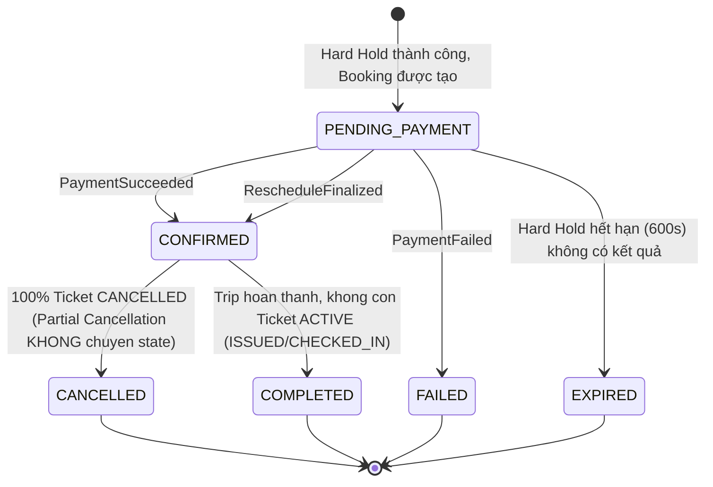
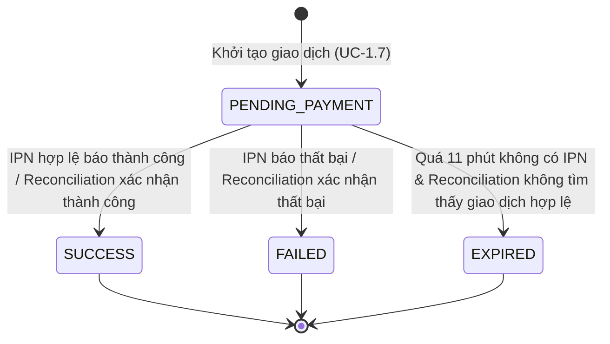
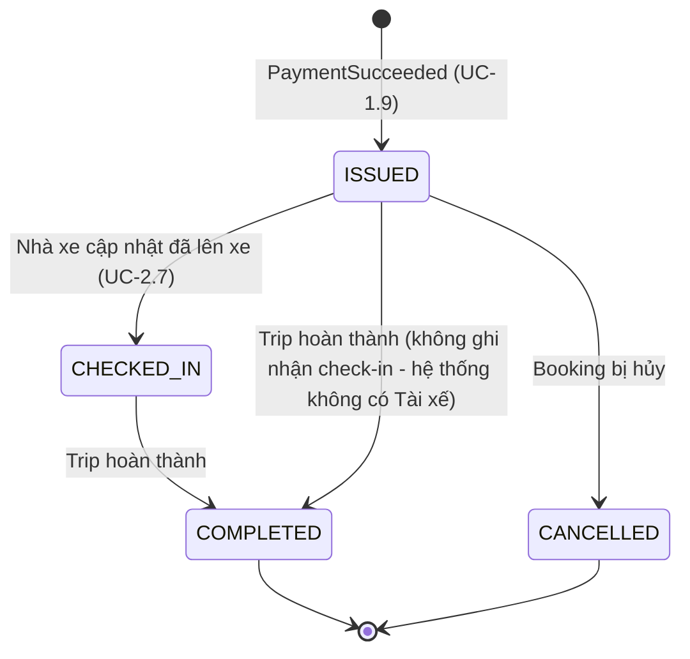
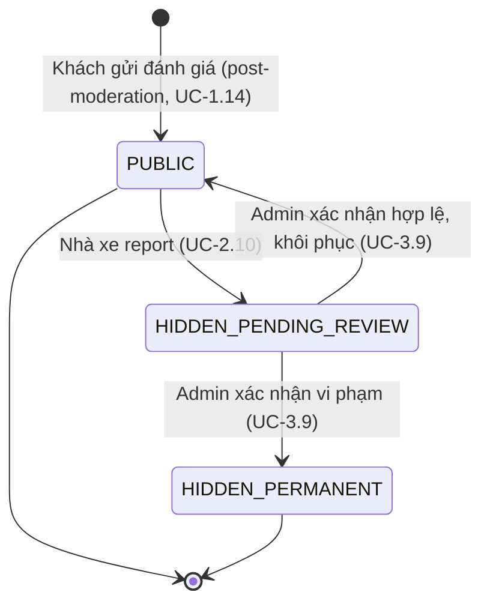
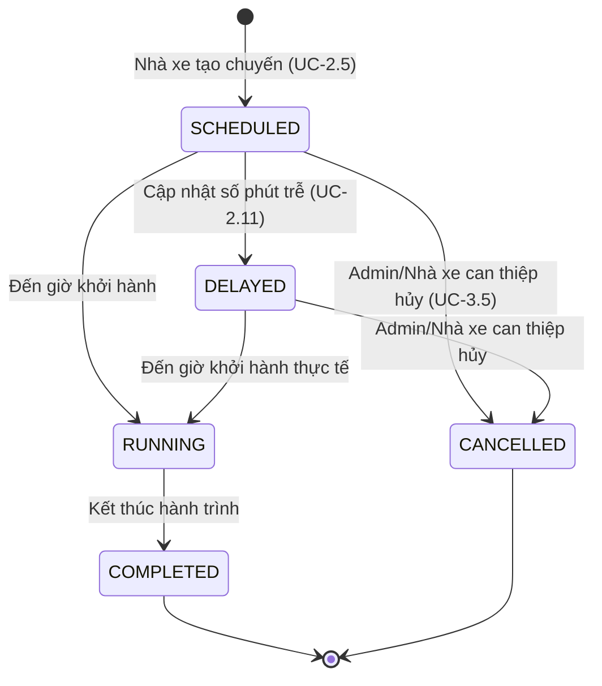

# DOMAIN MODEL — HỆ THỐNG VEXERE CLONE
### (Theo phương pháp Domain-Driven Design — dựa trên SRS v2.0)

> Tài liệu này KHÔNG thiết kế Database, KHÔNG có ERD, KHÔNG có API/DTO/Controller.
> Toàn bộ nội dung bám sát các Use Case UC-1.x (Khách hàng), UC-2.x (Nhà xe), UC-3.x (Admin) và các yêu cầu phi chức năng (mục 3.3) trong SRS.
> Mọi điểm SRS không nêu rõ được đánh dấu **[Assumption]** kèm lý do.

---

## PHẦN 1. PHÂN TÍCH DOMAIN

### 1.1 Core Domain

**Booking & Seat Inventory Domain** (Đặt chỗ & Quản lý tồn kho ghế theo thời gian thực)

Lý do là Core Domain:
- Đây là nơi tạo ra **lợi thế cạnh tranh** và **độ phức tạp nghiệp vụ cao nhất** của hệ thống: cơ chế khóa ghế hai lớp Soft Hold (180s) / Hard Hold (600s) trên Redis, atomic Lua script chuyển đổi Soft→Hard, cấm gia hạn Hard Hold (UC-1.6).
- Yêu cầu phi chức năng khắt khe nhất tập trung ở đây: 200 giao dịch đồng thời/chuyến không double-booking (mục 3.3.1) — đây chính là bài toán mà nếu làm sai, toàn bộ mô hình kinh doanh sụp đổ.
- Thuật toán **Ghép ghế bán tự động (Semi-automatic Seat Mapping – UC-2.5)** khi đổi xe khẩn cấp là nghiệp vụ đặc thù, không có sẵn ở bất kỳ nền tảng generic nào (deterministic rules + fallback thủ công) → đây là tri thức nghiệp vụ lõi (domain expertise) của riêng Vexere.
- Cơ chế đối soát giao dịch tự động (Reconciliation – UC-1.13) để đảm bảo tính nhất quán tài chính khi mất IPN cũng là logic lõi bảo vệ doanh thu.

### 1.2 Supporting Domain

| Domain | Lý do là Supporting |
|---|---|
| **Trip & Fleet Operations** (Quản lý nhà xe, xe, tuyến, chuyến đi, trễ chuyến thủ công) | Cần thiết để vận hành nhưng không phải là lợi thế cạnh tranh cốt lõi — bản chất là CRUD nghiệp vụ có ràng buộc (không sửa layout chuyến đã bán vé). |
| **Payment & Refund Orchestration** | Có logic nghiệp vụ riêng (idempotency, pessimistic lock, signature verification, chính sách hủy theo mốc %) nhưng bản thân việc "thanh toán" được ủy quyền cho VNPay/MoMo/ZaloPay — hệ thống chỉ điều phối. |
| **Cancellation Policy Management** | Quy tắc hoàn tiền theo tầng thời gian là đặc thù nghiệp vụ nhà xe, hỗ trợ trực tiếp cho Refund nhưng không phải trung tâm cạnh tranh. |
| **Review & Reputation Management** | Có quy trình hậu kiểm + report + SLA 48h đặc thù, hỗ trợ uy tín nhà xe nhưng không phải giá trị lõi giao dịch. |
| **Notification Dispatch** (Email/SMS xác nhận, nhắc lịch trình, ETA động) | Có luật nghiệp vụ về thời điểm gửi (2 phút sau đặt vé, quét trước giờ chạy 2 tiếng) nhưng cơ chế gửi bản thân là generic (SMS/Email gateway). |

### 1.3 Generic Domain

| Domain | Lý do là Generic |
|---|---|
| **Identity & Access Management** (Đăng ký, đăng nhập OTP/Google, JWT Access/Refresh Token, 3 role tĩnh) | Là bài toán authentication/authorization chuẩn, có thể dùng thư viện/dịch vụ có sẵn (Keycloak, Firebase Auth...), không mang giá trị khác biệt cho Vexere. |
| **Location/Geocoding** (Tọa độ, tích hợp Google Maps / Routing API hỗ trợ vị trí và tính travel duration cho RouteTemplate) | Hoàn toàn dựa vào bên thứ ba (Google Maps/Routing API), hệ thống lưu trữ tọa độ và thời lượng từng đoạn `estimatedTravelDurationFromPreviousStopMinutes` cho RouteTemplate. Routing API KHÔNG trực tiếp sinh `TripPoint`. `TripPoint` được khởi tạo khi Create Trip từ `RouteTemplateStop` + segment duration + `TripSchedule.baseDepartureTime`. |
| **Payment Gateway/Notification Gateway Configuration** (Admin cấu hình Merchant ID, API Keys...) | Thuần túy là cấu hình kỹ thuật tích hợp bên thứ ba. |
| **Audit Logging** | Là mối quan tâm hạ tầng/tuân thủ (compliance), áp dụng cho mọi hệ thống enterprise, không đặc thù cho vé xe. |
| **Banner/Marketing Content Management** | CRUD nội dung quảng cáo, không có logic nghiệp vụ phức tạp. |

---

## PHẦN 2. BOUNDED CONTEXT

### 2.1 Identity Context
- **Purpose:** Quản lý danh tính, xác thực, phiên làm việc.
- **Business Responsibility:** Đăng ký (UC-1.1), đăng nhập OTP/Google (UC-1.2), phát hành/thu hồi Access-Refresh Token, gán role tĩnh (CUSTOMER/BUS_COMPANY/ADMIN), khóa/mở khóa tài khoản (UC-3.1), quản lý tài khoản cá nhân & right-to-be-forgotten (UC-1.12, mục 3.3.4).
- **Entities:** User, RefreshToken.
- **Giao tiếp:** Phát hành `userId` + `role` dùng làm tham chiếu (reference-by-id) cho mọi Context khác (Booking, Trip, Review...) — không Context nào giữ bản sao dữ liệu cá nhân đầy đủ ngoài Identity. Booking Context gọi Identity (qua Access Token claims) để xác thực trước khi cho phép "Tiếp tục" (UC-1.6 bước 2).

### 2.2 Location Context (Master Data Catalog)
- **Purpose:** Quản lý danh mục địa điểm/bến xe dùng chung toàn hệ thống (Shared Master Data Catalog).
- **Business Responsibility:** CRUD địa điểm chuẩn hóa do Admin quản lý (UC-3.3); lưu tọa độ GeoCoordinate lấy từ Google Maps API. Tất cả địa điểm là dùng chung, không chứa thông tin chủ sở hữu hay thuộc về bất kỳ Nhà xe nào.
- **Entities:** Location (Station/Điểm đón-trả dùng chung).
- **Giao tiếp:** BusCompanyLocationConfig Context tham chiếu Location để cấu hình điểm đón/trả cho từng nhà xe; Trip Context tham chiếu Location cho điểm khởi hành (origin) và điểm đến (destination).

### 2.2b Route Template & Location Configuration Context
- **Purpose:** Quản lý cấu hình địa điểm vận hành riêng của từng Nhà xe, định nghĩa tuyến đường mẫu (`RouteTemplate`) và dịch vụ xe trung chuyển mẫu (`RouteTemplateShuttleService`).
- **Business Responsibility:** Quản lý cấu hình địa điểm nhà xe (UC-2.3: tên hiển thị, cờ pickup/dropoff trực tiếp tại trạm, hotline, hướng dẫn đón); tạo và quản lý Tuyến mẫu (UC-2.5: thiết lập danh sách điểm dừng `RouteTemplateStop` với thời lượng từng đoạn `estimatedTravelDurationFromPreviousStopMinutes` do Routing API tính — stop 1 luôn bằng 0, cấu hình dịch vụ xe trung chuyển `RouteTemplateShuttleService` kèm `referenceStop` do Nhà xe tự chọn thủ công NOT NULL, và bảng giá `RouteTemplateSeatPrice`).
- **Entities:** BusCompanyLocationConfig (Aggregate Root), RouteTemplate (Aggregate Root - chứa RouteTemplateStop, RouteTemplateSeatPrice, RouteTemplateShuttleService).
- **Giao tiếp:** RouteTemplateStop tham chiếu BusCompanyLocationConfig; Trip Context khởi tạo chuyến dựa trên RouteTemplate snapshot.

### 2.3 BusCompany (Fleet) Context
- **Purpose:** Đại diện hồ sơ nhà xe và đội xe vật lý.
- **Business Responsibility:** Quản lý thông tin nhà xe (UC-2.1), danh sách xe (UC-2.2), phê duyệt hồ sơ nhà xe mới (UC-3.2).
- **Entities:** BusCompany, Vehicle.
- **Giao tiếp:** RouteTemplate & Location Configuration Context tham chiếu BusCompany; Trip Context tham chiếu Vehicle khi tạo chuyến; SeatLayout Context tham chiếu Vehicle để gán sơ đồ ghế xe.

### 2.4 SeatLayout Context (Catalog Ghế)
- **Purpose:** Chuẩn hóa cấu trúc lưới ghế và danh mục loại ghế trên toàn hệ thống.
- **Business Responsibility:** Admin tạo sơ đồ mẫu + danh mục SeatType chuẩn hóa (UC-3.4); Nhà xe clone sơ đồ mẫu thành `VehicleSeatLayout` và gán SeatType cho từng vị trí, không được sửa cấu trúc lưới (UC-2.4).
- **Entities:** SeatLayoutTemplate (chứa `TemplateSeatSlot`), SeatType, VehicleSeatLayout (chứa `SeatPositionAssignment`).
- **Giao tiếp:** Trip Context clone `VehicleSeatLayout` thành `TripSeat` khi tạo chuyến; Booking Context (qua Seat Remapping Service) tham chiếu SeatType để so khớp "khớp loại ghế giống hệt" khi đổi xe.

### 2.5 Trip Context
- **Purpose:** Đại diện một chuyến chạy cụ thể — lịch trình, trạng thái, hành trình và dịch vụ trung chuyển trên chuyến.
- **Business Responsibility:** CRUD chuyến đi (UC-2.5), khởi tạo Trip từ giờ xuất phát gốc `TripSchedule.baseDepartureTime` tự động tính dồn tuần tự `TripPoint.eta` và snapshot `TripShuttleService`, cập nhật trễ chuyến thủ công (UC-2.11), giám sát/can thiệp điều phối/hủy chuyến (UC-3.5), kích hoạt đổi xe khẩn cấp và điều phối Seat Remapping.
- **Entities:** Trip, TripPoint, TripSeat, TripSeatPrice, TripShuttleService.
- **Giao tiếp:** Booking Context đọc trạng thái `TripSeat` (Trống/Đang chọn/Đã đặt) để cho phép giữ ghế; publish `TripDelayed`, `BusChanged` để Notification Context tiêu thụ.

### 2.6 Booking Context (bao gồm Seat Hold)
- **Purpose:** Điều phối vòng đời đặt chỗ từ chọn ghế đến khi có vé — đây là Core Domain.
- **Business Responsibility:** Soft Hold/Hard Hold (UC-1.6), tạo Booking, đặt vé thủ công tại quầy (UC-2.6), phối hợp với Payment để xác nhận, quản lý vé & hành khách (UC-2.7).
- **Entities:** Booking, PassengerInfo (thực chất là Value Object gắn trong Ticket), Ticket.
- **Giao tiếp:** Gọi Payment Context để khởi tạo giao dịch; nhận sự kiện `PaymentSucceeded/Failed` để chuyển trạng thái; publish `BookingCreated`, `TicketIssued` cho Notification Context; publish `SeatSoftHeld/SeatHardHeld` (qua WebSocket) cho mọi client đang xem chuyến.

### 2.7 Payment Context
- **Purpose:** Điều phối giao dịch thanh toán với cổng thứ ba, đảm bảo tính đúng đắn tài chính.
- **Business Responsibility:** Khởi tạo giao dịch (UC-1.7/1.8), xử lý IPN với idempotency + pessimistic lock + signature verification (mục 3.2.1.X), đối soát định kỳ (UC-1.13, Cron 5 phút).
- **Entities:** PaymentTransaction.
- **Giao tiếp:** Nhận lệnh từ Booking Context để tạo giao dịch; publish `PaymentSucceeded/PaymentFailed` để Booking Context và Ticket (Notification) tiêu thụ; gọi ra ngoài (Anti-Corruption Layer) tới VNPay/MoMo/ZaloPay.

### 2.8 Refund Context
- **Purpose:** Xử lý yêu cầu hủy vé và hoàn tiền tự động.
- **Business Responsibility:** Đánh giá Chính sách hủy (UC-2.9), tính số tiền hoàn, gọi API Refund của cổng thanh toán gốc (UC-1.11).
- **Entities:** RefundTransaction, CancellationPolicy.
- **Giao tiếp:** Đọc `PaymentTransaction` gốc từ Payment Context (theo `txnRef`); publish `RefundCompleted` để Booking Context giải phóng ghế và Notification Context gửi thông báo.

### 2.9 Ticketing Context
- **Purpose:** Đại diện vé điện tử — bằng chứng hợp lệ hóa chỗ ngồi.
- **Business Responsibility:** Sinh vé điện tử kèm QR Code (UC-1.9), tra cứu lịch sử vé (UC-1.15), cập nhật trạng thái lên xe/hủy (UC-2.7).
- **Entities:** Ticket (có thể coi Ticket là Entity con trong Booking Aggregate — xem Phần 5).
- **Giao tiếp:** Được tạo khi nhận `PaymentSucceeded`; là gốc tham chiếu cho Review Context ("một vé chỉ review một lần").

### 2.10 Review Context
- **Purpose:** Thu thập & kiểm duyệt đánh giá dịch vụ nhà xe.
- **Business Responsibility:** Gửi đánh giá post-moderation (UC-1.14), Nhà xe report vi phạm (UC-2.10), Admin xử lý report trong SLA 48h (UC-3.9).
- **Entities:** Review, ReviewReport.
- **Giao tiếp:** Tham chiếu `Ticket` (đảm bảo vé đã hoàn thành, chưa được review); publish `ReviewSubmitted`, `ReviewHidden`, `ReviewRestored` — BusCompany Context và Admin Context tiêu thụ.

### 2.11 Notification Context
- **Purpose:** Phân phối thông báo SMS/Email theo đúng luật nghiệp vụ thời điểm.
- **Business Responsibility:** Gửi OTP, xác nhận đặt vé (trong 2 phút), nhắc ETA động (Cron quét chuyến khởi hành trong 2 tiếng — UC-1.10), thông báo hoàn tiền, thông báo đổi vị trí ghế do Seat Remapping.
- **Entities:** (Thường là Domain Service thuần, không giữ Entity nghiệp vụ persistent ngoài NotificationLog — xem Phần 9).
- **Giao tiếp:** Là **consumer thuần túy** của hầu hết Domain Event từ các Context khác; gọi ra ngoài (ACL) tới SMS/Email Gateway.

### 2.12 Admin/Configuration Context
- **Purpose:** Cấu hình vận hành toàn hệ thống.
- **Business Responsibility:** Quản lý tài khoản (UC-3.1), phê duyệt nhà xe (UC-3.2), quản lý địa điểm/sơ đồ mẫu (UC-3.3/3.4 — thực chất chia sẻ Entity với Location/SeatLayout Context nhưng quyền ghi thuộc Admin), cấu hình cổng thanh toán (UC-3.7), cấu hình dịch vụ thông báo (UC-3.8), quản lý Banner (UC-3.10).
- **Entities:** PaymentGatewayConfig, NotificationGatewayConfig, Banner.
- **Giao tiếp:** Payment Context đọc `PaymentGatewayConfig` **theo `gatewayType`** khi khởi tạo giao dịch (resolve-by-type, không lưu FK trên `PaymentTransaction`); Notification Context đọc `NotificationGatewayConfig`.

### 2.13 Audit Context
- **Purpose:** Ghi vết bất biến (append-only) mọi hành động nhạy cảm.
- **Business Responsibility:** Ghi log đăng nhập, thay đổi cấu hình, CRUD chuyến đi, hủy vé (mục 3.3.2); hiển thị Read-Only cho Admin (UC-3.11).
- **Entities:** AuditLog.
- **Giao tiếp:** Là **subscriber thụ động** của gần như mọi Domain Event nhạy cảm phát ra từ các Context khác; không publish event, không bị Context nào phụ thuộc ngược.

---

## PHẦN 3. DOMAIN ENTITY

### User
- **Business meaning:** Đại diện một tài khoản đăng nhập hệ thống (Khách hàng / Nhà xe / Admin).
- **Identity:** `userId` (định danh nội bộ, bất biến).
- **Lifecycle:** Registered → Active → (Locked ↔ Active) → Anonymized (sau khi thực thi yêu cầu xóa tài khoản / ẩn danh hóa dữ liệu theo quy định PDPD / Right-to-be-Forgotten).
- **Business Rules:** Số điện thoại và Email là duy nhất trong hệ thống nhưng tài khoản OTP-phone và Google-email **không tự động gộp** (UC-1.2). Chỉ 3 role tĩnh: CUSTOMER, BUS_COMPANY, ADMIN. **`[FIX 1]`** User sở hữu thuộc tính `busCompanyId` (nullable): **chỉ có giá trị khi `role = BUS_COMPANY`**, bắt buộc `null` với CUSTOMER/ADMIN. Đây là nguồn dữ liệu cho `currentUser.busCompanyId` mà **Rule O3** (authorization) sử dụng.
- **State:** `AccountStatus` {ACTIVE, LOCKED, ANONYMIZED}.
- **Quan hệ:** **`[FIX 1]`** 1 User (role BUS_COMPANY) liên kết **đúng 1** `BusCompany` qua `busCompanyId` (reference-by-id); một `BusCompany` có thể có nhiều User đại diện (`BusCompany 1 - 0..* User`). Không có bảng mapping riêng, không có multi-tenant membership động. 1 User (CUSTOMER) có nhiều Booking, nhiều Review.

### RefreshToken
- **Business meaning:** Token dài hạn cho phép cấp lại Access Token mà không cần đăng nhập lại.
- **Identity:** `tokenId` (UUID).
- **Lifecycle:** Issued khi đăng nhập → Active → Revoked (khi logout, đưa vào blacklist) → Expired (hết TTL 7-30 ngày [Assumption: SRS chỉ nêu ví dụ, con số cụ thể do đội vận hành quyết định]).
- **Business Rules:** Không phải JWT; lưu ở Redis/DB kèm liên kết tới `userId`.
- **Quan hệ:** Thuộc về đúng 1 User.

### BusCompany
- **Business meaning:** Đại diện pháp nhân/nhà xe vận hành đội xe.
- **Identity:** `busCompanyId`.
- **Lifecycle:** Đăng ký/tạo bởi Admin → Pending Approval → Approved (Active) → có thể bị khóa.
- **Business Rules:** Phải được Admin phê duyệt mới hoạt động (UC-3.2).
- **State:** `BusCompanyStatus` {PENDING, ACTIVE, SUSPENDED}.
- **Quan hệ:** **`[FIX 8]`** Sở hữu **về mặt nghiệp vụ** (reference-by-id, **không** phải Aggregate containment) nhiều `Vehicle`, nhiều `BusCompanyLocationConfig` (cấu hình địa điểm đón/trả), nhiều `RouteTemplate` (tuyến mẫu), nhiều `Trip`, và nhiều `CancellationPolicy` — trong đó có 1 policy mặc định cấp công ty. Mỗi lớp kể trên là Aggregate Root độc lập, giữ `busCompanyId`/`ownerBusCompanyId` để trỏ về chủ sở hữu. **`[FIX 1]`** Ngoài ra, 1 BusCompany được đại diện bởi 0..N `User` có `role = BUS_COMPANY` (`users.busCompanyId`).

### Vehicle (Xe)
- **Business meaning:** Phương tiện vật lý cụ thể (biển số, loại xe).
- **Identity:** `vehicleId` (nội bộ) — biển số là thuộc tính nghiệp vụ, không nhất thiết là khóa định danh vì có thể thay biển.
- **Lifecycle:** Created → Active → Retired/Inactive.
- **Business Rules:** `Vehicle` là Aggregate Root độc lập, không phải Entity con của `BusCompany`; thuộc về đúng 1 BusCompany (tham chiếu `busCompanyId` là immutable sau khi tạo); quan hệ sở hữu nghiệp vụ chỉ là reference-by-id; có **tối đa 1** `VehicleSeatLayout` (xe mới tạo chưa có layout cho đến khi Nhà xe cấu hình). Các invariant nội tại của xe được xử lý tại Vehicle Aggregate; các điều kiện phụ thuộc BusCompany do Application Layer kiểm tra; Database enforce FK/ownership constraints.
- **State:** `VehicleStatus` {ACTIVE, INACTIVE}.
- **Quan hệ:** **`[D2]`** `Vehicle 1 — 0..1 VehicleSeatLayout`. Quan hệ được biểu diễn **một chiều**: `VehicleSeatLayout.vehicleId` (NOT NULL, UNIQUE) trỏ về `Vehicle`. `Vehicle` **không** giữ `vehicleSeatLayoutId` — tránh hai nguồn sự thật và FK cycle. Tham chiếu BusCompany sở hữu qua `busCompanyId` (reference-by-id, `Vehicle 0..* --> 1 BusCompany`). 1 Vehicle được gán cho nhiều Trip theo thời gian (không đồng thời hai chuyến trùng giờ [Assumption: ràng buộc lịch trình không trùng không được SRS nêu rõ, giả định hợp lý theo nghiệp vụ vận tải]).

### Location (Điểm đón/trả — Shared Master Data Catalog)
- **Business meaning:** Địa điểm danh mục dùng chung toàn hệ thống (bến xe, điểm mốc địa lý, tỉnh/huyện/xã).
- **Identity:** `locationId`.
- **Lifecycle:** Created → Active → Archived.
- **Business Rules:** Do Admin tạo và quản lý (UC-3.3); tất cả địa điểm là dùng chung toàn hệ thống (Shared Master Data Catalog). Không chứa `ownerType` hay `ownerBusCompanyId`.
- **State:** không có state machine phức tạp, chỉ Active/Archived.
- **Quan hệ:** Có 1 GeoCoordinate (Value Object); được tham chiếu bởi `BusCompanyLocationConfig` và `Trip` (origin/destination).

### BusCompanyLocationConfig (Cấu hình địa điểm Nhà xe)
- **Business meaning:** Cấu hình điểm đón/trả vận hành riêng của từng Nhà xe ứng với từng địa điểm trong danh mục dùng chung.
- **Identity:** `busCompanyLocationConfigId` (hoặc cặp `busCompanyId` + `locationId`).
- **Lifecycle & Soft Disable (Grandfather Rule):**
  ```
  ACTIVE (Có thể chọn khi tạo/chỉnh sửa RouteTemplateStop)
    │
    ▼
  DISABLED
    │
    ├── 1. Không xuất hiện trong UI chọn điểm đón/trả mới
    ├── 2. API tạo mới / cập nhật RouteTemplateStop chặn không cho dùng Config này
    ├── 3. RouteTemplateStop cũ đã tham chiếu trước đó VẪN GIỮ NGUYÊN
    ├── 4. Trip đã tạo trước đó VẪN CHẠY BÌNH THƯỜNG
    ├── 5. TripPoint snapshot VẪN GIỮ NGUYÊN
    └── 6. Booking, Ticket, ETA, Tracking, Report không bị ảnh hưởng
  ```
- **Business Rules & Validation Rules:** 
  - **Khi tạo mới `RouteTemplateStop`:** `busCompanyLocationConfigId` được chọn bắt buộc phải có trạng thái `ACTIVE`.
  - **Khi cập nhật `RouteTemplateStop`:** Config mới được chọn cũng bắt buộc phải ở trạng thái `ACTIVE`.
  - **Dữ liệu cũ đã tồn tại:** Nếu Config hiện tại đã chuyển sang `DISABLED` nhưng `RouteTemplateStop` đã tham chiếu từ trước, hệ thống KHÔNG bắt buộc migrate hay tự động thay thế Config khác.
  - **Cấu hình chi tiết:** Nhà xe thiết lập tên hiển thị riêng (`displayName`), bật/tắt quyền đón/trả (`acceptsPickup`, `acceptsDropoff`), số điện thoại liên hệ, ghi chú hướng dẫn đón, vị trí cổng/cột/bãi (UC-2.3).
- **Architectural Decision:**
  - KHÔNG cascade update. KHÔNG tự động thay đổi Config khác. KHÔNG xóa dữ liệu cũ.
  - KHÔNG chặn việc chuyển `DISABLED` nếu Config đang được tham chiếu bởi `RouteTemplateStop` hoặc `TripPoint` cũ.
  - Nguyên tắc Grandfather Rule là chủ đích thiết kế nhằm bảo vệ tính toàn vẹn lịch sử (Historical Integrity).
- **State:** `BusCompanyLocationConfigStatus` {ACTIVE, DISABLED}.
- **Quan hệ:** Định cấu hình cho 1 `Location` theo 1 `BusCompany`; được tham chiếu bởi `RouteTemplateStop` và `TripPoint`.

### RouteTemplate (Tuyến mẫu)
- **Business meaning:** Tuyến đường mẫu định nghĩa trước lộ trình, thời lượng di chuyển giữa các điểm dừng, dịch vụ trung chuyển và khung giá vé chuẩn của Nhà xe.
- **Identity:** `routeTemplateId`.
- **Lifecycle:** Draft → Published → Deprecated.
- **Business Rules:** 
  - **Lộ trình & Duration giữa các điểm dừng (`RouteTemplateStop`):**
    - Chứa danh sách điểm dừng vận hành `RouteTemplateStop` có thứ tự `sequence`.
    - Không lưu giờ tuyệt đối (`plannedArrivalTime`). Mỗi stop lưu `estimatedTravelDurationFromPreviousStopMinutes` (thời lượng di chuyển dự kiến của đoạn từ stop liền trước đến stop hiện tại).
    - Stop 1 (`sequence = 1`) luôn có `estimatedTravelDurationFromPreviousStopMinutes = 0` (NOT NULL).
    - Duration được tính tự động trực tiếp từ kết quả của Routing API (như Google Maps API) khi cấu hình hoặc cập nhật Tuyến mẫu. **Nhà xe không có quyền chỉnh sửa/ghi đè giá trị này**.
  - **Dịch vụ Xe trung chuyển mẫu (`RouteTemplateShuttleService`):**
    - Cấu hình Đón (`PICKUP`) và Trả (`DROPOFF`) độc lập. **`[MEDIUM-4]`** Một tuyến mẫu có tối đa **0..1 PICKUP** và tối đa **0..1 DROPOFF** Shuttle Service (tổng collection là 0..2, enforced bởi `UNIQUE(routeTemplateId, shuttleType)`). Các điểm/ lựa chọn mà khách nhìn thấy trong UI thuộc về service đó và **KHÔNG** được hiểu thành nhiều Shuttle Service độc lập. Có thể có: không Shuttle, chỉ PICKUP, chỉ DROPOFF, hoặc cả 2.
    - Bắt buộc sở hữu `referenceStop` là mốc thời gian vận hành chính do **Nhà xe tự chọn thủ công** từ các `RouteTemplateStop` thuộc tuyến đó (NOT NULL). Không mặc định/suy luận từ điểm cuối hay origin/destination. **`[INTEGRITY FIX]`** Ràng buộc `referenceStop ∈ RouteTemplate.routeTemplateId` được **Database enforce** bằng Composite FK `(reference_stop_id, route_template_id) → route_template_stops(id, route_template_id)` — không thể trỏ sang stop của tuyến khác.
    - Chứa `shuttleOffsetMinutes` (số phút chênh lệch so với ETA của `referenceStop`), `coverageAreaDescription` (chuỗi văn bản mô tả phạm vi như "Nội thành HCM", "Bán kính 10km", không tạo Location entity riêng), `pricingType` (`FREE` ở V1, sẵn sàng mở rộng `PAID`/`feeAmount` ở V2). Không xây dựng hệ thống Voucher/Discount.
  - **Bản chất của `originLocationId` & `destinationLocationId` (Default Representative Locations — Quyết định nghiệp vụ Issue #7):**
    - `originLocationId` và `destinationLocationId` KHÔNG phải luôn là điểm hiển thị trên Search Result Card.
    - Chúng chỉ đóng vai trò là **Default Representative Locations** của toàn tuyến: đại diện khu vực xuất phát/đích chính của tuyến, dùng để phân loại RouteTemplate, thống kê, quản trị, SEO, và làm **fallback** khi người dùng tìm kiếm không có Search Context cụ thể.
    - KHÔNG bắt buộc là stop đầu hoặc stop cuối của lộ trình. KHÔNG tạo CHECK Constraint hay Trigger ép trùng với stop đầu/cuối.
  - **Khái niệm Representative Stop & Thuật toán hiển thị card động (Dynamic Representative Stop Selection):**
    - Representative Pickup/Dropoff trên Search Result Card được xác định **ĐỘNG theo Search Context** từ danh sách `RouteTemplateStop`, KHÔNG đọc trực tiếp từ `originLocationId`/`destinationLocationId`. **`[FIX 4]`** Search **chỉ** dùng `RouteTemplate`/`RouteTemplateStop` — `TripPoint` là runtime snapshot, **không** tham gia luồng tìm kiếm.
    - **Thuật toán canonical `[FIX 4]`:**
      - **B1 — Tập ứng viên hợp lệ:** Lọc `RouteTemplateStop` nằm trong vùng hành chính của Điểm đi (tập Pickup) và Điểm đến (tập Dropoff) theo đúng cấp đã chọn (Province / District / Ward) — **đồng thời** kiểm tra năng lực thực tế:
        - *Tập Pickup:* chỉ gồm stop **cho phép đón khách** (`acceptsPickup = true` trên `BusCompanyLocationConfig` tương ứng; `RouteStopType` mâu thuẫn — `TRANSIT_ONLY` — bị loại).
        - *Tập Dropoff:* chỉ gồm stop **cho phép trả khách** (`acceptsDropoff = true`; `TRANSIT_ONLY` bị loại).
        - Stop chỉ khớp địa giới nhưng **không** cho đón/trả (ví dụ trạm kỹ thuật, điểm chỉ đi ngang) **không** vào tập ứng viên.
      - **B2 — Representative Pickup Stop** = stop khớp **ĐẦU TIÊN** theo hành trình (`sequence` **nhỏ nhất** trong tập Pickup).
      - **B3 — Representative Dropoff Stop** = stop khớp **CUỐI CÙNG** theo hành trình (`sequence` **lớn nhất** trong tập Dropoff).
      - **B4 — Loại tuyến:** nếu tập Pickup hoặc tập Dropoff rỗng (kể cả khi có stop đúng địa giới nhưng không cho đón/trả), hoặc `sequence(Pickup) >= sequence(Dropoff)` (sai chiều), RouteTemplate **không khớp** search đó.
      - *Ví dụ 1 — Province (HCM → Kon Tum):* Dropoff hiển thị là stop **cuối cùng cho phép trả khách** thuộc tỉnh Kon Tum.
      - *Ví dụ 2 — Province (HCM → Gia Lai):* cùng tuyến liên tỉnh đó vẫn khớp nếu có trạm ở Gia Lai; Dropoff là stop **cuối cùng cho phép trả khách** thuộc Gia Lai (ví dụ: Bến xe Pleiku).
      - *Ví dụ 3 — District (HCM → Đắk Tô):* chỉ tuyến có stop đúng huyện Đắk Tô mới khớp; Dropoff là stop **cuối cùng cho phép trả khách** thuộc huyện Đắk Tô. Tuyến chỉ tới TP. Kon Tum mà không dừng Đắk Tô sẽ **không** xuất hiện.
      - *Ward:* áp dụng cùng quy tắc ở cấp Phường/Xã.
    - **Fallback:** Chỉ khi **không có** Search Context (ví dụ: khách duyệt danh sách tuyến mặc định của Nhà xe), card mới dùng `originLocationId` và `destinationLocationId` làm đại diện. Khi **đã có** Search Context thì **không** dùng hai trường này làm representative.
    - **Chuyển tiếp đặt vé:** Sau khi khách chọn chuyến, hệ thống auto-select đúng cặp Pickup/Dropoff đã hiển thị trên Card; khách chỉ đổi được sang stop khác nếu stop đó cho phép đón/trả (`acceptsPickup`/`acceptsDropoff`).
- **State:** `RouteTemplateStatus` {DRAFT, PUBLISHED, DEPRECATED}.
- **Quan hệ:** Owned bởi 1 `BusCompany`; tham chiếu `originLocationId` và `destinationLocationId` (Default Representative Locations / Fallback); chứa 1..* `RouteTemplateStop` (lộ trình thực tế); chứa 0..* `RouteTemplateShuttleService` (**`[MEDIUM-4]`** trong đó tối đa 0..1 `PICKUP` + 0..1 `DROPOFF` theo `shuttleType`, enforced `UNIQUE(routeTemplateId, shuttleType)`); chứa 1..* `RouteTemplateSeatPrice`; dùng làm nguồn snapshot khi khởi tạo `Trip`.

### SeatLayoutTemplate
- **Business meaning:** Sơ đồ ghế mẫu chuẩn hóa do Admin công bố (VD: Giường nằm 38 chỗ 2 tầng).
- **Identity:** `templateId`.
- **Lifecycle:** Draft → Published → Deprecated.
- **Business Rules:** Chỉ Admin có quyền tạo (UC-3.4); là nguồn clone duy nhất cho VehicleSeatLayout.
- **Quan hệ:** Có nhiều SeatPositionAssignment (cấu trúc lưới thô, chưa gán loại ghế cụ thể theo xe).

### SeatType
- **Business meaning:** Danh mục loại ghế chuẩn hóa toàn hệ thống (VIP, Thường, Giường đơn, Giường đôi...).
- **Identity:** `seatTypeCode`.
- **Lifecycle:** Created bởi Admin → Active → Deprecated.
- **Business Rules:** Chỉ Admin CRUD; Nhà xe chỉ được chọn/gán, không tự tạo mới (UC-3.4).
- **Quan hệ:** Được gán cho từng vị trí ghế trong VehicleSeatLayout.

### VehicleSeatLayout
- **Business meaning:** Sơ đồ ghế thực tế của một xe cụ thể — clone cấu trúc lưới từ SeatLayoutTemplate + gán SeatType cho từng vị trí.
- **Identity:** `vehicleSeatLayoutId`. **`[D2]`** Mang `vehicleId` (NOT NULL, UNIQUE) — đây là **bên nắm giữ** quan hệ 1-1 với `Vehicle`.
- **Lifecycle:** Cloned từ Template → Configuring (gán loại ghế) → Finalized.
- **Business Rules:** KHÔNG được sửa cấu trúc lưới (thêm/bớt hàng/cột/tầng) sau khi clone — chỉ được gán loại ghế cho vị trí có sẵn (UC-2.4). Ràng buộc này là điều kiện tiên quyết để thuật toán Seat Remapping hoạt động.
- **Quan hệ:** **`[D2]`** `0..1` cho mỗi `Vehicle` — layout nắm `vehicleId` (NOT NULL, UNIQUE); là nguồn clone cho `TripSeat` khi Trip được tạo.

### Trip (Chuyến đi)
- **Business meaning:** Một chuyến chạy cụ thể tại một thời điểm khởi hành nhất định.
- **Identity:** `tripId`.
- **Lifecycle:** Scheduled → Boarding/Running → Completed | Cancelled.
- **Business Rules:** 
  - Khi tạo Trip, Nhà xe nhập Ngày chạy + Giờ xuất phát gốc (`TripSchedule.baseDepartureTime`). Không tạo field `Trip.departureTime` trùng nghĩa.
  - Tự động clone `RouteTemplateStop` thành danh sách snapshot `TripPoint` và tự động tính `TripPoint.eta` dồn tuần tự từng đoạn theo sequence (`TripPoint[1].eta = baseDepartureTime`, `TripPoint[i].eta = TripPoint[i-1].eta + duration[i]`).
  - Tự động clone `RouteTemplateShuttleService` thành snapshot `TripShuttleService` với `displayTime` được tính từ `TripPoint(referenceStop).eta +/- shuttleOffsetMinutes`.
  - Thay đổi đối với `RouteTemplate` sau đó không làm ảnh hưởng các `Trip` cũ đã snapshot.
  - Clone VehicleSeatLayout thành tập TripSeat riêng (UC-2.5). **Không được sửa trực tiếp layout ghế của chuyến đã có vé bán ra**, trừ khi kích hoạt luồng đổi xe khẩn cấp qua Seat Remapping (UC-2.5, UC-3.5). Có thể bị Admin can thiệp hủy nếu vi phạm (UC-3.5).
- **State:** `TripStatus` {SCHEDULED, DELAYED, RUNNING, COMPLETED, CANCELLED}.
- **Quan hệ:** 1 Trip — 1 Vehicle (có thể đổi Vehicle khi khẩn cấp); 1 Trip chứa 1..* TripPoint; chứa 0..* TripShuttleService (**`[MEDIUM-4]`** trong đó tối đa 0..1 `PICKUP` + 0..1 `DROPOFF` theo `shuttleType`, enforced `UNIQUE(tripId, shuttleType)`); chứa 1..* TripSeat; chứa 1..* TripSeatPrice; có 1 CancellationPolicy áp dụng thực tế (kế thừa mặc định hoặc override — UC-2.9); có nhiều Booking.

### TripPoint
- **Business meaning:** Một điểm dừng/đón trả cụ thể trên hành trình của Trip, kèm mốc thời gian ước tính (ETA).
- **Identity:** `tripPointId` (thứ tự trong hành trình).
- **Lifecycle:** Generated (tự động dồn duration khi tạo Trip) → **BẤT BIẾN vĩnh viễn**. **`[D6]`** `TripPoint` **không bao giờ** được recalculate/update — kể cả khi trễ chuyến (UC-2.11). Trễ chuyến chỉ tác động lên `TripSchedule.delayMinutes` của `Trip`.
- **Business Rules `[D6]`:** ETA gốc được tính **một lần duy nhất** khi tạo Trip từ `baseDepartureTime` cộng dồn tuần tự các đoạn duration, và **bất biến** sau đó. Khi trễ chuyến, hệ thống **KHÔNG** sửa `TripPoint.eta` — chỉ **SET** `TripSchedule.delayMinutes` (tổng số phút trễ hiện tại). Giờ dự kiến thực tế được tính khi đọc: `effectiveEta = eta + delayMinutes`. Không gọi lại Routing API.
- **Snapshot Semantics `[FIX 2]`:** `TripPoint` là snapshot **lịch trình + thông tin vận hành cần bảo toàn lịch sử**. Tại thời điểm tạo Trip, các giá trị sau được **sao chép** từ `BusCompanyLocationConfig`: `displayName`, `acceptsPickup`, `acceptsDropoff`, `contactPhone`, `driverMeetingInstructions`, `gate`, `platform`, `landmark`.
  - **Quy tắc đọc:** Mọi luồng hiển thị chuyến đi **PHẢI đọc từ `TripPoint`**, **KHÔNG** đọc live từ `BusCompanyLocationConfig` đối với các field đã snapshot. `busCompanyLocationConfigId` chỉ để **truy vết nguồn gốc cấu hình (lineage)**.
  - **Bất biến:** các field snapshot immutable sau khi Trip được tạo — cùng nguyên tắc với `TripSeatPrice`.
  - **Đây chính là cơ chế hiện thực Soft Disable (Grandfather Rule):** sửa hoặc `DISABLED` Config sau đó **không** ảnh hưởng `TripPoint` đã tạo.
  - **Không snapshot master data của `Location`** (tên tỉnh/huyện/xã, tọa độ) — đây là dữ liệu địa lý dùng chung, không mang tính lịch sử vận hành.
- **Quan hệ:** Tham chiếu 1 BusCompanyLocationConfig (chỉ để trace nguồn); thuộc về đúng 1 Trip.

### TripShuttleService
- **Business meaning:** Snapshot dịch vụ xe trung chuyển trên chuyến đi cụ thể.
- **Identity:** `tripShuttleServiceId`.
- **Lifecycle:** Generated (snapshot từ RouteTemplateShuttleService khi tạo Trip).
- **Business Rules:** `displayTime` được tính snapshot tại thời điểm tạo Trip từ `TripPoint(referenceStop).eta +/- shuttleOffsetMinutes`.
- **Quan hệ:** Tham chiếu 1 `TripPoint` làm referenceStop; thuộc về đúng 1 Trip. **`[INTEGRITY FIX]`** Ràng buộc `referenceStop ∈ Trip.tripId` được **Database enforce** bằng Composite FK `(reference_stop_id, trip_id) → trip_points(id, trip_id)` — không thể trỏ sang TripPoint của Trip khác.

### TripSeat
- **Business meaning:** Một vị trí ghế cụ thể trên một chuyến chạy cụ thể — đơn vị tồn kho có thể bán.
- **Identity:** ghép bởi `(tripId, seatCode)`.
- **Lifecycle:** Available (Trống) → Selecting/SoftHeld (Đang chọn) → HardHeld → Booked (Đã đặt) → có thể Released (khi hủy hold/hủy vé) quay lại Available.
- **Business Rules:** Một ghế chỉ thuộc một TripSeat trên một Trip; không được bán trùng (double-booking) — đảm bảo bởi cơ chế Soft/Hard Hold nguyên tử trên Redis (UC-1.6).
- **State:** `SeatStatus` {AVAILABLE, SOFT_HELD, HARD_HELD, BOOKED}.
- **`[M3]` Phân vai Source of Truth — Redis Hold vs `TripSeat.status` (canonical):**
  - **`TripSeat.status` là trạng thái tồn kho bền vững (persistent inventory state / projection)** trong Database — phục vụ truy vấn, hiển thị và vận hành. Nó **không** lưu TTL và **không** phải nơi quyết định một Hold còn hiệu lực hay không.
  - **Redis là Source of Truth cho Hold tạm thời + TTL validity** — quyết định Soft/Hard Hold còn hiệu lực hay đã hết hạn, và cung cấp atomicity phân tán chống double-booking.
  - Hai vai trò này **bổ sung cho nhau**, **không** phải hai nguồn sự thật cạnh tranh. Câu hỏi *"ghế còn Hold hợp lệ không?"* → **hỏi Redis**, không chỉ đọc `TripSeat.status`.
  - **Hold hết hạn:** Redis key biến mất **không** tự động đổi trạng thái Database. Bắt buộc có **bước đồng bộ** đưa `TripSeat.status` về `AVAILABLE` (eventual consistency). Không được để tồn tại lâu dài trạng thái *Redis không còn Hold* nhưng *DB vẫn `HARD_HELD`*.
  - **`BOOKED`** là trạng thái tồn kho **bền vững** sau khi Booking finalize — không phải Hold tạm thời, không phụ thuộc TTL Redis.
- **Quan hệ:** Kế thừa SeatType từ VehicleSeatLayout tại thời điểm clone; tham chiếu bởi đúng 1 Ticket khi Booked.

### Booking
- **Business meaning:** Đơn đặt chỗ — tập hợp các ghế được đặt cùng một giao dịch bởi một người đặt.
- **Identity:** `bookingId`.
- **Lifecycle:** Booking được khởi tạo trực tiếp với trạng thái ban đầu **PENDING_PAYMENT** (sau sự kiện tạo Booking khi Hard Hold thành công). Vòng đời trạng thái canonical: PENDING_PAYMENT → CONFIRMED (sau PaymentSucceeded hoặc RescheduleFinalized) | FAILED (sau PaymentFailed) | EXPIRED (khi Hard Hold hết hạn); CONFIRMED → CANCELLED (khi 100% vé bị hủy, UC-1.11) | COMPLETED (sau khi Trip hoàn thành và không còn vé ACTIVE).
- **Business Rules:** Chỉ được tạo khi ghế đã Hard Hold thành công; người đặt phải đã đăng nhập (401 nếu chưa — UC-1.6 bước 2); có thể được tạo thủ công bởi nhân viên Nhà xe (UC-2.6) mà không cần luồng Soft/Hard Hold online đầy đủ [Assumption: đặt vé thủ công tại quầy có thể bỏ qua Soft Hold vì nhân viên thao tác trực tiếp trên sơ đồ, SRS không mô tả chi tiết luồng kỹ thuật cho UC-2.6].
- **State:** `BookingStatus` {PENDING_PAYMENT, CONFIRMED, FAILED, EXPIRED, CANCELLED, COMPLETED}.
- **Quan hệ:** Chứa 1..n Ticket; tham chiếu 1 User (người đặt); có 0..N PaymentTransaction (tối đa 1 `INITIAL` và 0..N `RESCHEDULE_SURCHARGE`); tham chiếu 1 Trip.

### Ticket (Vé điện tử)
- **Business meaning:** Bằng chứng hợp lệ hóa cho một hành khách trên một ghế cụ thể của một chuyến đi. Một Ticket gắn cố định vào 1 `Booking` và 1 `Trip` trong suốt vòng đời — Ticket không bao giờ được chuyển sang Booking khác hay Trip khác.
- **Identity:** `ticketId`.
- **Lifecycle:** Issued (sau PaymentSucceeded, kèm QR Code — UC-1.9) → CheckedIn (đã lên xe) → Completed (sau khi Trip hoàn thành, mở khóa quyền Review) → **Cancelled** (Terminal State — kèm hoặc không kèm hoàn tiền).
  - **Cancelled — lý do Partial Cancellation:** Khách hủy chủ động. `cancellation_reason = 'CUSTOMER_CANCELLATION'`. Hoàn tiền theo `CancellationPolicy`.
  - **Cancelled — lý do Reschedule:** Old Ticket bị CANCELLED khi khách đổi chuyến. cancellation_reason = 'RESCHEDULED'. Old Booking giữ nguyên lịch sử; New Booking + New Ticket được tạo mới.
- **`[HIGH-2]` Semantics Payment source & Rule Phân bổ Refund theo Financial Lineage:**
  - **Normal Ticket:** Payment source thuộc chính Booking của Ticket (`RefundTransaction.bookingId` = Booking chứa Ticket; `payment_txn_ref` trỏ PaymentTransaction của Booking đó).
  - **Rescheduled Ticket:** Một Rescheduled Ticket có thể sở hữu **nhiều `PaymentTransaction` trong financial lineage** (ví dụ: `Payment INITIAL` của Old Booking và `Payment RESCHEDULE_SURCHARGE` của New Booking). Khi hoàn tiền cho Rescheduled Ticket, số tiền cần hoàn có thể phải phân bổ từ nhiều PaymentTransaction trong financial lineage.
  - **Semantics Canonical của `RefundTransaction.bookingId` và `paymentTxnRef`:**
    - Khi refund phát sinh từ Reschedule (cả khi giảm giá vé ở Phase 1 lẫn khi hủy vé đã đổi sau này): **`RefundTransaction.bookingId = NEW BOOKING`** (booking context của thao tác reschedule hiện tại).
    - **`RefundTransaction.paymentTxnRef`** trỏ tới `PaymentTransaction` **THỰC TẾ ĐƯỢC HOÀN TIỀN** (có thể thuộc `oldBooking` trong financial lineage, không nhất thiết thuộc `newBooking`).
    - Do đó **KHÔNG** giả định `RefundTransaction.bookingId == PaymentTransaction.bookingId`. Hai quan hệ này độc lập, **KHÔNG** sử dụng Composite FK `(booking_id, payment_txn_ref)` trên `refund_transactions`.
  - **Financial Lineage Validation Contract (Application Layer bắt buộc):**
    - Trước khi tạo bất kỳ bản ghi `RefundTransaction` nào cho Reschedule, Application Layer **BẮT BUỘC** phải validate financial lineage trước.
    - Backend truy vết lineage theo chuỗi:
      $$\text{New Ticket} \rightarrow \text{RescheduleRecord} \rightarrow \text{Old Ticket} \rightarrow \text{Old Booking} \rightarrow \text{PaymentTransaction lineage}$$
    - **Recursive Reschedule Case:** Nếu `Old Ticket` vốn là kết quả của một lần Reschedule trước đó, Application Layer phải tiếp tục truy ngược đệ quy:
      $$\text{Old Ticket} \rightarrow \text{previous RescheduleRecord} \rightarrow \text{previous Old Ticket} \rightarrow \text{previous Old Booking} \rightarrow \text{PaymentTransaction lineage}$$
      cho đến khi xác định được `PaymentTransaction` hợp lệ đủ điều kiện hoàn tiền trong lineage.
    - **Chỉ sau khi lineage validation thành công** mới được phép khởi tạo `RefundTransaction`. Nếu validation thất bại $\rightarrow$ reject thao tác, **KHÔNG** insert `RefundTransaction`.
    - **KHÔNG** tạo thêm entity/bảng `PaymentAllocation`. Lineage được Application Layer reconstruct logic từ dữ liệu hiện có.
  - **Chốt Business Rule Phân bổ:**
    - **1 Ticket → Nhiều `RefundTransaction`:** Một Rescheduled Ticket có thể tạo nhiều `RefundTransaction` (0..N) nếu số tiền cần refund phải phân bổ từ nhiều PaymentTransaction trong financial lineage. Không đồng nhất `RefundTransaction` với `RescheduleRecord`.
    - **Quan hệ 1-1 với Payment source:** Mỗi `RefundTransaction` chỉ tham chiếu đúng một `PaymentTransaction` qua `payment_txn_ref`.
    - **Giới hạn từng Payment source:** Tổng số tiền Refund của từng PaymentTransaction không được vượt quá phần tiền còn được phép refund của PaymentTransaction đó (`remaining_limit = payment.amount - SUM(requested/processing/completed refunds)`).
    - **Phạm vi Lineage hợp lệ:** Refund chỉ được phân bổ vào các PaymentTransaction thuộc financial lineage hợp lệ của Ticket đang refund. Không coi toàn bộ `Payment INITIAL` của Booking cũ là tiền của Rescheduled Ticket; phải giới hạn theo financial lineage của Ticket (phần giá trị vé gốc `oldTicket.seatPrice`, không lấy phần tiền của các vé khác trong Booking cũ).
    - **Không thêm bảng/cột mới:** Không thêm bảng `PaymentAllocation`, không thêm field mới để lưu allocation. Allocation là logic nghiệp vụ được Application Layer tính toán từ financial lineage hiện có. Nếu cần nhiều source thì tạo nhiều bản ghi `RefundTransaction`, mỗi bản ghi ứng với một PaymentTransaction source.
    - **Thứ tự phân bổ deterministic (mới nhất trước):**
      1. `RESCHEDULE_SURCHARGE` gần nhất trước.
      2. Sau đó mới đến PaymentTransaction nguồn trước đó trong lineage (truy ngược dần về `INITIAL`).
      - Tiếp tục phân bổ đến khi đủ số tiền cần refund.
      - Nếu một source chỉ còn một phần hạn mức refund thì chỉ phân bổ phần còn lại vào source đó, phần thiếu tiếp tục phân bổ sang source kế tiếp trong lineage.
    - **Semantics `ticketId` trong Reschedule Refund (totalNetAdjustment < 0 tại Phase 1):**
      - Tại Phase 1, New Ticket chưa tồn tại (`newTicketId = null`). Do đó, `RefundTransaction.ticketId` bắt buộc gán bằng **`oldTicketId`**. Tuyệt đối không dùng `newTicketId` tại Phase 1.
      - Sau khi New Ticket được tạo ở Phase 2A, New Ticket truy ngược lineage qua: `newTicket -> RescheduleRecord -> oldTicket` để xác định các `RefundTransaction` đã phát sinh trên old ticket.
    - **Ví dụ canonical 1 (Hủy vé đã đổi — Rescheduled Ticket Cancellation):**
      - Booking A: Ticket B = 500k, Ticket A = 100k, Ticket C = 100k. Payment INITIAL = 700k.
      - B đổi sang B2 = 600k, Payment RESCHEDULE_SURCHARGE = 100k.
      - Khi B2 cần refund 480k:
        - `PAY_SURCHARGE` = 100k (còn hạn mức 100k)
        - `PAY_INITIAL` lineage hợp lệ của B2 = 500k (không lấy 200k của Ticket A/C)
        - Refund cần = 480k
        → `RefundTransaction` #1: 100k trỏ `PAY_SURCHARGE`, `bookingId = Booking B` (`ticketId = B2.id`)
        → `RefundTransaction` #2: 380k trỏ `PAY_INITIAL`, `bookingId = Booking B` (`ticketId = B2.id`)
    - **Ví dụ canonical 2 (Reschedule Refund giảm giá vé — Phase 1):**
      - Old Ticket B = 500k $\rightarrow$ Đổi sang vé mới giá 400k $\rightarrow$ Refund chênh lệch cần = 100k.
      - Phase 1: New Ticket chưa tồn tại $\rightarrow$ Tạo `RefundTransaction`: `bookingId = newBooking.id`, `ticketId = Old Ticket B`, `amount = 100k`, `payment_txn_ref =` Payment source hợp lệ trong lineage (INITIAL của Old Booking).
      - Phase 2A: Tạo New Ticket B2, `RescheduleRecord.newTicketId = B2.id`, Finalize Reschedule.
  - **`payment_txn_ref` không được trỏ tới PaymentTransaction tùy ý:** Application phải **resolve và validate financial lineage** trước khi ghi Refund. Database chỉ đảm bảo FK tồn tại; tính hợp lệ của lineage và logic allocation thuộc trách nhiệm Application Layer.
- **Cumulative Refund Invariant (giữ nguyên):** $\sum \text{refund\_transactions.amount}_{\text{payment\_txn_ref}=X,\ \text{status} \in \{\text{REQUESTED, PROCESSING, COMPLETED}\}} \le \text{payment\_transactions.amount}_{\text{txn\_ref}=X}$ — áp dụng **trên từng PaymentTransaction** (`payment_txn_ref`), bảo vệ bằng Pessimistic Lock (`SELECT ... FOR UPDATE` trên PaymentTransaction gốc). Khi hoàn tiền phân bổ trên nhiều PaymentTransaction, hệ thống thực hiện Pessimistic Lock trên từng PaymentTransaction source theo thứ tự deterministic để chống deadlock và bảo toàn invariant.    - *Refund đã tồn tại:* Nếu `RefundTransaction` đã được tạo trước khi Booking chuyển sang `COMPLETED`, nó vẫn được phép tiếp tục `PROCESSING → COMPLETED` hoặc `FAILED` theo flow refund async; không được kiểm tra `booking.status == COMPLETED` để chặn một RefundTransaction đang xử lý.
  - Mọi luồng tạo RefundTransaction phải đi qua cơ chế Pessimistic Lock (SELECT ... FOR UPDATE), SUM, validate hạn mức và INSERT trong cùng 1 DB transaction (xem SRS mục 3.2.1.X).
- **State:** `RefundStatus` {REQUESTED, PROCESSING, COMPLETED, FAILED}.
- **Quan hệ:** Tham chiếu 1 PaymentTransaction gốc (`payment_txn_ref`); tham chiếu 1 Booking đang được hoàn (`bookingId`); có thể tham chiếu 0..1 Ticket (`ticketId` — khi là Partial Cancellation: `ticketId` = Ticket bị hủy; khi là Reschedule Refund tại Phase 1: `ticketId = oldTicketId` do New Ticket chưa tồn tại ở Phase 1. New Ticket sau khi tạo ở Phase 2A sẽ truy ngược financial lineage qua: `newTicket -> RescheduleRecord -> oldTicket` để xác định các `RefundTransaction` đã phát sinh trên old ticket. `ticketId` vẫn là anchor của Ticket mà khoản refund phát sinh từ lineage của nó. Một Ticket, đặc biệt là Rescheduled Ticket, có thể liên kết tới 0..N `RefundTransaction` về mặt lịch sử tài chính, mỗi `RefundTransaction` trỏ đúng 1 PaymentTransaction source). **`[HIGH-2]`** `payment_txn_ref` và `bookingId` là **2 quan hệ độc lập**: `payment_txn_ref` tham chiếu PaymentTransaction; `bookingId` tham chiếu Booking đang được hoàn. **Không** có Composite FK `(payment_txn_ref, booking_id) → payment_transactions(txn_ref, booking_id)`.
- **`[HIGH-2]` Semantics Payment source & Rule Phân bổ Refund theo Financial Lineage:**
  - **Normal Ticket:** Payment source thuộc chính Booking của Ticket (`RefundTransaction.bookingId` = Booking chứa Ticket; `payment_txn_ref` trỏ PaymentTransaction của Booking đó).
  - **Rescheduled Ticket:** Một Rescheduled Ticket có thể sở hữu **nhiều `PaymentTransaction` trong financial lineage** (ví dụ: `Payment INITIAL` của Old Booking và `Payment RESCHEDULE_SURCHARGE` của New Booking). Khi hoàn tiền cho Rescheduled Ticket, số tiền cần hoàn có thể phải phân bổ từ nhiều PaymentTransaction trong financial lineage.
  - **Chốt Business Rule Phân bổ:**
    - **1 Ticket → Nhiều `RefundTransaction`:** Một Rescheduled Ticket có thể tạo nhiều `RefundTransaction` (0..N) nếu số tiền cần refund phải phân bổ từ nhiều PaymentTransaction trong financial lineage. Không đồng nhất `RefundTransaction` với `RescheduleRecord`.
    - **Quan hệ 1-1 với Payment source:** Mỗi `RefundTransaction` chỉ tham chiếu đúng một `PaymentTransaction` qua `payment_txn_ref`.
    - **Giới hạn từng Payment source:** Tổng số tiền Refund của từng PaymentTransaction không được vượt quá phần tiền còn được phép refund của PaymentTransaction đó (`remaining_limit = payment.amount - SUM(requested/processing/completed refunds)`).
    - **Phạm vi Lineage hợp lệ:** Refund chỉ được phân bổ vào các PaymentTransaction thuộc financial lineage hợp lệ của Ticket đang refund. Không coi toàn bộ `Payment INITIAL` của Booking cũ là tiền của Rescheduled Ticket; phải giới hạn theo financial lineage của Ticket (phần giá trị vé gốc `oldTicket.seatPrice`, không lấy phần tiền của các vé khác trong Booking cũ).
    - **Không thêm bảng/cột mới:** Không thêm bảng `PaymentAllocation`, không thêm field mới để lưu allocation. Allocation là logic nghiệp vụ được Application Layer tính toán từ financial lineage hiện có. Nếu cần nhiều source thì tạo nhiều bản ghi `RefundTransaction`, mỗi bản ghi ứng với một PaymentTransaction source.
    - **Thứ tự phân bổ deterministic (mới nhất trước):**
      1. `RESCHEDULE_SURCHARGE` gần nhất trước.
      2. Sau đó mới đến PaymentTransaction nguồn trước đó trong lineage (truy ngược dần về `INITIAL`).
      - Tiếp tục phân bổ đến khi đủ số tiền cần refund.
      - Nếu một source chỉ còn một phần hạn mức refund thì chỉ phân bổ phần còn lại vào source đó, phần thiếu tiếp tục phân bổ sang source kế tiếp trong lineage.
    - **Semantics `ticketId` trong Reschedule Refund (totalNetAdjustment < 0 tại Phase 1):**
      - Tại Phase 1, New Ticket chưa tồn tại (`newTicketId = null`). Do đó, `RefundTransaction.ticketId` bắt buộc gán bằng **`oldTicketId`**. Tuyệt đối không dùng `newTicketId` tại Phase 1.
      - Sau khi New Ticket được tạo ở Phase 2A, New Ticket truy ngược lineage qua: `newTicket -> RescheduleRecord -> oldTicket` để xác định các `RefundTransaction` đã phát sinh trên old ticket.
    - **Ví dụ canonical 1 (Hủy vé đã đổi — Rescheduled Ticket Cancellation):**
      - Booking A: Ticket B = 500k, Ticket A = 100k, Ticket C = 100k. Payment INITIAL = 700k.
      - B đổi sang B2 = 600k, Payment RESCHEDULE_SURCHARGE = 100k.
      - Nếu B2 cần refund 480k:
        - `PAY_SURCHARGE` = 100k (còn hạn mức 100k)
        - `PAY_INITIAL` lineage hợp lệ của B2 = 500k (không lấy 200k của Ticket A/C)
        - Refund cần = 480k
        → `RefundTransaction` #1: 100k trỏ `PAY_SURCHARGE` (`ticketId = B2.id`)
        → `RefundTransaction` #2: 380k trỏ `PAY_INITIAL` (`ticketId = B2.id`)
    - **Ví dụ canonical 2 (Reschedule Refund giảm giá vé — Phase 1):**
      - Old Ticket B = 500k $\rightarrow$ Đổi sang vé mới giá 400k $\rightarrow$ Refund chênh lệch cần = 100k.
      - Phase 1: New Ticket chưa tồn tại $\rightarrow$ Tạo `RefundTransaction`: `ticketId = Old Ticket B`, `amount = 100k`, `payment_txn_ref =` Payment source hợp lệ trong lineage.
      - Phase 2A: Tạo New Ticket B2, `RescheduleRecord.newTicketId = B2.id`, Finalize Reschedule.
  - **`payment_txn_ref` không được trỏ tới PaymentTransaction tùy ý:** Application phải **resolve và validate financial lineage** trước khi ghi Refund. Database chỉ đảm bảo FK tồn tại; tính hợp lệ của lineage và logic allocation thuộc trách nhiệm Application Layer.
- **Cumulative Refund Invariant (giữ nguyên):** $\sum \text{refund\_transactions.amount}_{\text{payment\_txn\_ref}=X,\ \text{status} \in \{\text{REQUESTED, PROCESSING, COMPLETED}\}} \le \text{payment\_transactions.amount}_{\text{txn\_ref}=X}$ — áp dụng **trên từng PaymentTransaction** (`payment_txn_ref`), bảo vệ bằng Pessimistic Lock (`SELECT ... FOR UPDATE` trên PaymentTransaction gốc). Khi hoàn tiền phân bổ trên nhiều PaymentTransaction, hệ thống thực hiện Pessimistic Lock trên từng PaymentTransaction source theo thứ tự deterministic để chống deadlock và bảo toàn invariant.

### CancellationPolicy
- **Business meaning:** Bộ quy tắc (mốc thời gian + tỷ lệ hoàn tiền) áp dụng khi hủy vé.
- **Identity:** `policyId`.
- **Lifecycle:** Set tại cấp BusCompany (mặc định) → có thể Override tại cấp Trip cụ thể (UC-2.9).
- **Business Rules:** Mỗi Trip luôn có đúng 1 policy áp dụng thực tế tại thời điểm tạo Booking (kế thừa mặc định hoặc override). **`[INTEGRITY FIX]`** Policy **chưa từng được Trip nào sử dụng** (`lockedAt == null`) vẫn được thêm/sửa/xóa `CancellationRule` bình thường. Policy **đã được Trip sử dụng** (`lockedAt != null`) là **bất biến**: DB trigger row-level chặn mọi UPDATE/DELETE trên `CancellationRule` thuộc Policy đó. Thay đổi chính sách đã khóa = tạo Policy mới (Copy-on-Write) — Trip cũ và mọi Refund của nó luôn đọc đúng bộ rule tại thời điểm Trip được tạo.
- **Quan hệ:** 1 BusCompany có 1 policy mặc định; 1 Trip có 0..1 policy override (nếu không có thì dùng mặc định của BusCompany).

### Review
- **Business meaning:** Đánh giá (rating 1-5 sao + comment) của khách hàng cho một chuyến đi đã hoàn thành.
- **Identity:** `reviewId`.
- **Lifecycle:** Submitted (hiển thị công khai ngay lập tức — post-moderation, UC-1.14) → [ReportedByBusCompany] → Hidden-PendingReview → RestoredPublic | HiddenPermanently (quyết định của Admin trong SLA 48h — UC-3.9).
- **Business Rules:** 
  - Một Ticket chỉ được tạo tối đa 01 Review (Flow: Booking -> Completed -> Ticket -> Review). Edit Review nếu cần, tuyệt đối không tạo Review thứ 2 cho cùng 1 Ticket.
  - Chỉ review được khi Trip đã hoàn thành và vé ở trạng thái hợp lệ.
- **State:** `ReviewStatus` {PUBLIC, HIDDEN_PENDING_REVIEW, HIDDEN_PERMANENT}.
- **Quan hệ:** Thuộc về đúng 1 Ticket (1-1); tham chiếu BusCompany (gián tiếp qua Trip); chứa 0..* `ReviewReport` theo thời gian để lưu lịch sử moderation.

### ReviewReport
- **Business meaning:** Yêu cầu báo cáo vi phạm của Nhà xe đối với một Review và lịch sử xử lý moderation của Admin.
- **Identity:** `reportId`.
- **Lifecycle:** Submitted → PendingAdminDecision → Approved(Hidden) | Rejected(Restored).
- **Business Rules:** 
  - Một Review có thể có nhiều `ReviewReport` theo thời gian (`Review 1 --- 0..* ReviewReport`) để lưu toàn bộ lịch sử moderation (Audit, History, Anti-spam).
  - Tại một thời điểm, chỉ được tồn tại **tối đa 01 `ReviewReport` ở trạng thái PENDING** (`PENDING_ADMIN_DECISION`) cho một Review (chặn report chồng report).
  - Sau khi Admin xử lý REJECTED, Nhà xe ĐƯỢC PHÉP tạo ReviewReport mới trong tương lai nếu phát hiện vi phạm khác.
  - Mỗi lần report mới LUÔN tạo thành một bản ghi `ReviewReport` mới hoàn toàn. KHÔNG bao giờ reopen hay cập nhật bản ghi cũ.
  - Giới hạn số report miễn phí/tháng cho một Nhà xe (VD: 10 report/tháng — UC-2.10); nếu tỷ lệ report bị bác bỏ cao có thể bị cảnh báo.
- **Quan hệ:** Thuộc về 1 Review (`Review 1 *-- 0..* ReviewReport`); tham chiếu BusCompany người report.

### Banner
- **Business meaning:** Nội dung quảng cáo hiển thị tại trang chủ.
- **Identity:** `bannerId`.
- **Lifecycle:** Draft → Published → Archived.
- **Business Rules:** Chỉ Admin CRUD (UC-3.10).
- **Quan hệ:** Không phụ thuộc Entity khác (Generic domain).

### PaymentGatewayConfig
- **Business meaning:** Cấu hình kết nối kỹ thuật một cổng thanh toán (Merchant ID, Hash Key, Payment URL).
- **Identity:** `configId` (theo tên cổng: VNPay/MoMo/ZaloPay).
- **Lifecycle:** Configured → Active → Deactivated.
- **Business Rules:** API Key mã hóa AES-256 trước khi lưu (mục 3.3.2); chỉ Admin cấu hình (UC-3.7).

### NotificationGatewayConfig
- **Business meaning:** Cấu hình kết nối SMS/Email Gateway (API Keys, SMTP server).
- **Identity:** `configId`.
- **Lifecycle:** Configured → TestSent → Active.
- **Business Rules:** Chạy gửi thử nghiệm trước khi lưu chính thức (UC-3.8).

### AuditLog
- **Business meaning:** Bản ghi bất biến của một hành động nhạy cảm trong hệ thống.
- **Identity:** `auditLogId`.
- **Lifecycle:** Append-only — không có state chuyển đổi, không được sửa/xóa (mục 3.3.2).
- **Business Rules:** Phải ghi đầy đủ IP, User, Thời gian, Chi tiết thay đổi.
- **Quan hệ:** Tham chiếu (bằng ID, không phụ thuộc vòng đời) tới User thực hiện hành động và đối tượng bị tác động.

---

## PHẦN 4. VALUE OBJECT

| Value Object | Vì sao là Value Object |
|---|---|
| **PhoneNumber** | Không có định danh riêng, so sánh bằng giá trị, bất biến sau khi tạo (validate định dạng — UC-1.2 ngoại lệ 1). |
| **Email** | Tương tự PhoneNumber — so sánh bằng giá trị, không có vòng đời riêng. |
| **Money** | Gồm amount + currency, không có identity, hai Money bằng nhau nếu giá trị bằng nhau (dùng cho giá vé, số tiền hoàn). |
| **GeoCoordinate** | Cặp (latitude, longitude) lấy từ Google Maps API — bất biến, so sánh theo giá trị (UC-2.3, UC-3.6). |
| **SeatCode** | Mã vị trí ghế (VD: "A5", "B12") — định danh theo giá trị trong phạm vi một layout, không có vòng đời riêng ngoài layout chứa nó. |
| **SeatPosition** | Cấu trúc (tầng, hàng, cột) mô tả vị trí vật lý ghế trong lưới — bất biến sau khi layout được finalize. |
| **QRCode** | Chuỗi mã hóa thông tin vé (chuyến đi, tên, số ghế) — sinh ra một lần, không thay đổi, không có định danh nghiệp vụ riêng ngoài Ticket nó đại diện (UC-1.9). |
| **OTPCode** | Mã 6 số + thời điểm hết hạn (120s) — vòng đời cực ngắn, không cần định danh, chỉ so sánh giá trị + hạn dùng (UC-1.2). |
| **PassengerInfo** | Họ tên + SĐT hành khách gắn trên một Ticket cụ thể — không tồn tại độc lập ngoài Ticket, hai PassengerInfo giống hệt nhau về giá trị là tương đương. |
| **TripSchedule** (giờ khởi hành gốc + số phút trễ cộng dồn) | Gộp thành cụm giá trị duy nhất mô tả thời gian thực tế, tái tính toán lại chứ không có lịch sử vòng đời phức tạp riêng (UC-2.11). |
| **CancellationRule** (mốc giờ trước khởi hành + % hoàn tiền) | Là một "dòng quy tắc" trong CancellationPolicy — bất biến, nhiều rule ghép lại tạo thành Policy, không có identity riêng. |
| **AuditDetail** (IP, timestamp, action, before/after) | Cụm dữ liệu mô tả một sự kiện audit — không thay đổi sau khi ghi, gắn chặt vào AuditLog entity chứa nó (chính AuditLog mới có identity là bản ghi). |
| **JwtClaims** (sub, role, iat, exp) | Cấu trúc dữ liệu bất biến nhúng trong Access Token, không có vòng đời độc lập ngoài chính token. |

---

## PHẦN 5. AGGREGATE

### 5.1 Booking Aggregate
- **Aggregate Root:** `Booking`
- **Contained Entities:** `Ticket` (1..n, mỗi Ticket chứa `PassengerInfo` VO, `QRCode` VO), `RescheduleRecord` (0..n — Entity con của Old Booking, lưu vết `oldTicketId` → `newTicketId` và `oldBookingId` → `newBookingId` khi đổi chuyến).
- **Invariant:** 
  - **Ràng buộc Trip duy nhất (Booking-Trip Invariant):** 1 `Booking` thuộc về đúng 1 `Trip` duy nhất (`Booking.tripId`). Mọi `Ticket` thuộc `Booking` đó bắt buộc phải có `Ticket.tripId == Booking.tripId`. Không tồn tại một `Booking` chứa `Ticket` thuộc nhiều `Trip` khác nhau. **Invariant này được Database enforce trực tiếp** bằng Composite Foreign Key `tickets(booking_id, trip_id) → bookings(id, trip_id)` — không phụ thuộc vào cam kết của Application Layer. `Ticket.tripId` được gán một lần tại thời điểm tạo và **immutable**; mọi thao tác UPDATE làm lệch `trip_id` giữa Booking và Ticket đều bị Database từ chối.
  - **Reschedule tạo Booking mới:** Khi khách đổi vé sang `newTrip`, hệ thống **tạo một `Booking` mới (`newBooking`)** thuộc `newTrip` và **tạo `Ticket` mới (`newTicket`)** thuộc `newBooking`. Old Ticket chuyển sang `CANCELLED` (`cancellation_reason = 'RESCHEDULED'`). Không chuyển Ticket cũ sang Booking mới; không tái sử dụng Ticket cũ.
  - Tổng số Ticket ban đầu trong Booking phải khớp đúng số ghế đã Hard Hold thành công tại thời điểm tạo; không Ticket nào được Issued nếu Booking chưa Confirmed.
  - **`[D5]` Định nghĩa ACTIVE (canonical):** một `Ticket` được coi là **ACTIVE** khi `status IN (ISSUED, CHECKED_IN)`. `COMPLETED` **KHÔNG** phải active (đây là trạng thái kết thúc — hành trình đã xong), `CANCELLED` cũng không.
  - `Booking.status` duy trì `CONFIRMED` khi còn ít nhất 01 `Ticket` **ACTIVE**. `Booking.status` chuyển `CANCELLED` khi **100% `Ticket` con đều `CANCELLED`** (bao gồm cả Ticket CANCELLED do Reschedule). `Booking.status` chuyển `COMPLETED` khi không còn Ticket ACTIVE và có ít nhất 01 Ticket `COMPLETED` (chuyến đã kết thúc).
- **Consistency Boundary:** Mọi thao tác Hủy vé từng phần (Partial Cancellation) và Đổi vé (Reschedule) phải đi qua `Booking` Root để kiểm tra điều kiện, cập nhật trạng thái `Ticket` và ghi nhận `RescheduleRecord`.
- **Business Rules:** Booking chỉ chuyển Confirmed khi nhận `PaymentSucceeded`; Booking tự chuyển Expired nếu Hard Hold hết hạn mà chưa có kết quả thanh toán.

### 5.2 Trip Aggregate
- **Aggregate Root:** `Trip`
- **Contained Entities:** `TripPoint` (1..n), `TripSeat` (1..n, clone từ VehicleSeatLayout), `TripSeatPrice` (1..n, snapshot từ RouteTemplateSeatPrice), `TripShuttleService` (0..n, snapshot từ RouteTemplateShuttleService — **`[MEDIUM-4]`** tối đa 0..1 `PICKUP` + 0..1 `DROPOFF` theo `shuttleType`, enforced `UNIQUE(tripId, shuttleType)`).
- **Invariant:** Tổng số TripSeat là cố định sau khi Trip được tạo (trừ khi Seat Remapping khẩn cấp thay thế toàn bộ tập); không được sửa cấu trúc TripSeat nếu đã tồn tại Booking tham chiếu, ngoại trừ luồng Seat Remapping.
- **Consistency Boundary:** Trạng thái từng TripSeat (Available/SoftHeld/HardHeld/Booked) được thay đổi thông qua Trip Root (phối hợp với Redis distributed lock) để đảm bảo không double-booking.
- **Business Rules:** Trip giữ snapshot CancellationPolicy áp dụng tại thời điểm tạo (kế thừa hoặc override — UC-2.9); snapshot bất biến `originLocationId`, `destinationLocationId`, `TripPoint`, `TripSeatPrice`, `TripShuttleService` từ `RouteTemplate`.
- **Ownership Invariant `[OWNERSHIP]`:** `Trip` không mang cột `busCompanyId` riêng — chủ sở hữu được xác định qua `RouteTemplate` mà Trip được tạo ra. Từ mốc đó:
  - **Rule O2 — Vehicle:** `Trip.vehicleId` bắt buộc thuộc **cùng BusCompany**. Trip của Nhà xe A không được dùng `Vehicle` của Nhà xe B.
  - **Rule O3 — RouteTemplate:** Trip chỉ được tạo từ `RouteTemplate` thuộc đúng Nhà xe đang thao tác.
  - **Rule O4 — CancellationPolicy:** `Trip.cancellationPolicyId` bắt buộc thuộc **cùng BusCompany** (`CancellationPolicy.ownerBusCompanyId`). Policy vẫn là Aggregate riêng — không đổi Aggregate boundary.
  - **Lớp bảo vệ:** **Database (trigger)** enforce O2 và O4 — `tg_trip_same_company_ownership` trên `trips` đối chiếu `vehicles.bus_company_id` và `cancellation_policies.owner_bus_company_id` với `route_templates.bus_company_id`. **`[FIX 1]`** Bổ sung **lớp thứ hai**: trigger `tg_*_owner_immutable` trên `vehicles`/`route_templates`/`bus_company_location_configs`/`cancellation_policies` chặn **đổi chủ sở hữu của parent** sau khi đã có tham chiếu con — nếu thiếu lớp này, O1/O2/O4 có thể bị phá bằng một lệnh UPDATE trên parent. **Application Layer** enforce O3 (`TripCreationService` xác thực `routeTemplate.busCompanyId == currentUser.busCompanyId`) — Database không biết ngữ cảnh người dùng nên **không** enforce được điều này; DB chỉ đảm bảo FK tồn tại và các thành phần còn lại khớp BusCompany của RouteTemplate.

### 5.3 VehicleSeatLayout Aggregate
- **Aggregate Root:** `VehicleSeatLayout`
- **Contained Entities:** **`[FIX 7]`** `SeatPositionAssignment` (1..n — vị trí + `SeatType` được gán + `SeatAssignmentStatus`). Được clone từ `TemplateSeatSlot` của `SeatLayoutTemplate` khi khởi tạo.
- **Invariant:** Cấu trúc lưới (số hàng/cột/tầng) không được thay đổi sau khi clone từ SeatLayoutTemplate.
- **Consistency Boundary:** Việc gán SeatType cho từng vị trí phải qua Root để đảm bảo không có vị trí nào trong lưới bị bỏ trống loại ghế khi Finalize.

### 5.4 SeatLayoutTemplate Aggregate (Admin-owned)
- **Aggregate Root:** `SeatLayoutTemplate`
- **Contained Entities:** **`[FIX 7]`** `TemplateSeatSlot` (1..n) — cấu trúc lưới thô (vị trí + mã ghế, **không** gán `SeatType`). Lưu ý: `SeatPositionAssignment` **KHÔNG** thuộc Aggregate này — nó là Entity con của `VehicleSeatLayout` (xem 5.3), được sinh ra khi clone Template sang xe cụ thể.
- **Invariant:** Chỉ Admin publish; một khi đã có VehicleSeatLayout clone từ Template, Template không được xóa (chỉ Deprecated).

### 5.5 PaymentTransaction Aggregate
- **Aggregate Root:** `PaymentTransaction`
- **Contained Entities:** không có entity con — bản thân là aggregate nhỏ, atomic.
- **Invariant:** Trạng thái chỉ được chuyển đổi một chiều PENDING_PAYMENT → {SUCCESS | FAILED | EXPIRED}, không được quay ngược; xử lý IPN phải kiểm tra trạng thái hiện tại trước khi ghi (idempotency).
- **Consistency Boundary:** Một `txnRef` chỉ được ghi đè trạng thái bởi đúng một luồng xử lý thắng cuộc trong pessimistic lock.

### 5.6 RefundTransaction Aggregate
- **Aggregate Root:** `RefundTransaction`
- **Invariant:** Số tiền hoàn không được vượt quá số tiền đã thanh toán gốc. Booking COMPLETED không cho phép tạo yêu cầu Refund mới, nhưng không ngăn RefundTransaction đã tồn tại tiếp tục xử lý và hoàn tất bất đồng bộ.

### 5.7 Review Aggregate
- **Aggregate Root:** `Review`
- **Contained Entities:** `ReviewReport` (0..* chứa toàn bộ lịch sử moderation theo thời gian).
- **Invariant:** 
  - Một Ticket chỉ sinh ra tối đa 1 Review (`Ticket 1-1 Review`).
  - Một Review chỉ được có tối đa 01 `ReviewReport` ở trạng thái PENDING (`PENDING_ADMIN_DECISION`) tại một thời điểm (chặn report chồng report).
  - Sau khi Admin `REJECTED` một report, Nhà xe được phép gửi `ReviewReport` mới trong tương lai. Mỗi report mới LUÔN tạo thành bản ghi mới, không reopen bản ghi cũ.
- **Consistency Boundary:** Trạng thái Review (Public/Hidden) chỉ được thay đổi qua quyết định gắn liền với ReviewReport hoặc hành động rà soát chủ động của Admin.

### 5.8 BusCompany Aggregate
- **Aggregate Root:** `BusCompany`
- **Contained Entities:** **Không có entity con.** **`[FIX 8]`** `Vehicle` **KHÔNG** phải entity con của BusCompany — `Vehicle` là **Aggregate Root độc lập** (xem 5.13) tham chiếu chủ sở hữu bằng `busCompanyId` (reference-by-id). Tương tự, `CancellationPolicy` là Aggregate riêng được tham chiếu bằng ID. Cách này giữ BusCompany nhỏ gọn, tránh Aggregate khổng lồ phải tải toàn bộ đội xe khi chỉ cần sửa hồ sơ pháp nhân.
- **Invariant (nội tại BusCompany):** Hồ sơ pháp nhân hợp lệ; vòng đời trạng thái `PENDING_APPROVAL → ACTIVE ↔ SUSPENDED` do Admin quyết định (UC-3.2).
- **Ownership nghiệp vụ (cross-Aggregate) `[FIX 8]`:** BusCompany **sở hữu về mặt nghiệp vụ** nhiều `Vehicle`, `RouteTemplate`, `BusCompanyLocationConfig`, `CancellationPolicy` — nhưng **không** sở hữu về mặt Aggregate boundary. Mỗi `Vehicle` thuộc đúng 1 BusCompany; ràng buộc này được đảm bảo bởi:
  - **Database:** FK `vehicles.bus_company_id → bus_companies.id ON DELETE RESTRICT` (+ các trigger ownership O1/O2/O4).
  - **Application:** kiểm tra quyền và quy tắc nghiệp vụ khi tạo xe mới (VD: BusCompany phải ở trạng thái `ACTIVE`).
- **Consistency Boundary:** Mỗi transaction chỉ sửa **một** Aggregate. Thêm/xóa `Vehicle` là thao tác trên **Vehicle Aggregate** (không đi qua BusCompany Root); các invariant nội tại của xe được xử lý tại `Vehicle` Aggregate. Điều kiện phụ thuộc BusCompany (trạng thái `ACTIVE`) được **Application Service** kiểm tra bằng cách đọc BusCompany, không phải bằng cách nạp BusCompany làm Root chứa Vehicle.

### 5.9 User Aggregate
- **Aggregate Root:** `User`
- **Contained Entities:** `RefreshToken` (0..n).
- **Invariant:** Chỉ tối đa một RefreshToken hợp lệ (chưa revoke) tương ứng một phiên đăng nhập tại một thiết bị **[Assumption: SRS không giới hạn số phiên đồng thời, giả định one-refresh-token-per-login-session theo thực hành phổ biến]**.

### 5.10 AuditLog Aggregate
- **Aggregate Root:** `AuditLog`
- **Invariant:** Append-only tuyệt đối — không entity con, không thao tác Update/Delete được phép ở tầng domain.

### 5.11 RouteTemplate Aggregate
- **Aggregate Root:** `RouteTemplate`
- **Contained Entities:** `RouteTemplateSeatPrice` (1..n), `RouteTemplateStop` (1..n), `RouteTemplateShuttleService` (0..n — **`[MEDIUM-4]`** tối đa 0..1 `PICKUP` + 0..1 `DROPOFF` theo `shuttleType`, enforced `UNIQUE(routeTemplateId, shuttleType)`).
- **Invariant:** 
  - Tuyến mẫu thuộc sở hữu của đúng 1 Nhà xe (`busCompanyId`), sở hữu `originLocationId` và `destinationLocationId` làm Default Representative Locations / Fallback.
  - Phải có ít nhất 1 giá vé theo loại ghế (`RouteTemplateSeatPrice`) và ít nhất 1 điểm dừng (`RouteTemplateStop`). Stop 1 luôn có duration = 0.
  - Mỗi Tuyến mẫu có tối đa 0..1 Pickup Shuttle và 0..1 Dropoff Shuttle (`UNIQUE(routeTemplateId, shuttleType)`). Mỗi Shuttle Service bắt buộc sở hữu `referenceStop` do Nhà xe chọn thủ công (NOT NULL).
  - **Rule O1 — Ownership của RouteTemplateStop `[OWNERSHIP]`:** Mỗi `RouteTemplateStop` thuộc Tuyến mẫu của Nhà xe A **chỉ được** tham chiếu `BusCompanyLocationConfig` của **cùng Nhà xe A**. Config của Nhà xe B là **INVALID**. Chuỗi sở hữu: `BusCompany → BusCompanyLocationConfig → Location (Shared)`. `Location` bên dưới Config vẫn là dữ liệu dùng chung — **không** áp ownership (Rule O5).
    - **Lớp bảo vệ:** **Database (trigger)** — `tg_rt_stop_config_same_company` trên `route_template_stops` đối chiếu `route_templates.bus_company_id` với `bus_company_location_configs.bus_company_id`, chặn cả INSERT lẫn UPDATE. **Application Layer** xác thực sớm để báo lỗi thân thiện trước khi persist.
- **Consistency Boundary:** Mọi cập nhật giá vé, điểm dừng, dịch vụ xe trung chuyển đều đi qua `RouteTemplate` Root. Mọi sửa đổi sau đó KHÔNG làm thay đổi các `Trip` cũ đã được khởi tạo trước đó (bảo vệ snapshot bất biến).

### 5.12 BusCompanyLocationConfig Aggregate
- **Aggregate Root:** `BusCompanyLocationConfig`
- **Contained Entities:** Không có entity con — bản thân là Aggregate Root độc lập.
- **Invariant:** 
  - Quản lý cấu hình địa điểm vận hành riêng của từng Nhà xe tại 1 `Location` dùng chung (Shared Master Data Catalog) theo cặp duy nhất (`UNIQUE(busCompanyId, locationId)`).
  - Áp dụng quy tắc Soft Disable (Grandfather Rule): khi `status = DISABLED`, chỉ chặn không cho chọn mới khi tạo/sửa `RouteTemplateStop`, KHÔNG cascade update hay ảnh hưởng dữ liệu `RouteTemplateStop` cũ và snapshot `TripPoint` đã tạo.
  - **`[D3]` `locationId` bất biến sau khi ĐÃ TỪNG được sử dụng (Immutable-After-Use / EVER USED):**
    - Aggregate mang marker **`locationLockedAt`** (write-once): `null` = **chưa từng** được `RouteTemplateStop` nào sử dụng; khác `null` = **đã từng** được sử dụng.
    - `locationLockedAt == null` → `locationId` **sửa được** (giai đoạn cấu hình nháp).
    - Ngay khi `RouteTemplateStop` đầu tiên tham chiếu → hệ thống set `locationLockedAt`, `locationId` **BẤT BIẾN VĨNH VIỄN**.
    - **Kể cả khi toàn bộ `RouteTemplateStop` tham chiếu bị xóa sau đó**, `locationLockedAt` **không** được reset → `locationId` vẫn khóa. Config đã từng định danh địa điểm cho dữ liệu lịch sử.
    - Muốn cấu hình một `Location` khác → **tạo `BusCompanyLocationConfig` mới**, KHÔNG mutate Config cũ.
    - *Lý do chọn marker thay vì kiểm tra "hiện có Stop nào tham chiếu không":* điều kiện `EXISTS(...)` chỉ phản ánh trạng thái **hiện tại**; nếu Stop bị xóa thì Config sẽ "mở khóa" trở lại và cho phép đổi `locationId` — phá vỡ ngữ nghĩa lịch sử. Ngữ nghĩa đúng là **EVER USED**.
    - **`busCompanyId` bất biến vô điều kiện** (xem Rule 40 / `[FIX 1]`) — khác với `locationId` chỉ bất biến sau khi đã từng dùng.
    - *(Enforce: **DB trigger** `tg_mark_config_location_locked` (set marker) + `tg_config_location_immutable_after_use` (chặn đổi `location_id` và chặn reset marker) + Application validate)*

### 5.13 Vehicle Aggregate
- **Aggregate Root:** `Vehicle`
- **Contained Entities:** Không có entity con. **`[D2]`** `Vehicle` **không** lưu `vehicleSeatLayoutId` — truy layout qua `VehicleSeatLayoutRepository.findByVehicleId(vehicleId)`.
- **Invariant:** Biển số xe (`plateNumber`) là duy nhất; thuộc sở hữu của đúng 1 `BusCompany`; `Vehicle.busCompanyId` là immutable sau khi tạo; **`[D2]`** có **tối đa 1** `VehicleSeatLayout` — được đảm bảo bằng `UNIQUE(vehicle_id)` trên bảng layout, không phải bằng cột trên `Vehicle`.
- **`[FIX 8]` Aggregate boundary:** `Vehicle` là Aggregate Root **độc lập**, **không** phải Entity con của `BusCompany` và không nằm trong BusCompany Aggregate (xem 5.8). Mọi invariant nội tại của xe (biển số duy nhất, gán layout) được xử lý tại chính `Vehicle` Aggregate trong 1 transaction. Quan hệ sở hữu nghiệp vụ với `BusCompany` chỉ là **reference-by-id** (`Vehicle 0..* --> 1 BusCompany`), `busCompanyId` là immutable sau khi tạo. Các điều kiện phụ thuộc BusCompany (trạng thái `ACTIVE`) được Application Layer kiểm tra; Database chỉ enforce FK và ownership constraints đã chốt (O2/O4, trigger immutable owner). Tuyệt đối không lồng Vehicle vào BusCompany Root.

### 5.14 SeatType Aggregate
- **Aggregate Root:** `SeatType`
- **Contained Entities:** Không có entity con (Reference Data).
- **Invariant:** Khóa tự nhiên `seatTypeCode` duy nhất toàn hệ thống; chỉ Admin mới có quyền CRUD; Nhà xe chỉ được phép chọn/gán từ danh mục có sẵn.

### 5.15 Location Aggregate
- **Aggregate Root:** `Location`
- **Contained Entities:** Không có entity con (chứa `GeoCoordinate` Value Object).
- **Invariant:** Shared Master Data Catalog do Admin quản lý tập trung toàn hệ thống; không chứa `ownerType` hay `ownerBusCompanyId`; lưu thuộc tính hành chính phục vụ tìm kiếm.

### 5.16 CancellationPolicy Aggregate
- **Aggregate Root:** `CancellationPolicy`
- **Contained Entities:** `CancellationRule` (1..n collection).
- **Invariant:** Mức phần trăm hoàn tiền `refundPercentage` nằm trong khoảng [0..100]; các mốc thời gian `hoursBeforeDeparture` là duy nhất trong cùng một chính sách (`UNIQUE(policyId, hoursBeforeDeparture)`).
- **Invariant Immutable-After-Use (Copy-on-Write) `[INTEGRITY FIX]`:** Policy sở hữu cờ `lockedAt`.
  - **Policy chưa được sử dụng (`lockedAt == null`): MUTABLE** — Nhà xe được thêm, sửa, xóa `CancellationRule` tự do theo nghiệp vụ hiện tại.
  - Khi `Trip` đầu tiên tham chiếu Policy, `lockedAt` được set (`TripCreationService`, **cùng transaction** tạo Trip).
  - **Policy đã khóa (`lockedAt != null`): IMMUTABLE vĩnh viễn** — không được sửa/xóa bất kỳ `CancellationRule` con. Nhà xe muốn thay đổi chính sách → `CancellationPolicyResolutionService` tạo **Policy mới** với bộ rule mới (Copy-on-Write); Trip cũ giữ nguyên tham chiếu Policy cũ, Trip mới dùng Policy mới.
  - **Đảm bảo:** *Refund của Trip cũ luôn dùng đúng bộ rule tại thời điểm Trip được tạo — không bị thay đổi hồi tố.*
  - **Phân lớp bảo vệ:** **Application** chịu trách nhiệm **set `lockedAt`** khi Trip đầu tiên được tạo (DB không tự biết thời điểm Trip tham chiếu) và điều hướng Copy-on-Write. **Database** chịu trách nhiệm **chặn sửa/xóa rule của Policy đã khóa** bằng trigger row-level trên `cancellation_rules` (chỉ tác động khi Policy cha có `locked_at IS NOT NULL`), đồng thời bảo vệ `lockedAt` là write-once để không thể reset lách cơ chế khóa. Không dùng REVOKE toàn bảng — vì sẽ khóa nhầm cả Policy chưa được sử dụng.

### 5.17 Banner Aggregate
- **Aggregate Root:** `Banner`
- **Contained Entities:** Không có entity con.
- **Invariant:** Quản lý nội dung banner quảng cáo hiển thị trang chủ (`title`, `imageUrl`, `status`).

### 5.18 PaymentGatewayConfig Aggregate
- **Aggregate Root:** `PaymentGatewayConfig`
- **Contained Entities:** Không có entity con.
- **Invariant:** Mỗi cổng thanh toán (`gatewayType`) chỉ có đúng 1 bản ghi cấu hình (`UNIQUE`); các khóa nhạy cảm (`encryptedApiKey`) bắt buộc phải mã hóa AES-256 trước khi lưu.

### 5.19 NotificationGatewayConfig Aggregate
- **Aggregate Root:** `NotificationGatewayConfig`
- **Contained Entities:** Không có entity con.
- **Invariant:** Mỗi kênh thông báo (`channel`: SMS/EMAIL) có đúng 1 bản ghi cấu hình (`UNIQUE`); thông tin xác thực bắt buộc được mã hóa.

---

## PHẦN 6. DOMAIN SERVICE

| Domain Service | Vì sao phải là Domain Service (không thuộc về 1 Entity) |
|---|---|
| **SeatHoldService** | Điều phối trạng thái ghế giữa Redis (Soft/Hard Hold TTL, Lua script atomic) và TripSeat — hành vi này cắt ngang qua nhiều TripSeat và phụ thuộc hạ tầng phân tán, không thể gán trách nhiệm cho một Entity đơn lẻ. **`[M3]`** Phân vai canonical: **Redis** là Source of Truth cho **Hold validity + TTL**; **`TripSeat.status`** là **persistent inventory state / projection**. SeatHoldService chịu trách nhiệm **đồng bộ hai bên**: khi Hold được tạo → set `SOFT_HELD`/`HARD_HELD`; khi Hold **hết hạn hoặc được giải phóng** → đồng bộ `TripSeat.status` về `AVAILABLE`. Kiểm tra *"Hold còn hợp lệ không?"* luôn dựa trên Redis, **không** chỉ dựa vào `TripSeat.status`. |
| **SeatRemappingService** | Thuật toán ghép ghế bán tự động (deterministic rules: khớp SeatType, FIFO, fallback thủ công) thao tác trên toàn bộ tập TripSeat + Booking liên quan của một Trip — là một quy trình nghiệp vụ đa-entity, không thuộc về TripSeat hay Booking riêng lẻ. |
| **BookingOrchestrationService** | Điều phối chuỗi bước Hold → Booking → Payment → Ticket xuyên suốt nhiều Aggregate (Trip, Booking, Payment) — cần một Service điều phối vì mỗi Aggregate chỉ tự chịu trách nhiệm invariant cục bộ của nó. |
| **PaymentReconciliationService** | Logic Cron Job quét giao dịch treo, gọi Query Transaction Status API, đối chiếu và cập nhật hàng loạt PaymentTransaction (UC-1.13) — là quy trình hệ thống định kỳ, không gắn với một transaction cụ thể. |
| **RefundCalculationService** | Tính số tiền hoàn = **`Ticket.seatPrice`** (snapshot bất biến của vé — **`[D7]`**) × tỷ lệ hoàn theo `CancellationPolicy` áp dụng, xác định bởi thời điểm hủy so với giờ khởi hành. **Không** suy ngược giá từ `TripSeatPrice` — số tiền hoàn phải căn cứ trên giá khách **đã thực trả**. Là phép tính nghiệp vụ thuần túy kết hợp dữ liệu từ Ticket, Trip và CancellationPolicy, không thuộc về riêng entity nào. |
| **CancellationPolicyResolutionService** | Xác định policy áp dụng thực tế cho một Trip (override hay kế thừa mặc định của BusCompany) — logic kết hợp 2 nguồn dữ liệu. |
| **NotificationDispatchService** | Quyết định thời điểm & nội dung gửi thông báo dựa trên nhiều sự kiện nghiệp vụ khác nhau (đặt vé, trễ chuyến, hoàn tiền) — không thuộc về một Entity nghiệp vụ cụ thể, chỉ tiêu thụ Domain Event. |
| **TripDelayReportService** `[D6]` | Ghi nhận trễ chuyến (UC-2.11) bằng cách **SET** `TripSchedule.delayMinutes = totalDelayMinutes` (tổng số phút trễ hiện tại, **không cộng dồn**). **Không** ghi đè `TripPoint.eta` và **không** thao tác hàng loạt trên tập TripPoint — giờ dự kiến thực tế được dẫn xuất khi đọc (`eta + delayMinutes`). Nhờ vậy báo trễ nhiều lần không bao giờ gây cộng dồn sai (double-count), và đưa `delayMinutes` về 0 sẽ khôi phục đúng lịch trình gốc. Không gọi lại Routing API. *(Thay thế `TripDelayRecalculationService` cũ — tên cũ phản ánh sai bản chất "recalculate" và dẫn tới thiết kế mutate ETA tại chỗ.)* |
| **TripPointGenerationService** | Đọc danh sách `RouteTemplateStop` (đã có thời lượng từng đoạn `estimatedTravelDurationFromPreviousStopMinutes` từ Routing API) và giờ xuất phát gốc `TripSchedule.baseDepartureTime` khi khởi tạo Trip (UC-2.5) để tự động cộng dồn tuần tự từng đoạn theo sequence sinh `TripPoint.eta` (`cloneStopsFromRouteTemplate`), đồng thời snapshot danh sách `RouteTemplateShuttleService` thành `TripShuttleService` kèm giờ hiển thị `displayTime` (`cloneShuttleServicesFromRouteTemplate`) — là dịch vụ tính toán lịch trình và snapshot nội bộ của Domain. |
| **ReviewModerationService** | Quy trình ra quyết định Approve/Reject của Admin đối với ReviewReport trong SLA 48h — kết hợp dữ liệu Review + ReviewReport + lịch sử report của BusCompany (để phát hiện lạm dụng report). |
| **AuthenticationService** | Xác thực OTP (rate limiting, hết hạn, khóa tạm sau 3 lần sai) và xác thực ID Token Google OAuth2 — là quy trình xác thực xuyên suốt, không thuộc về User Entity (User chỉ là kết quả). |
| **IdentityAnonymizationService** | Thực thi Right-to-be-Forgotten: ẩn danh hóa/xóa dữ liệu cá nhân của User trong 72h, ngoại trừ dữ liệu tài chính bắt buộc lưu theo luật (mục 3.3.4) — thao tác xuyên nhiều Aggregate/Context (User, Ticket's PassengerInfo, PaymentTransaction). |

---

## PHẦN 7. DOMAIN EVENT

| Domain Event | Publish khi nào | Ai consume |
|---|---|---|
| **UserRegistered** | Sau khi tạo tài khoản thành công (UC-1.1) hoặc tự động tạo tài khoản mới khi login OTP/Google lần đầu (UC-1.2) | Notification Context (gửi email chào mừng — [Assumption], SRS không nêu rõ nhưng là thực hành phổ biến); Audit Context |
| **SeatSoftHeld** | Khi khách chọn ghế trống, tạo khóa `SETNX` thành công trên Redis (UC-1.6 bước 1) | WebSocket broadcast tới mọi client xem cùng chuyến (cập nhật màu "Đang chọn"); Trip Aggregate (cập nhật SeatStatus) |
| **SeatSoftHoldExpired** | Khi TTL 180s hết hạn mà không chuyển sang Hard Hold | Trip Aggregate (giải phóng ghế về Available); WebSocket broadcast |
| **SeatHardHeld** | Khi Lua script chuyển đổi Soft→Hard thành công (UC-1.6 bước 3) | Booking Context (tạo Booking); WebSocket broadcast |
| **SeatHardHoldExpired** | Khi TTL 600s hết hạn mà chưa nhận PaymentSucceeded | Trip Aggregate (giải phóng ghế); Booking Context (chuyển Booking → Expired); WebSocket broadcast |
| **BookingCreated** | Ngay sau khi Hard Hold thành công và Booking được khởi tạo | Payment Context (chuẩn bị khởi tạo giao dịch) |
| **PaymentSucceeded** | Khi IPN xác thực chữ ký hợp lệ báo giao dịch thành công, hoặc khi Reconciliation Cron đối chiếu ra kết quả thành công (UC-1.7/1.8, UC-1.13) | Booking Context (Confirmed); Ticketing (Issue Ticket + QR); Notification Context (gửi xác nhận trong 2 phút) |
| **PaymentFailed** | Khi IPN báo thất bại hoặc Reconciliation xác nhận thất bại | Booking Context (Failed); Trip Aggregate (giải phóng ghế nếu chưa tự hết hạn) |
| **TicketIssued** | Ngay sau PaymentSucceeded, khi Ticket + QRCode được sinh (UC-1.9) | Notification Context (gửi hóa đơn email) |
| **TicketCancelled `[FIX 10]`** | Khi một hoặc một số Ticket bị hủy (UC-1.11 — Partial Cancellation, hoặc hủy cả Booking nhiều vé) | Refund Context (khởi tạo RefundTransaction cho từng Ticket bị hủy); Trip Aggregate (giải phóng TripSeat tương ứng); Notification Context. **Booking vẫn giữ `CONFIRMED` nếu còn Ticket active.** |
| **BookingCancelled `[FIX 10]`** | Chỉ khi **100% Ticket** trong Booking đều ở trạng thái `CANCELLED` (kể cả do hủy chủ động lẫn do Reschedule) | Notification Context (gửi thông báo hủy toàn bộ đơn); Audit Context. **Không** dùng event này cho Partial Cancellation — Partial phát `TicketCancelled`, không phát `BookingCancelled`. |
| **RefundCompleted** | Khi API Refund cổng thanh toán xác nhận hoàn tiền thành công | Booking Context (đánh giá lại Booking.status: nếu 100% Ticket đều `CANCELLED` thì chuyển Booking → `CANCELLED`; nếu còn Ticket active (Partial Cancellation) thì giữ nguyên `CONFIRMED`); Notification Context |
| **TripDelayed** | Khi nhân viên nhà xe nhập **tổng** số phút trễ (UC-2.11) | **`[D6]`** `TripDelayReportService` (SET `Trip.delayMinutes`, **không** sửa `TripPoint.eta`); Notification Context (gửi nhắc nhở với giờ thực tế = `eta + delayMinutes` — UC-1.10) |
| **BusChanged** (đổi xe khẩn cấp) | Khi Nhà xe gán xe dự phòng mới cho chuyến đang chạy (UC-2.5) | SeatRemappingService (kích hoạt thuật toán ghép ghế) |
| **SeatRemapped** | Khi thuật toán ghép ghế tự động gán thành công 100% hành khách (UC-2.5 Quy tắc 3) | Notification Context (gửi thông báo thay đổi ghế cho khách) |
| **SeatRemappingRequiresManualIntervention** | Khi không đủ ghế tương đương để ghép tự động (UC-2.5 Quy tắc 4) | Nhân viên điều hành Nhà xe (UI kéo thả thủ công); Audit Context |
| **ReviewSubmitted** | Ngay khi khách gửi đánh giá, hiển thị công khai tức thì (UC-1.14) | BusCompany Context (hiển thị trong UC-2.10) |
| **ReviewReported** | Khi Nhà xe report một Review vi phạm (UC-2.10) | Review Aggregate (tự chuyển trạng thái Hidden-PendingReview ngay lập tức); Admin Context (đưa vào hàng chờ xử lý SLA 48h) |
| **ReviewHidden** | Khi Admin xác nhận vi phạm, ẩn vĩnh viễn (UC-3.9) | BusCompany Context; Audit Context |
| **ReviewRestored** | Khi Admin xác nhận Review hợp lệ, khôi phục hiển thị (UC-3.9) | BusCompany Context |
| **AccountDeletionRequested** | Khi khách gửi yêu cầu xóa tài khoản (UC-1.12) | IdentityAnonymizationService (thực thi trong 72h — mục 3.3.4) |
| **AccountAnonymized** | Sau khi hoàn tất ẩn danh hóa dữ liệu cá nhân | Audit Context (ghi vết hoàn tất tuân thủ PDPD) |

---

## PHẦN 8. ENUM

- **BookingStatus:** PENDING_PAYMENT, CONFIRMED, FAILED, EXPIRED, CANCELLED, COMPLETED
- **TicketStatus:** ISSUED, CHECKED_IN, COMPLETED, CANCELLED
- **PaymentStatus:** PENDING_PAYMENT, SUCCESS, FAILED, EXPIRED
- **RefundStatus:** REQUESTED, PROCESSING, COMPLETED, FAILED
- **TripStatus:** SCHEDULED, DELAYED, RUNNING, COMPLETED, CANCELLED
- **SeatStatus:** AVAILABLE (Trống), SOFT_HELD (Đang chọn), HARD_HELD, BOOKED (Đã đặt)
- **ReviewStatus:** PUBLIC, HIDDEN_PENDING_REVIEW, HIDDEN_PERMANENT
- **ReviewReportStatus:** SUBMITTED, PENDING_ADMIN_DECISION, APPROVED, REJECTED
- **UserRole:** CUSTOMER, BUS_COMPANY, ADMIN (tĩnh, nhúng trong JWT claim `role`)
- **AccountStatus:** ACTIVE, LOCKED, ANONYMIZED
- **BusCompanyStatus:** PENDING_APPROVAL, ACTIVE, SUSPENDED
- **VehicleType:** SEATED (Ghế ngồi), SLEEPER (Giường nằm), LIMOUSINE
- **VehicleStatus `[FIX 4]`:** ACTIVE, INACTIVE — `Vehicle.retire()` chuyển `ACTIVE → INACTIVE`; xe INACTIVE không được chọn cho `Trip` mới, `Trip` cũ giữ nguyên
- **CancellationReason `[FIX 4]`:** CUSTOMER_CANCELLATION (khách hủy chủ động — Partial/Full Cancellation), RESCHEDULED (Old Ticket bị thay thế khi đổi chuyến) — thuộc tính của `Ticket`, chỉ có giá trị khi `TicketStatus = CANCELLED`
- **SeatAssignmentStatus:** ACTIVE, BROKEN, DISABLED, MAINTENANCE — trạng thái vận hành của từng vị trí ghế trong `VehicleSeatLayout`
- **VehicleSeatLayoutStatus `[D4]`:** CONFIGURING (đang cấu hình — Nhà xe còn sửa `seatTypeCode`/`status` từng vị trí), FINALIZED (đã chốt — sẵn sàng dùng cho `Trip`). Chỉ layout `FINALIZED` mới được clone thành `TripSeat` khi tạo chuyến
- **BusCompanyLocationConfigStatus:** ACTIVE, DISABLED
- **LocationStatus `[FIX 7]`:** ACTIVE, ARCHIVED — `Location.archive()` chuyển sang `ARCHIVED`; Location ARCHIVED không được chọn cho `BusCompanyLocationConfig` mới, dữ liệu cũ giữ nguyên
- **RouteTemplateStatus:** DRAFT, PUBLISHED, DEPRECATED
- **RouteStopType:** PICKUP, DROPOFF, PICKUP_AND_DROPOFF, TRANSIT_ONLY
- **ShuttleType:** PICKUP, DROPOFF
- **ShuttlePricingType:** FREE, PAID
- **PaymentGatewayType:** VNPAY, MOMO, ZALOPAY

**Tổng cộng: 23 Enum canonical** — khớp chính xác danh sách `### Enum (23)` trong `class_diagram.md`.

> **`SeatType` KHÔNG phải Enum:** `SeatType` là **Aggregate Root** (bảng `seat_types`, có `SeatTypeRepository`, do Admin CRUD — xem 5.14). Danh mục giá trị khởi tạo: VIP, STANDARD (Thường), SINGLE_BED (Giường đơn), DOUBLE_BED (Giường đôi) — **mở rộng được tại runtime**, nên không thể mô hình hóa bằng enum cứng.

> **`[FIX 6]` Không thuộc Domain Model canonical:** `NotificationType` (OTP, BOOKING_CONFIRMATION, PAYMENT_RECEIPT, TRIP_DELAY_REMINDER, SEAT_REMAP_NOTICE, REFUND_CONFIRMATION, REVIEW_DECISION_NOTICE) và `NotificationChannel` (SMS, EMAIL) là **metadata ở tầng Application/Infrastructure** phục vụ `NotificationDispatchService` chọn template và kênh gửi. Chúng **không** phải Domain Enum: không Aggregate/Entity/Value Object nào giữ chúng làm thuộc tính, không có bảng nào lưu chúng, và Class Diagram **không** khai báo chúng. Ghi lại ở đây chỉ để tham chiếu khi hiện thực hóa — **không** tính vào tổng số Enum của Domain Model.

---

## PHẦN 9. REPOSITORY

| Repository | Mục đích |
|---|---|
| **UserRepository** | Truy vấn/lưu User theo `userId`, tra cứu theo SĐT/Email khi đăng ký-đăng nhập (kiểm tra trùng lặp — UC-1.1). |
| **RefreshTokenRepository** | Lưu/thu hồi RefreshToken (hỗ trợ blacklist khi logout). |
| **BusCompanyRepository** | Truy vấn hồ sơ Nhà xe, danh sách chờ phê duyệt (UC-3.2). |
| **VehicleRepository** | Truy vấn đội xe theo BusCompany. |
| **LocationRepository** | Truy vấn/lưu danh mục địa điểm dùng chung toàn hệ thống (Shared Master Data Catalog — `findAll()`, `findById()`, `save()`). |
| **BusCompanyLocationConfigRepository** | Truy vấn/lưu cấu hình điểm đón/trả riêng của từng Nhà xe (`findByBusCompany()`, `findByBusCompanyAndLocation()`, `save()`). |
| **RouteTemplateRepository** | Truy vấn/lưu tuyến mẫu của từng Nhà xe (`findByBusCompany()`, `findById()`, `save()`). |
| **SeatLayoutTemplateRepository** | Truy vấn danh sách sơ đồ mẫu đã Published để Nhà xe chọn clone (UC-2.4). |
| **SeatTypeRepository** | Truy vấn danh mục loại ghế chuẩn hóa. |
| **VehicleSeatLayoutRepository** | Truy vấn/lưu sơ đồ ghế thực tế của từng xe. |
| **TripRepository** | Truy vấn chuyến đi theo tiêu chí tìm kiếm (điểm đi/đến/ngày — UC-1.4), theo trạng thái vận hành (UC-3.5). |
| **BookingRepository** | Lưu/truy vấn Booking (gồm Ticket con) theo `bookingId`, theo User (lịch sử đặt vé — UC-1.15). |
| **PaymentTransactionRepository** | Truy vấn theo `txnRef` với pessimistic lock (xử lý IPN); quét giao dịch PENDING_PAYMENT quá hạn cho Reconciliation Cron (UC-1.13). |
| **RefundTransactionRepository** | Lưu/truy vấn lịch sử hoàn tiền. |
| **CancellationPolicyRepository** | Truy vấn policy mặc định cấp BusCompany và policy override cấp Trip. |
| **ReviewRepository** | Truy vấn Review theo Ticket (kiểm tra đã review chưa), theo BusCompany, theo trạng thái (Public/Hidden). Vì `ReviewReport` là Entity con của `Review` (không có Repository riêng), Repository này đồng thời phục vụ truy vấn hàng chờ report cho Admin xử lý (`findReviewsWithPendingReport()` — SLA 48h, UC-3.9) và đếm số report/tháng của một BusCompany (UC-2.10). |
| **BannerRepository** | Truy vấn banner Published hiển thị trang chủ. |
| **PaymentGatewayConfigRepository** | Lưu/truy vấn cấu hình cổng thanh toán (mã hóa AES-256). |
| **NotificationGatewayConfigRepository** | Lưu/truy vấn cấu hình SMS/Email Gateway. |
| **AuditLogRepository** | Ghi (append-only) và truy vấn Read-Only cho Admin (UC-3.11) — không cung cấp thao tác update/delete. |

---

## PHẦN 10. DOMAIN UML (Mermaid classDiagram)

```mermaid
classDiagram
    class User {
        +userId
        +phoneNumber : PhoneNumber
        +email : Email
        +role : UserRole
        +busCompanyId
        +accountStatus : AccountStatus
    }
    class RefreshToken {
        +tokenId
        +issuedAt
        +expiresAt
        +revoked : bool
    }
    class BusCompany {
        +busCompanyId
        +name
        +hotline
        +status : BusCompanyStatus
    }
    class Vehicle {
        +vehicleId
        +plateNumber
        +vehicleType : VehicleType
    }
    class Location {
        +locationId
        +name
        +coordinate : GeoCoordinate
        +provinceName
        +districtName
        +wardName
    }
    class BusCompanyLocationConfig {
        +busCompanyId
        +locationId
        +locationLockedAt : DateTime
        +displayName
        +status : BusCompanyLocationConfigStatus
        +acceptsPickup : bool
        +acceptsDropoff : bool
        +contactPhone : PhoneNumber
        +driverMeetingInstructions
        +gate
        +platform
        +landmark
    }
    class RouteTemplate {
        +routeTemplateId
        +busCompanyId
        +name
        +originLocationId
        +destinationLocationId
        +status : RouteTemplateStatus
    }
    class RouteTemplateStop {
        +sequence : int
        +busCompanyLocationConfigId
        +estimatedTravelDurationFromPreviousStopMinutes : int
        +stopType : RouteStopType
    }
    class RouteTemplateShuttleService {
        +shuttleType : ShuttleType
        +referenceStopId : String
        +shuttleOffsetMinutes : int
        +coverageAreaDescription : String
        +pricingType : ShuttlePricingType
        +feeAmount : Money
    }
    class RouteTemplateSeatPrice {
        +seatTypeCode
        +price : Money
    }
    class LocationRepository {
        <<Interface>>
        +findAll() List
        +findById(id String) Location
        +save(location Location) void
    }
    class BusCompanyLocationConfigRepository {
        <<Interface>>
        +findByBusCompanyAndLocation(busCompanyId String, locationId String) BusCompanyLocationConfig
        +findByBusCompany(busCompanyId String) List
        +save(config BusCompanyLocationConfig) void
    }
    class RouteTemplateRepository {
        <<Interface>>
        +findByBusCompany(busCompanyId String) List
        +findById(id String) RouteTemplate
        +save(routeTemplate RouteTemplate) void
    }
    class SeatLayoutTemplate {
        +templateId
        +name
    }
    class SeatType {
        +seatTypeCode
        +label
    }
    class VehicleSeatLayout {
        +layoutId
    }
    class SeatPositionAssignment {
        +seatCode : SeatCode
        +position : SeatPosition
        +seatType : SeatType
    }
    class Trip {
        +tripId
        +baseDepartureTime : DateTime
        +status : TripStatus
        +delayMinutes : int
    }
    class TripPoint {
        +tripPointId
        +busCompanyLocationConfigId
        +sequence : int
        +eta : DateTime
        +displayName : String
        +acceptsPickup : boolean
        +acceptsDropoff : boolean
        +contactPhone : String
        +driverMeetingInstructions : String
        +gate : String
        +platform : String
        +landmark : String
        +effectiveEta(delayMinutes) : DateTime
    }
    class TripSeatPrice {
        +seatTypeCode
        +price : Money
    }
    class TripShuttleService {
        +shuttleType : ShuttleType
        +referenceStopId : String
        +shuttleOffsetMinutes : int
        +coverageAreaDescription : String
        +pricingType : ShuttlePricingType
        +feeAmount : Money
        +displayTime : DateTime
    }
    class TripSeat {
        +seatCode : SeatCode
        +status : SeatStatus
        +seatType : SeatType
    }
    class CancellationPolicy {
        +policyId
        +lockedAt
        +rules : CancellationRule
    }
    class Booking {
        +bookingId
        +tripId
        +status : BookingStatus
    }
    class Ticket {
        +ticketId
        +tripId
        +seatPrice : Money
        +status : TicketStatus
        +cancellationReason : CancellationReason
        +passenger : PassengerInfo
        +qrCode : QRCode
    }
    class RescheduleRecord {
        +rescheduleRecordId
        +rescheduleOperationId
        +oldBookingId
        +newBookingId
        +oldTicketId
        +newTicketId
        +oldTripId
        +oldSeatCode
        +oldSeatPrice
        +newTripId
        +newSeatCode
        +newSeatPrice
        +fareDifference
        +rescheduleFee
        +netAdjustmentAmount
        +paymentTxnRef
        +rescheduledAt
    }
    class PaymentTransaction {
        +txnRef
        +txnType
        +gatewayType : PaymentGatewayType
        +amount : Money
        +status : PaymentStatus
    }
    class RefundTransaction {
        +refundId
        +paymentTxnRef
        +bookingId
        +ticketId
        +amount : Money
        +status : RefundStatus
    }
    class Review {
        +reviewId
        +rating
        +comment
        +status : ReviewStatus
    }
    class ReviewReport {
        +reportId
        +status : ReviewReportStatus
    }
    class Banner {
        +bannerId
        +status
    }
    class PaymentGatewayConfig {
        +configId
        +gatewayType : PaymentGatewayType
    }
    class NotificationGatewayConfig {
        +configId
    }
    class AuditLog {
        +auditLogId
        +detail : AuditDetail
    }

    User "1" o-- "0..*" RefreshToken : owns
    Vehicle "0..*" --> "1" BusCompany : belongs to by id
    BusCompany "1" --> "0..1" CancellationPolicy : default policy
    BusCompanyLocationConfig "0..*" --> "1" BusCompany : configured by id
    BusCompanyLocationConfig "0..*" --> "1" Location : configures by id
    RouteTemplate "0..*" --> "1" BusCompany : owned by id
    RouteTemplate "1" *-- "1..*" RouteTemplateStop : contains
    RouteTemplate "1" *-- "0..*" RouteTemplateShuttleService : contains
    RouteTemplate "1" *-- "1..*" RouteTemplateSeatPrice : contains
    RouteTemplateStop "0..*" --> "1" BusCompanyLocationConfig : references by id
    RouteTemplateShuttleService "0..*" --> "1" RouteTemplateStop : referenceStop
    Vehicle "1" --> "0..1" VehicleSeatLayout : has (layout giu vehicleId, NOT NULL UNIQUE)
    VehicleSeatLayout "1" *-- "1..*" SeatPositionAssignment : contains
    SeatPositionAssignment "0..*" --> "1" SeatType : uses
    SeatLayoutTemplate "1" ..> "0..*" VehicleSeatLayout : cloned into
    Trip "1" --> "1" Vehicle : operated by
    Trip "1" *-- "1..*" TripPoint : has
    Trip "1" *-- "0..*" TripShuttleService : has
    Trip "1" *-- "1..*" TripSeat : has
    Trip "1" *-- "1..*" TripSeatPrice : has (snapshot bat bien tu RouteTemplateSeatPrice)
    Trip "0..*" --> "1" CancellationPolicy : applied policy
    TripPoint "0..*" --> "1" BusCompanyLocationConfig : references by id
    TripShuttleService "0..*" --> "1" TripPoint : referenceStop
    TripSeat "1" --> "1" SeatType : inherits
    Booking "1" *-- "1..*" Ticket : contains
    Booking "1" *-- "0..*" RescheduleRecord : logs
    Booking "1" --> "1" User : booked by
    Booking "1" --> "1" Trip : for trip
    Booking "1" --> "0..*" PaymentTransaction : paid via
    Booking "1" --> "0..*" RefundTransaction : refunded via
    Ticket "1" --> "0..*" RefundTransaction : refunded via (0..N)
    Ticket "1" --> "1" TripSeat : occupies
    Ticket "1" --> "0..1" Review : reviewed by
    Review "1" *-- "0..*" ReviewReport : contains history
    ReviewReport "0..*" --> "1" BusCompany : reported by
    RefundTransaction "0..*" --> "1" PaymentTransaction : refunds
    RescheduleRecord "0..*" --> "1" Ticket : oldTicketId ref
    RescheduleRecord "0..*" --> "1" Ticket : newTicketId ref
    %% [FIX 3] PaymentTransaction chi luu gatewayType; PaymentProcessingService resolve PaymentGatewayConfig theo gatewayType.
    %% Khong co association truc tiep PaymentTransaction --> PaymentGatewayConfig.
```



---

## PHẦN 11. BUSINESS RULE (tổng hợp toàn bộ)

1. Một ghế chỉ thuộc một TripSeat trên đúng một Trip.
2. Booking chỉ được tạo khi ghế đã Hard Hold thành công (không được tạo trên ghế chỉ mới Soft Hold).
3. Soft Hold có TTL = 180 giây; hết hạn tự động giải phóng ghế.
4. Hard Hold có TTL = 600 giây (10 phút); **tuyệt đối không gia hạn dưới mọi hình thức**, kể cả khi thanh toán thất bại và thử lại.
5. Chuyển đổi Soft Hold → Hard Hold chỉ xảy ra đúng một lần, bằng thao tác atomic (Lua script) khi bấm "Tiếp tục" ở bước Thông tin liên hệ.
6. Nếu Soft Hold đã hết hạn tại thời điểm chuyển đổi, hệ thống trả lỗi 409 Conflict, khách phải chọn lại ghế từ đầu.
7. Bước "Tiếp tục" ở màn hình Thông tin liên hệ bắt buộc phải đăng nhập; backend trả 401 nếu thiếu JWT hợp lệ.
8. IPN (server-to-server) là nguồn xác nhận duy nhất (Source of Truth) để cập nhật trạng thái vé; Return URL client-side tuyệt đối không dùng để xử lý logic đơn hàng.
9. Xử lý IPN phải idempotent: nếu giao dịch không còn ở PENDING_PAYMENT, bỏ qua logic nghiệp vụ, chỉ trả ACK.
10. Xử lý IPN dùng Pessimistic Lock theo `txnRef` để tránh race condition khi có 2 IPN gần như đồng thời.
11. Backend phải xác thực chữ ký (signature) của IPN trước khi xử lý; sai chữ ký → từ chối và ghi log cảnh báo xâm nhập.
12. Reconciliation Cron quét mỗi 5 phút các giao dịch PENDING_PAYMENT quá 11 phút (TTL Hard Hold 600s + 1 phút buffer) chưa nhận IPN, gọi Query Transaction Status API để xử lý dứt điểm.
13. Một vé chỉ được review một lần; chỉ review được sau khi Trip ở trạng thái hoàn thành và vé chưa bị hủy.
14. Review được hiển thị công khai NGAY LẬP TỨC theo cơ chế hậu kiểm (post-moderation), không cần Admin duyệt trước.
15. Khi Nhà xe report một Review, Review tự động chuyển "Tạm ẩn - Chờ xử lý" ngay lập tức.
16. Admin phải xử lý report trong tối đa 48 giờ (SLA).
17. Giới hạn số report miễn phí của một Nhà xe trong một khoảng thời gian (VD: 10 report/tháng); vượt quá cần xác nhận thêm hoặc bị cảnh báo nếu tỷ lệ bị bác bỏ cao.
18. Nhà xe clone sơ đồ ghế mẫu từ Admin nhưng KHÔNG được sửa cấu trúc lưới (hàng/cột/tầng) — chỉ được gán loại ghế cho từng vị trí.
19. Chỉ Admin có quyền CRUD danh mục SeatType chuẩn hóa; Nhà xe chỉ chọn/gán từ danh mục có sẵn.
20. Không được sửa trực tiếp sơ đồ layout ghế của một chuyến đi đã có vé bán ra, kể cả bởi Admin — ngoại trừ luồng đổi xe khẩn cấp qua Seat Remapping.
21. Thuật toán Ghép ghế bán tự động ưu tiên khớp loại ghế giống hệt (Quy tắc 1), sau đó xử lý theo thứ tự FIFO thời gian hoàn tất đặt vé sớm nhất (Quy tắc 2).
22. Nếu 100% hành khách tìm được ghế tương đương, hệ thống tự động gán và thông báo (Quy tắc 3); nếu thiếu ghế cho bất kỳ ai, toàn bộ nhóm bị ảnh hưởng của chuyến đó chuyển "Chờ xếp xe thủ công" — con người quyết định cuối cùng (Quy tắc 4).
23. Chính sách hủy được thiết lập mặc định ở cấp Nhà xe (công ty); mỗi chuyến áp dụng chính sách kế thừa mặc định hoặc override riêng.
24. Số tiền hoàn khi hủy vé được tính theo mốc thời gian trước giờ chạy (ví dụ: >24h hoàn 100%, 12-24h hoàn 50%, <12h không hoàn — tham số hóa theo policy áp dụng, không phải hằng số cứng toàn hệ thống).
25. Hoàn tiền tự động gọi API Refund của đúng cổng thanh toán gốc đã dùng để thanh toán.
26. Tài khoản OTP (theo SĐT) và tài khoản Google (theo Email) là hai luồng độc lập, không tự động gộp.
27. OTP có hiệu lực tối đa 120 giây; tự động hủy sau 3 lần nhập sai; áp dụng Rate Limiting chống brute force (quá 1 lần/60s hoặc quá 3 lần/15 phút bị chặn).
28. Access Token là JWT thời hạn ngắn (không lưu session server-side); Refresh Token là chuỗi ngẫu nhiên thời hạn dài hơn, lưu ở Redis/DB, có thể bị thu hồi khi logout.
29. Hệ thống chỉ có 3 role tĩnh: CUSTOMER, BUS_COMPANY, ADMIN — không hỗ trợ RBAC động.
30. Chỉ Admin có quyền quản lý và tạo lập Địa điểm (Location) trong Shared Master Data Catalog. Nhà xe không tự tạo mới Location riêng thuộc sở hữu của mình, mà chỉ chọn một Location sẵn có trong danh mục để tạo/cấu hình BusCompanyLocationConfig riêng cho địa điểm đó. Nhiều Nhà xe có thể cùng sử dụng chung một Location với các cấu hình BusCompanyLocationConfig độc lập.
31. Mọi hành động đăng nhập, cập nhật cấu hình cổng thanh toán, thay đổi lịch trình, hủy vé của Nhà xe phải được ghi vào Audit Log (IP, User, thời gian, chi tiết) — Audit Log không được sửa/xóa.
32. API Key cổng thanh toán/SMS phải mã hóa AES-256 trước khi lưu. Hệ thống V1 không lưu trữ mật khẩu (xác thực chỉ qua OTP và Google ID Token) nên không có yêu cầu băm mật khẩu.
33. **`[M3]`** Khi cổng thanh toán gặp sự cố, Hard Hold trong Redis hết hạn sau 10 phút (TTL) → Hold **không còn hiệu lực**. Trạng thái tồn kho bền vững `TripSeat.status` sau đó được **đồng bộ** về `AVAILABLE`, không cần can thiệp thủ công. Lưu ý: TTL Redis hết hạn **chỉ** làm Hold mất hiệu lực — nó **không** tự động ghi đè `TripSeat.status` trong Database; bước đồng bộ là bắt buộc (xem Rule 44).
34. Dữ liệu cá nhân được lưu tối đa 5 năm phục vụ đối soát tài chính/thuế; sau đó phải ẩn danh hóa hoặc xóa hoàn toàn.
35. Khách hàng có quyền yêu cầu xóa tài khoản; hệ thống phải hoàn tất xóa/ẩn danh hóa trong tối đa 72 giờ, ngoại trừ dữ liệu giao dịch tài chính bắt buộc lưu theo Luật kế toán.
36. Hệ thống không có actor Tài xế — thông tin hành trình/hành khách được Nhà xe kết xuất thủ công ra ngoài hệ thống.
37. **Partial Cancellation (Hủy vé từng phần — Phương án A):** Khách hàng được phép chọn hủy từng `Ticket` cụ thể trong một `Booking` nhiều vé. Ticket bị hủy chuyển sang `CANCELLED` với `cancellation_reason = 'CUSTOMER_CANCELLATION'` và ghế tương ứng giải phóng (`TripSeat.status = AVAILABLE`); các Ticket chưa hủy giữ trạng thái `ISSUED`. `Booking.status` tiếp tục giữ `CONFIRMED` nếu còn ít nhất 1 Ticket active, và chỉ chuyển `CANCELLED` khi tất cả Ticket bị hủy.
38. **Reschedule (Đổi chuyến / Đổi ngày — Model Tạo Booking Mới):** Canonical flow:
   ```
   Old Booking → Old Ticket (ISSUED)
         ↓ [Reschedule]
   New Booking (newTripId) → New Ticket (ISSUED)
   Old Ticket → CANCELLED (cancellation_reason = 'RESCHEDULED')
   ```
   **Kiến trúc Reschedule Core (Customer và Operator dùng chung):** Cả Customer tự thực hiện lẫn Operator hỗ trợ khách đều đi qua **cùng một Reschedule Core** (`BookingOrchestrationService.rescheduleTicketsToNewBooking`). Không tạo business rule Reschedule riêng cho từng actor:
   - **Customer**: tự chọn Ticket, Trip mới, Seat mới qua UI.
   - **Operator** (Nhân viên Nhà xe hỗ trợ): chọn Ticket, Trip mới, Seat mới thay mặt khách qua giao diện Operator. Nếu phát sinh surcharge (`totalNetAdjustment > 0`), tạo `PaymentTransaction PENDING_PAYMENT` để Customer thanh toán sau; không tạo business rule đặc biệt cho Operator.
   - Cả hai actor áp dụng đầy đủ PBD-01, PBD-02, PBD-03, PBD-04.
   **Semantics của `PENDING_PAYMENT` trong Reschedule:** `newBooking = PENDING_PAYMENT` có nghĩa là: ghế mới đang được giữ tạm thời (Hard Hold TTL = 600 giây), payment chưa hoàn tất. **Không phải trạng thái lưu trữ vĩnh viễn.** Khi TTL hết mà payment chưa SUCCESS: ghế mới được giải phóng, `newBooking` không được finalize, Old Ticket vẫn ACTIVE, Reschedule attempt **chưa** được tính là thành công (`new_ticket_id = NULL`, PBD-04 không bị block).
   Khi khách đổi vé từ `oldTrip` sang `newTrip`:
   - **Điều kiện Reschedule (business rules V1 `[PBD-01, PBD-03, PBD-04 CLOSED V1]`):**
     - **`[PBD-01]` Cutoff:** `currentTime < oldTrip.baseDepartureTime - 2 hours` — không cho phép Reschedule nếu đã nằm trong vòng **2 giờ trước giờ khởi hành của chuyến cũ** (`oldTrip`). Cutoff dựa trên chuyến cũ, không phải chuyến mới.
     - **`[PBD-03]` Cùng RouteTemplate & Cùng Nhà xe:** bắt buộc `newTrip.routeTemplateId == oldTrip.routeTemplateId` **và** `newTrip.busCompany == oldTrip.busCompany`. Không cho phép Reschedule sang Trip thuộc `RouteTemplate` khác hay sang Trip của Nhà xe khác. Đây là business rule V1, không chỉ là UI validation.
     - **`[PBD-04]` Max 1 lần / Ticket:** mỗi `Ticket` chỉ được Reschedule thành công **tối đa 1 lần**. **Chỉ block khi Ticket đã có một Reschedule FINALIZED/COMPLETED thành công**:
       - Với model hiện tại (nhất quán với **`[HIGH-1]`**), `newTicketId` là dấu hiệu xác định finalized: Phase 1 tạo `RescheduleRecord` với `newTicketId = null`; Phase 2A thành công mới cập nhật `newTicketId != null`.
       - **Quy tắc kiểm tra PBD-04:**
         - Nếu tồn tại `RescheduleRecord` / `ticket_reschedule_histories` của `oldTicketId` với `newTicketId IS NOT NULL` (`new_ticket_id != NULL`) → **REJECT** Reschedule mới (vé đã đổi thành công 1 lần).
         - Nếu chỉ tồn tại bản ghi có `newTicketId IS NULL` (`new_ticket_id = NULL` — attempt trước bị FAILED/EXPIRED/Rollback ở Phase 2B, chưa thành công) → **PASS**, vẫn cho phép Reschedule lại.
       - Không thêm trạng thái Operation mới, không thêm bảng/field mới. New Ticket sau khi tạo **không được Reschedule tiếp**.
   - Hệ thống giữ ghế mới trên `newTrip` (Soft/Hard Hold).
   - **Tạo `Booking` mới (`newBooking`)** thuộc `newTrip`.
   - **Tạo `Ticket` mới (`newTicket`)** thuộc `newBooking`, snapshot giá từ `TripSeatPrice` của `newTrip` tại thời điểm đổi.
   - Old Ticket (`oldTicketId`) chuyển sang `CANCELLED` với `cancellation_reason = 'RESCHEDULED'`; ghế cũ trên `oldTrip` giải phóng về `AVAILABLE`.
   - Tạo bản ghi `RescheduleRecord` (Entity con của `oldBooking`): `oldBookingId`, `newBookingId`, **`oldTicketId`**, **`newTicketId`**, `oldTripId`, `newTripId`, `oldSeatCode`, `newSeatCode`, `oldSeatPrice`, `newSeatPrice`, `fareDifference`, `rescheduleFee`, `netAdjustmentAmount`, `paymentTxnRef`, `rescheduledAt`. (Các khoản hoàn tiền nếu có được tạo thành 1..N bản ghi `RefundTransaction` độc lập theo financial lineage, liên kết qua `ticketId`, không lưu scalar `refundTransactionId` trong `RescheduleRecord`).
   - Ticket cũ không được tái sử dụng cho New Booking. New Booking là đơn hoàn toàn độc lập.
39. **Xử lý chênh lệch tài chính & Ràng buộc Hoàn tiền cộng dồn (Financial Adjustment & Cumulative Refund Invariant):**
   - **Per-ticket pair:** `netAdjustment = newSeatPrice - oldSeatPrice` (**`[PBD-02 CLOSED V1]`** — `rescheduleFee = 0` trong V1; không còn `+ rescheduleFee` trong công thức nghiệp vụ V1. Nếu field `rescheduleFee` vẫn giữ trong model để mở rộng tương lai thì giá trị V1 luôn bằng 0), tính riêng cho **từng cặp** `(oldTicket → newTicket)`. **`[D7]`** `oldSeatPrice` lấy từ **`oldTicket.seatPrice`** (snapshot vé cũ — đúng số tiền khách đã trả), `newSeatPrice` lấy từ `TripSeatPrice` của `newTrip` tại thời điểm đổi và được snapshot vào `newTicket.seatPrice`.
   - **`[FIX 11]` Multi-ticket Reschedule — Quy tắc tổng hợp tài chính (Aggregation Semantics):** `BookingOrchestrationService.rescheduleTicketsToNewBooking(oldBookingId, ticketIds[], newTripId, newSeatCodes[])` cho phép đổi **nhiều vé trong cùng một thao tác**. Khi đó:
     - Mỗi cặp `(oldTicket_i → newTicket_i)` sinh **một `RescheduleRecord` riêng biệt**, mang đầy đủ `fareDifference`, `rescheduleFee`, `netAdjustmentAmount` của chính cặp đó (không gộp chung một bản ghi).
     - Tổng điều chỉnh tài chính của **toàn thao tác**:
       $$\text{totalNetAdjustment} = \sum_{i=1}^{n} \text{RescheduleRecord}_i.\text{netAdjustmentAmount}$$
     - **Giao dịch tài chính phát sinh theo TỔNG, không theo từng vé:**
       - `totalNetAdjustment > 0`: tạo **đúng 1** `PaymentTransaction` loại `RESCHEDULE_SURCHARGE` thuộc `newBooking`, số tiền = `totalNetAdjustment`.
       - `totalNetAdjustment < 0`: khởi tạo **một hoặc nhiều `RefundTransaction`** theo financial lineage của `oldBooking` cho phần âm (xem Refund Allocation Rule `[HIGH-2]`), xử lý qua `RefundProcessingService` và tuân thủ Cumulative Refund Invariant bên dưới. **Điều kiện để Finalize Reschedule: `RefundTransaction` được tạo thành công — không phải chờ `RefundTransaction.COMPLETED`.**
       - `totalNetAdjustment == 0`: **không** phát sinh giao dịch tài chính nào — kể cả khi từng cặp lẻ có chênh lệch dương/âm bù trừ nhau. Đây chính là trường hợp `newBooking` có **0 `PaymentTransaction`**.
     - **`[PBD-02 CLOSED V1]`** `rescheduleFee = 0` trong V1 — công thức tổng hợp là `netAdjustment = newSeatPrice - oldSeatPrice`. Field `rescheduleFee` vẫn giữ trong model (`RescheduleRecord.rescheduleFee`) để mở rộng tương lai nhưng **giá trị V1 luôn bằng 0**; cơ chế Reschedule Fee khác sẽ thuộc phiên bản tương lai, không nằm trong phạm vi V1.
   - **Ràng buộc Hoàn tiền cộng dồn (Cumulative Refund Invariant):** Chỉ tính các RefundTransaction đang chiếm hạn mức (`status IN (REQUESTED, PROCESSING, COMPLETED)`); `FAILED` không tính.
     $$\sum \text{refund\_transactions.amount}_{\text{payment\_txn\_ref}=X,\ \text{status} \in \{\text{REQUESTED, PROCESSING, COMPLETED}\}} \le \text{payment\_transactions.amount}_{\text{txn\_ref}=X}$$
   - **Cơ chế bảo vệ (Transaction Boundary):** Áp dụng cho TẤT CẢ các luồng tạo RefundTransaction (Full Cancellation, Partial Cancellation, Reschedule netAdjustment < 0). Logic bắt buộc:
     ```
     BEGIN TRANSACTION
       SELECT * FROM payment_transactions WHERE txn_ref = X FOR UPDATE
       -- Sau khi lock thành công, chỉ SUM các refund đang chiếm hạn mức:
       READ SUM(refund_transactions.amount
                WHERE payment_txn_ref = X
                  AND status IN ('REQUESTED', 'PROCESSING', 'COMPLETED'))
       VALIDATE: existing_sum + new_amount <= payment_transactions.amount
       INSERT INTO refund_transactions (...)
     COMMIT
     ```
     Lock, SUM, validation và INSERT phải nằm trong cùng một database transaction. Không có code path tạo RefundTransaction nào được bypass cơ chế này.
40. **Ownership Invariants — Dữ liệu riêng của từng Nhà xe `[OWNERSHIP]`:** Nhà xe A tuyệt đối không được sử dụng Config/Vehicle/Policy của Nhà xe B.
    - **O1 — RouteTemplateStop:** Stop thuộc `RouteTemplate` của Nhà xe A chỉ được tham chiếu `BusCompanyLocationConfig` của cùng Nhà xe A. *(Enforce: DB trigger `tg_rt_stop_config_same_company` + Application validate)*
    - **O2 — Trip & Vehicle:** `Trip` của Nhà xe A chỉ được sử dụng `Vehicle` của Nhà xe A. *(Enforce: DB trigger `tg_trip_same_company_ownership` + Application validate)*
    - **O3 — Trip & RouteTemplate:** `Trip` chỉ được tạo từ `RouteTemplate` thuộc đúng Nhà xe đang thao tác. *(Enforce: **Application Layer** — đây là kiểm tra quyền theo ngữ cảnh người dùng đăng nhập, Database không có thông tin này. DB chỉ đảm bảo FK tồn tại và các thành phần còn lại của Trip khớp BusCompany của RouteTemplate)*
    - **O4 — Trip & CancellationPolicy:** `Trip` của Nhà xe A chỉ được áp dụng `CancellationPolicy` có `ownerBusCompanyId = A`. Policy vẫn là Aggregate riêng, không đổi boundary. *(Enforce: DB trigger `tg_trip_same_company_ownership` + Application validate)*
    - **O5 — Location KHÔNG áp ownership:** `Location` thuộc Shared Master Data Catalog do Admin quản lý; nhiều Nhà xe cùng tham chiếu một `Location` thông qua `BusCompanyLocationConfig` riêng của mình. **Không** thêm `busCompanyId` vào `Location`. Chuỗi sở hữu dừng ở tầng Config: `BusCompany → BusCompanyLocationConfig → Location (Shared)`.
    - **`[FIX 1]` Ownership Immutability — điều kiện để O1/O2/O4 không bị bypass:** Các trường xác định chủ sở hữu là **BẤT BIẾN sau khi Aggregate được tạo**: `Vehicle.busCompanyId`, `RouteTemplate.busCompanyId`, `BusCompanyLocationConfig.busCompanyId`, `CancellationPolicy.ownerBusCompanyId`. Không được chuyển một Aggregate đã tồn tại sang Nhà xe khác — muốn phục vụ Nhà xe khác thì **tạo bản ghi mới** thuộc Nhà xe đó.
      - *Lý do:* O1/O2/O4 chỉ kiểm tra tại thời điểm tạo/sửa **bản ghi con**. Nếu cho phép đổi `busCompanyId` của **parent** sau đó, mọi tham chiếu con đã tồn tại sẽ lệch chủ sở hữu mà không bị phát hiện. Bất biến hóa owner field là cách tối giản để đóng lỗ hổng này.
      - *(Enforce: **Database trigger** `tg_*_owner_immutable` trên 4 bảng tương ứng + Application validate)*
41. **`[D5]` Ticket/Booking State Semantics — thuật ngữ canonical:** Toàn hệ thống dùng **đúng một** định nghĩa cho "active"; không dùng lẫn "active"/"non-cancelled"/"booked"/"completed".

    | Thuật ngữ | Định nghĩa chính xác |
    |---|---|
    | **ACTIVE Ticket** | `TicketStatus IN (ISSUED, CHECKED_IN)` — vé còn hiệu lực, hành trình **chưa kết thúc** |
    | **CANCELLED Ticket** | `TicketStatus = CANCELLED` (`CUSTOMER_CANCELLATION` hoặc `RESCHEDULED`) |
    | **COMPLETED Ticket** | `TicketStatus = COMPLETED` — **terminal**, đã đi xong. **KHÔNG** phải ACTIVE |

    **Điều kiện chuyển `Booking.status`** (đánh giá lại sau mỗi thay đổi Ticket):

    | Booking status | Điều kiện |
    |---|---|
    | `CONFIRMED` | Có ≥1 Ticket **ACTIVE** |
    | `COMPLETED` | Không còn Ticket ACTIVE **và** có ≥1 Ticket `COMPLETED` |
    | `CANCELLED` | **100%** Ticket đều `CANCELLED` |

    **Ma trận thao tác được phép theo trạng thái Ticket:**

    | Thao tác | ISSUED | CHECKED_IN | COMPLETED | CANCELLED |
    |---|:---:|:---:|:---:|:---:|
    | Partial Cancellation | ✅ | ❌ | ❌ | ❌ |
    | Reschedule (Old Ticket) | ✅ | ❌ | ❌ | ❌ |
    | Check-in | ✅ → CHECKED_IN | ❌ | ❌ | ❌ |
    | Viết Review | ❌ | ❌ | ✅ | ❌ |

    - **`CHECKED_IN` không được hủy/đổi:** khách đã lên xe, chỗ ngồi đã được sử dụng thực tế.
    - **`COMPLETED` không được hủy/đổi:** hành trình đã kết thúc.
    - **Refund sau khi Booking `COMPLETED` (Canonical Rule):** *Booking COMPLETED không cho phép tạo yêu cầu Refund mới, nhưng không ngăn RefundTransaction đã tồn tại tiếp tục xử lý và hoàn tất bất đồng bộ.*
      - **Tạo Refund mới:** Nếu Booking đã `COMPLETED` thì không được tạo `RefundTransaction` mới (áp dụng tại thời điểm tạo refund request).
      - **Refund đã tồn tại:** Nếu `RefundTransaction` đã được tạo trước khi Booking chuyển sang `COMPLETED`, nó vẫn được phép tiếp tục: `PROCESSING → COMPLETED` hoặc `PROCESSING → FAILED` theo flow refund async hiện tại. Không được kiểm tra `booking.status == COMPLETED` để chặn một RefundTransaction đang xử lý. Việc này **không** làm đổi `Booking.status` — xem Rule 39 (`RefundCompleted ≠ Booking CANCELLED`).
    - **Booking `COMPLETED` là terminal:** không quay lại `CONFIRMED`; các Ticket `CANCELLED` trong đó vẫn giữ nguyên lịch sử.
42. **`[D1]` Reschedule Operation Identity:** Một lần đổi vé (dù đổi 1 hay nhiều Ticket) là **một operation duy nhất**, định danh bằng `rescheduleOperationId` (UUID sinh tại Application khi bắt đầu thao tác).
    - Mọi `RescheduleRecord` sinh ra trong cùng thao tác mang **cùng** `rescheduleOperationId`.
    - Tất cả record cùng operation phải có cùng `oldBookingId`, `newBookingId`, `newTripId`, và cùng `paymentTxnRef` (nếu phát sinh surcharge; nếu không có surcharge thì `paymentTxnRef = NULL`). Các khoản hoàn tiền (khi `totalNetAdjustment < 0`) được tạo thành **1..N `RefundTransaction`** độc lập theo financial lineage (liên kết qua `ticketId`), không lưu qua một scalar `refundTransactionId` trong `RescheduleRecord`.
    - Truy vấn `GROUP BY rescheduleOperationId` tái dựng trọn vẹn một lần đổi vé và `totalNetAdjustment` của nó.
    - **Cấm** suy luận operation bằng `rescheduledAt` — hai operation khác nhau có thể trùng thời điểm, và một khách có thể đổi vé nhiều lần.
    - **`rescheduleOperationId` là định danh nghiệp vụ (business-operation identity), KHÔNG đồng nghĩa với một database transaction duy nhất.** Một Reschedule operation bắt buộc trải qua **hai pha database transaction** riêng biệt do payment bất đồng bộ. Có **3 nhánh** tùy giá trị `totalNetAdjustment`:

      **Nhánh A — `totalNetAdjustment > 0` (cần thu thêm tiền):**
      - **Phase 1 (DB Tx 1):** Validate → Hold Seat mới → Tạo `newBooking` (PENDING_PAYMENT) → Tạo **`PaymentTransaction` (`PENDING_PAYMENT`, loại `RESCHEDULE_SURCHARGE`)** → Tạo `RescheduleRecord` (**`[HIGH-1]`** `newTicketId = NULL`, chứa `payment_txn_ref`) → COMMIT. Chờ Payment Gateway / IPN.
      - **Phase 2A — Finalize (DB Tx 2, khi IPN thành công):** Tạo `New Ticket` → UPDATE `RescheduleRecord.newTicketId = newTicketId` → Old Ticket CANCELLED (RESCHEDULED) → New Ticket ISSUED → Ghế cũ AVAILABLE → Ghế mới BOOKED → **`newBooking → CONFIRMED` (transition `PaymentSucceeded`)** → COMMIT.
      - **Phase 2B — Rollback (DB Tx 2, khi payment timeout/thất bại):** Giải phóng ghế mới (Held → AVAILABLE) → Old Ticket vẫn ACTIVE → **`newBooking → FAILED`** → COMMIT. **`[HIGH-1]`** `newTicketId` giữ nguyên NULL.

      **Nhánh B — `totalNetAdjustment == 0` (không chênh lệch):**
      - **Phase 1 (DB Tx 1):** Validate → Hold Seat mới → Tạo `newBooking` (PENDING_PAYMENT) → **KHÔNG tạo PaymentTransaction** → Tạo `RescheduleRecord` (**`[HIGH-1]`** `newTicketId = NULL`) → COMMIT.
      - **Phase 2A — Finalize (DB Tx 2, ngay lập tức):** Không cần chờ Payment Gateway. Tạo `New Ticket` → UPDATE `RescheduleRecord.newTicketId = newTicketId` → Old Ticket CANCELLED (RESCHEDULED) → New Ticket ISSUED → Ghế cũ AVAILABLE → Ghế mới BOOKED → **`newBooking → CONFIRMED` (transition `RescheduleFinalized`)** → COMMIT.
      - **`[HIGH-2]`** `RescheduleFinalized` là transition nghiệp vụ: `PENDING_PAYMENT → CONFIRMED` khi Reschedule không phát sinh giao dịch tài chính (totalNetAdjustment == 0). Không có Phase 2B cho nhánh này.

      **Nhánh C — `totalNetAdjustment < 0` (cần hoàn tiền):**
      - **Phase 1 (DB Tx 1):** Validate → Hold Seat mới → Tạo `newBooking` (PENDING_PAYMENT) → **KHÔNG tạo PaymentTransaction surcharge** → Tạo `RescheduleRecord` (**`[HIGH-1]`** `newTicketId = NULL`, `paymentTxnRef = NULL`) → Khởi tạo **một hoặc nhiều `RefundTransaction`** (1..N, với `ticketId = oldTicketId` do New Ticket chưa tồn tại ở Phase 1; mỗi bản ghi trỏ đúng 1 `payment_txn_ref` source) theo financial lineage đã chốt (Cumulative Refund Invariant) **`[HIGH-2]`** → COMMIT.
      - **Điều kiện tiến hành Phase 2A: `RefundTransaction` được tạo thành công** — không chờ Payment Gateway, không chờ `RefundTransaction.COMPLETED`.
      - **Phase 2A — Finalize (DB Tx 2, ngay lập tức):** Tạo `New Ticket` → UPDATE `RescheduleRecord.newTicketId = newTicketId` → Old Ticket CANCELLED (RESCHEDULED) → New Ticket ISSUED → Ghế cũ AVAILABLE → Ghế mới BOOKED → **`newBooking → CONFIRMED` (transition `RescheduleFinalized`)** → COMMIT.
      - **Transaction boundary chính thức:** `Create RefundTransaction (Phase 1) → Finalize Reschedule (Phase 2A) → COMMIT`. Sau COMMIT: Gateway/IPN cập nhật `RefundTransaction` bất đồng bộ: `REQUESTED → PROCESSING → COMPLETED` hoặc `FAILED`.
      - **`[HIGH-2]`** Refund tiếp tục là luồng tài chính **bất đồng bộ độc lập**. Không rollback Reschedule chỉ vì Refund xử lý chậm. Nếu Refund bị `FAILED`, Reschedule đã hoàn tất vẫn **không** tự động quay ngược vé — đây là vấn đề xử lý tài chính riêng (retry/manual reconciliation). Tuyệt đối không dùng `IPN refund success` / `refund completed` làm điều kiện Finalize Reschedule. RefundCompleted ≠ Booking CANCELLED (xem Rule 39).

      **`[HIGH-2]` Transition chuyển trạng thái CONFIRMED của New Booking trong Reschedule Operation:**
      ```text
      PENDING_PAYMENT (New Booking từ Reschedule)
          ├── PaymentSucceeded (nhánh Reschedule có surcharge: totalNetAdjustment > 0)
          │      └──> CONFIRMED
          └── RescheduleFinalized (nhánh Reschedule hòa vốn/hoàn tiền: totalNetAdjustment <= 0)
                 └──> CONFIRMED
      ```

    - Trong suốt khoảng thời gian PENDING (giữa Phase 1 và Phase 2), trạng thái hệ thống là nhất quán và bền vững: `newBooking.status = PENDING_PAYMENT`, ghế mới đang HardHeld, Old Ticket vẫn ACTIVE — không có trạng thái dở dang. `rescheduleOperationId` cho phép tái dựng toàn bộ operation dù nó trải qua nhiều DB transaction. **`[HIGH-1]`** Giá trị `newTicketId = NULL` trong giai đoạn PENDING là **hợp lệ** và **không** được hiểu là Reschedule thành công; NULL chỉ đại diện operation đang chờ Finalize. Chỉ khi Finalize thành công, `newTicketId` mới được điền giá trị.
43. **`[D7]` Snapshot Immutability — ma trận canonical:** Mọi snapshot đều được **Database enforce**, không snapshot nào chỉ dựa vào cam kết của Application Layer.

    | # | Snapshot | Nguồn | Thời điểm | Sau đó | Enforce |
    |---|---|---|---|---|---|
    | 1 | `TripPoint.eta` | `RouteTemplateStop` + `baseDepartureTime` | Create Trip | Immutable | `tg_trip_point_eta_immutable` |
    | 2 | `TripPoint` — 8 field vận hành | `BusCompanyLocationConfig` | Create Trip | Immutable | `tg_trip_point_snapshot_immutable` |
    | 3 | `TripSeatPrice` | `RouteTemplateSeatPrice` | Create Trip | Immutable | `tg_trip_seat_price_immutable` |
    | 4 | `TripShuttleService` | `RouteTemplateShuttleService` | Create Trip | Immutable | `tg_trip_shuttle_immutable` |
    | 5 | `Trip.originLocationId` / `destinationLocationId` | `RouteTemplate` | Create Trip | Immutable | `tg_trip_route_snapshot_immutable` |
    | 6 | `TripSeat.seatCode` / `seatTypeCode` | `VehicleSeatLayout` | Create Trip | Immutable (`status` **mutable**) | `tg_trip_seat_identity_immutable` |
    | 7 | **`Ticket.seatPrice`** | `TripSeatPrice` | **Issue Ticket** | Immutable | `tg_ticket_price_immutable` |
    | 8 | `CancellationPolicy.rules` | — | Trip đầu tiên dùng Policy | Immutable sau `lockedAt` | `tg_cancellation_rules_immutable_after_use` |

    - **Nguồn sự thật sau khi Trip được tạo là chính các snapshot** — mọi luồng hiển thị/vận hành/tài chính đọc từ `TripPoint`, `TripSeatPrice`, `TripShuttleService`, `Ticket.seatPrice`; **KHÔNG** đọc live từ `BusCompanyLocationConfig` hay `RouteTemplate*`.
    - **Ngoại lệ có chủ đích (mutable):** `TripSeat.status` (tồn kho ghế), `Trip.status`, `Trip.delayMinutes` (D6), `Trip.vehicleId` (đổi xe khẩn cấp UC-2.5). Các trường này **không** phải snapshot.
    - **Ticket.seatPrice khác biệt về thời điểm:** đây là snapshot duy nhất diễn ra tại **Issue Ticket** (không phải Create Trip), vì giá vé chỉ được chốt khi khách thực sự thanh toán thành công.
44. **`[M3]` Seat Hold Source of Truth — Redis vs `TripSeat.status` (canonical):** Hai thành phần giữ **hai vai trò khác nhau**, **không** phải hai nguồn sự thật cạnh tranh nhau.

    | Thành phần | Vai trò canonical | Chịu trách nhiệm |
    |---|---|---|
    | **Redis** | **Source of Truth** cho Hold tạm thời + **TTL validity** | Soft Hold, Hard Hold, TTL, xác định Hold còn hiệu lực hay đã hết hạn, distributed atomicity chống double-booking |
    | **`TripSeat.status`** (Database) | **Persistent inventory state / projection** | Lưu trạng thái bền vững phục vụ truy vấn/hiển thị/vận hành: `AVAILABLE`, `SOFT_HELD`, `HARD_HELD`, `BOOKED` |

    - **Quyết định "ghế còn Hold hợp lệ không?" PHẢI dựa vào Redis**, không được chỉ đọc `TripSeat.status`. `TripSeat.status` **không** lưu TTL và **không** phải nguồn quyết định hiệu lực Hold.
    - **Hold hết hạn:** Redis key biến mất **không** tự động thay đổi Database. Bắt buộc tồn tại **bước đồng bộ** đưa `TripSeat.status` về `AVAILABLE` (yêu cầu ở mức **eventual consistency**). Cấm để tồn tại lâu dài trạng thái lệch: *Redis không còn Hold* nhưng *DB vẫn `HARD_HELD`*.
    - **Không** phát sinh `Ticket` hợp lệ từ Hold đã hết hạn — hiệu lực Hard Hold phải được kiểm trên Redis tại thời điểm finalize.
    - **Ba kịch bản canonical (đồng bộ trên cả 4 tài liệu):**

      | Kịch bản | Redis | `TripSeat.status` |
      |---|---|---|
      | **A — Hard Hold còn hiệu lực** | Hard Hold ACTIVE, TTL chưa hết | `HARD_HELD` — ghế **chưa** được coi là Available |
      | **B — Hard Hold hết hạn** | Hold EXPIRED / key không còn | đồng bộ → `AVAILABLE` — ghế được phép tham gia Hold/Booking mới |
      | **C — Thanh toán thành công** | Hold được finalize / release | `BOOKED` (tồn kho bền vững, không phụ thuộc TTL); `Ticket` → `ISSUED` |

    - **Không thay đổi:** mô hình Soft/Hard Hold, TTL hiện tại (180s / 600s), enum `SeatStatus`, và các cơ chế chống double-booking hiện có (Redis atomic + Optimistic Lock + Partial Unique Index trên `tickets`). Cơ chế triển khai bước đồng bộ là **implementation detail**, không ràng buộc ở tầng tài liệu này.

---

### RESCHEDULE BUSINESS DECISIONS (Quyết định Nghiệp vụ Reschedule — V1 Closed)
- **PBD-01 (Reschedule Cutoff Window) `[CLOSED V1]`:** Không cho phép Reschedule trong vòng **2 giờ** trước giờ khởi hành của **chuyến cũ** (`oldTrip`). Canonical rule: `currentTime < oldTrip.baseDepartureTime - 2 hours`. Nếu đã nằm trong khoảng 2 giờ trước `oldTrip.baseDepartureTime` → Reschedule bị từ chối. Cutoff được tính dựa trên **chuyến cũ**, không phải chuyến mới.

- **PBD-02 (Reschedule Fee Structure) `[CLOSED V1]`:** `rescheduleFee = 0`. Reschedule hoàn toàn miễn phí trong V1. Công thức canonical V1:

  ```
  netAdjustment = newSeatPrice - oldTicket.seatPrice
  ```

  Không được tiếp tục dùng công thức `newSeatPrice - oldTicket.seatPrice + rescheduleFee`. Nếu field `rescheduleFee` vẫn giữ trong model để mở rộng tương lai thì **giá trị V1 luôn bằng 0**; cơ chế Reschedule Fee khác sẽ thuộc phiên bản tương lai, không nằm trong phạm vi V1.

- **PBD-03 (Cross-Route Reschedule Policy) `[CLOSED V1]`:** Customer/Operator chỉ được Reschedule từ `oldTrip` sang `newTrip` khi:

  ```
  newTrip.routeTemplateId == oldTrip.routeTemplateId
  và
  newTrip.busCompany == oldTrip.busCompany
  ```

  Không cho phép Reschedule sang Trip thuộc `RouteTemplate` khác. Không cho phép Reschedule sang Trip của Nhà xe khác. Đây là business rule V1, không chỉ là UI validation.

- **PBD-04 (Max Reschedule Limit) `[CLOSED V1 — PATCH]`:** Mỗi `Ticket` chỉ được Reschedule thành công **tối đa 1 lần**.
  - **Chỉ block khi Ticket đã có một Reschedule FINALIZED/COMPLETED thành công**. Reschedule attempt tạo History từ Phase 1 nhưng thất bại/hết hạn ở Phase 2B (`new_ticket_id = NULL`) **không phải là Reschedule thành công** và **không được dùng để block PBD-04**.
  - **Dấu hiệu Finalized (nhất quán với `[HIGH-1]`):** `new_ticket_id IS NOT NULL` là bằng chứng duy nhất xác nhận Reschedule đã hoàn tất thành công (New Ticket đã được cấp phát ở Phase 2A).
  - **Quy tắc kiểm tra:**
    - Tồn tại History của `oldTicketId` với `new_ticket_id IS NOT NULL` → **REJECT** yêu cầu Reschedule mới.
    - Chỉ tồn tại History với `new_ticket_id IS NULL` → **PASS**, vẫn cho phép khách Reschedule lại.
  - Sau khi Reschedule thành công: Old Ticket → `CANCELLED / RESCHEDULED`; New Ticket → **không được Reschedule tiếp**.
  - Không thêm trạng thái Operation mới, không thêm bảng hoặc cột mới.

---

## PHẦN 12. INVARIANT CỦA TỪNG AGGREGATE

**Booking Aggregate**
- 1 `Booking` thuộc về đúng 1 `Trip` duy nhất (`Booking.tripId`). Mọi `Ticket` thuộc `Booking` có `Ticket.tripId == Booking.tripId` — **enforce ở tầng Database** bằng Composite FK `tickets(booking_id, trip_id) → bookings(id, trip_id)`. `Ticket.tripId` immutable sau khi tạo.
- Số lượng Ticket ban đầu = số ghế Hard Hold thành công tại thời điểm tạo Booking.
- Không Ticket nào Issued khi Booking chưa Confirmed.
- **`[D5]` ACTIVE Ticket** = `status IN (ISSUED, CHECKED_IN)`. `Booking.status = CONFIRMED` khi còn ít nhất 01 `Ticket` ACTIVE.
- `Booking.status` chỉ chuyển `CANCELLED` khi 100% `Ticket` con thuộc Booking bị hủy (kể cả CANCELLED do Reschedule). Hủy 1 phần (Partial Cancellation) giữ nguyên `Booking.status = CONFIRMED`.
- Mỗi lượt Reschedule: tạo 1 `Booking` mới + 1 `Ticket` mới trên `newTrip`; Old Ticket chuyển `CANCELLED` (`cancellation_reason = 'RESCHEDULED'`); lưu `RescheduleRecord` với `oldTicketId` và `newTicketId` rõ ràng. Old Booking giữ nguyên lịch sử, không bị xóa hay overwrite.

**Trip Aggregate**
- Tổng TripSeat cố định trừ khi có sự kiện SeatRemapped (thay thế toàn bộ tập do đổi xe).
- Không có hai Booking đồng thời chiếm giữ hợp lệ cùng một TripSeat ở trạng thái Booked.
- **`[FIX 5]`** CancellationPolicy áp dụng là bất biến (immutable snapshot) **ngay khi Trip đầu tiên tham chiếu Policy** (`lockedAt` được set trong cùng transaction tạo Trip) — không chờ đến Booking đầu tiên. Tránh thay đổi hồi tố ảnh hưởng quyền lợi khách đã đặt.
- Mỗi Trip có tối đa 0..1 Pickup Shuttle và 0..1 Dropoff Shuttle (`UNIQUE(tripId, shuttleType)`), snapshot từ RouteTemplateShuttleService.

**RouteTemplate Aggregate**
- Chứa danh sách điểm dừng `RouteTemplateStop` (1..n). Stop đầu tiên (`sequence = 1`) luôn có `estimatedTravelDurationFromPreviousStopMinutes = 0`.
- Thời lượng `estimatedTravelDurationFromPreviousStopMinutes` của các stop sau (`sequence > 1`) là thời gian di chuyển dự kiến từ stop liền trước (segment duration), được tính tự động từ Routing API (Google Maps), Nhà xe không có quyền tự chỉnh sửa/ghi đè. Không lưu giờ tuyệt đối hay cumulative offset.
- Mỗi RouteTemplate có tối đa 0..1 Pickup Shuttle và 0..1 Dropoff Shuttle (`UNIQUE(routeTemplateId, shuttleType)`).
- Dịch vụ xe trung chuyển (`RouteTemplateShuttleService`) bắt buộc sở hữu `referenceStop` do Nhà xe chọn thủ công từ các `RouteTemplateStop` thuộc chính tuyến đó (NOT NULL).
- `originLocationId` và `destinationLocationId` đóng vai trò Default Representative Locations / Search Anchors của tuyến, không mặc định hay bắt buộc ép trùng với stop đầu/cuối của lộ trình.
- Mọi sửa đổi trên `RouteTemplate` sau khi xuất bản KHÔNG làm thay đổi các `Trip` cũ đã khởi tạo trước đó (bảo vệ snapshot bất biến).

**VehicleSeatLayout Aggregate**
- Cấu trúc lưới bất biến sau khi clone từ Template.
- Mọi vị trí trong lưới phải được gán đúng 1 SeatType trước khi Finalize.

**PaymentTransaction Aggregate**
- Trạng thái chuyển đổi một chiều: PENDING_PAYMENT → {SUCCESS | FAILED | EXPIRED}, không đảo ngược.
- Một `txnRef` chỉ có duy nhất một kết quả xử lý nghiệp vụ cuối cùng, bất kể số lần IPN nhận được (idempotency).

**RefundTransaction Aggregate**
- **Cumulative Refund Invariant:** $\sum \text{refund\_transactions.amount}_{\text{payment\_txn\_ref}=X} \le \text{payment\_transactions.amount}_{\text{txn\_ref}=X}$.
- Kiểm tra hạn mức hoàn tiền bắt buộc phải bảo vệ bằng Pessimistic Lock (`SELECT ... FOR UPDATE` trên `PaymentTransaction` gốc) để ngăn chặn race condition khi hoàn tiền đồng thời.
- **Canonical Rule khi Booking COMPLETED:** Booking COMPLETED không cho phép tạo yêu cầu Refund mới, nhưng không ngăn RefundTransaction đã tồn tại tiếp tục xử lý và hoàn tất bất đồng bộ.

**Review Aggregate**
- Tối đa 01 Review cho mỗi Ticket (`Ticket 1-1 Review`). Không tạo Review thứ 2 cho cùng 1 Ticket.
- Một Review có thể chứa nhiều `ReviewReport` theo thời gian (`Review 1 --- 0..* ReviewReport`) để lưu toàn bộ lịch sử moderation (Audit, History, Anti-spam).
- Tối đa 01 `ReviewReport` ở trạng thái PENDING (`PENDING_ADMIN_DECISION`) cho mỗi Review tại một thời điểm (chặn report chồng report).
- Sau khi Admin `REJECTED` một report, Nhà xe được phép tạo `ReviewReport` mới trong tương lai. Mỗi report mới LUÔN tạo thành bản ghi mới hoàn toàn (không reopen bản ghi cũ).

**BusCompany Aggregate**
- Hồ sơ pháp nhân hợp lệ; chỉ BusCompany ở trạng thái ACTIVE mới được tạo Trip mới.
- Không có entity con. Quan hệ sở hữu nghiệp vụ với Vehicle, RouteTemplate, BusCompanyLocationConfig, CancellationPolicy là reference-by-id.

**Vehicle Aggregate**
- Là Aggregate Root độc lập, không phải Entity con của BusCompany.
- Mỗi Vehicle thuộc về đúng 1 BusCompany qua reference-by-id (`Vehicle 0..* --> 1 BusCompany`), `Vehicle.busCompanyId` là bất biến (immutable) sau khi tạo.
- Biển số xe (`plateNumber`) là duy nhất; có tối đa 1 `VehicleSeatLayout` (`UNIQUE(vehicle_id)`).
- Các invariant nội tại của xe được xử lý tại Vehicle Aggregate; các điều kiện phụ thuộc BusCompany được Application Layer kiểm tra; Database enforce FK và ownership constraints (O2/O4, trigger immutable owner).

**BusCompanyLocationConfig Aggregate**
- Trạng thái `DISABLED` chỉ áp dụng ngăn chặn tham chiếu cho dữ liệu mới (khi tạo mới/chỉnh sửa `RouteTemplateStop`).
- Áp dụng nguyên tắc Soft Disable (Grandfather Rule): Dữ liệu `RouteTemplateStop` cũ, `Trip` cũ và `TripPoint` snapshot giữ nguyên 100% không bị ảnh hưởng, không cascade update.

**User Aggregate**
- SĐT và Email duy nhất trong toàn hệ thống (theo từng luồng xác thực riêng biệt, không gộp).
- RefreshToken đã Revoked không thể cấp lại Access Token mới.

**AuditLog Aggregate**
- Không tồn tại thao tác Update/Delete ở tầng domain — chỉ Append.

---

## PHẦN 13. STATE MACHINE

### Booking


> **Ghi chú ngữ nghĩa transitions chuyển sang CONFIRMED của Booking:**
> - `PaymentSucceeded`: Transition generic khi nhận thanh toán thành công cho Booking (áp dụng cho Booking đặt vé thông thường và New Booking từ Reschedule khi phát sinh surcharge).
> - `RescheduleFinalized`: Transition đặc thù của Reschedule flow khi chuyển New Booking sang `CONFIRMED` mà không cần phát sinh giao dịch thanh toán thêm (`totalNetAdjustment <= 0`, gồm nhánh hòa vốn `== 0` và nhánh hoàn tiền âm `< 0` ngay sau khi tạo `RefundTransaction` thành công).
> - `totalNetAdjustment` là khái niệm và thước đo tài chính thuộc riêng `Reschedule Operation` (để phân nhánh surcharge / zero / refund); Booking State Machine chung hoàn toàn độc lập và không phụ thuộc trực tiếp vào `totalNetAdjustment`.

### Payment (PaymentTransaction)


### Ticket


### Review


### Trip


---

## PHẦN 14. KIỂM TRA DOMAIN MODEL (Self-Review)

**1. Có Entity bị thiếu không?**
Đã rà lại toàn bộ UC-1.x, UC-2.x, UC-3.x. Bổ sung 2 điểm dễ bị bỏ sót: (a) `RefreshToken` — SRS mô tả kỹ cơ chế Access/Refresh Token ở UC-1.2 nên cần Entity riêng thay vì gộp vào User; (b) `ReviewReport` tách khỏi `Review` vì có vòng đời và SLA riêng (48h) độc lập với vòng đời hiển thị của Review.

**2. Có Aggregate quá lớn không?**
Ban đầu có thể gộp `BusCompany` với toàn bộ `Vehicle + Location + CancellationPolicy + SeatLayout` thành một Aggregate khổng lồ. Đã tách: `Vehicle` (Aggregate Root độc lập, reference-by-id), `Location` (Shared Master Data Catalog dùng chung toàn hệ thống), `BusCompanyLocationConfig` (Aggregate quản lý cấu hình địa điểm riêng của nhà xe), `VehicleSeatLayout`, `CancellationPolicy` thành các Aggregate/Context độc lập, chỉ tham chiếu bằng ID từ BusCompany, để tránh transaction boundary quá rộng và giảm khoá tranh chấp khi nhiều nhân viên thao tác đồng thời trên các phần khác nhau của hồ sơ nhà xe.

**3. Có Entity đang làm quá nhiều việc không?**
`Trip` ban đầu dễ bị "phình to" nếu vừa quản lý lịch trình, vừa quản lý layout ghế, vừa quản lý chính sách hủy chi tiết. Đã giới hạn: Trip chỉ giữ **snapshot tham chiếu** đến CancellationPolicy (không sao chép toàn bộ logic tính hoàn tiền — logic đó nằm ở `RefundCalculationService`), và TripSeat chỉ là bản clone nhẹ (seatCode + seatType + status), không lặp lại toàn bộ cấu trúc VehicleSeatLayout.

**4. Có Value Object nào nên tách riêng không?**
`CancellationRule` (mốc giờ + %) ban đầu dễ bị nhét cứng thành thuộc tính đơn lẻ của CancellationPolicy; đã tách thành Value Object riêng để CancellationPolicy có thể chứa nhiều rule (nhiều tầng % theo mốc giờ) mà không phá vỡ tính bất biến.

**5. Có Business Rule nào chưa phản ánh từ SRS không?**
Đã bổ sung ở Phần 11 các rule dễ bị bỏ sót khi đọc lướt: giới hạn report/tháng của Nhà xe (UC-2.10), yêu cầu chạy gửi thử nghiệm trước khi lưu cấu hình thông báo (UC-3.8), và ràng buộc PDPD về retention 5 năm + xóa trong 72h (mục 3.3.4) — đây là các rule phi chức năng nhưng có tác động trực tiếp đến vòng đời Entity (`User`, `PassengerInfo`, `PaymentTransaction`).

**6. Có Use Case nào chưa được cover không?**
Đã rà soát đối chiếu toàn bộ 15 UC Khách hàng (UC-1.1 → UC-1.15), 11 UC Nhà xe (UC-2.1 → UC-2.11), 11 UC Admin (UC-3.1 → UC-3.11), và mục đặc tả IPN (3.2.1.X). Toàn bộ đã được ánh xạ vào Bounded Context / Entity / Domain Service / Event tương ứng. Riêng UC-1.3 (Xem trang chủ) không sinh Entity/Aggregate mới — chỉ là truy vấn tổng hợp (read-model) từ `Banner` (Admin Context) và `Trip` nổi bật (Trip Context), nên không cần mô hình hóa riêng ở tầng Domain.

**Kết luận:** Domain Model đáp ứng đầy đủ yêu cầu SRS v2.0, tách biệt rõ Core/Supporting/Generic Domain, các Aggregate được giữ ở kích thước hợp lý theo transactional consistency thực sự cần thiết, và mọi giả định (Assumption) đều được đánh dấu tường minh để đội phát triển xác nhận lại với Product Owner trước khi hiện thực hóa.

---

## PHẦN 15. BÁO CÁO ĐỒNG BỘ THIẾT KẾ DOMAIN (SYNCHRONIZATION REPORT)

### Kết quả Chuẩn hóa & Đồng bộ Domain Model

1. **RouteTemplate & RouteTemplateStop:**
   - Xóa bỏ thuộc tính `plannedArrivalTime: PlannedTime` cũ.
   - Thêm `estimatedTravelDurationFromPreviousStopMinutes: int` (thời lượng của đoạn từ stop liền trước đến stop hiện tại).
   - Quy ước Stop 1 luôn có `estimatedTravelDurationFromPreviousStopMinutes = 0` (NOT NULL).
   - Duration lấy trực tiếp từ Routing API khi cấu hình Tuyến mẫu. **Nhà xe không có quyền chỉnh sửa/ghi đè**.

2. **RouteTemplateShuttleService & TripShuttleService (Shuttle Service Snapshot):**
   - Thêm Entity `RouteTemplateShuttleService` trong Aggregate `RouteTemplate`.
   - Bắt buộc có `referenceStop` do **Nhà xe tự chọn thủ công** từ danh sách `RouteTemplateStop` thuộc tuyến (NOT NULL).
   - Cấu hình Đón (`PICKUP`) và Trả (`DROPOFF`) độc lập.
   - Scope coverage là văn bản mô tả `coverageAreaDescription`, không sinh `Location` entity.
   - Giá dịch vụ hỗ trợ `FREE` ở V1, sẵn sàng mở rộng `PAID`/`feeAmount` ở V2. Không xây dựng hệ thống Voucher/Discount.
   - Thêm Entity snapshot `TripShuttleService` trong Aggregate `Trip`. `displayTime` được tính snapshot: `TripPoint(referenceStop).eta +/- shuttleOffsetMinutes`.

3. **Trip & TripSchedule & TripPoint:**
   - Tái sử dụng `TripSchedule.baseDepartureTime` làm mốc khởi hành gốc do Nhà xe nhập khi tạo Trip. Không tạo `Trip.departureTime`.
   - `TripPointGenerationService` tự động dồn tuần tự thời lượng từng đoạn theo sequence (`TripPoint[1].eta = baseDepartureTime`, `TripPoint[i].eta = TripPoint[i-1].eta + duration[i]`) để sinh `TripPoint.eta` snapshot.
   - **`[D6]`** Trễ chuyến: `TripDelayReportService` **SET** `delayMinutes` = tổng số phút trễ hiện tại. `TripPoint.eta` **bất biến**, không bị ghi đè; giờ thực tế = `eta + delayMinutes` tính khi đọc. KHÔNG gọi lại Routing API runtime.

4. **FINAL CONSISTENCY FIX — trạng thái canonical hiện hành:**
   - **User ↔ BusCompany:** `User.busCompanyId` nullable, **chỉ** có giá trị khi `role = BUS_COMPANY`; 1 BusCompany có 0..N User đại diện. Không có mapping table.
   - **TripPoint snapshot đầy đủ:** ngoài `eta`, snapshot 8 field vận hành (`displayName`, `acceptsPickup`, `acceptsDropoff`, `contactPhone`, `driverMeetingInstructions`, `gate`, `platform`, `landmark`). Mọi luồng hiển thị đọc **từ TripPoint**, không đọc live Config; `busCompanyLocationConfigId` chỉ để trace lineage.
   - **Representative Stop:** Pickup = stop khớp **đầu tiên** (`sequence` MIN), Dropoff = stop khớp **cuối cùng** (`sequence` MAX); rỗng hoặc `sequence(Pickup) >= sequence(Dropoff)` → RouteTemplate không match. `origin/destinationLocationId` **chỉ** dùng làm fallback khi không có Search Context.
   - **CancellationPolicy lock:** khóa tại **Trip đầu tiên** tham chiếu (không phải Booking đầu tiên); `lockedAt` write-once; Copy-on-Write khi cần đổi.
   - **PaymentGatewayConfig:** `PaymentTransaction` chỉ giữ `gatewayType`; resolve config qua `PaymentGatewayConfigRepository.findByType()`. Không có association trực tiếp.
   - **Payment cardinality:** 1 Booking — **0..N** PaymentTransaction (tối đa 1 `INITIAL` + 0..N `RESCHEDULE_SURCHARGE`), **không** phải invariant "tối thiểu 1".
   - **Aggregate boundary:** `Vehicle`, `BusCompany`, `RouteTemplate`, `BusCompanyLocationConfig`, `Location`, `CancellationPolicy` đều là Aggregate Root độc lập; quan hệ sở hữu là reference-by-id, không containment.
   - **Enum canonical = 23** (gồm 23 Enum canonical đã chuẩn hóa, khớp chính xác Class Diagram; `SeatType` là Aggregate Root chứ không phải enum; `NotificationType`/`NotificationChannel` không thuộc Domain canonical).
   - **RescheduleRecord:** thống nhất hệ tên `old*/new*` (`oldTripId`/`newTripId`/`oldSeatCode`/`newSeatCode`/`oldSeatPrice`/`newSeatPrice`) trên cả 3 tài liệu mô hình và Database.